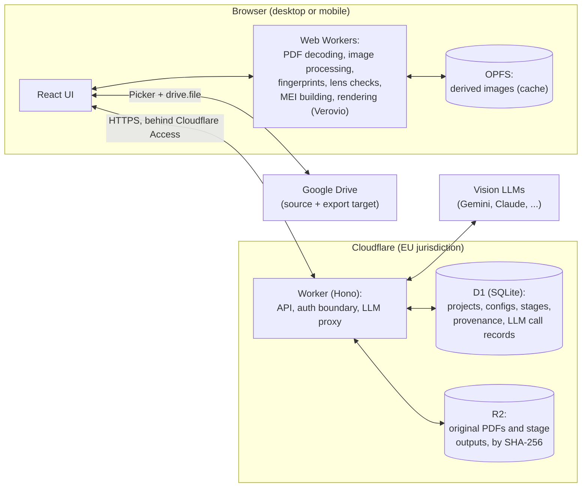

# Design Document — Score-to-MEI Pipeline (v2)

> Status: draft. Progress is tracked in one place, the checklist of the first release (§16). This document records the architecture, the reasons behind it, and the known risks with proposed mitigations. Items marked **Proposed** are leading candidates, not final decisions. Concrete **tasks**, including the decisions still to be made, are in `docs/tasks.md` (§15).

## 1. What this app is

A web app that converts PDFs of music scores into a formal, text-based encoding of the music: **MEI** (§6, "MEI").

- **Input:** a PDF, usually a scan of an old score, sometimes a digitally typeset (vector) PDF.
- **Output:** an MEI file (the **export format**), with an engraved rendering for side-by-side comparison with the original. Inside the pipeline, the models read and write a compact format built on LilyPond's notation instead (the **internal format**, §6, "The lens").
- **Focus:** the **pipeline**, not just the end result.
  - Every step is configurable.
  - Every intermediate input and output can be inspected.
  - Any part of the pipeline can be re-run from the first stage that went wrong, with a different configuration.
  - Any intermediate artifact can be edited by hand, and the pipeline resumes from the edited version.
- **Recognition is done by vision LLMs** (e.g. Gemini, Claude), steered by programmatic steps and human assistance. Programmatic steps handle the deterministic work: image handling, structure, checks, assembly. Humans assist where machines are unreliable, for example cropping heavily ornamented old scores.

### Why a text encoding, and which one
Two goals decided what score3ly should produce:
- **A: work with a score that exists only as a PDF:** convert it, edit it, render it anew. Any good notation format would do, MusicXML with MuseScore included.
- **B: give the music to an LLM** for analysis or generation, e.g. a simpler version for a beginner. score3ly itself does neither, but its output should make them possible. MusicXML is a poor fit here: verbose, full of typesetting, and its durations are tick arithmetic (`<divisions>`, `<backup>`, `<forward>`).

**What models write** (the lens, §6) had to be compact and natural for a model:
- **ABC:** compact, and the format LLMs know best, but weak for dense piano polyphony and cross-staff notes.
- **kern** (Humdrum): a time grid, one column ("spine") per staff and one row per moment, used in research because image-to-sequence models need a compact linear target. Simultaneity is explicit, but melodic lines are scattered down the columns, and every row needs one token per column, which is fragile to generate.
- **LilyPond:** melodic lines stay contiguous and readable, for people and models alike; simultaneity needs duration sums, which code checks. **Chosen,** as a format of our own built on its notation (§6, "The symbolic format").

**What users get** had other requirements:
- everything musical, as opposed to typesetting: pitches, durations, rests, ties, slurs, articulations, tremolo, dynamics, and what a player needs: voices, cross-staff notes, stem directions;
- room for editorial notes and alternatives, clearly separated from the music;
- unambiguous to parse, and, once what isn't musical is removed, one way to encode given music, or equivalences that are trivial to recognize. No format guarantees that by itself: it takes a normalizer, and ours is the conversion from the lens (§6);
- conversion to other formats. Lossless conversion to ABC or kern is impossible (they express less).

**MEI fits best** (§6, "MEI"): XML from the musicology community, with the musical content apart from the layout, pitches as name and octave, durations as note values (no ticks), written and sounding values kept apart (`accid` and `accid.ges`), dynamics, slurs and the like attached to notes, irregular measures marked as such (`@metcon`), editorial markup (`app`/`rdg`, `choice`, `supplied`, `unclear`, `annot`), links to image regions (`facsimile`), and MEI Basic, an official subset with "one way of encoding for every feature". Verovio renders it in the browser and keeps the MEI's ids in its SVG. MusicXML was the fallback (the best ecosystem of tools, but heavy normalization and weak editorial markup); the other formats would be views derived from MEI. Export to them is a later question: no converter between MEI and LilyPond exists in either direction, and Verovio doesn't write MusicXML.

**Considered and dropped:** starting from an OMR tool's MusicXML, checking it in code, and letting an LLM fix only the measures that fail the checks. Cheap, but no OMR output tested is good enough to start from (§13, "Baselines"), and turning MusicXML into LilyPond (`musicxml2ly`) loses things: MusicXML moves a time cursor back and forth between voice numbers where LilyPond has continuous voices (and voice identity is musical information for piano), its data is redundant and often inconsistent (`<duration>` and `<type>`, `<alter>` and the printed accidental), and the converter has gaps (cross-staff notes, changing staff counts, pedal, ornaments, octave marks).

### Lessons from v1
v1 was Python-only, local-only and command-line-only.

**What failed:** heavy programmatic preprocessing (cropping, deskewing, stain removal) followed by Audiveris (MusicXML) and `musicxml2ly`.
- Ornamented old scores were impossible to handle with scripts.
- Audiveris failed badly on them.

**What carries over:**
- The stage-tracking system: detecting finished stages, resuming interrupted runs, re-running stages, with hash checks and JSON documentation. It is the basis for §5.
- Some LilyPond conventions, now part of the lens (§6): absolute pitches, so that an octave error doesn't propagate, and code, not the model, building the score's structure.

**Where v2 starts from:** experience from other projects shows that current vision LLMs read difficult material very well, at a cost of cents per call.

### Scope
- **The scope is music in conventional Western staff notation** (decided; also called common music notation): notes on staves of five lines, with clefs, key and time signatures, noteheads with stems, beams and flags, rests, bar lines, and the marks that go with them. For any instrument, voice or ensemble, and any genre: piano, voice and choir, chamber and orchestral music, lead sheets, Baroque continuo, popular music. **Unpitched percussion is in it too** (decided), since orchestral music needs it from Beethoven's Ninth on (bass drum, cymbals, triangle, …): one-line staves, or five-line staves with a percussion clef, where a note's position means an instrument rather than a pitch. Every decision about the format and the stages is made with all of it in mind.
- **Outside the scope:** other notations. Tablature (decided); probably also, by the same reasoning, chant neumes, early music's mensural notation and graphic scores.
- **Reached step by step:** what the scope holds is covered release by release, not all in the first one. Lyrics, chord symbols, alternative versions and much else come later (§15). Until something is covered, the model writes its best workaround and raises a format issue (§6, "Issues"), and the format gap report shows what to cover next.
- **Piano music is the project owner's background, not the scope:** it is where most of the examples, the knowledge and the test set come from, and when something has to wait for a later release, what piano music needs tends to come first. It is also hard enough to test the design: multiple voices per staff, the staff count changing mid-piece (e.g. 3 staves in a passage, 2 elsewhere), lyrics below systems, editorial notes, ossia and alternative versions, a reduction staff for an orchestral part, two-piano double systems.
- **Possible later: image input (PNG, JPEG)** in addition to PDFs. It is almost no extra work: an image is a page image, so it skips PDF extraction and joins the same pipeline at `rasterize` (§6), with JPEGs going through the same bundled decoder (§8.1).

### Goals
- **Quality first:** the measure of success is how good the transcription is and how little human correction it needs. Infrastructure only exists to serve that.
- **Cheap:** runs on free tiers. Paid LLM calls are the only expected running cost.
- **Transparent:** open source, simple deployment, documented strategy (this file).
- **Runnable from anywhere:** start on the desktop, continue on the phone. Every pipeline stage should work on both.
- **Reproducible and testable:** every stage output (§5.2) can be traced back to its inputs, code version, prompt version, model and configuration. Non-deterministic parts (LLM calls, human input) are recorded so they can be replayed (§12).

### Non-goals (for now)
- Multiple users, sharing, collaboration. Each person deploys their own instance to their own Cloudflare account, or runs the desktop version (§3), with their own secrets, so the app has no user accounts and none are planned.
- MusicXML output, or any export but MEI (§9).
- Other input formats (LilyPond, MusicXML), with score3ly as a normalizer that turns music written in any of them into its well-behaved MEI, a starting point for further work by machines.
- Fixing printing mistakes: the transcription is as printed (§6, "Issues").
- Offline-first operation.

## 2. Architecture overview



### Where data lives

| Data | Location | Why |
|---|---|---|
| Original PDFs | R2, key = SHA-256 of the file bytes | Source of truth. About 0.66 GB for 200 PDFs, well within R2's 10 GB free tier. Identifying PDFs by content makes deduplication and "resume an existing project?" trivial. |
| Projects, step configs, stages, one row per stage output (§5.2), provenance, fingerprints | D1 | Small, structured, relational. SQLite is easy to inspect and migrate. |
| The content of stored stage outputs (analysis JSON, extractions in the internal format, issues, MEI files, human operations) | R2, key = SHA-256 of the content | Small, must never be lost, often not reproducible. One storage mechanism and one rule for everything stored (see below), plain files in the desktop version (§3), and far more room than D1 has. Content can't be queried there, so whatever the app filters or sums on (costs, counts, types of findings) is also a column in D1. |
| LLM call records (full request + response) | D1 (large payloads in R2) | Needed for provenance, cost tracking and replay tests (§12). |
| Derived images (page images, preprocessed pages, system crops) | OPFS on the current device | Large (roughly 150–300 MB per PDF in colour, a third of that in grayscale) but regenerable from the PDF plus the recipe. Device-local means real deletion, no cloud quota, and no data residency issue. |
| Final exports (the MEI file, optionally its engraved PDF) | Download, or an app-created folder in Google Drive | The user's own file space. Browsable anywhere. |

### Why this split
- **No server-side compute.** Workers have tight CPU limits and no native libraries. All heavy processing happens in the browser, so the Worker stays a thin API and LLM proxy, and stays on the free tier. Waiting on an LLM response doesn't consume Worker CPU time.
- **Images are cache, not data.** This removes the biggest storage cost entirely. Switching devices costs some regeneration time, not storage.
- **Everything persistent is small** (rows in D1) or **content-addressed and immutable** (R2).
- **Every object in R2 is stored under the SHA-256 of its bytes,** not only the PDFs. Objects never change: changed content is a new object under a new key. So a repeated upload is harmless, the browser can cache every object for good, a fork (§15) copies no objects, and the hash that a stage's validity check needs anyway (§5.2) is also the key. The price is that an object can't simply be deleted with the row that refers to it, since other rows may refer to it too (§4).

## 3. Technology decisions

| Area | Choice | Reason |
|---|---|---|
| Language | TypeScript everywhere | One set of types shared by the UI, the processing code, the Worker and the DB rows. The v1 Python code is being rewritten anyway. |
| Frontend | React + Vite | Familiar. Deploys to Cloudflare as static assets without changes. |
| Backend | Cloudflare Worker, HTTP layer on Hono | Web-standard `Request`/`Response`, minimal and portable. |
| Database | Cloudflare D1, created with `--jurisdiction eu` | SQLite semantics, free tier, EU data residency. The jurisdiction can only be set at creation. |
| Object storage | Cloudflare R2, bucket created with EU jurisdiction | 10 GB free, no egress fees, native Worker binding. The jurisdiction can only be set at creation. |
| Auth | Cloudflare Access in front of the whole app | No auth code in the app. |
| Device storage | OPFS (Origin Private File System) | Supported by Firefox, Chrome and Safari. Fast binary access from Web Workers. |
| PDF handling | pdf.js, version pinned | Renders vector PDFs and decodes CCITT, JBIG2 and JPEG 2000 images in JS/WASM, deterministically. |
| JPEG decoding | pdf.js's own JavaScript decoder, not the browser's (pdf.js would use the browser's `ImageDecoder` where there is one; it is switched off, §8.1) | Browser JPEG decoders may differ by about ±1 gray level. A decoder in our bundle gives identical pixels everywhere. |
| Vision LLMs | The user's choice, per stage (§7.2). Recommended: Claude Opus 5.5 for everything. | In the manual run (§13) Opus did best at everything, layout included. Providers are swappable behind the `LlmProvider` port. |
| Structured LLM output | Provider-native schema-constrained output, validated with Zod | Machine-checkable outputs. No free-form parsing. |
| Schema validation | Zod (or similar) | Validates step configs, LLM outputs and DB payloads. The same schema generates the UI controls (toggles, sliders). |
| Rendering | Verovio (WASM) in the browser, rendering the MEI | Keeps rendering runnable everywhere, with no native program. See §9. |
| Google Drive | Google Identity Services + Google Picker + `drive.file` scope, entirely in the browser | `drive.file` is non-sensitive: no app verification, and access only to files the user picks or the app creates. |
| Local development | `wrangler dev` (local D1/R2 emulation) + Vite dev server, run as two processes. Vite proxies `/api` to Wrangler. No Cloudflare Vite plugin. | One code path from day 1. Keeps the app and the Worker as separate packages with a clear boundary. |
| Deployment | One Worker with static assets: `apps/worker`'s Wrangler config serves `apps/web`'s build output. `wrangler deploy` uploads both. | One origin: no CORS, one Access policy, app and API always deployed at the same version. |
| Tests | Vitest | Pure-TS core runs in Node for unit, golden-image and replay tests. |

### Repository layout (suggested)

```
packages/
  core/      What more than one app needs (built): content keys and SHA-256, the Project type; and as entry
             points of their own, drawing a PDF page in a browser (`/pdf`) and the Vite plugin serving
             pdf.js's data files (`/pdfjs-assets`). The main entry runs in browsers, Workers and Node.
             (The step definitions and the pipeline's logic live in apps/web for now: only it runs them.)
  imaging/   Page images from PDFs, deterministic image operations (skew, rotation, scaling, crops, PNG),
             fingerprints. Pure TS/WASM.
  notation/  Lens parser and checks, measure building from stretches,
             MEI builder (the frame from the structure and metadata, the music from the lens).
  prompts/   Versioned prompt templates and their output schemas.
apps/
  web/       React UI, Web Worker host, OPFS + Drive + local-file adapters.
  worker/    Hono API, D1 + R2 adapters, LLM provider adapters.
  desktop/   The desktop version (§3): the Worker on Node, in an Electron window.
  eval/      Local evaluation tooling: engrave command, side-by-side viewer (§13).
fixtures/    Recorded test projects (§12).
testset/     Evaluation test set (§13): inputs, their strokes and .ly/.musicxml candidates committed, rest ignored.
DESIGN.md
```

The Worker's entry module (`apps/worker/src/index.ts`) may only export handlers: the Workers runtime refuses to start otherwise, and the tests (which import the module directly) don't notice. Helpers live in their own modules (e.g. `names.ts`).

### License
**score3ly is licensed under the GNU Affero General Public License, version 3 or (at the user's option) any later version** (`AGPL-3.0-or-later`; decided, 2026-10-24; `LICENSE`, added by the project owner; the license's own notice in the README, and the SPDX id in the root `package.json`). **The license is done** (decided): nothing about it is left to decide or build; only the third-party notices are kept up to date, by their test. In short: anyone may use, change and share the code, but whoever shares it, or lets others use a changed version over a network, must offer its source code under the same license. Chosen over a permissive license (MIT, Apache-2.0) to keep options open: no one can run a closed copy as a service, and a paid hosted version or a commercial license stays possible for the copyright holder (who should then accept outside contributions only with a contributor agreement). Moving to a permissive license later is easy; the reverse isn't. "Or later" (decided) lets the code also be used under future versions of the AGPL that the Free Software Foundation may publish.

**What we use from others** sets conditions of its own, all met by passing on their notices: permissive licenses (MIT, Apache-2.0, BSD, 0BSD, the Unlicense) for the libraries; the SIL Open Font License for the fonts (Inter, JetBrains Mono, and Leipzig's metronome glyphs, §6, "Tempo marks"); the Educational Community License 2.0 for the MEI schema the web app loads (Fix MEI). **Verovio is LGPL-3.0:** the app may be under any license, as long as Verovio's license and source are offered and users can replace it with another build (it is a separate WebAssembly module), and changes to Verovio itself would have to be published under the LGPL.

**Third-party notices** (built): `THIRD_PARTY_NOTICES.md` lists every package the builds include (the production dependencies of `apps/web`, `apps/worker` and `packages/*`, and theirs, as installed; optional dependencies left out, since they are platform-specific or Node-only; `apps/eval`, a local tool, left out), each with its version, license and repository, then their license and notice files verbatim (packages with the same texts share one section), and the material that isn't a package. A package without a license file gets its license's standard text, kept in `scripts/licenses` (with the LGPL goes the GPL it supplements). Made by `npm run notices` (`scripts/notices.ts`); a test fails, saying to run it, whenever the file differs from what the installed packages give, so a dependency change can't go unnoticed. The About page links to it.

### Ports and adapters

The core depends only on interfaces. Adapters live in `apps/*`.

| Port | Adapters |
|---|---|
| `PdfSource` | Local file input, Google Drive (Picker) |
| `BlobStore` (original PDFs, stage outputs) | R2 via the Worker. A folder of files (desktop version). In-memory for tests. |
| `ProjectStore` (projects, stages, output rows, provenance) | D1 via the Worker. A SQLite file (desktop version). SQLite or in-memory for tests. |
| `DerivativeCache` (regenerable images) | OPFS. In-memory for tests. |
| `LlmProvider` | One adapter per provider (via the Worker). **Replay** adapter for tests. |
| `Renderer` | Verovio in the browser. See §9. |
| `ExportTarget` | Browser download, Google Drive folder |

### Desktop version

The app is built for the browser and Cloudflare, and that stays the focus. An optional **desktop version** wraps the same code, for people who prefer that trade-off:

| | Web app on Cloudflare | Desktop app |
|---|---|---|
| Setup | A Cloudflare account, a deployment, secrets in the dashboard | Install and run |
| Devices | Every device, phones included, with the important data synced | One computer |
| Data | D1 and R2 in the EU, images cached per device (sometimes missing and rebuilt) | Everything local and persistent; the disk is the only backup |
| Secrets | Worker secrets | A local file |
| Residency | EU storage at a US company (§10) | Local, apart from the LLM calls |

The project owner uses the web app. The desktop version mainly makes the app easier to share with people who would not set up Cloudflare (the API keys they have to bring remain a hurdle either way).

**The rule that keeps it cheap:** the web app only ever talks to the Worker's HTTP API, and the Worker only touches Cloudflare through its D1 and R2 bindings and its secrets. Anything Cloudflare-only beyond those (e.g. Workflows or Durable Objects, §15) goes behind a port with a desktop equivalent, or is a deliberate exception. Then the desktop version is a different host for the same server code, not a second app.

**How:**
- **Electron.** Its main process (Node) runs the Worker's Hono app as a local server on `127.0.0.1`, and the window shows that address. The React app doesn't change. Electron rather than Tauri because it ships Chromium: the system web views (WebKit on macOS) differ in canvas, OPFS and pdf.js behaviour, and Tauri would still need Node alongside for the server. The price is a download of about 150 MB.
- **Small adapters on Node, not Miniflare.** D1 is SQLite: the part of the D1 API we use (`prepare`, `bind`, `all`, `batch`) is a thin layer over Node's built-in SQLite, running the same migration files, at startup. R2 is a few calls (`get`, `put`, `head`, `delete`) over a folder of plain files. Miniflare would need no adapters but is a development tool, ships the `workerd` binary per platform and stores R2 objects in its own format.
- **No login:** the server only listens on localhost, so Cloudflare Access isn't needed.
- **The same server also runs without Electron,** as a plain local server, **strictly a development helper** (the project owner, 2026-10-25), like `dev:worker` with `dev:web`: e.g. to try the desktop version's server in a browser, or to run the screenshots against it. The products are the two editions below.

**Editions** (decided, 2026-10-25): the two have names, so that someone with both on one computer can tell them apart, kept within the brand and its music. The web app on Cloudflare is ***concerto*** (from *concertare*, to bring into agreement: every device in sync), the desktop app ***cadenza*** (the soloist alone, on one device); the plain local server, a development helper, shows *cadenza* too, being the desktop app's server. Chosen over tutti/solo (the clearest contrast, but "tutti" didn't appeal), sinfonia/solo, recital/symphony, loco ("in place", after an *8va*), da camera, da lontano and unplugged (which promises "offline", and the LLM calls aren't). Built: the window's title is "score3ly – concerto" or "score3ly – cadenza" (a tab, an installed app's title bar, the desktop app's window, which takes the page's title), and the About page has the edition under the wordmark, like a work's subtitle, and after the summary: "The *concerto* app uses cloud storage and remote servers. You can log into your account on different devices and your projects are kept in sync across them." / "The *cadenza* app runs and stores all files on your device. There's no account to log into. Installations on different devices share no data." The header shows the edition next to the wordmark, in muted italic serif, in wide mode only (decided): on a phone there is no room for it beside the wordmark and the header's button. (`host.ts`: the edition follows `GET /api/info`). **Cadenza's icon** (decided, 2026-10-25) is the mark on a light grey tile (#dfe1e5) with a black note and the same coral brackets (`apps/web/public/icon-cadenza.svg`, PNGs by `npm run icons`): chosen over a lighter grey (#ebedf0, which loses its edge on white), a coral tile with white or black marks, and a coral tile with coal brackets. It is the Electron window's icon (the taskbar's on Windows and Linux; the dock's on macOS, set at startup while the app runs from the repository) and the tab's icon of the plain local server; concerto keeps the coal icon.

**Packaging** (decided and built, 2026-10-26): **users build the app themselves,** on their own computer, for their own system and processor: an app started from its icon, with its own name in the dock, the taskbar and the app switcher, its data in the system's app data folder. No code signing (no paid certificates or developer accounts for an app that earns nothing), no downloadable builds per platform and release, no automatic updates; a little effort from the user is fine. No signing is needed: macOS blocks unsigned apps only when they were downloaded (the quarantine flag), and a locally built one is signed ad hoc, for free (`mac.identity: "-"`); Windows' SmartScreen warns only about files from the internet.
- **How:** Node.js, the code (a ZIP from GitHub or `git clone`), `npm install` and `npm run package:desktop` (electron-builder, configured in `apps/desktop/package.json`, after the usual build), then installing the result the usual way: macOS, the `.app` (target `dir`) dragged into Applications; Windows, an NSIS installer (a Start menu entry, no desktop shortcut (decided); the folder can be chosen); Linux, a `.deb` (`apt install ./…deb`), or an `.rpm` with `npm run package:rpm -w apps/desktop`. A new version: the same again, installed over the old one; the data stays. Step by step, for users: `apps/desktop/README.md`.
- **What the package holds:** the app's `dist/` (the two bundles, the web app, the migrations) and no `node_modules` (everything is bundled); our `LICENSE` and `THIRD_PARTY_NOTICES.md` as resources; Electron's and Chromium's licence files, which electron-builder adds. The product name is "score3ly cadenza" (decided), and the installed web app's, the manifest's `name`, "score3ly concerto" (decided; its `short_name`, for a phone's home screen, stays "score3ly"); the app ID `io.github.tomasssalles.score3ly.cadenza`, the icon cadenza's, the version the app's (a test keeps `apps/desktop/package.json`'s equal to the root's). On Linux the package and its launcher entry are `score3ly-cadenza`, which is also the window's class, so the dock links the window to its entry.
- **Tried** on Linux here: the `.deb` built, installed and started from its installed path (title "score3ly – cadenza", packaged, data in `~/.config/score3ly`). Not yet on macOS and Windows (§15).

**What differs in the app.** The server says which host it is (e.g. `GET /api/info`), so the web bundle stays the same for both; the UI asks the server, and nowhere else decides by host:
- **Secrets:** in the desktop version they are in a file in the app's data folder, in the same `NAME=value` format as `.dev.vars` (§10). The app creates it on first start, with a commented example and permissions for the user only. A button in the settings opens it in the system's default text editor: the page asks the server, which opens it (`shell.openPath`), since a web page can't. Changes take effect without a restart: the server reads the file again when it changes, and the secret names in the model configs (§7.2) update. In the web version, the same place in the settings explains that secrets are set in the Cloudflare dashboard, with a link to the user guide.
- **Navigation:** an Electron window has no browser bar, but the app relies on the back button (closing an artifact or a stage's details, leaving a menu page, §5.6). So: back and forward buttons in the header, left of the wordmark, disabled when there is nowhere to go (Electron knows: `navigationHistory.canGoBack()`), and the usual shortcuts, which Electron doesn't set by itself: Alt+←/→ (Windows, Linux), Cmd+[/] (macOS), the mouse's side buttons and swipes on macOS. The condition is "no browser bar", not "desktop": an installed app (§5.7) needs the same, on phones too, with no difference between Android and iOS (decided).
  - **Built in the web app** (`Header.tsx`, `navigation.ts`): the buttons, arrows (not chevrons, which collapse and expand), show when the display mode is `standalone`, `fullscreen` or `window-controls-overlay` (`minimal-ui` keeps the browser's back button), or when the server says it is the desktop host. In a browser tab they are hidden: the browser's own buttons do the same (decided by the project owner's "best judgement" brief, and approved from the screenshots). They go back and forward in the browser's history, which is the app's, since its navigation is the URL's hash. Whether there is somewhere to go comes from the Navigation API (`navigation.canGoBack`/`canGoForward`: Chromium, so Electron, Android and desktop installs, and Safari 26.2); without it, both stay enabled and do nothing at the ends. The shortcuts and mouse buttons need nothing in a browser's installed app (the browser handles them); Electron's are set in its main process. On a phone the arrows take the room of the header button's second word: "+ New" instead of "+ New project" (below 480 px, only with the arrows).
- **The data folder:** nothing in the app opens it. The user guide says where things are stored on each platform, with a strong warning that changing those files can invalidate pipelines that already ran (§5.2).
- **Easier on desktop:** no Worker limits on CPU time, no lost answers when a phone sleeps, no free-tier quotas. Running the whole pipeline on the server (§15) is simple there.

**The real costs** are outside the code:
- **Code signing:** unsigned apps get warnings (macOS Gatekeeper, Windows SmartScreen) that stop non-technical users. Notarizing for macOS needs an Apple Developer account ($99/year); a Windows certificate costs money too.
- **Builds for three platforms** (GitHub Actions) and updates (e.g. electron-updater from GitHub Releases).
- **Migrations on users' machines,** run at startup.

**When:** first version built on 2026-10-25, ahead of the first release, at the project owner's request. **Out of scope** (decided): code signing, downloadable builds per platform and automatic updates; users build the app themselves (below, "Packaging"). For development it also runs straight from the repository: `npm install`, then `npm run desktop`.

**Built** (`apps/desktop`):
- **`server.ts`:** the Worker's Hono app (`apps/worker/src/index.ts`, unchanged) on Node with `@hono/node-server`, on 127.0.0.1 and a free port. It serves the built web app as Cloudflare serves the assets (Vite's hashed `/assets/` cached for good, the rest revalidated) and answers two things itself: `GET /api/info` (the Worker answers `{ host: "cloudflare" }`; this server `"desktop"` in Electron, `"local"` alone) and `POST /api/secrets-file/open` (Electron only). It also runs alone, as the plain local server, for development: `npm run serve` (port 8790, data in `~/.score3ly`, or `--data`/`--port`), on 127.0.0.1 only.
- **`d1.ts`:** D1 over `node:sqlite` (`DatabaseSync`): `prepare`/`bind`/`first`/`all`/`run`/`raw`, `batch` in one transaction, `exec`, with D1's conversions (booleans as 1 and 0, blobs as ArrayBuffers) and foreign keys on. At startup it applies the Worker's migration files not applied yet, recording them in a `d1_migrations` table as Wrangler does.
- **`r2.ts`:** R2 over a folder: an object is a file at its key's path, its content type in a `.type` file next to it, its upload time the file's. `put` refuses content that doesn't match a given SHA-256, as R2 does, and writes through a temporary file; `list` goes by prefix in key order, a page at a time.
- **`secrets.ts`:** the secrets file, `secrets.env` (dotenv's format: comments, `export`, quotes, a double-quoted value over several lines for a service account's JSON); created with a commented example, mode 600; read again when its modification time or size changes, so a new key works without a restart. Its values are the environment's other entries, as a Worker's secrets are.
- **`main.ts`:** Electron's main process. The data folder is Electron's `userData` for the app name "score3ly" (e.g. `~/.config/score3ly` on Linux): `score3ly.sqlite`, `files/` and `secrets.env`. One instance at a time (a second start focuses the first window). The window is sandboxed, without Node. Its background before the page paints, the splash, is cadenza's icon tile, #dfe1e5 (decided). **The window's frame follows the app's theme** (decided), not the system's setting: the page says which (`POST /api/window/theme`, from `startDesktopWindow` in `host.ts`) and Electron sets `nativeTheme.themeSource`; the last one is kept in `window-theme.json` in the data folder, so the frame is right from the start. Auto hands the frame back to the system: in Electron, forcing the frame also forces the page's `prefers-color-scheme`, which Auto follows, so Auto would stay stuck on what it was forced to. Back and forward: Alt+←/→ (Windows, Linux), Cmd+[/] and Cmd+←/→ (macOS), the keyboards' Back and Forward keys, the mouse's side buttons (`app-command`) and a swipe on macOS (`swipe`, right for back: untested, no Mac here). Links to other sites open in the browser, never in the app's window. **No menu bar** (decided): none on Windows and Linux; macOS, which always has the global menu bar, keeps a minimal one (the app's menu, Edit for copy and paste by keyboard, Window). Reloading and the developer tools, which came with Electron's default menu, are bound without one: Ctrl+R or F5 and Ctrl+Shift+I or F12 (Cmd+R and Cmd+Alt+I on macOS).
- **`build.ts`:** esbuild bundles `main.js` and `server.js` (one file each, the Worker's code and dependencies included, Electron left outside) into `dist/`, with the web app's build and the migration files. Electron 44 (Node 24, where `node:sqlite` needs no flag).
- **Checked:** unit tests for the adapters and the secrets file; the screenshot script with `--desktop` seeds its projects through this server (whole pipelines with the fake model, a failed stage, a fix in progress) and takes every shot; Electron under Xvfb, driven by Playwright: a project created and run, back and forward by button, keyboard and mouse button, the settings, and the project still there after a restart.
- **In the app:** the back and forward buttons show for the `desktop` host too (§5.7). Settings has a "Secrets" section: a button that opens the file in the desktop app, where the file is with the plain server, and the Worker's secrets on Cloudflare; a model config's secret is labelled "Worker secret" only on Cloudflare. Texts that assumed a remote storage follow the host: after deleting a project, "was deleted" (not "from this device and from the remote storage"); a running stage that blocks the deletion isn't said to be "here or on another device".

## 4. Identity and projects

- A PDF is identified by the **SHA-256 of its bytes**, computed on the device with `crypto.subtle.digest` **before** uploading.
- When a PDF is selected, the app asks D1 whether the hash exists:
  - **Unknown:** upload to R2 at `pdfs/<sha256>.pdf` and create a project.
  - **Known:** offer to resume an existing project on this PDF, or start a new one. There can be several projects per PDF.
- The file name and source (Drive ID, local path) are stored as informational metadata only, never as identity.
- Each project has a **name**, so the user can tell projects on the same PDF apart (e.g. "Sonata, Claude run" vs "Sonata, Gemini run"). The name is a label, not the identity (that is the project ID), but it is unique so it can be relied on:
  - It defaults to the PDF's file name without ".pdf". If a project already has that name, the Worker appends " (1)", " (2)", ... and takes the first free one, like file managers do. A file that is already called `Sonata (1).pdf` becomes `Sonata (1) (1)`, also like file managers.
  - Uniqueness is case-insensitive ("Sonata" and "sonata" clash) and enforced by the database (a unique index, `COLLATE NOCASE`), so two projects created at once can't get the same name. Names are trimmed, never empty, and at most 200 characters.
  - The user can rename a project at any time ("Rename" in the project actions, §5.6). Renaming to a name that is taken is refused with a message, not numbered: numbering only applies to the default. Changing only the case of the project's own name is allowed.
  - Deleting a project frees its name.
- **Deleting a project** (built): apart from the costs and statistics, it must be **as if the project had never existed** (decided). In particular, a new project with the same PDF, name and config runs every stage from scratch and finds nothing of the deleted one in the cache.
  - **Deleted:** the project's stage outputs (their rows and their content), the full requests and responses of its LLM calls, its PDF and the PDF's image fingerprints, in D1, R2 and the device cache, unless another project that isn't deleted still uses them. That is checked with a query at deletion time, not with stored reference counts, which can drift.
  - **Orphans in R2 are collected then too:** objects that no row in D1 refers to any more, from any project. They are left behind when a manual stage in progress is saved again (the new content is a new object, §2) or when an upload isn't followed by its row in D1. Nothing else deletes them: a save doesn't delete the object it replaces. This lists the whole bucket and compares it with D1, which is acceptable because deleting a project is rare.
  - **Kept, but marked with a deletion time (`deleted_at`):** the project's row, its stages and their LLM calls, for the costs and statistics (§10). Every cache lookup ignores marked rows (§5.8), so they are never reused. A stage that a fork which isn't deleted still uses is not marked (§5.8).
  - A deleted project never appears in the UI again, except in the costs view. Picking its PDF again doesn't trigger the "already based on this file" dialog, unless other projects use that PDF.
  - Uniqueness of names only counts projects that aren't deleted: a partial unique index (`... WHERE deleted_at IS NULL`). *Built* (migration 0003, which rebuilt the table: the earlier constraint sat on the column and couldn't be dropped).
  - **Behind one dialog** (decided): it shows the project's full name, says what is deleted, and the user has to type the name, exactly (case included); pasting or dropping text into the field doesn't count. "Delete project" stays disabled until the name matches.
  - **Refused while a stage of the project runs,** here or on another device (an interrupted one doesn't count), with a message saying so.
  - **Its text** (the project owner's): "The project and all its files will be deleted, along with any data cached on this device (with the exception of files still in use by other projects). Only its costs will still be reported in the Statistics page. This action cannot be undone."
  - **Afterwards** the app shows a screen like the one without a project, saying that "<name>" was deleted from this device and from the remote storage; the URL is `#/` (the project's URL is replaced, so going back doesn't land on it), and a reload shows the usual empty screen.
  - **Built** (`apps/worker/src/deletion.ts`, `DELETE /api/projects/<id>`; `apps/web/src/DeleteProjectDialog.tsx`): marking as above; the outputs of marked stages are deleted unless a stage that isn't marked read them, or an output of one was made from them or corrects them (with the provenance rows of marked stages that point to them); the PDF's fingerprints when no project left uses the PDF. Content in R2 is deleted by collecting orphans: every object no row refers to (a stored output's content, the request or response of a call that isn't marked or that an output names, the PDF of a project that isn't deleted), **if it was uploaded more than an hour ago**: content is uploaded before the row that refers to it, e.g. by a stage running on another device, and must not be collected in between. On the device, the images made from the PDF are deleted when no project left uses it: they are cached in a folder per PDF (§8.6). Renderings of the Transcription and the engraving (SVG, keyed by the MEI's hash) stay until the cache's size limit is built. Tried in Chromium at both widths.
- Each project also has three timestamps, all set by the Worker (ISO 8601, UTC) so a wrong device clock can't scramble the order:
  - **created**
  - **last modified:** any change to the project's own data (pipeline results, manual stages, a rename). Opening or viewing doesn't count.
  - **last opened:** set by a dedicated request when the project is opened, so listing projects doesn't touch it.

  Both start equal to the creation time, so sorting needs no special case for "never".
- Concurrent edits from two devices are prevented by optimistic locking: each project has a version number, and stale writes are rejected with a reload prompt.

## 5. The pipeline model

The pipeline is designed like a small build system. The v1 stage-tracking system (hash checks, resumability, JSON documentation) is the starting point and is ported, not reinvented.

### 5.1 Steps and stages

- A **step** is a definition in the code: what is done, with which configuration options.
- A **stage** is one occurrence of a step in a project's pipeline, with its own configuration and its own results.
- A project's **pipeline** is the ordered list of its stages. It is stored in D1 and shown in the UI (in the pipeline panel, §5.6), so it has to stay short.

There are two sorts of stages:
- **Recipe stages** have a predefined order (§6, the recipe) and can run automatically, one after the other. (Not to be confused with the status `planned`, §5.8: a stage of any sort that hasn't run yet.)
- **Manual stages** are added by the user to intervene by hand (§5.4). They are recorded in the pipeline like any other stage.

The same step can occur more than once in a pipeline. Example: the review step run twice for extra accuracy, or once with one model and once more with another.

#### Run modes
A small drop-down in the pipeline panel sets, per project, how the pipeline runs:
- **Auto:** one click starts the pipeline (or resumes it), and it keeps going from stage to stage, following the recipe, until it is done or fails. If a model flags that it would like human input, the flag is recorded, but the pipeline goes on with the model's best guess. The spending cap (§10) also stops it.
- **Manual:** each stage is started by a click. This leaves time to look at the outputs and decide whether to step in with a manual stage or to run a stage again with other parameters.

The mode for new projects is a settings item. After installation it is "Auto". Built: `newProjectRunMode` in the settings (`/api/settings`), a drop-down like the panel's on the settings page, saved when picked; the Worker reads it when it creates a project.

The browser drives the pipeline, so in either mode a run only advances while the app is open (§15).

Each step declares:
- `id` and `version`, e.g. `extract@3` (see §11).
- A **config schema** (Zod), which is also the source of its UI controls.
- **Input** and **output types**.
- **Granularity:** per document, per page, or per system. Steps can fan out, e.g. one page becomes many systems.
- Its **kind:** `ingest`, `computed` (code), `llm` or `manual`, and nothing else (decided). `ingest` is the kind of the first stage only: it doesn't run (the PDF is given when the project is created), so the UI treats it apart (no run, progress or retry; it is done from the start), and its output is stored like LLM and manual outputs (§5.3).

Every stage runs in the browser, its heavy work in Web Workers; an LLM stage sends each of its requests through the Worker (§7.2), which makes the call.

While it runs, a stage **reports its own progress** as a fraction from 0 to 1, which the UI shows (§5.6):
- Only the code that performs the stage knows how far it is. It is handed a function to call whenever it has got further (e.g. after each system), and doesn't know about the bar or the circle that show the value. A stage running in a Web Worker can't call into the page, so there the function passes the value on as a message.
- **A single LLM call has nothing to report while it waits,** so its share of the bar fills with the time elapsed out of the call's timeout, and jumps to full when the answer arrives. If the timeout is reached, the call has failed. For a stage that is one call, the share is the whole bar; for a stage with a call per system, each call fills its own slice.

### 5.2 Outputs, artifacts and provenance

**Terminology** (decided):
- **Stage outputs** are internal: many and fine-grained, e.g. one per page, per system or per LLM request. They carry provenance and cache keys, have a row each in D1, and are what is stored or regenerated. They are saved as soon as each is done, so an interrupted or failed stage resumes where it stopped.
- **Stage artifacts** are what the user sees: few per stage, mostly for the whole score (the pages, the layout, the transcription so far, the MEI file, the issues), shown as tiles and in the artifact view (§5.6). A stage doesn't show 107 tiles for 107 systems. An artifact is built from the stage's outputs, as a view; some are stored as well for convenience (the MEI file for download), but an artifact never holds anything that isn't in, or computable from, the outputs. So provenance and caching live in one place, the outputs.
- **The export format** is what the user gets: MEI (§6, "MEI"). **The internal format** is what the pipeline works with: the lens (§6, "The lens"). There is no single storage format: the outputs may hold either or both, as the stages need; that is settled when they are built.

Every stage output has:
- `step id@version`
- a canonical config hash (JSON with sorted keys)
- the IDs of the outputs it was made from
- its `origin`: the kind of the stage that produced it (`ingest` | `computed` | `llm` | `manual`)
- for an image from which a stored result was computed, its fingerprint (§8.3)
- a timestamp

LLM outputs additionally reference their **call record**: prompt template version, filled-in context, the images' recipe keys and hashes, exact model ID, parameters, full response, token usage and cost.

**The cache has two levels** (decided):
- **Stage level:** the key is hash(step id, version, canonical config, the model's provider, model and effort for LLM stages, the content keys of the stage's inputs). An input's content key is the hash of its stored content, or the recipe key of a computed image (§8.6): content rather than row IDs, so a stage that produces identical content again (e.g. `layout` run again with the same boxes) doesn't invalidate what follows. If it matches, the stage is skipped and its outputs reused. Outputs of later stages may already exist when an earlier stage is run again with the same inputs and config: they are found through the key and reused.
- **Item level, when the stage's key doesn't match:** the stage runs, but each item checks its own key first: for an LLM request, the exact request including the model config (provider, model, effort; §7.2: an identical request is served from its record), with each image named by its recipe key; for an image, its recipe (§8.6). Cheap code just runs again. **Only recipes, never pixels, in any key** (decided): an image is identified by its recipe all the way from the PDF to the final crop, at the stage level and at the item level alike. Images made from the same recipe on different devices are taken to be the same, which our deterministic code makes them, or close enough (§8.1, §8.2); anything computed from an image is reused whichever device made the image. So a cached call is also found before its images are made, and a re-run on another device doesn't render and crop images only to find the answers stored. Fingerprints warn when an image turns out not to be close (§8.3). Requests contain only what they really use (§5.5), so fixing one page's boxes changes only the requests that depend on that page; a request that contains the whole score (`review`) changes with any change upstream, as it should.
- **What isn't part of any key:** a model config's plain parameters (the region, the project) and its secrets (§7.2). They choose where and with which credentials a request runs, not what the model is given. A parameter that some day does change the answer must be added to the keys.
- **Only usable answers are cached:** an error (no answer, a timeout) or an answer that fails to parse is recorded (call record, costs, §10) but never served from the cache, so a retry asks again.

Every output has a row in D1, which belongs to the stage that produced it and says whether its content is stored (in R2, under its hash, §2) or only its recipe (§5.3).

**Checking that stages are still valid:** a pipeline checks its stages against the hashes of their inputs and outputs. Stored content can change outside the app (e.g. files in the desktop version's data folder edited by hand), and a stage whose recorded inputs or outputs no longer match what is stored is not valid any more. How and when this is checked, and what the app does then, is still to be designed (§15).

### 5.3 Persisted vs. regenerable (important)

- **Computed** outputs (page images, straightened pages, crops) store only their **recipe** (and its key), plus a fingerprint for an image from which a stored result was computed (§8.3). Images live in OPFS and can be regenerated. Small text outputs may be stored anyway for convenience.
- **Ingest**, **LLM** and **manual** outputs **must be persisted**: everything that isn't computed. They cannot be regenerated: re-running an LLM call gives a different answer and costs money.
- Rule: *anything you would hate to lose must never exist only as a cached image.*
- **Regeneration is lazy, per device** (decided): a device computes a computed output only when something needs it, never the whole chain up front. Example: seven stages run on a laptop, and on the bus the user adds an eighth, manual stage on a phone. The phone has none of the laptop's images, but the eighth stage's inputs are there (stored outputs fetched from R2, or images regenerated from their recipes because the stage needs them), so the user simply continues. If the user then opens an earlier stage's images to inspect them, they are regenerated from their recipes then, and cached on the phone (§8.6).

### 5.4 Manual stages

The user intervenes by adding a manual stage to the pipeline. The manual stages foreseen so far:
- fix the lines that should be horizontal (`fix_skew`)
- fix the system boxes and bar lines (`fix_layout`)
- fix the metadata (`fix_metadata`) and the observations (`fix_observations`)
- answer the issues and correct the music (`human_review`, after any `apply_review`)

(The stages are listed in §6.)

Rules:
- **One manual stage covers the whole PDF,** however many items are fixed in it. Fixing the boxes on twelve pages is one `fix_layout` stage, not twelve. Otherwise the pipeline shown in the UI would get too long.
- The outputs of a manual stage have `origin = manual` and the corrected output as their parent.
- Edits to images are stored as **replayable operations**, not as edited pixels: lines that should be horizontal, boxes, bar line positions. Replaying them on the regenerated base image reproduces the edited result.
- Text outputs (metadata, observations) are stored whole, as edited, and name their parent (the output they correct); what changed is found by comparing the two.
- **Undo and redo exist only inside a tool for manual work,** while it is open. Leaving the tool saves, and after that nothing can be undone: the stage can only be edited further or dropped (§5.5).
- **A finished stage never changes.** Editing a finished manual stage creates a new manual stage, which starts from the finished state of the old one and takes its place in the pipeline. The old one becomes a replaced stage (§5.5) and stays in storage as it was. The reason is forking (§15): another project's pipeline can use the same stored stage, and it must not change there.

### 5.5 Resuming and re-running
- **The history of a project is linear.** There are no branches inside a project, and no undo.
- Changing something in the middle (e.g. the config of stage N, or a manual stage added there) means running everything after that point again. The later stages are replaced: they leave the pipeline and are no longer shown.
- To keep the old results and try something else, the project is forked (planned, §15), not branched.
- **Any stage that isn't part of the recipe can be dropped:** manual stages, and extra stages the user added, such as a further review. Dropping is a change in the middle like any other: after a confirmation, the pipeline continues from the stage before the dropped one, with the same rules (run mode, reuse where the inputs match). Recipe stages can't be dropped.
- **Execution is per item** (a page, a system), with each item's outputs saved as soon as it is done (§5.2).

#### What a re-run follows
A re-run follows **the pipeline as it was, not the standard recipe** of recipe stages, for as long as the outcomes stay the same. This is the intended behaviour, not yet a technical definition; the details are worked out when we get there.
- **A stage whose inputs and config are exactly the same is reused,** manual stages included. Example: the composer's name is corrected after a full run that also had a wrong note fixed by hand. Nothing that the note fix depended on changed, so the fix is still there after the re-run.
- **A manual stage whose input changed at all is dropped as a whole** (decided), even if only one page or system of its input changed, and none of its fixes is applied, and the pipeline continues with the planned stages. The typical manual fix is a better deskewing angle or better system crops on a difficult old score. The point of it is that the stages after it then produce very different, better output, which ideally no longer needs the manual fixes that the poor first attempt needed.
- **Stages must depend only on what they really use.** If an `extract` call got the whole metadata as context, composer included, correcting the composer would change the input of every `extract` call, and all of them would be paid for again.
- **A dropped stage leaves a card where it was** (decided, built, migration 0018: `dropped_stages`): a courtesy heads-up, since which stages are dropped depends on the outcome of the run, can't be said beforehand, and would otherwise go unnoticed. Kept stages need no report: they are in the pipeline.
  - **What it shows:** the stage's icon and name, the name struck through, and a second line "⚠️ Dropped: inputs have changed" (the usual yellow triangle, the text not struck through and in no warning colour); the whole card dimmed like a planned stage. Its only button is an "x" to dismiss it: no "⋮", no artifacts, no progress. Its artifacts can't be opened: they are gone from the pipeline. The cards aren't stages and don't count in the pipeline's progress.
  - **Where:** after the stage it came after (`after_stage_id`); several there are in the order they were dropped.
  - **Until:** the user dismisses it; or a change rewrites the pipeline at or before the stage it came after (a new config, a stage added, edited or dropped there; a change after it leaves it); or a stage of the same step is added there again (e.g. `fix_metadata` dropped after `analyze` ran with a new config, then "Fix metadata manually" in `analyze`'s "⋮"). Stored with the project, so a drop during an Auto run is still there when the user comes back; deleting the project deletes its cards.
- **Extra reviews are dropped like manual stages** (decided; to build with the reviews, §6): a review added after the recipe's one (and its `apply_review`) is carried through a re-run, kept at its turn if its inputs are the same (it would come from the cache anyway) and dropped otherwise, with one card for the pair. Re-running them would be right for a user who always runs several reviews, and wrong for one who added one because the first review missed problems on this score, which a re-run may have fixed. Dropping them means what runs after the first `apply_review` is either not an LLM stage (`human_review`, `fix_mei`, `engrave`) or comes from the cache, so it is fast and free; a user who wants them adds them back, having paid for no unnecessary calls.
- **An `apply_review` goes with its review** (decided): dropping an extra review or a `human_review`, by the user or at its turn, drops the `apply_review` that follows it too. **The recipe's review can't be dropped,** even with further reviews after it (decided: keeping it simple).

#### Replaced stages
- **Replaced stages are kept in storage,** with their outputs and full LLM call records (requests and responses). They are reused whenever possible: a stage that runs again with the same inputs and config, or an identical LLM request (§7.2), is served from what is stored and costs nothing.
- **They stay connected to their project in D1,** although the pipeline no longer shows them, so that deleting the project (§4) finds and deletes them too. Until then, a project's storage only grows.

#### Confirmation before a re-run
A dialog asks for confirmation before anything is replaced (decided, built in `ProjectView.tsx`). It shows when a change replaces stages that have already run (done, failed, WIP or running): a new config for a stage that has run or is followed by one that has; a manual stage added, or a finished one edited, where a stage after it has run. Dropping a stage always asks.
- **Simple and almost generic** (decided): it says that automated stages after the change may have to run again, that manual stages after it (and, once they exist, extra reviews) will be kept only if their inputs stay the same (§5.8, carried), and that it can't be undone, without working out which stages exactly.
- **Title:** "Are you sure?"
- **Text** (decided)**:** "Later pipeline stages may have to run again (if their inputs change). Manual fixes for later stages will be kept if their inputs stay the same, and dropped otherwise. This action cannot be undone." When extra reviews exist (§6), the middle sentence becomes "Manual fixes for later stages, and extra reviews, will be kept if their inputs stay the same, and dropped otherwise." For a new config, it starts with "This stage will have to run again with the new config." (In Manual mode it runs again only when the user runs it.)
- **Buttons:** "Cancel", and one naming the change, in the accent colour like every confirmation: "Change config", "Add stage", "Edit stage", "Drop stage".
- **No manual stage has a config.** If one ever has, the text for a new config must be adjusted.

### 5.6 How the app shows a project
- **The pipeline is the main attraction; the artifact view is secondary.** The usual use is: new project, let it run, take the final MEI and leave. So the pipeline gets the comfortable place on every screen, and inspecting artifacts is what gets less comfortable on small screens.
- **Two layout modes, nothing in between:** wide (from 1024 px, the same breakpoint as the header) and narrow. Resizing a window switches between them on the fly.
  - **Wide:** the **pipeline panel** on the left (project, run controls, the stages), the **artifact view** on the right, much larger. The panel collapses into a narrow strip that shows only an expand button (a chevron, like the one that collapses the panel) and the progress circles below it: "Pipeline" above the current stage's, each labelled below and without numbers (the stage's circle is labelled with its name; see "Progress" for what it shows in each state). The chevron sits at exactly the same height as the one that collapses the expanded panel. The collapsed state is remembered per browser.
  - **Narrow:** the pipeline panel is the only view. Picking an artifact (or a stage's details) opens it over the whole app, with a close button ("x") floating over its top right corner, white on translucent grey. The artifact is in the URL (`#/projects/<id>/artifacts/<artifact id>`), so the back button closes it too, and a reload keeps it open. A stage's details have a URL too (`#/projects/<id>/stages/<stage id>`). After closing, what was open stays selected in the panel, so the user sees what they last looked at (until the page is reloaded or another project is opened).
- **The artifact view has no header of its own,** in either mode: it is the most valuable space on the screen. Which artifact is shown can be seen in the pipeline panel, where it is selected.
- **Progress:** one indicator for the whole pipeline and one for the running stage, **never with numbers**. In the expanded panel, the pipeline's is a thin bar in the panel's head; the stage's is a bar in the running stage's card. The collapsed strip shows both as circles. The pipeline's total is a best guess (a second review round or a manual correction adds stages), and a change only moves the circle a little. The pipeline's progress is the finished stages out of all stages, so adding a manual stage moves it back a little (accepted). A stage is a big chunk of work: doing something to every system is still one stage.
  - **Where the pipeline is** (decided and built, 2026-10-26, `pipelineState` and `stateLabel` in `pipeline.ts`): the first stage that isn't done is running (on this device, with its progress, or on another, whose progress isn't known here), failed (or interrupted: a running stage whose heartbeat stopped, §5.8), or waits for the user (not started, in Manual mode or before the first run in Auto mode, or after a stop; or a manual stage in progress); or every stage is done.
    - **The expanded panel's head:** a line under the pipeline's bar, within the row's height, says it: "Analyze…" while it runs (here or elsewhere), in muted text; "Layout failed" or "Layout interrupted" in red, without an ellipsis; "Layout (not started)" or "Fix layout (WIP)" while it waits for the user (a manual stage is created WIP, so it is never "not started"); "Done". Under the bar, not over it, and with the ellipsis, so that it reads as a status rather than as the bar's title: the bar is the pipeline's. The longest ("Skew detection interrupted") fit on one line.
    - **The collapsed strip:** under the pipeline's circle, the current stage, its name below (two rows at most, cut with "…" beyond): its progress circle while it runs here; a grey spinner while it runs on another device (it turns; grey, so it doesn't read as progress); a red warning triangle if it failed or was interrupted; an empty circle with a grey pause sign while it waits for the user. When the pipeline is done, no stage: a green check inside the full pipeline circle.
    - **Following a stage on another device:** while one runs elsewhere, this device fetches the pipeline every 5 seconds, so that its end shows (and its toast), besides the fetch when its heartbeat would be too old.
  - **Toasts** (decided and built, 2026-10-26, `toasts.ts`): in narrow mode only, while an artifact or a stage's details covers the pipeline (none in wide mode, none on the narrow pipeline view), one short line near the bottom says what just happened without the user doing it right then, whichever device runs the stage. It disappears on its own after 4 seconds; one at a time, a new one replaces it; it may cover the corner's item counter. The stage names are bold; no period at the end.
    - "**Layout** done. Starting **Analyze**"; "**Layout** done. **Analyze** ready" (the next waits for Run, or is a manual stage in progress: "**Fix layout** ready"); "**Layout** failed. Pipeline stopped", "**Layout** interrupted. Pipeline stopped"; "Pipeline done".
    - Carried manual stages (§5.5) are named on the way: "**Skew detection** done. **Fix skew** applied. Starting **Layout**", "**Skew detection** done. **Fix skew** dropped (inputs changed). Starting **Layout**"; a kept one still in progress ends it: "**Skew detection** done. **Fix skew** ready".
    - **How:** two snapshots of the pipeline are compared on every change (the stages' statuses, the carried ones, the dropped cards); the events of half a second are joined into one text. The user's own changes (Run, Stop, Finish, adding, editing or dropping a stage, a config, the run mode) make no toasts for 3 seconds: what follows from them is what they asked for. Not toasted: a failure's reason (it is on the card), app errors.
- **Each stage declares its main artifact** (stages can have several). What the artifact view shows in wide mode, unless the user picked something:
  - a new project: the original PDF;
  - when the pipeline finishes: the final MEI;
  - when a project is opened: the latest stage's main artifact.

  While the pipeline runs, **the view stays on what the user picked** (decided): it follows the pipeline only while nothing is picked (`defaultArtifactId` in `pipeline.ts`). The panel's head, the strip and the toasts say what is happening meanwhile (above).
- **How it is built:** the pipeline panel shows the project's stages (`GET /api/projects/<id>/pipeline`, §5.8). Creating a project adds Ingest, done, with the PDF as its output, and the recipe's other stages, planned; a migration adds a new recipe stage, planned, to the projects created before. A step's config form is declared with the step (`steps.ts`) and shown by one dialog for all steps (`ConfigDialog.tsx`). **A config is checked when it is saved** (decided), before the confirmation that stages will be replaced, against the PDF too (a page selection beyond its last page): a stage must never be replaced by one that can't run, since the old config is then lost. Only if the PDF can't be opened on the device is the page count left unchecked until the stage runs. What the code declares about each step (title, kind, how its outputs become artifacts) is in `apps/web/src/steps.ts`; `pipeline.ts` turns the stored stages into what the panel shows; `runners.ts` lists the steps that can run. Running a stage works as described here: Run (and Retry), Stop, progress, Auto mode carrying on to the next stage, "Change config" with its dialog and the confirmation when stages that ran are replaced. Manual stages can be added, finished, edited and dropped (below, and §5.8). The run mode is stored with the project (`PATCH /api/projects/<id>` with `runMode`). The original PDF is shown with pdf.js (its legacy build: the modern one needs browser features many phones don't have yet). The Worker serves the PDF at `GET /api/pdfs/<sha256>/file`.

#### The header
- **Narrow screens** show the wordmark and "+ New project" on one row and the project picker on its own row below. From 1024 px, everything is on one row, with the picker in the middle.
- **New project:** the button picks a PDF (a local file; Drive later), and the browser hashes it. Its hash is looked up first (`GET /api/pdfs/<sha256>?filename=...`, which returns the PDF's projects, most recently opened first, and the name a new project would get). An unknown PDF is uploaded and gets a project right away, in one request (`POST /api/projects`) that stores it in R2 and adds the project to D1 with the default name (§4). A known PDF opens a dialog that lists its projects to open one, with "+ New project" as the last item, showing the name the new project would get; that project is created without uploading the file again (`POST /api/projects` with the `filename` instead of the `pdf`).
- **The open project is part of the URL** (`#/projects/<id>`), so it survives a reload, each tab has its own, and the back button and bookmarks work. Any other URL means no project is open, which is how a fresh tab or device starts. "Last opened" (§4) is shared by all devices and only sorts the list: a project created or opened elsewhere never changes what this tab shows.
- **The project picker** shows the open project's name, or "Open a project". Opening it turns the name into a filter field over all projects (name, how long ago it was opened, PDF file name), most recently opened first (`GET /api/projects`), fetched when the app loads. Picking a project opens it and marks it as opened (`POST /api/projects/<id>/opened`); creating a project opens it too. Loading a URL or going back doesn't mark the project as opened.

#### The pipeline panel
- **A small head stays in view,** and only what is below it scrolls: the project's name (one line, shortened in the middle) with its "⋮" and the collapse chevron, then the **run mode** (a small drop-down showing "Auto" or "Manual", §5.1, which takes less room than a switch), the pipeline's progress bar and, in Auto mode only, **Run** (green) or **Stop** (red) while a stage runs, and, when something went wrong that isn't a stage's own failure (a stage that can't start, a request that failed), the error: in the head, so the list scrolling to the current stage doesn't take it out of view. Below the head, scrolling away: when the project was created and changed.
- **The stages are stacked,** first at the top, as cards (rectangles). The original PDF is the artifact of the first stage, **Ingest**, so every card is a stage and every tile in it an artifact. There are no arrows between the cards: a stage's inputs are often not just the previous stage's outputs, and arrows would suggest they were.
- **A card shows:**
  - an **icon for its step,** not its kind (decided), for the automated stages: Ingest an upload arrow, `rasterize` the usual image icon (a frame with a mountain and a sun), `extract` a quarter note turning into a letter, `engrave` the other way round. **Manual stages all share one icon, a wrench** (decided): they all fix something by hand. A step without an icon of its own shows its kind's (computed, LLM, manual). The kind is in the icon's tooltip and in the details. Then its name and a "⋮";
  - for LLM stages, the model config on a line of its own: its name, or without one its model string as the config has it, shortened in the middle if it doesn't fit (§5.7, §7.2; built). Then one line of facts: once done, the run time and a short result ("54 systems", "3 boxes moved, 1 added"). **No costs, prices, providers or token counts on the cards** (decided): users shouldn't be worried about money while a project runs, and the panel has little room. They belong to the stage's details and the costs view (§10);
  - while running, its progress bar; when failed, the error;
  - its button, if it has one (below);
  - at the bottom, its **artifacts as tiles,** three per row, each with an **icon for its kind of artifact, never a thumbnail:** at a tile's size no content is recognizable, so a thumbnail adds nothing. The original PDF's tile shows a sheet with "PDF" on it (`PdfIcon`). Artifacts are **grouped logically:** all 54 system crops are one artifact, one tile with "×54", not 54 tiles (§5.2). The first artifact is the stage's main one. Tiles are what gets selected (highlighted in coral), not the card.
- **Stage states:**
  - **done**;
  - **running**: a green border and its progress bar;
  - **failed**: a red border and the error. It can run again;
  - **ready**: its turn has come. It looks like a done card, but without outputs;
  - **planned**: not its turn yet. Only the dimmed title (and the "⋮"), no outputs. It becomes ready, no longer dim, when its turn comes;
  - **WIP**: a manual stage being worked on (below).
  - A "needs you" state for a model asking for human input is left out for now; it will be easy to add (§5.1, §15).
- **Buttons:** in Manual mode, the ready stage has **Run** and, while it runs, **Stop** in the same place. In Auto mode the cards have no Run or Stop: those are in the head. When the stage whose turn it is has failed, Run reads **Retry**, with a circular arrow, in both modes. Stop throws away what the running stage did so far: the stage is marked as stopped and leaves the pipeline. Its LLM calls stay, for the costs and the cache.
- **Manual stages** are added from a stage's "⋮" ("Fix layout manually", "Fix skew manually": the manual stage's title and "manually", for whichever fixes fit after that stage; decided). They start as **WIP** (a badge next to the name): the user opens the stage's output as often as they like and works on it, and clicks **Finish** on the card when done. Then the next stage gets its turn. In Auto mode the pipeline carries on by itself; in Manual mode the next stage is ready. A finished manual stage can be edited again ("Edit" in its "⋮"): that continues from where the user left it, not from scratch, but like any change in the middle (§5.5) it replaces the later stages and needs confirming. In storage, the stage being edited is a new one that replaces the finished one (§5.4). There is no "Discard": a manual stage, WIP or finished, is removed with "Drop stage" (§5.5). Undoing single edits belongs to the tools for manual work (§5.4).
- **The stage's "⋮"** holds everything else, so the card stays clean: "Show details", "Change config", "Fix … manually", "Edit" (manual stages), "Drop stage" (stages that aren't part of the recipe, WIP ones included, §5.5; in red). Only what applies is listed, and while a stage runs only "Show details". There is no "Run again": running a stage again without changing its config only makes sense after it failed, and that is Retry. Whatever replaces stages that already ran asks first (§5.5).
- **Show details** opens the stage in the artifact view: step and version, kind, status, run time, cost, result, its config, and for LLM stages its tokens. Costs are per stage and higher, never per call (decided): a stage makes many calls, mostly costing fractions of a cent.
- **Groups are shown as a filmstrip:** the items one below the other with a small gap, scrolling continuously, with a counter in a corner ("12 / 54"). That way the end of one system and the start of the next are on screen together, which helps when checking musical content. `extract` shows each system's crop with its music below it.
- **Auto-scroll:** the list scrolls to the current stage (the first that isn't done) when the project is opened, when an Auto run starts, and whenever another stage gets its turn, in both modes: as an Auto run moves on, and in Manual mode when a stage finishes and the next one becomes ready. The stage is brought to about the middle of the view, or as far up as the list goes when few stages follow it.

- **The menu** (☰, at the far right of the header, after "+ New project") leads to the app's own pages: Statistics (including costs, §10), Settings, Help and About, in three groups separated by lines (what you look at, what you change, help). Each page has its own URL (`#/stats`, `#/settings`, `#/help`, `#/about`) and replaces the project view while it is open, so the back button returns to the project. Help will not be a page of its own: it will lead to a user guide, a Markdown file in the repository on GitHub. Anything urgent (the spending cap reached, a missing key) must not hide in the menu: it is shown where the user is.
- **The settings page has a "Developer" section** (decided) with a button that downloads **the format gap report:** one file (e.g. a zip) built in the browser, so that access to D1 and R2 is the app's own. It goes through every project not deleted, reads the latest list of issues in its pipeline where there is one, and keeps the format issues. Nothing extra is stored for it, no table and no images: the crops are rebuilt from their recipes on demand, as for every other issue. Per issue: the crop with its boxes, the whole page image, the issue itself, the project's name, the PDF's name, the metadata, and the stage that raised it (step and version, model config, the prompt's and the lens's versions, the call). The script that groups and counts them for analysis works on that file.
- **Project actions:** a "⋮" button next to the project's name in the pipeline panel opens a menu of things to do with the project: "Rename", then a line, then "Delete project" in red (`--danger`, kept apart from the coral accent), which opens the dialog of §4.
  - **Rename** opens a dialog with the name selected. "Rename" stays disabled while the name is empty (after trimming) or unchanged; a name over 200 characters gets a message right away. A name another project has (ignoring case) is refused by the Worker (409) with "A project with that name already exists. Names must be unique (case-insensitive).", and the dialog stays open. The field has no visible label (the dialog's title says it all), only one for screen readers. Both menus share one component (`DropdownMenu`).
- **The About page:** the wordmark (centered), what the app does ("A music transcription tool, driven by vision LLMs, that converts printed scores into MEI, an open, XML-based standard for encoding music notation."), its version (§11), the author (Tomás Silveira Salles), a link to the repository on GitHub, the license (§3, "License": its name, linking to `LICENSE` on GitHub, and what it means in one sentence), and a link to the third-party notices.
- **Leaving a project loses nothing,** whether for a page from the menu, another project or a closed tab, because manual work is saved as it happens (§5.4). Once editing exists, changes not saved yet are saved or confirmed before the project view goes away.

### 5.7 Look and feel
The look of the app (colours and themes, type, components, the brand: wordmark, accent, fonts, icon) is in the style guide, `docs/style.md`. What is built around it:
- **Screenshots** (built, `npm run screenshots`, `scripts/screenshots.ts`): to compare versions and themes at a glance, without clicking through the app. It starts its own Worker and Vite on the test ports (8887 and 5273, §12), with a database and storage in a temporary folder, seeds them through the app with the fake model (a finished project, one with the card of a dropped stage (§5.5), one with `fix_layout` in progress, one whose `layout` failed, one whose page images differ from their fingerprints, §8.3), and takes, for every theme and three layouts (wide with the pipeline panel expanded, wide collapsed, narrow at 390 px), each artifact, a stage's details, the editor, the failed card, the warning, the menu pages, and, by a few scripted clicks, the open menus (the project picker, the header's menu, the project's and a stage's "⋮") and dialogs (rename, delete, a config, the confirmation before a re-run, a PDF already known), and the project as an installed app, with its back and forward buttons (Chromium can't emulate the display mode, so the script answers the app's `matchMedia` question). `--only <text>` takes only the shots whose names contain it. `--desktop` runs them against the desktop version's server (§3) instead of Wrangler, which tests it end to end. `screenshots/<theme>/<layout>/<shot>.png` (ignored by git) and `index.html`, a contact sheet of all of them. Needs Playwright's Chromium (`npx playwright install chromium` once locally). About four minutes; 146 shots with both themes.
- **Installed, the app opens as an app** (decided, built: the manifest's `"display": "standalone"`, with `id`, `start_url` and `scope` "/"): from a phone's home screen, or installed from a desktop browser, it gets its own window or the whole screen, without the browser's bar. It then shows its own back and forward buttons (§3, "Navigation"). Opened in a browser tab, nothing changes.

### 5.8 The database
The D1 schema for the pipeline (decided; built in `apps/worker/migrations/0003_pipeline.sql`, which has the columns and their comments, and changed by the later migrations). Artifacts have no table: a step's code defines them as views over its outputs (§5.2), and an artifact that is stored for convenience (the MEI file) is an output for the whole score.

| Table | One row per | Holds |
|---|---|---|
| `projects` | project | Besides §4: the run mode (§5.1), a version for optimistic locking (§4), the number the next issue gets (§6, "Issue ids"), `deleted_at`. |
| `pipeline_entries` | stage in a pipeline | Project, position (1, 2, 3, ... without gaps) and the stage. Nothing else: the pipeline is a list of pointers. |
| `stages` | stage, planned ones included | The project it was created in, the step and its version, the status (`planned`, `running`, `failed`, `done`, `wip`, `stopped`), the step's config, the model config (LLM stages), the stage key, its page count, error, a short result, the stage it replaces (an edited manual stage, §5.4), times, a heartbeat, `deleted_at`. |
| `stage_inputs` | input of a stage | The outputs a stage read. |
| `outputs` | item a stage produced | The stage, the item, the type (`pdf`, `layout`, `lens`, `mei`, ...), the content's hash (stored, in R2) or the recipe and its key (computed), the corrected output (manual), the call that produced it (LLM). One per stage, item and type. |
| `output_inputs` | input of an output | The outputs an output was made from (§5.2). |
| `llm_calls` | LLM call | The stage, the model config, the request key, the model the response names (`response_model`), the full request and response (in R2), the status (`running`, `ok`, `error`, `unparseable`, `refused`, `cut_off`), the error, tokens (output tokens include thinking: Gemini reports thinking apart, and its adapter adds it), the cost, times, `deleted_at`. |
| `model_configs` | version of a model config | Optional name, provider, model, effort, plain parameters (region, project), secrets as `{field: secret name}` (Bedrock with a key pair needs two), the free-tier mark, the row it supersedes, `deleted_at`. Append-only (§7.2). |
| `image_fingerprints` | image from which a stored result was computed (§8.3) | Its recipe key, its PDF, and the fingerprint (§8.3): dimensions, the hash of the raw pixels, the thumbnail. |
| `settings` | user setting | A key and a JSON value. |

- **Planned stages have a row** (status `planned`), so all there is to know about a stage lives in `stages`, and a pipeline entry is only a pointer. A planned stage is unfinished, so it may change: its config is NULL while it takes the settings' choice (§7.2), or what the user picked for it. When it starts, its config is the resolved one (what it actually used), and its version and stage key are set. "Ready" isn't stored: it is the first planned stage after the done ones.
- **The kind isn't stored:** it follows from the step, declared in code (§5.1). A step's kind never changes, which a unit test guarantees (§15).
- **Stages are shared, not owned by a pipeline.** A fork (§15) copies the pipeline entries up to its stage, and the issue counter, and no stages or outputs. `created_in` says which project a stage was created in.
- **Item names:** `''` for the whole score, `p3` for page 3, `p3/s2` for the second system on page 3. A system's number in the whole score (system 17) is derived, not stored.
- **A manual stage has an output for every item** of what it corrects, not only for the items changed: an unchanged one points to the same content (the same hash, so nothing is copied in R2). The next stage's inputs are then simply the outputs of the stages before it, with no falling back to an earlier stage per item.
- **Running a stage:** resolve its config and inputs and compute the stage key. If a stage that is done and not deleted has that key, the entry points to it and nothing runs. Otherwise the stage runs, each item first looks in the cache (`llm_calls` for an LLM request, a successful call with the same request key that isn't deleted; the device's image cache for an image), and each output's row is written as soon as it is done.
- **Retry** runs the failed stage again in the same row: the items already saved stay, the missing ones run.
- **Stop** marks the stage `stopped` and takes it out of the pipeline. Its outputs are deleted; its calls stay, for the costs and the cache.
- **A change in the middle** (§5.5) points the later entries to new planned stages, each with the config of the stage it replaces (a re-run follows the pipeline as it was). The replaced stages stay as they are, for the stage key to find; a dropped manual stage's entry is removed.
- **An interrupted run** (a tab closed mid-stage) leaves a stage `running`. A running stage writes a heartbeat **once a minute**, no more: each one is a write to the remote database. A running stage whose heartbeat is older than about three minutes counts as interrupted, and is resumed like a failed one. **Losing an LLM answer that was paid for** when the tab is closed or a phone suspends the page mid-call is **accepted** (decided), even if its cost doesn't reach the records; while this device runs a stage, closing or reloading the tab asks first (built; browsers show their own wording, not ours).
- **The requests while a stage runs** (built, `apps/worker/src/pipeline.ts`; the browser does the work, the Worker records it), all under `/api/projects/<id>/stages/<stage id>/`:
  - `PUT config`: sets a stage's config. A planned stage gets it in place; a stage that has run is replaced by a new planned one, and every stage after it by a planned copy of itself.
  - `POST start`: the browser sends what it resolved (the step's version, the resolved config, the stage key, the page count and the outputs it reads). If a finished stage that isn't deleted has the same key, the entry points to it, the planned stage's row is deleted (nothing ran in it), and nothing runs. A planned, failed or interrupted stage can start; a running one can't.
  - `POST outputs`: records outputs as each is done; an item recorded already is left as it is (a retry skips them anyway).
  - `POST heartbeat`, `POST finish` (done with a short result, or failed with the error), `POST stop`.
- **Manual stages** (built, same file), under the same path:
  - `POST fix` with the step (and its version, page count and inputs), on a done stage: adds a WIP stage right after it. Refused if the next stage is already that step, or if a stage is running.
  - `POST outputs` while WIP: saves outputs as the user works; a WIP stage's item saved again is overwritten (a running stage's is left as it is). Outputs name their parent (the output they correct).
  - `POST finish` on a WIP stage: done, with a short result.
  - `POST edit` on a done manual stage: a new WIP stage takes its place, with the same outputs and inputs, and `replaces_stage_id` pointing to the old one, which stays as it was (§5.4).
  - `POST drop` on a manual stage, WIP or done: its entry is removed and the later ones move up.
  - Each of them, like a config change, replaces the stages after it: a planned one stays as it is, one that ran gets a planned copy.
  - **A manual stage after a change is carried** (built, migration 0017: `pipeline_entries.carried`): it stays in the pipeline, WIP or done, as it is, and waits for its turn. Then it is kept if what it would read now holds what it read (the same items and types, each with the same content hash or recipe key: `stage_inputs`), and dropped otherwise, with the stages after it moving up (`POST resolve` with the outputs it would read now, as when it was added: `carriedInputs` in `steps.ts`, the outputs of the stage it fixes). A kept stage keeps its status: a WIP one stays WIP (decided). While it waits, it looks like a planned stage (dimmed, the wrench, no artifacts; decided), it can be dropped, and it can't be edited, saved or finished. Its turn comes when every stage before it is done: it is resolved at once, in Auto and Manual mode alike (decided), and an Auto run carries on. Tried in Chromium: a `fix_skew` kept after `rasterize` ran again on a scan at another resolution (the same lines), and dropped on a vector PDF (other lines).
  - The Worker knows which steps are manual (`MANUAL_STEPS`): a step's kind is declared in the web app's code, but the Worker needs it for these rules.
  - **The recipe's stages are listed in the Worker** (`RECIPE`), which creates them, planned, with every new project.
- **A stage that seems to run, but not on this device** (another device, or this one before a reload) shows as running, without progress, and can be stopped. Once its heartbeat is about three minutes old it shows as failed ("Interrupted"), and can run again. The panel fetches the pipeline again at the moment its heartbeat would be too old (a heartbeat may have come meanwhile), so it turns "Interrupted" without a reload (built: `nextStaleAt` in `pipeline.ts`).
- **Progress isn't stored:** only the device that runs a stage knows it (§5.1). Another device sees the stage running, without a bar.
- **Deleting a project** (§4) marks rows instead of deleting them, for the costs and statistics, and every cache lookup ignores marked rows (partial indexes `... WHERE deleted_at IS NULL`). Marking in the rows, rather than filtering every lookup by the projects that aren't deleted, keeps the rule in one place. When project P is deleted:
  - a stage is marked if no other project that isn't deleted has it in its pipeline, and it was created in P or in a project already deleted. A stage a fork still uses stays, and is marked when that fork is deleted; a stage created in a project that isn't deleted is never marked;
  - the calls of a marked stage are marked with it;
  - the outputs of marked stages, the content of stages and calls that nothing else uses, and the fingerprints of a PDF nothing else uses are deleted (§4).
- **Each stage records its page count** (decided), when it starts, and it never changes: the number of pages its inputs cover. `rasterize`: the pages selected; `layout` and `analyze`: the same; per-system stages (`extract`, `review`, `apply_review`): the pages their systems are on; `engrave`: all selected pages, since it also builds the header from the metadata, which `analyze` read from every page, cover included. Pages without music aren't discounted: pages aren't classified (§6, `layout`). NULL for Ingest, which doesn't read the PDF.
  - **Why on the stage, and not the project's:** the selection of pages can change within a project (`rasterize`'s config, then a re-run), and the replaced stages keep their statistics. A replaced `extract` is no longer in any pipeline, so "the `rasterize` stage in the same pipeline" can't give its count. Following its inputs back to its `rasterize` (`stage_inputs`, `output_inputs`) would, but for every statistics query; a column makes per-page averages one query over `stages` (§10).
- **Two kinds of settings:** the user's, in the `settings` table (the default model config, the run mode for new projects, the spending cap, ...), and the device's, in the browser (`localStorage`), for what may differ between a phone and a laptop: screen size, touch or mouse, bandwidth. The collapsed pipeline panel (§5.6) is the first device setting.

## 6. Pipeline stages

### The stages

Stages marked **[manual]** are optional and added by the user (§5.4). The last column lists each stage's artifacts, what the user sees (§5.2); its outputs are finer, e.g. one per page or per system. Everything else is the recipe. Each stage has a short identifier, used throughout this document.

| # | Id | Stage | Kind | Artifacts |
|---|---|---|---|---|
| 1 | `ingest` | Ingest | ingest | The PDF (R2) |
| 2 | `rasterize` | Rasterize | computed | All page images, as one artifact. Not stored: reproduced from the config (§5.3) |
| 3 | `skew_analysis` | Skew detection | computed | The pages, not rotated, with the staff lines found drawn in red, each labelled with its angle. Stored per page: at most 5 lines, the page's angle, the confidence and the staves (§8.4). No rotated images, and no decision whether to rotate |
| 4 | `fix_skew` | Fix the lines **[manual]**, after `skew_analysis` | manual | The lines, as in `skew_analysis` |
| 5 | `layout` | Layout | LLM, per page | The layout: the straightened pages with the system boxes and the bar lines drawn over them. Stored per page as JSON |
| 6 | `fix_layout` | Fix system boxes and bar lines **[manual]**, after `layout` | manual | The layout, as in `layout`; the editor while it is WIP |
| 7 | `analyze` | General analysis | LLM, per page and for the whole score | Metadata (including the pieces and where they start) and Observations, as views. Stored as JSON: the metadata, the observations (one document: the pages' items as the whole-score call corrected them, including the special bar lines, and the score-wide items), and `pieces`, where the pieces start, taken from the metadata as an output of its own for `extract` |
| 8 | `fix_metadata` | Fix metadata **[manual]**, after `analyze` | manual | JSON: metadata |
| 9 | `fix_observations` | Fix observations **[manual]**, after `analyze` | manual | JSON: observations |
| 10 | `extract` | Extraction | LLM, per system | The Transcription (see "The Transcription"): each system's crop with its rendering, the issues and the warnings on it. Stored per system: its answer in the lens, its issues and warnings |
| 11 | `review` | Review | LLM, per system | The Transcription, with the issues as the review left them |
| 12 | `apply_review` | Apply review | LLM, per system | The Transcription, as the review's answers changed it, with the issues (what was applied) and the warnings |
| 13 | `human_review` | Human review **[manual]**, after any `apply_review` | manual | The Transcription as a form: the issues answered and added by the user. An `apply_review` is added after it automatically |
| 14 | `fix_mei` | Fix MEI **[manual]**, after the latest stage that produces the extraction, right before `engrave` | manual | The MEI, edited as text: the MEI view, editable while WIP |
| 15 | `engrave` | Engrave | computed | The full score's MEI (with syntax highlighting and navigation) and its engraving as a PDF; the card has a download button for both. Always the last stage |

- **No manual fixes of the music before the first review.** The first point where the user corrects the music is `human_review`.
- **The recipe has exactly one review** (`review`, followed by `apply_review`). **Further reviews** can be added by hand after it, as many as the user wants, with the same or another config. Adding a review, by hand or after a human review, always adds its `apply_review` after it. Further reviews are dropped with their `apply_review`, and carried through a re-run like manual stages, kept only if their inputs stay the same; the recipe's review can't be dropped (§5.5).
- **Manual stages after an LLM stage** are added from its "⋮": `fix_layout` after `layout`; `fix_metadata` and `fix_observations` after `analyze`. "Fix X manually" is only in the "⋮" of the stage that creates X (decided), so both are in `analyze`'s. **The second of the two goes right after the first** (decided, built): nothing needs an order between them (they edit different outputs of `analyze`), and inserting it directly after `analyze` would carry the first (§5.8), for no reason. It can be added while the first is still WIP. Dropping the first carries the second, which is kept if its input comes out the same (§5.8).
- **Two stages read the pages** (decided): `layout` finds where things are, `analyze` says what they are. `analyze` runs after `fix_layout`, so it sees the final layout: code draws the systems and bar lines on each page, numbered, and the observations refer to those labels. Each has its own model config (§7.2: finding layout boxes, extracting metadata), and a better prompt for one doesn't re-run the other. The price is that every page is sent twice, small next to one `extract` call per system.
- **No skeleton stage** (decided; an earlier draft had one, an MEI file with a placeholder per measure). What it was for (a fixed structure, assembly as filling in, a check that the extraction returns exactly the measures asked for) needs no stored MEI: code builds the MEI frame from the structure whenever it is needed (see "MEI" below).
- **A stage exists where there is a config or a decision** (decided). A pure function of other stages' results is a view, not a stage. So there is no skeleton stage (above), and no stages for the straightened pages or the crops: the angles and boxes are decisions of other stages, and rotating and cropping are fixed operations (§8.2). Those images are computed when something needs them (a view, an LLM request) and cached on the device (§8.6); stages wouldn't add anything but cards in the pipeline and a second copy of every page on the device. They are shown as views of other stages' outputs: `extract` shows each system's crop with its music below it (the filmstrip, §5.6). `rasterize` stays a stage: its config (the resolution for vector pages, perhaps colour or grayscale, §15) changes every image after it, and its pages are the natural first view.
- **The structure is final before `extract`.** The structure is what decides which pixels the models see: the skew angles (`fix_skew`), where the systems are on each page and where the bar lines are on each system (`fix_layout`). `extract` is shown system crops and stretch crops, and if it is shown the wrong part of the page, no model can make up for it. So every fix of the structure comes before `extract`, and no later stage changes it; a mistake in it found later is fixed by going back to `fix_layout`, which replaces everything after it (§5.5). The pieces or movements (`fix_metadata`) are fixed before `extract` too: nothing carries over a piece's boundary (see `extract`), and the MEI's sections and the numbering restart there. `extract` reads only where the pieces start (the `pieces` output, see `analyze`), not the rest of the metadata.
  - **Everything else is content,** read by `extract` and open to correction by the stages after it: how the stretches between bar lines form measures, the kinds of measure and of bar line, and so which measures exist and how they are numbered; and the `scoreDef` (clefs, keys, time signatures, staff labels and groups). Those are hard for a model to get right from a whole page (the stretches need the note durations read), and easy to correct later, now that no MEI is built in advance. A user of an automated app shouldn't be asked to transcribe them by hand before anything is extracted.

#### Details per stage
- **`rasterize`, `skew_analysis` and `fix_skew`:** in `docs/stages/pages.md`. In short: `rasterize` makes one image per selected page (a scan's own pixels, a vector page drawn at a chosen resolution); `skew_analysis` measures on each page up to 5 lines that should be horizontal and stores them, deciding nothing; `fix_skew` lets the user delete, move and draw those lines. Whether and by how much a page is straightened is a function of its lines, computed by the stage that first sends the page anywhere (`layout`).
- **`layout` and `fix_layout`:** in `docs/stages/layout.md`. In short: `layout` asks a model, page by page, for a box around each system and the positions of the bar lines inside it (not those at its start and end), in up to 3 rounds where code draws the answer on the page and the model corrects it; a page it isn't satisfied with is flagged for a person. `fix_layout` is the editor where the user draws, resizes and deletes boxes and bar lines. Both write one `layout` output per page. Three things that hold beyond them:
  - **Every box in the app is in our format:** `{ left, right, top, bottom }`, fractions of the image's width and height from 0 to 1 (systems, issues, zooms, crops), not a provider's.
  - **Boxes are tight** around everything that belongs to the system; **margins are code's,** added by one rule where crops are cut (`extract`).
  - **Systems are numbered top to bottom, continuing from page to page,** and drawn in 7 colours that colour-blind people can tell apart, cycling; a system's bar lines have its box's colour.
- **`analyze`, `fix_metadata` and `fix_observations`:** in `docs/stages/analyze.md`, with the metadata's fields and how they fill the MEI's header. In short: `analyze` reads every page with the final layout drawn on it, one call per page and then one for the whole score, and gives the metadata (what is printed about the work and the edition), the observations (a bird's-eye view of the music for `extract`: staves and instruments, changes, special bar lines, endings, directions, notes for the whole score) and `pieces` (the system where each piece starts). `fix_metadata` and `fix_observations` are forms in which the user corrects and confirms them. What holds beyond them:
  - **Confidence:** every item a model reports has a confidence, low, medium or high; a user's confirmation is stored beside it (`confirmed`), never instead of it. The views show ???, ?, a grey ✓ and a green ✓ (confirmed).
  - **Places are labels drawn on the page,** read by the model, never counted: a system's start, one of its inner bar lines (1 to n), a stretch (1 to n + 1), its end. A person picks them from the same list, by name.
  - **Observations are hints, not ground truth:** `extract` checks them against what it sees.
  - **Code links items when the links are needed, not before** (an end repeat to its start, an ending to its repeat, a span across systems): at the start of `extract` (from the observations), of `review` and of `apply_review` (from the current extraction), and in the checks of the whole score. No links are stored, by a model or a person.
  - **Pieces start at a system,** and `pieces` always starts with system 1. `extract` reads only `pieces`, not the rest of the metadata.
  - **The metadata reports only what is printed;** the user can add anything in `fix_metadata`.
- **`extract`, `review`, `apply_review`, `human_review` and the Transcription:** in `docs/stages/music.md`. In short:
  - **`extract`:** one call per system, in the score's order, with the system's crop and its stretch crops, the neighbouring systems' crops, all the observations, and what code carries over from the previous system (the state, the marks left open, whether the last measure continues); nothing carries over a piece's boundary. The model writes the lens (below), never MEI, and reports its doubts as issues. Each answer is checked as soon as it arrives; an answer that can't be used stops the run there, the answers before it kept.
  - **`review`:** one call per system, with the whole score in every call; it writes issues only (never the music), and sees what the earlier calls changed through an append-only log, which keeps prompt caching working.
  - **`apply_review`:** one call per system where an issue that needs applying begins; it answers with a typed patch of only what it changes, stretch by stretch. A change outside the issues' boxes needs a reason and becomes a warning.
  - **`human_review`:** the user answers the issues, and adds their own, on the original score. Every correction, the user's too, is applied by `apply_review`, an LLM call, never by code; nobody edits the source directly before `fix_mei`.
  - **The Transcription:** the artifact of all four, a filmstrip of the systems, each crop with its music rendered below it and the issues and warnings as boxes on the crops.
  - **Models don't get renderings,** at first: they compare the crops with the lens as text.
- **The checks by code have no stage of their own:** validation happens inside `extract` and `apply_review`, on the lens, after each system and for the whole score at the stage's end. Problems that code finds without failing the stage are issues raised by code when they are a question about the page (a slur that never ends: "where does it end?"), and warnings otherwise (a measure whose durations don't add up; see "Warnings").
- **No `assemble` stage** (decided; an earlier draft had one, to build the full MEI after `extract`). Building MEI is code, and nothing before `engrave` needs the full score's MEI:
  - **the checks of the whole score** (loose ends, the repeat structure, measures across systems, measure numbers) run on the lens at the end of `extract` and of `apply_review`, not on MEI, so their warnings come while reviews can still act on them;
  - **each system gets a small MEI of its own, rendered** (see "The Transcription"), as a view;
  - **the full score's MEI is built by `engrave`,** at the end.
- **`engrave` and `fix_mei`:** in `docs/stages/engrave.md`. In short: `engrave` is always the last stage: it builds the full score's MEI from the latest extraction, layout, metadata and pieces (or takes `fix_mei`'s MEI as it is), engraves it with Verovio, and offers the MEI, the engraved PDF and a report of the run for download; its main artifact is the MEI view, the file beside its engraving, linked both ways. `fix_mei` is the only place where the user edits the MEI directly, as text, checked against MEI's schema before it is applied; it comes right before `engrave` and nothing else can come after it, since a direct edit makes the issues unreliable. What holds beyond them:
  - **The engraving has Verovio's own breaks,** never the original's: the PDF always engraves exactly the MEI it comes with. Matching the original system by system is the review's business.
  - **The MEI is what is stored;** the PDF is made again from it when it is needed.

#### MEI
**The export format is full MEI 5, close to MEI Basic** (decided): as simple as possible, focused on the musical content. The music uses only what MEI Basic allows; a few features of full MEI are used where needed, each a deliberate decision, listed in one place in the code (below) and explained in our documentation.
- **Divisions:** an `mdiv` per piece or movement, labelled and linked to its entry in the header's `componentList`; flat in the first version, since the metadata's pieces are one list. Nested `mdiv`s (a work with an `mdiv` per movement inside) are a later version (§15). (MEI's `<parts>` is something else: separate part books, one per player, which we don't produce.)
- **Each division's `<score>` begins with a `scoreDef`:** the staves (`staffGrp`, `staffDef`) with their labels and instrument names as printed, and each staff's starting clef, key and time signature. It declares **every staff that appears anywhere in the division,** e.g. a third staff in one passage, an ossia staff; a measure leaves out the staves it doesn't have. Groups nest: the Mozart concerto in the test set, with two pianos (I and II) of two staves each, is one score with two braced `staffGrp`s labelled "Piano I" and "Piano II" inside the outer one, staves 1 to 4; not parts.
- **A bar line inside a measure divides it** (decided): an MEI measure runs from bar line to bar line, so a measure with a bar line printed inside it (a repeat or a double bar after a pickup, a single bar line in the middle) is written as two or more `<measure>`s, each `@metcon="false"`, all with the measure's number, the bar line between them as the first's `@right` (a start repeat as the next one's `@left`). Valid MEI Basic, and the division is musical, so it holds in any layout. (Full MEI could also link the parts with `@join`, which MEI Basic doesn't have; left out.) A system break inside a measure is layout, not a bar line: the measure stays whole, with the break inside its layers (`engrave` deals with it for Verovio).
- **Measures:** measure → `staff` (numbered as in the `staffDef`s) → `layer` (a voice) → notes. Code writes each measure's frame, from the classification of the stretches: its number (`@n`), `@metcon="false"` for an incomplete one, the bar lines' kinds (`@left`, `@right`), its zones (`@facs`, below) and one `staff` per staff present on its system. `extract` fills the layers: how many voices a staff has changes from measure to measure, and is content.
- **The original's layout** is kept with page and system breaks (`<pb/>`, `<sb/>`) between measures. Renderers can ignore them, and `engrave` does (see `engrave`). A measure split across systems is the awkward case: its `<sb/>` is inside its layers, valid MEI, but Verovio doesn't break inside a measure; a rendering that keeps the original's breaks (the review's) is made from a copy built with the measure divided there (`divideAtSystemBreaks`).
- **`facsimile`** (decided, a feature of full MEI): zones on the page images, and each measure linked to its zone (`@facs`), or to several when it is split across systems. The structure lives in the file itself, and an issue's boxes map to measures through it.
  - **A `<surface>` per page,** with a coordinate space we choose: zones (`@ulx`, `@uly`, `@lrx`, `@lry`) are in the surface's own space, not in any image's pixels. MEI wants whole numbers, so our fractions are scaled (e.g. to 0–10000).
  - **The coordinates are on the deskewed page,** the image the models and the user saw and where all our boxes are (§8.2); on the original page a box would be a rotated rectangle.
  - **No images are stored or required:** `<graphic>`, which names an image of a surface with its pixel size, is optional and left out, since page images are a regenerable cache (§5.3). MEI has no notion of PDF pages: "surface 3 is page 3 of the project's PDF" is our own convention, documented with the file.
  - **The other direction, from the rendering to the MEI,** comes for free: Verovio's SVG keeps the MEI's `xml:id`s, so a rendered measure or note maps back to the stored one. `human_review` uses it to link the panels and to highlight the measures that changed.

**What MEI Basic allows** (checked in its customization, `customizations/mei-basic.xml` in the music-encoding repository, 2026-10):
- **Nested `mdiv`:** yes, explicitly (an `mdiv` holds a score or further `mdiv`s).
- **The music:** everything above (`scoreDef`, `staffGrp`, measures with `@n` and `@metcon`, `pb`, `sb`).
- **The header:** only `fileDesc` (`titleStmt` with titles, `<composer>`, `<arranger>`, `<lyricist>` and a `respStmt` of `persName`s with roles; `pubStmt` with publisher, place, date, license). No `encodingDesc`, `notesStmt`, `workList`, `componentList`, `manifestation`, `sourceDesc`, `titlePage`, `perfMedium`, `plateNum`. (Corrected when the builder was validated against the 5.1 schemas: MEI Basic 5.1 has no `encodingDesc`, and its `titleStmt` has those three elements.)
- **`facsimile`:** neither the facsimile module (`facsimile`, `surface`, `zone`) nor `@facs` on `measure` (corrected likewise).
- **In the music:** written accidentals and articulations only as child elements (`<accid>`, `<artic>`), which we use; no `<barLine>` inside a layer (we don't need it: a bar line inside a measure divides it, above); no `@n` on `pb` or `ending`, which we leave out.

**So we go beyond MEI Basic in these places** (`BEYOND_BASIC` in `packages/notation/src/mei.ts`): the header's work, pieces and edition (`workList`, `manifestationList`, and `mdiv/@corresp` linking a piece to its entry; titles and people would fit), how the file was made (`encodingDesc`), the user's comment (`notesStmt`), the `facsimile` element and `@facs` on `measure`, and `@accid.ges` on `note` (decided: MEI Basic keeps it only on the `<accid>` child element, its class being left out of the note's gestural attributes in the customization; we already go beyond Basic in the header, and later tasks will in the music, so the plain attribute it is). Later tasks add more (§15: beams and tuplets across bar lines, alternatives). One file of full MEI 5, rather than a strict MEI Basic file with `fileDesc/@corresp` pointing to a second file with the rest, which MEI Basic would allow.

**Validation is in the tests, not at run time:** models never write MEI (`extract`), so every element comes from our code, and conformance is a property of the code, not of a run. At run time only content varies inside a fixed structure, and a validator (libxml2 as WASM, a few MB) would add nothing but weight. The tests cover every construct of the symbolic format and every case of the frame (staff groups, split measures, the header fields; nested `mdiv`s once they exist), and check every MEI file they produce twice:
1. it validates against full MEI 5;
2. with exactly the elements we decided to use outside MEI Basic removed (the list in the code, the single source of truth), it validates against MEI Basic. Using anything else outside it fails the test until it is added to the list on purpose.

Text from users and models (titles, names) must be escaped correctly when the XML is written; the tests cover that too.

**Built** (`packages/notation/src/score.ts`, `mei.ts`, `xml.ts`; tests in `mei.test.ts`, with the official 5.1 schemas in `packages/notation/schemas` and `xmllint-wasm` as the validator): one builder for the full score (`engrave`) and for each system alone (the Transcription). One pass through each piece interprets the symbolic format; the full score joins a measure's parts, a system alone makes each part a measure of its own and leaves out what points outside it. A fixture with most of the format (two pieces, chords with their own curves, ties across a bar line and a system break, a split measure, an ottava, tuplets, grace notes, both tremolos, cross-staff notes, dynamics between staves, pedal, texts, navigation, endings, repeats, a multi-measure rest, key, time and clef changes, a staff added mid-piece) validates against both schemas, in full and system by system, and renders in Verovio. Decisions made while building it (to confirm):
- **Layers:** a voice's layer is on the staff it starts on in the measure, numbered by voice id among that staff's voices, with the voice's description as `@label`. No `layerDef`s: the layer numbers change from measure to measure. A voice missing from one of the measure's stretches gets a `<space>` there.
- **Pitches:** `@pname` and `@oct` as written; `@accid.ges` where the sounding alteration isn't printed (from the key, an earlier accidental in the voice, octave and measure, or a tie), `@oct.ges` under an ottava. An ottava ends the accidentals before it.
- **Ties:** a curve between two notes of the same letter and octave that follow each other in the voice is a tie, unless the second prints another accidental; a rest between them makes it a slur; a curve after a whole chord is always a slur, only a chord note's own curve can be a tie.
- **Marks with two ends:** an ottava (`<octave>`) runs from the first to the last note under it in the voice that writes it; a hairpin ends at `\!`, the next dynamic or the next hairpin; a glissando at the next note of its voice; a trill line at `\stopTrillSpan`. One never ended is left out (the checks raise it).
- **Placed by time** (`@tstamp`): breath marks (on their staff), caesuras (every staff), segno, coda and Fine (on the top staff). Everything else is on its note (`@startid`). The beat counts from the start of the MEI measure the event is in (a part of a divided measure starts at beat 1).
- **Two-note tremolos:** `<fTrem>`, each note with half of the tremolo's length, as printed; one that doesn't fit is written out note by note.
- **Repeats:** a start repeat between two measures is the next measure's `@left`; a system's own start repeat the left bar line of its first measure.
- **The pickup:** numbered 0 when that matches the printed numbers at least as well as 1 (so also when nothing is printed).
- **The header:** dedications and composition dates in the work's `creation`, translators as `<contributor role="translator">`, notices as the edition's `availability/useRestrict`, editors and other roles in the edition's `titleStmt`; the pieces as works of the work's `componentList`.

#### The lens
**The format models read and write** (decided: the symbolic format, below, and the JSON schema here, with its field names as in the sketch below; the request's exact schema is written with `extract`'s prompt, in the same names).
- **Two formats, each for its purpose:** MEI is the export format, what users get (`engrave`'s file, downloads). The lens is the internal format: inside the pipeline, the extraction is kept in it, per stretch (`extract`): the stretch is our unit of work, and more precise than MEI's measures, which can be split across systems and are regrouped by `apply_review`, while stretches never change. `extract` and `apply_review` write the lens, `review` and `apply_review` read the whole score in it (decided: the lens, not MEI), and code builds the MEI from it.
- **The lens is JSON with strings in the symbolic format:** the JSON schema carries the structure, the symbolic format the music of one voice in one stretch.
- **JSON carries the structure** (the provider's schema-constrained output, §7.1). Our schemas require every property and allow no others, so what is absent is `null`. camelCase, as in `analyze`'s schema.
- **The model reports what the page prints, and code works out the rest** (decided), as in the symbolic format. What `analyze` saw (or `fix_observations` holds) and what the previous system said are hints for the model, never a default for code. Code carries values forward from where they are printed:
  - **clefs and key signatures are printed on every system,** so the model reports them for every staff at the start of every system, on the system's staves (below), again, never "as before" (which would carry a mistake along); a key signature with nothing printed is `"0"`;
  - **a time signature is usually printed only at the start and where it changes,** so the model reports one only where it is printed (at the system's start on the system's staves, elsewhere on a stretch), and `null` elsewhere;
  - **clef changes are always in the strings** (decided): `\clef` in the symbolic format, also at the start of a stretch, never in a stretch's JSON. A clef changes in the middle of a measure often, so the strings must carry clef changes anyway, and one place for them beats two. A courtesy clef before a system's last bar line is a `\clef` at the end of the last stretch's string, inside the last measure;
  - **key and time changes are in the stretch's JSON, per staff** (decided), on the stretch they start: they happen at bar lines and apply to the whole staff, not to one voice, code needs the keys before it resolves the accidentals in the strings, and LilyPond's `\key g \major` would need a mode, which isn't printed. Per staff leaves room for transposing instruments (§15). A courtesy signature at the end of a system goes on the `none` stretch that holds it, which code checks against the next system;
  - **staff labels** as printed (a full name on the first system, an abbreviation or nothing later), and the groups (brace, bracket) as printed on the system.
- **Per system:** `startRepeat` (whether the system begins with a start-repeat bar line: the line at a system's left edge is the system's connecting line, typesetting, and a single staff usually has none; a start repeat is the only thing there that is musical); the staves top to bottom (below; a staff's description only where it is new), each with **its clef, key and time signature as printed at the system's start** (the time `null` where none is printed); the groups; the stretches; whether the last measure continues; the issues.
- **Per stretch:** its index; its class (`none`, `new`, `continues`); on a `new` stretch, the measure's kind (`normal`, `incomplete`, `unmeasured`); the measure number as printed (`printedNumber`, a string or `null`, e.g. `"12–16"`) and, where it is a string, the number it gives the current measure (`measureNumber`, e.g. 12, or `null`), which code compares with its own count (the offset warning, "Bar lines, stretches and measures") without parsing the editions' many forms; the key and time changes printed at its start, per staff (`changes`, an empty list where there are none; the system's starting signatures are on its staves, and clefs are in the strings); its ending (below); its voices (below); and **the bar line at its right** (`rightBarLine`: single, double, final, start repeat, end repeat, both repeats, dashed, or none), the last stretch's being the system's end. Full statements, not corrections of what was suggested: one complete record per bar line is simpler to check, and to replace in `apply_review`.
- **Time signatures as strings** (decided): `"3/4"`, `"6/8"`, `"C"` (common time), `"C|"` (cut time), `"3+2/8"`; code parses them into MEI's `meter.count`, `meter.unit` and `meter.sym`.
- **Code checks the structure** of every answer, and rejects one that fails, as it rejects an answer that doesn't cover exactly the stretches asked for: every staff on the system has a clef and a key at the system's start; changes name only staves on the system; the first system of a piece has a time signature on every staff at its start; every value parses (clefs, keys, time signatures); every staff has a voice in every stretch except `none` ones; the staff and voice ids follow their rules (above and below); endings are contiguous and labelled (below).
- **Endings are reported in the lens** (decided), like curves: an ending has a start and an end, a stretch may continue one from the previous stretch or into the next, and not every stretch shows its number. Per stretch, `ending` is `null` or `{ startsHere, endsHere, label }`: `label` is the printed text ("1.", "2.", "1.–3.") or `null` where none is visible; a one-stretch ending has both flags. Endings never overlap, so code resolves the label along the run, and checks that each ending is contiguous, that at least one of its stretches has a label, and that an ending left open at the end of a system continues on the next system's first stretch. `analyze`'s endings are a hint in the request.
- **One stretch schema for `extract` and `apply_review`,** the two stages that write music, so code compares versions stretch by stretch with no conversion. `review` writes only issues (new ones, and choices on existing ones by id) and reads the lens.
- **The request is JSON in the same field names as the answer** (decided): the staves and voices so far, the marks left open by the previous system, the state carried in, the stretches to fill, the hints from `analyze`. The prompt explains each name once.
- **No limits of our own on an answer's size,** for now (decided): every call already has a maximum of output tokens, and an answer cut off there is recorded as such and can't be used, like one that doesn't parse (§7.2). Caps on strings, voices or issues wait until real runs show a need, and are then designed with what they show.
- **Which quoted texts are dynamics is code's business** (decided): "cresc.", "dim.", "p dolce", "sempre f" are written as quoted text, as printed, and code tells them apart from other directions with a list of dynamic words, for MEI's `<dynam>` versus `<dir>`. No rule for the model.
- **A version for the lens** (`LENS_VERSION`, as for the prompts), set when `extract` is built; the format gap report records it.
- **Issue boxes are on the images sent:** `{ image, box }`, the image named by its label in the request ("system", "stretch 3", "previous system", …, §7.2), the box in our usual format (`{ left, right, top, bottom }`, fractions of that image, §6, `layout`); code turns them into boxes on the page.
- **Staves are numbered across each piece** (decided; the lists start again at every piece, §6, `extract`). The model is the only one that can tell which staff of one system continues which staff of another: code has only `analyze`'s count and free-text labels per system, often empty, and the count changes (a staff added above for a higher voice or an orchestra reduction, empty staves dropped in orchestral scores), and even with the same count the order or the instruments could change. Code needs the correspondence to match open marks across a system break, and the MEI needs it to exist at all: one set of staff definitions (`staffDef n`) for each piece, onto which every system's staves are mapped. So:
  - **the request lists the score's staves so far:** each with its number, the model's short description ("piano right hand", "orchestra reduction") and the system where it was last seen; `analyze`'s instrument labels are hints, as elsewhere;
  - **the answer lists the system's staves top to bottom,** each with a number from that list, or a new number with a description. A staff that comes back after systems without it (hidden while empty) takes its old number, so the numbers needn't be consecutive or in order within a system (3, 1, 2 when a staff is added above staves 1 and 2);
  - **each piece's staff definitions (its `scoreDef`) are its list at the piece's end;**
  - **code checks** that no number is used twice in a system, that every reused number is on the list, and that every new one has a description; a change in the order of the staves is a warning (see "Warnings"), being rare;
  - **the same numbers everywhere:** `\change Staff = "3"` in the symbolic format, open marks across a system break ("slur 2 in staff 3 continues"), with nothing to translate;
  - **one more dependency between systems,** which fits: `extract` runs them in order anyway, for the open marks;
  - **a wrong reuse or a needless new staff can't be caught by code:** `review` may correct the numbers, and its prompt says so.
  - **Considered and dropped:** numbering each system's staves 1, 2, … from the top, with a "continuation of" field naming a staff of the previous system or none. It links only to the previous system, so a staff hidden in between (system 3 and system 12) would need a second mechanism.
- **Voices are numbered across each piece, like staves** (decided), and listed apart from the staves, since a voice can move between staves (`\change Staff`). Voices are numbered traditionally where it makes sense (voice 1 the upper, stems up; voice 2 the lower), but each has a short description ("melody", "inner alto line", "left-hand bass"); the request lists the voices so far, with where they were last seen, and the answer reuses an id where it makes sense or adds one with a description. So:
  - **a measure split across a system break,** extracted in two calls, has its voices matched by id, which the accidental rule (per voice, "The symbolic format") needs;
  - **an arranger can give voices to instruments, a student practise one alone,** and a conversion into LilyPond can use meaningful, consistent voice variables throughout the score;
  - **per stretch, each voice** is `{ voice, staff, description, music }`: its id, the staff it starts on, a description only where the voice is new (on its first appearance in the answer; `null` for a voice already on the list), and one string in the symbolic format (below), in which it may move to other staves. There is no separate list of the system's voices: the stretches say which are there (decided);
  - **in MEI** the layer numbers stay per staff, top to bottom, and the voice's id and description go on the layer (`@label`, with `layerDef`s in the staff definitions);
  - **code checks** that an id is used once per stretch, that every reused id is on the list and comes without a description, and that every new one has a description on its first appearance, and that every staff on the system has a voice in every stretch (with `s` or `R` where it has no notes);
  - **the cost:** one more decision per voice and call, and piano voices often blur, merge into chords and come back. A reasonable choice is enough: a "wrong" reuse changes no note, so `review` needn't spend effort on it.
- **The whole lens is defined in the prompt** (decided): the symbolic format and the JSON schema, in full, in every request that writes or reads it. That caps its complexity: it has to fit, the model has to understand it, and it has to keep every detail in mind late in a long answer, with much more in its context. A feature earns its place only if the music needs it, and one way to write a thing beats two; what the lens can't express is raised as a format issue (see "Issues" and "Musical content and typesetting").
- **A sketch** (the field names are final):

  ```json
  { "startRepeat": false,
    "staves": [ { "staff": 3, "description": "orchestra reduction", "label": "Orch.", "clef": "treble", "key": "1f", "time": null },
                { "staff": 1, "description": null, "label": null, "clef": "treble", "key": "1f", "time": null },
                { "staff": 2, "description": null, "label": null, "clef": "bass", "key": "1f", "time": null } ],
    "groups": [ { "staves": [1, 2], "symbol": "brace", "label": null } ],
    "stretches": [
      { "stretch": 1, "class": "new", "kind": "normal", "printedNumber": "12", "measureNumber": 12,
        "changes": [],
        "ending": null,
        "voices": [
          { "voice": 1, "staff": 1, "description": null, "music": "e''4\\=1( <c'' e''>4 \\flat a'2-.\\=1)_\\p" },
          { "voice": 5, "staff": 1, "description": "inner alto line", "music": "a'2 \\change Staff = \"2\" g2" },
          { "voice": 2, "staff": 2, "description": null, "music": "c2 \\clef treble <e' g'>2" } ],
        "rightBarLine": "single" },
      { "stretch": 2, "class": "new", "kind": "normal", "printedNumber": null, "measureNumber": null,
        "changes": [ { "staff": 1, "key": "2f", "time": "3/4" }, … ],
        … } ],
    "lastMeasureContinues": false,
    "issues": [ { "boxes": [ { "image": "stretch 1", "box": { "left": 0.1, "right": 0.3, "top": 0.2, "bottom": 0.4 } } ],
                  "location": null, "question": "…", "answers": [ { "key": "a", "text": "…" }, { "key": "b", "text": "…" } ],
                  "applied": "a", "class": "reading", "lilypond": null } ] }
  ```

  The `\p` written below staff 1 (`_\p`) is printed between the braced staves 1 and 2, so it applies to both ("The symbolic format", "Dynamics between staves").
- **The conversion to MEI normalizes** whatever freedom the lens still leaves (§1, "Why a text encoding").
- **The lens is swappable** (e.g. a kern-like one) without touching MEI. Which lens transcribes best is an empirical question.
- **Answers of issues have keys** (decided): `answers` is a list of `{ key, text }`, and `applied` and every choice name an answer by its key, never by its text (long, and easy to miscopy) nor by its position (models count unreliably). The key is written next to its answer, so nothing is counted. **Keys are letters,** `a`, `b`, `c`, …: short, uniform, unlike every other id in the lens (issues `#3`, staves, voices, stretches and curves are numbers), and not a judgement of their own, as words ("smudge", "staccato") would be. A model that adds an answer to an existing issue takes the next free letter; code gives the user's answers theirs. A list rather than a dictionary keyed by letter: schema-constrained output wants fixed property names. Code checks that the keys of an issue are unique and that `applied` and every choice name an existing one.

#### The symbolic format
**The strings inside the lens:** the music of one voice in one stretch (decided, as an experiment: §15, "Compare the symbolic format with plain LilyPond"). It borrows LilyPond's notation, but it isn't a subset of LilyPond: the model reports the symbols printed, and code works out what they mean, for accidentals and 8va.
- **Standard LilyPond wherever we don't need to diverge** (decided): every token is LilyPond's own, with its usual meaning, unless there is a good reason. What the model writes naturally then needs no explaining, and the prompt stays short (see "The lens": the whole format is in the prompt).
- **Why:** the model looks only at the note in front of it. In the manual run it wrote G♮ for a G♭ whose flat was in the key signature far to the left (§13), and a missed flat on the first G of a measure spoils every later G in it: six fixes. With symbols, a missed flat is one mistake, and fixing it fixes the other notes too; the same for a misread 8va line. MEI keeps the written accidental (`accid`) apart from the sounding one (`accid.ges`), and both are filled exactly; Verovio prints `accid` as given, so the rendering shows the page's accidentals, courtesy ones included, instead of choosing its own. A printing error (an accidental the engraver forgot) stays as printed: fixing it is outside score3ly (§6, "Issues"), and the user can do it in a notation editor.
- **The model still uses its understanding of the music:** reporting symbols is its task, and interpreting what it sees is how it does it well. Musical sense fills gaps and decides what isn't fully clear on the page (a smudged accidental, a faint note); it is why LLMs give better results than OMR. The prompt says so; only where the page is clear does what is printed win over what would be likely.
- **Tokens: a lexer that follows LilyPond's own rules on whitespace** (decided). Splitting at whitespace only would force the model to write unlike the LilyPond it knows (`< c' e' >4` instead of `<c' e'>4`, `c'4 -. \=1(` instead of `c'4-.\=1(`). Our token set is small, so a real lexer stays small: each token class is one pattern, matched longest first, and whitespace is optional wherever LilyPond's is:
  - notes and rests (`g'4.`, `r8`, `s4`, `R1*12`, with `:32` for a tremolo); `<` `>` around a chord; `{` `}`; `[` `]`; `\=N(` and `\=N)`;
  - marks after a note with LilyPond's placement prefixes `-`, `^` and `_` (`-.`, `->`, `-1`, `^\p`, `_\<`); the only ambiguities, `>` against `->` and `\>`, are settled by the longest match;
  - backslash commands, each with its fixed arguments (`\clef treble`, `\ottava #1`, `\change Staff = "3"`, `\tuplet 3/2`, `\repeat tremolo 4`);
  - **quoted text** (`^"dolce"`, `_"rit."`, `-"…"`): to the closing quote, spaces included, with `\"` for a quote inside it, as in LilyPond.

  Anything that isn't one of our tokens is rejected. Rules beyond the tokens (every note has its own duration, absolute octaves, no `fis`) are the parser's checks, not the lexer's.
- **Placement prefixes are accepted on every mark** (`c'4^.`, `c'4_\p`), since models write them, and ignored by code (placement is typesetting), with one exception: dynamics between staves (below).
- **Where tokens go: LilyPond's rule** (decided), three positions, as in standard LilyPond:
  - **after the note, rest or chord they belong to,** as post-events: articulations, fingering, dynamics, hairpins, curves, beams, text, ornaments, a tremolo, pedal (`c4\sustainOn`, `\unaCorda`, `\treCorde`), jump instructions (`^"D.C."`). After a chord's `>` they apply to the whole chord; inside the brackets, after a note, to that note alone (its fingering, its curves);
  - **between notes, at their point in time,** as events of their own: `\breathe`, `\caesura`, `\segnoMark`, `\codaMark`, `\fine` (`c4 \breathe d4`);
  - **before the notes they affect,** as commands: `\clef`, `\ottava`, `\change Staff`, `\stemUp`, `\stemDown`, `\stemNeutral`, `\tuplet … { }`, `\grace`, `\acciaccatura`, `\appoggiatura`, `\repeat tremolo … { }`.

  Code checks that each mark is on something it can belong to: a curve only on notes, never on a pedal mark or a rest.
- **Brackets close in the stretch where they open** (decided, for now): beams `[ ]`, tuplets, grace groups `{ }` and two-note tremolos `\repeat tremolo … { }`. Marks with two ends that aren't brackets (curves, hairpins, ottavas, pedal, trill spans) cross stretches freely, as they cross bar lines and systems: a tie over a bar line is the commonest case. A bracket across stretches (a beam over a bar line, or across a mid-measure bar line or a system break inside a measure) is a later task (§15); until then it is split, and the model raises a format issue.
- **Everything is absolute:** octaves with `'` and `,` (`c` is the C below middle C, `c'` middle C, `c''` the C above, `c,` an octave below `c`), and every note and rest has its own duration. No `\relative` or `\fixed`, no durations left out to repeat the previous one, no chord repetition (`q`).
- **Notes:** a letter `a` to `g`, the octave marks and the duration (`1 2 4 8 16 32 64 128`, `\breve`, dots), e.g. `g'4.`. The letter and octave are the natural note at that position on the staff, without any accidental; LilyPond's suffixes (`ges`, `fis`) are rejected, so a pitch name can't mean two things.
- **The clef: where the format isn't purely symbolic.** The model needs the clef to name the note it sees: the same staff position is `g'` under a treble clef and `b,` under a bass clef. A purely symbolic format would report staff positions instead, which would make the lens too hard to write, and above all to read: a reviewer that has to work out the actual music behind the text can't easily reason about harmony. **The clef never changes what a note means:** `g'` is the same G under any clef, as in LilyPond. Clef changes are tokens (`\clef treble`; standard LilyPond) for the MEI and the rendering; code doesn't need them to resolve pitches. **The clefs are LilyPond's** (decided, for all music on staves, §1): `treble`, `bass`, `alto`, `tenor`, `soprano`, `mezzosoprano`, `baritone`, `varbaritone`, `subbass`, `french`, LilyPond's synonyms (`G`, `F`, `C`, `violin`), which code normalizes, and the octave suffixes `_8`, `^8`, `_15`, `^15` (quoted, `\clef "treble_8"`). **Not the percussion clef:** unpitched staves need LilyPond's separate drum notation, so a percussion staff is a format issue for now (§15).
- **Accidentals:** five markers, `\flat`, `\sharp`, `\natural`, `\doubleflat`, `\doublesharp` (names LilyPond uses for these glyphs in text markup, so a model is likely to recognize them), each a token directly before the note it is printed for; nothing else may come between (no rest, bar line, bracket, slur or other mark), and in a chord it goes inside the brackets (`< \flat g' b' d'' >`). The model reports exactly the accidentals printed, all of them and nothing implicit: a G that sounds G♭ because of the key signature or an earlier accidental is written `g`.
- **Cautionary accidentals** (reminders that don't change the pitch, often in parentheses) are reported like any printed accidental, as courtesy accidentals; the parentheses are typesetting, which a renderer can add back following the user's preference. `review`'s prompt says so, so that a reminder accidental written without its parentheses isn't taken for a mistake.
- **Code resolves the pitch** by the modern rules (decided; as Elaine Gould's *Behind Bars* and Kurt Stone's *Music Notation in the Twentieth Century* give them, summarized for the project owner by Gemini and accepted as reliable), from the key signature and the accidentals earlier in the measure:
  - **an accidental applies** to the note it stands before and to every later note of the same letter and octave in the measure, until another accidental cancels it or the bar line resets it;
  - **only in its own octave,** not to the same letter in other octaves;
  - **only in its own voice:** an accidental in voice 1 doesn't alter voice 2 on the same staff (engravers print courtesy accidentals where that could be misread). A voice that moves to another staff (`\change Staff`) keeps its accidentals, whatever staff it is on (decided). So code goes through each voice's string in order and needs no durations to know which notes come after an accidental: a misread duration can't change which notes it reaches. (The one exception is an ottava written in another voice of the staff, below);
  - **a clef change in the middle of a measure doesn't cancel it:** it belongs to the pitch, not to the line or space (engravers print it again after the clef anyway, Gould recommends it, and that is then a courtesy accidental);
  - **over a bar line only to a note tied to it,** that note only; a later note of the same pitch in the new measure follows the key signature again (decided). Across a system break, engravers print the tied note's accidental again in parentheses, a courtesy accidental;
  - **grace notes' accidentals count like any note's** within their measure, and a grace note before a bar line carries nothing over it (decided);
  - **an ottava starting or ending ends the accidentals before it** (decided): a sharp on a `g'`, then `\ottava #1`, then another `g'` doesn't make the second one a G♯, since it sounds in another octave; Gould says to print the accidental again there.
- **Rests:** `r` is a printed rest, `s` an invisible one (a voice that starts later than the others, or pauses without a printed rest).
- **Chords:** `<` … `>`, **the duration after `>`** (decided, as in LilyPond: `<c' e' g'>4`): the notes of one chord in one voice share a stem, so they always have the same duration. A single note's marks go inside, after it, its accidental before it.
- **Whole-measure and multi-measure rests** (decided, standard LilyPond): `R` with the measure's duration (`R1` in 4/4, `R2.` in 3/4), and a multiplier for several measures (`R1*12`, printed as one bar with 12 above it). A stretch with a multi-measure rest is many measures: code builds them from the multiplier (MEI `<multiRest num="12"/>`), and its count goes up by that many. **The JSON needs nothing extra** (decided: no measure kind of its own): the stretch is `new`, of kind `normal`, and its `measureNumber` is the first of its measures' (the printed number is often a range, `"12–23"`). Code checks that every voice of every staff in the stretch is `R…*N` with the same N, and that the next stretch doesn't continue it.
- **8va by the same principle:** notes are written where they are printed, under the 8va line, which stays a mark, and code transposes them. The manual run switched to sounding pitch under 8va midway (§13), so this also settles that. **LilyPond's notation** (decided): `\ottava #1` (8va), `#-1` (8vb), `#2` (15ma), `#-2` (15mb), and `\ottava #0` to end it. *Ottava* is "octave": 8va (*ottava alta*) is an octave up, 8vb (*ottava bassa*) an octave down, 15ma and 15mb two octaves. *Coll'ottava* (doubling at the octave) and the small 8 on a clef are something else. **An ottava belongs to a staff,** while the lens has a string per voice: the model writes it in one voice of the staff, whichever it chooses, and code applies it by time to every note on that staff, including the notes of a voice from another staff that cross into it (`\change Staff`; decided). **By time** means that for the other voices, durations count: a misread duration in one of them can put a note inside or outside the ottava, or before or after the point where it ends the accidentals. Accepted: a voice in which the ottava isn't written is the only place where a duration decides a pitch.
- **What belongs to the staff is written in a voice, not in a track of its own** (decided): an ottava, a clef change, a pedal mark, a breath mark or a caesura goes in the voice where it is printed (the model chooses the most appropriate one), in its LilyPond position ("Where tokens go"), and code applies it to every voice on that staff. **A caesura applies to every staff of the system:** time stops for all of them, or the staves would go out of sync; a breath mark is the staff's own (a singer breathes while the piano goes on). A separate track, like an extra voice, would need its durations right on their own: a misread duration there would put the mark on the wrong note, and give a correct note the wrong sound, and fixing the stretch would take two corrections. In the voice, a misread duration earlier in it can't move the mark off its note, and one fix moves both together; in the staff's other voices the mark applies by time, as for ottavas. 
- **Dynamics between staves** (decided): on the page, the placement is what says that a dynamic applies to two staves. So a dynamic or hairpin printed between the two staves of a braced group (piano, harp, organ) is written in a voice of the upper staff, placed below it with `_` (`c'4_\p`, `c'4_\<`), and code applies it to both staves of the brace (MEI `staff="1 2"`). Every other dynamic applies to its own staff only, a dynamic below a staff that isn't braced with the staff under it included, so in choral and orchestral scores every staff keeps its own. One way to write it (not also `^` on the lower staff), and standard LilyPond; it is the only place where code reads a placement prefix.
- **Tempo marks** (decided, built; `\tempo` in `symbolic.ts`, `tempoContent` in `mei.ts`, `tempoProblem` in `lens.ts`): LilyPond's own `\tempo`, which models know well, rather than quoted text, whose numbers would depend on how a model happened to write them: `\tempo "Allegro" 4 = 132`, `\tempo 4. = 60`, `\tempo 4 = 120-132` (a range), `\tempo "Andante"`, `\tempo "a tempo"`. The parser reads the text, the note value with its dots and the number or range; a mark needs a text, a metronome mark or both, takes no time, and can't be inside `{ }` (a tuplet, a grace group, a tremolo). The metronome mark is never inside the text: a text with a note symbol (♩, ♪, the musical symbols' notes, SMuFL's metronome glyphs) or "=" followed by a number is refused, since its numbers would be lost.
  - **What tempo marks look like:** above the top staff at the start of a piece or movement and wherever the tempo changes (orchestral scores repeat them above some groups, e.g. the strings). A word or phrase alone (Allegro, Andante con moto, Langsam, Lent, Tempo di valse; most music before about 1815 has no number); a metronome mark alone (♩ = 120, ♩. = 60, a range ♩ = 120–132, "ca." or "c.", "M.M." for Maelzel's metronome); both ("Allegro (♩ = 132)"); returns ("Tempo I", "a tempo"); editorial ones in brackets ([♩ = 100]).
  - **Left as quoted text:** gradual changes (rit., accel.), which aren't tempo marks; equations at a change of metre (♩ = ♩.), which `\tempo` can't hold (and a format issue). "ca." and "M.M." stay in the text.
  - **The model reports what it sees** (decided): a mark printed over several staves is written on each of them, in a voice of that staff, where it is printed. Marks at the same moment of a stretch must say the same: otherwise a warning (`tempoProblem`). Whether an engraving prints them all is typesetting, an open task (§15).
  - **In MEI:** `<tempo>` on the staff it is written on, by time (`@tstamp`), above. Its content is what is printed, the text and the metronome mark as LilyPond prints one after a text, in parentheses: `Allegro (<rend glyph.auth="smufl">&#xE1D5;</rend> = 120–132)`, the note as SMuFL glyphs (Verovio draws only the content, not `@mm`). For playback, `@mm` (a range's lower bound, decided), `@mm.unit` and `@mm.dots`. Valid MEI Basic.
  - **The PDFs:** Verovio draws the note in its music font, which it embeds in the SVG as WOFF2, where neither jsPDF nor pdfkit can use it. So the metronome glyphs of that font (Leipzig, SIL Open Font License) are in the app as a small TrueType font (`apps/web/src/metronomeFont.ts`, made by `npm run metronome-font -w apps/web`, with Python's fontTools), registered under the same name in both. The file records the hash of the font it was made from, and a test (`metronomeFont.test.ts`) fails, saying to run the script, when the installed Verovio's font differs; svg2pdf.js would leave a gap after the glyph (it measures it in the text's font), so the text after one is pinned where the browser draws it.
  - Lens version 3, `extract`'s prompt version 2.
- **Navigation marks** (decided): segno, coda and Fine as LilyPond's `\segnoMark`, `\codaMark` and `\fine`, and jump instructions as quoted text from a fixed list in the prompt (D.C., D.C. al Fine, D.C. al Coda, D.S., D.S. al Fine, D.S. al Coda, To Coda), which code turns into MEI's `<repeatMark>` (in MEI Basic) with its function. An instruction not on the list is written as the closest one, with a format issue naming the printed text. They are the repeat scheme's jumps, musical structure, and apply to every staff, like a caesura.
- **Curves: one kind, numbered** (decided): ties, slurs and phrasing slurs are all written the same way. On the page they are the same curve (a phrasing slur only marks a phrase, usually around shorter slurs, and LilyPond renders both alike); several can be open at once (one from each note of a chord, §13, the triple slurs), so each has a number. **The numbers are for two things:** writing several curves at once, which don't start and end together, and matching a curve's two ends across boundaries, system breaks included ("Loose ends across systems"). So **an open curve keeps its number until it closes** (never renumbered), and a new curve takes any number not open at that moment (decided); which one doesn't matter, so the prompt sets no rule for it. A request lists the curves left open with their numbers, and the model closes them with the same numbers. **Code decides which curves are ties:** a curve between two consecutive notes of the same letter and octave, the second without a different printed accidental, is a tie; any other is a slur. This runs before the pitches are resolved, so a tie can carry an accidental over the bar line. The rare slur over two notes of the same pitch (more common in string bowings than in piano music, often with dots under it) would be taken for a tie; the rendering shows it, and `review` can raise it. **Let ring** is LilyPond's `\laissezVibrer`.
- **Cross-staff notes:** LilyPond's `\change Staff = …` (decided), switching the following notes to the other staff until switched back. The staff is named by its number in the score (`\change Staff = "3"`; see "The lens").
- **Fingering is musical** (decided) and extracted: `-1` to `-5` after the note.
- **Also in the format** (the full list is the prompt's description, below): beams (`[` `]`, since grouping is musical), tuplets (`\tuplet 3/2 { … }`, not nested: they are for complex modern music, and practically never in common-practice piano music; §15), grace notes (`\grace`, `\acciaccatura`, `\appoggiatura`, followed by one note or by several in braces, both as in LilyPond), stem direction where it separates voices (`\stemUp`, `\stemDown`, `\stemNeutral`), dynamics (`\ppp` to `\fff`, `\sf`, `\sfz`, `\fz`, `\fp`, `\sfp`, `\rfz`), hairpins (`\<`, `\>`, `\!`), articulations (staccato `-.`, staccatissimo `-!`, accent `->`, marcato `-^`, tenuto `--`, portato `-_`), `\fermata`, ornaments (`\trill`, `\mordent`, `\prall`, `\turn`), `\arpeggio`, tremolos (`c'4:32` on one note, `\repeat tremolo 4 { c'16 e'16 }` for two; standard LilyPond) pedal (`\sustainOn`, `\sustainOff`, `\unaCorda`, `\treCorde`), and breath marks and caesuras (`\breathe`, `\caesura`, after the note they follow, as in LilyPond; MEI `<breath>`, `<caesura>`).
- **Lyrics come in a later version** (§15).
- **The risk:** it deviates from the LilyPond the models were trained on, 8va even more than accidentals. Hence the experiment (§15): if the symbolic format does worse, and debugging shows the model struggling with the format, we pivot towards plain LilyPond. A lighter variant on the way: the model writes sounding pitches *and* marks the printed accidentals, and code only checks the two against each other (a pitch that differs from what the key and the measure imply, without a printed accidental, contradicts the page).

**Decided elsewhere in the lens:** key signatures are in the JSON, never inside a string: at the system's start on its staves, and changes per staff on the stretch they start, since key changes come at bar lines and code needs them to resolve accidentals (see "The lens"). Clefs are the other way round: in the JSON only at the system's start, every change a `\clef` in a string. They are written as MEI does, the printed symbols only (`"0"`, `"1s"`, `"4f"`), with no mode: G major and E minor have the same signature, and the mode isn't printed. Texts are written by `extract` where they are, in the strings; `analyze`'s directions ("rit.", "dolce") are only context.

**How the prompt describes the format** (decided): **what is in,** every token and rule, with references to LilyPond to keep it short, under one opening line, "LilyPond with these differences". Drafted both ways: "what is in" took about 520 words, "what is out" (standard LilyPond minus what we removed, restricted or changed) about 320, but its list of what is not allowed never ends (LilyPond is huge, and the draft still missed things a model could write, e.g. `\harmonic`, `\xNote`, `\slashedGrace`), and the parser accepts a closed list anyway: the model would find out what is allowed by having answers rejected, and a rejected answer stops the run. A list of what to use is also easier to keep in mind late in a long context than prohibitions, doubles as the checklist of what to look for on the page, and is the parser's own spec, so it can be generated from the code and never drift from the parser. Its length is mostly LilyPond names the model already knows.

**The token list** (decided): the draft below, with breath marks and caesuras added, and nothing that is a task for a later version (lyrics, nested tuplets, alternatives, beams and tuplets across bar lines, brackets across stretches, percussion staves, chord symbols and figured bass, repeat signs, harp pedals). What is missing shows up in format issues and the format gap report. **Labelled slurs on single notes inside a chord** (`< c' \=1( e' \=2( >4`, one curve per chord note) are part of it: whether LilyPond itself compiles them doesn't matter, since we never build LilyPond; the lens only borrows its notation, and the form is close enough to LilyPond's to be natural for a model.

**The prompt's description, as drafted** (the wording is settled when `extract`'s prompt is written; the list is generated from the parser's code then):

```markdown
## The music of a voice

Each voice of each stretch is one string: LilyPond with these differences. Write only what is listed here: the parser rejects anything else. Spaces are as in LilyPond (`<c' e'>4`, `c'4-.\=1(` and `c'4 -. \=1(` are all fine). Quoted text runs to its closing quote, spaces included; `\"` is a quote inside it.

### Notes, rests, chords
- **Note:** letter, octave, duration: `g'4.`. Octaves are absolute (LilyPond's absolute mode): `c'` is middle C, `c''` the C above, `c` the C below, `c,` the one below that. Name the note from its place on the staff and the current clef.
- **Accidentals are printed symbols, never part of the name** (no `fis`, `bes`). Write each printed accidental as a token right before its note: `\sharp`, `\flat`, `\natural`, `\doublesharp`, `\doubleflat`. Write exactly the accidentals printed, courtesy ones included (without their parentheses), and none that aren't: a G that sounds G♭ because of the key signature or an earlier accidental is written `g`. Code works out the sounding pitch.
- **Durations:** `1 2 4 8 16 32 64 128 \breve`, with dots. Every note and rest has its own; never leave one out.
- **Rests:** `r4` printed, `s4` invisible (the voice has nothing there and no rest is printed). A whole-measure rest has the measure's duration (`R1` in 4/4, `R2.` in 3/4); a multi-measure rest adds the count (`R1*12`).
- **Chords:** `<c' \flat e' g'>4`, the duration after `>`. Inside the brackets, after a note, only that note's own marks: its fingering and its curves (`<c'\=1( e'\=2(>4`).

### Marks, after the note, rest or chord they belong to
- **Curves:** every tie, slur and phrasing slur is a curve, `\=N(` where it starts and `\=N)` where it ends. A new curve takes any number not open at that moment; an open curve keeps its number until it ends, also across bar lines and systems (close the curves the request lists as open with their numbers). Never `~`, `(` or `\(`.
- **Articulations:** `-.` `-!` `->` `-^` `--` `-_` `\fermata`
- **Ornaments:** `\trill` `\mordent` `\prall` `\turn`; a trill line `\startTrillSpan` … `\stopTrillSpan`
- **Other:** `\arpeggio` `\glissando` `\laissezVibrer` (a tie to nothing)
- **Fingering:** `-1` to `-5`
- **Dynamics:** `\ppp` … `\fff`, `\sf` `\sfz` `\fz` `\fp` `\sfp` `\rfz`; hairpins `\<` `\>`, ended by `\!` or the next dynamic. A dynamic or hairpin printed between the two staves of a braced instrument (piano, harp, organ): write it in a voice of the upper staff, below it with `_` (`c'4_\p`); it applies to both staves. Every other dynamic applies to its own staff.
- **Beams:** `[` after the first note, `]` after the last
- **Tremolo on one note:** on its duration, `c'4:32`
- **Pedal:** `\sustainOn` `\sustainOff` `\unaCorda` `\treCorde`
- **Navigation:** a jump instruction as quoted text, exactly one of `"D.C."`, `"D.C. al Fine"`, `"D.C. al Coda"`, `"D.S."`, `"D.S. al Fine"`, `"D.S. al Coda"`, `"To Coda"`. A printed instruction not on the list: the closest one, and a format issue naming the printed text
- **Text:** `^"dolce"` above, `_"rit."` below, `-"…"` either

### Between notes, where they are printed
- **Pauses:** `\breathe` (a breath mark), `\caesura` (a full stop of the music, //): `c4 \breathe d4`
- **Navigation signs:** `\segnoMark`, `\codaMark`, `\fine` where the sign or "Fine" is printed
- **Tempo marks:** `\tempo` as in LilyPond, where the mark is printed, with its text as printed, its metronome mark, or both: `\tempo "Allegro" 4 = 132`, `\tempo 4. = 60`, `\tempo 4 = 120-132` (a range), `\tempo "Andante"`. Gradual changes ("rit.") are quoted text. Where the same mark is printed above several staves, write it on each of them.

### Commands, before the notes they apply to
- `\clef` with `treble`, `bass`, `alto`, `tenor`, `soprano`, `mezzosoprano`, `baritone`, `varbaritone`, `subbass`, `french`, and octave suffixes in quotes (`\clef "treble_8"`, `"bass^8"`, `_15`, `^15`). A clef change is always written here, also at the start of a stretch; the clefs at the system's start are in the JSON.
- `\ottava #1` (8va), `#-1` (8vb), `#2` (15ma), `#-2` (15mb); `\ottava #0` ends it. Write the notes where they are printed under the line; code transposes them.
- `\change Staff = "3"`: the following notes are on staff 3 (the staff's number in the score), until the next change.
- `\stemUp` `\stemDown` `\stemNeutral`, only where the stem direction separates voices or hands.
- `\tuplet 3/2 { … }` (not nested), `\repeat tremolo 4 { c'16 e'16 }` (two alternating notes)
- `\grace`, `\acciaccatura`, `\appoggiatura`, before one note or `{ … }`

**Clef, ottava, pedal, breath marks, caesuras, navigation and tempo marks belong to the staff:** write them in the voice they are printed at, in their place above; they apply to every voice on that staff (a caesura and navigation to every staff).

**Brackets close in the stretch where they open:** beams `[ ]`, tuplets, grace groups and tremolos `{ }`. If a beam or tuplet crosses a bar line, split it there and raise a format issue. Curves, hairpins, ottavas, pedal and trill lines may continue into the next stretch.

**If something printed can't be written with these tokens,** write your best workaround and raise a format issue.
```

#### Zooming in
**Zoom crops on request, without tool calls** (decided, for a later version: the first version has none), for `extract`, `review` and probably `apply_review`:
- **The first answer has one of two shapes,** in one schema: the stage's answer itself, when the model needs nothing more (a clean system), or a list of requests: zoom boxes on the crops it was sent (and, for `review`, other systems' crops), at most N, each with a short reason ("dot near the A♭: staccato or smudge?").
- **The second request** repeats the first, adds the model's requests as its answer and the zoom crops, each labelled (§7.2), and asks for the stage's answer; this one can't ask for more. Its prefix is the first request, so prompt caching makes the repeated part cheap.
- **So at most two rounds per call,** plus the follow-ups for failed checks, if those come too (`extract`). This is a tool loop with one round, built ourselves: the same on every provider (no tool-use APIs, no loop in the adapters), every call record a plain request and answer, and the cap enforced by the schema rather than by the model's judgement (the manual run's over-exploration, §13).
- **Code cuts the zoom crops** from the deskewed page at the page image's resolution. A zoom gives the model real detail where its view of a large crop was shrunk (Claude sees at most 2576 px on the long edge); on a low-resolution scan it is only a closer look at the same pixels, which may still help it focus.
- **The zoom boxes and their reasons are recorded** with the call (§5.2), and the issues that come from them can point at the same boxes: evidence for the reviewer and the user.
- **Open, until `review` is built: accumulating zoom crops across stages** (§15, "Zoom crops on request").

#### Musical content and typesetting
**What is extracted is the music, never its appearance** (decided). In the manual run (§13), Claude attached the m7 crescendo to the pedal line instead of the notes, so that it would print lower and not clutter the music: a false musical fact encoded on purpose to make the engraving look better. That must never happen.
- **The test:** *would a player read it differently?* If yes, it is musical and is encoded exactly as printed.
- **Musical** (extracted and reviewed): pitches, rhythms, rests, voices, which hand plays what, ties, slurs (including one slur per chord note), articulations, dynamics and hairpins with the notes they start and end on, 8va extents, clefs, repeats, **beam grouping** (4 × 3 eighths is not 12 single eighths: grouping shows rhythm and phrasing, including beams against the meter or across bar lines and staves), and **stem direction** where it separates voices or hands (in one staff shared by both hands it often shows which hand plays what).
- **Typesetting** (ignored): spacing, the shapes of slurs and beams, beam slope and thickness, stem length, the exact vertical position of marks, line and page breaks, fonts, the default stem direction of a single voice.

**Defences:**
- **The `extract` prompt:** encode what the music means, never how it should look; attach every dynamic, hairpin, articulation and slur to the notes it applies to; never let layout influence what is encoded; never simplify to suit the format, and report what can't be expressed as a format issue (see "Issues") instead of dropping it silently. In the manual run, Claude saw three slurs in the left hand (m23→24, m25→26), one from each note of a chord to the next chord, and silently wrote one, because that is simpler in LilyPond; it reported most of its other simplifications, but not this one. The pedal-line and the triple-slur examples go in the prompt.
- **Hacks are impossible in the lens:** it has no layout controls (no `\override`, `\tweak`, spacer-only voices or separate `Dynamics` contexts); beam grouping (manual beams) and stem direction where it separates voices or hands are in the lens, as musical content, not as layout controls; and dynamics and hairpins can only be written on notes or rests in a voice. The parser rejects anything that isn't one of the symbolic format's tokens (`extract`'s checks). In MEI, `<dynam>` and `<hairpin>` refer to a staff and to notes or beats; where they appear on the page is decided by the renderer, from the musical data. A dynamic printed between the two staves of a braced instrument applies to both (MEI `staff="1 2"`); how the lens says so is in "The symbolic format" ("Dynamics between staves").
- **`review` and `apply_review`:** check only the musical content against the original and ignore typesetting; an issue is about the music ("the hairpin looks too high" is not one). They read the extraction as text, not only a rendering, since a rendering can look right while the source is wrong (the pedal-line hack would render plausibly).

#### Bar lines, stretches and measures
Bar lines alone don't give the measures. A courtesy key or time signature at the end of a system comes after the system's last bar line and belongs to no measure (a courtesy clef comes before it, inside the last measure). A measure can be split across systems, even pages, or by a repeat bar line or a double bar in its middle (typically after a pickup). A passage without bar lines (a cadenza) is one long stretch. So:
- **Bar lines:** `layout` gives the x-positions of the bar lines inside each system, not those at its start and end (structure, fixed in `fix_layout`); `analyze` lists the special ones by kind (double, final, start repeat, end repeat, dashed; content, in the observations), and every other bar line is a single one. `extract` may correct the kinds, never the positions.
- **Stretches:** code cuts each system at its bar lines: from the start of the staff to the first bar line, between consecutive bar lines, and from the last bar line to the end. The stretches partition the system.
- **Whether a system ends with a bar line, and of what kind,** is content: `layout` and `fix_layout` only record the bar lines inside the system, and the last stretch runs to the system's end. `extract` reads the end from the system crop (and the reviews correct it); the last stretch's `rightBarLine` says how it ends, `none` for a system that ends without a bar line ("The lens").
- **`extract` classifies each stretch,** in order, while reading its music: **none** (part of no measure, e.g. courtesy signatures), **new** (starts a measure) or **continues** (part of the same measure as the previous stretch that is part of a measure, even on the previous system or page). This is local: the model never numbers measures across the score.
- **Across systems, from both sides:** `extract` says whether the system's last measure continues into the next system, and that goes into the next system's request; the next system classifies its first stretch as "continues" or not. A mismatch (one says the measure ends, the other that it continues) becomes an issue (below). A measure split across systems is extracted in two calls, one stretch each; code joins them into one MEI measure, and the duration check runs on the joined measure (once both systems are extracted).
- **The kind of each measure,** on its first stretch: **normal**, **incomplete** (a pickup, or the short measure that completes one before a repeat or at the end of a section) or **unmeasured** (a cadenza, a passage without bar lines).
- **Printed measure numbers,** where one is visible (usually at the start of a system), on the stretch where it is printed.
- **Code builds the measures** from the classification and numbers them, **per piece or movement** (from the `pieces` output): numbering starts again with each piece. It does so again whenever the classification changes: after `extract` and after every `apply_review`.
  - **0 or 1:** when a piece begins with an incomplete measure, code numbers it 0 or 1, whichever matches the printed numbers better, chosen anew at every build. Nothing is asked of the user: without printed numbers it doesn't matter, and with them, once the bar lines and the classification are right, the offset between printed and counted numbers is the same throughout the piece and settles it. What doesn't match becomes a warning (below), which the next review sees.
- **Code checks plausibility.** What it finds is either an issue, when it can be asked as a question about the page, or a warning (see "Issues" and "Warnings"):
  - **Issues raised by code:**
    - a mismatch across systems (above), in either direction: "Is the first stretch of system 8 a continuation of the measure that ends system 7?", answers "yes" and "no", `applied` the one the current classification says;
    - the first stretch of a piece classified "continues", or a "none" anywhere but at the end of a system: "What part of a measure is this stretch?", answers "start", "continuation", "not part of a measure", `applied` known;
    - a printed number on a stretch not classified "new": the same question, the first answer stressing the observation ("start, because there is a printed measure number next to it"), which a reviewer takes into account.
  - **Warnings:**
    - printed numbers that don't match code's count. Only where the **offset** between printed and counted numbers changes, not every measure after it: one missing measure must not flag the rest of the score. The box runs from the previous printed number to the one where the change is noticed, since the misclassified stretch is somewhere in that range (usually not more than 2 systems, with a number per system). Some changes are legitimate (editions often give a first and a second ending the same number);
    - durations that don't add up in a measure (a wrong classification is one possible cause).

#### Issues
An **issue** is one question about what the printed score says at one place (or a few, below): a model's doubt, a reviewer's correction or a user's correction. (Earlier called "uncertainty".)

- **It describes a place in the printed score,** not in the MEI or in the rendering, with **bounding boxes,** whoever raised it (a model, the user, code). Each box is a page and a box on it in our usual fractions (§6). An issue can have several, e.g. a slur that continues into the next system, perhaps on the next page: one box at the end of one system, one at the start of the next.
  - **At most 2 systems, consecutive** (decided): the systems an issue's boxes touch must be one system or two consecutive ones, checked when the issue is created, whether by a model (a failed check, which makes the answer unusable, as `extract`'s checks do) or by the user (the tool doesn't allow otherwise). It keeps `apply_review`'s calls small; where more systems are genuinely involved, the user writes several issues.
  - **Code works out the stretches** under the boxes, and so the measures, from the system boxes, the bar lines and the measures as code built them (see "Bar lines, stretches and measures"), instead of trusting a model's measure numbers: the detection of measures is one of the things that can be wrong. They are the stretches `apply_review` changes for the issue without needing a reason.
  - **Models give boxes on the crop they were sent** (a system, stretch or zoom crop). Code turns them into boxes on the page: the crops were cut from known boxes, so this is exact.
  - **An optional prose location** says what in the box is meant when the box alone doesn't, e.g. "the middle note of the chord". It must be **simple and local to the box,** and not depend on the model's reading of the score: "the left-hand note on the third beat" turns wrong if the note wasn't for the left hand, or wasn't on the third beat, after all. The prompts say so.
  - **Issues are text only:** no stored image with annotations. A model sees the boxes as coordinates and, **proposed,** as pictures drawn by code when the request is built: one copy of the crop with all boxes in different colours, and one without any, since lines over the music would get in the way of reviewing everything else, and boxes may overlap.
- **What an issue holds** (the field names are a sketch):
  - `id`: assigned by code, the same through all stages (see "Issue ids" below);
  - `source`: who raised it: the extraction, a review, the user or code;
  - `class`: what kind of question it is (below, "Classes of issues");
  - `lilypond`: for a format issue only, the LilyPond tokens that would express what is printed (below);
  - `boxes`: page and box, one or more (above);
  - `location` (optional, above) and `question`: prose, e.g. "the middle note of the chord" and "not sure which duration it has";
  - `answers`: a list of `{ key, text }`, the key a letter, the text free, possibly empty (see "The lens", "Answers of issues have keys");
  - `choices`: who chose which answer (by its key), one entry per stage that chose (the extraction, each review, the user), each with an optional `reason` (below). The answer that counts is the latest one, but nothing is overwritten, so disagreement between reviewers stays visible and the human review can show those issues first. Possibly empty;
  - `applied`: the key of the answer the current MEI reflects, or **null** when that isn't known. It is null for an issue the user added: the user only says what is right, not what the MEI has now;
  - `resolved`: set when a human chose or wrote the answer.
- **One schema for every source** (decided): `location`, `question` and `applied` are optional, `answers` and `choices` may be empty. Which may be missing depends on `source`, and code checks it, e.g.:
  - **from a model:** a question and at least one answer, with `applied` the one its music reflects (from `extract`, the answer it wrote; from a review, the present state, below); a format issue also its `lilypond` tokens;
  - **a review's new issue** (decided, as in `review`): an answer for the present state, which is `applied`, and the one the reviewer thinks is right, which it chooses (the answer to apply), and possibly other reasonable ones;
  - **a model's choice may come with a reason** (decided), not forced: the prompt asks for one only where there is something logical and helpful to add, e.g. "measure 23 is extremely similar and there it's clearly a D, while here we're on the fence", or "there are several similar spots in the upper left of the crop and this one isn't perfectly round, so it is likely a spot from aging paper, not a staccato". "I think it's a D" adds nothing and is left out;
  - **from the user:** one answer, chosen by the user, `resolved` set, `applied` null; the question may be missing;
  - **from code** (see "Bar lines, stretches and measures", and a slur or tie that never ends: "where does it end?"): a question, and the answers where code knows them (e.g. yes and no), with `applied` known when the extraction says which one it reflects. Code doesn't raise an issue when one about the same stretches and the same question exists already; otherwise every rebuild would raise it again.

  The prompts explain what is missing for each source. Answers and choices added later go through the same append-only log as every other change (`review`).
- **Classes of issues** (decided: two), in the `class` field of every issue:
  - **`reading`:** what the page says is hard to tell: a smudge or a staccato, a faint note, a slur that might end on either of two notes. Most of the models' doubts, and the questions code raises (a slur that never ends).
  - **`format`:** the page is clear, but the lens can't express it (a mark the symbolic format doesn't have, lyrics, an ossia). See below.
  - **No class for printing mistakes** (decided): whether something printed is an engraving mistake is a separate problem from transcription. score3ly turns the scan into source code, transcribed as printed; with that in their hands, users can easily have an LLM do that kind of analysis.
- **Format issues: what the lens is missing** (decided, in the first version, with the format gap report). They are real issues, not a mechanism of their own:
  - **raised by `extract` and `review`,** whenever something printed and musically relevant can't be written in the lens (what is typesetting is never one, see "Musical content and typesetting"). The model still writes its best workaround. The prompts say that format issues cost nothing and are wanted;
  - **what they hold:** the boxes and the location as any issue; the `question` says what is printed and why it matters; the `answers` are the workarounds (dropping the mark is one), and the one the model wrote is `applied`, as for any issue, so what it used instead needs no field of its own; `lilypond` lists the tokens that would cover it, e.g. `["\\breathe"]` (required for a format issue, absent on every other class; code checks);
  - **the user takes part in `human_review`:** they see the workaround and can choose another answer, or add one, which `apply_review` applies like any other;
  - **they are also the warning** that the MEI leaves something out, with no other mechanism or UI;
  - **and they are how we learn what the format is missing** (the format gap report, §5.6, "The pipeline panel"): future versions add the features that make the most sense for the app and have the most return on investment.
  - **A gap all over a score** (lyrics under every system) makes an issue per system and crowds the human review. Accepted for now (decided): such issues push us to expand the format sooner, and tell us what to do first.
- **A re-run treats issues like everything else** (§5.5): nothing special. A stage is reused when its inputs are exactly the same, and dropped otherwise. A change before `extract` will usually change the extraction, so the issues start over, and a human review after it is likely dropped with the issues it resolved. That is accepted.
- **Issue ids** (decided):
  - **Code assigns them,** when an issue is first stored: a short number per score (`#1`, `#2`, …), never reused, not even after a re-run drops the issue. After a re-run from before `extract`, the numbering continues, so old and new issues can't be confused in the call records.
  - **Models never write ids.** A new issue comes without one, and code numbers it as soon as the answer is stored, so the next call (the next system, the next review) already sees it with its id. A model refers to existing issues by their ids, e.g. when choosing an answer; a reference to an id that doesn't exist is a failed check, which makes the answer unusable, as `extract`'s checks do.
  - **Ids carry over:** every stage that touches the issues produces a new version of the same list, with the same ids.
- **A resolved issue stays in the list for good.** No LLM stage can change its chosen answer: later reviews take it as the truth and don't raise the question again. The user can change it, in a later `human_review` (changing their own earlier decision).
- **An issue needs applying** (`apply_review`) when its chosen answer differs from `applied`, which includes every issue whose `applied` is null.
- **The issues of a score are one JSON artifact.** Each stage that touches them produces a new version (§5.4: stored stages never change).

#### Warnings
A **warning** is about the current extraction, or about how it was produced, not about the page (that is an issue). Code finds it; it has boxes and an explanation, and it is never answered or applied: it calls attention, the user's or a reviewer's. The user who sees one can act on it with an issue of their own, e.g. a box around a smudge with the answer "this is a smudge, not a note" after a duration warning showed where the extraction invented a note.
- **The warnings so far:** durations that don't add up in a measure; a change in the offset between printed and counted measure numbers (both in "Bar lines, stretches and measures"); and from comparing two versions (`apply_review`): a change beyond the boxes (with the model's reason), a change where none was due, a missing change.
- **They belong to a version of the music:** whichever stage produces one (`extract` or `apply_review`) also produces its warnings, shown in its Transcription (see "The Transcription"): dashed boxes on the original, their text below the system, and their number on the stage's card. A quick look tells the user whether they warrant a human review.
- **They are shown to the next `review`,** in the part of its prompt that all calls share, and that's all. They aren't stored with the issues and don't last: the next version gets its own warnings, computed anew. A problem that persists is warned about again; a problem that was fixed isn't.
- **Their boxes have no cap:** they are never applied, so the 2-system rule of issues doesn't apply.

## 7. LLM steps

What each LLM stage is given and returns is in §6, with the stages (`layout`, `analyze`, `extract`, `review`, `apply_review`), the format models write music in ("The lens"), and what is checked (`extract`'s checks, issues and warnings). This section covers what all of them share.

### 7.1 Structured output
Every call returns JSON validated by a Zod schema, using the provider's schema-constrained output. Doubts are issues (§6), not prose.

### 7.2 Prompts and model configs
- Prompt templates are versioned in `packages/prompts` and are part of their step's version.
- Every call is recorded (§5.2), and identical requests are served from the record instead of being paid for again.
- **Provider, model and thinking budget or effort are the user's choice.** The app is meant to be flexible here and doesn't prescribe a model. The user guide will recommend Claude Opus 5.5 for everything: the only evidence so far is the project owner's manual runs with Gemini 3.1 Pro, a Gemini Flash and Opus 5.5, and even Gemini 3.1 Pro got far too much wrong. The prompts are tuned on Opus, so the app offers the choice but can't promise the same quality with another model.

#### Calling the providers
Built: `apps/worker/src/llm/`. One small request and response shape for every provider (`LlmProvider`, §3): a system prompt, messages of text and images, a maximum of output tokens, an effort, and optionally a JSON schema the answer must follow (the provider's schema-constrained output, §7.1; the answer is then parsed). The response says which model answered, the text (and parsed JSON), why it stopped (finished, cut off, refused) and the tokens. Errors are typed and say whether retrying can help.
- **The chosen model answers, or the call fails.** No fallback to another model, not even Anthropic's server-side fallback on refusals: a refusal comes back as a refusal.
- **Several images in one request are labelled** with a text block right before each ("System 3:", "System 3, stretch 2:"): content is an ordered list of text and images for both Anthropic and Gemini, and the adapters keep the order. Neither API passes a file name to the model. Anthropic's vision docs recommend this way of labelling.
- **Anthropic** (Claude API), with the official SDK. Requests are streamed, so long answers don't hit timeouts. Thinking is left at the model's default (adaptive on current models), and effort maps directly. As a sanity check, an answer that names another model than the one asked is an error (`unexpected_model`).
- **Google** (Gemini API, keys from AI Studio), with the official SDK. Effort maps to Gemini's thinking levels (low, medium, high), which exist from Gemini 3 on; older Gemini models want a token budget and would refuse a level. Thinking tokens count as output, cached ones apart from the rest. Gemini names the exact version that answered, which can differ from the name asked for (an alias, a dated version), so there is no model check.
- **Claude on Google Cloud's Vertex AI** (for processing in the EU, §10), with Anthropic's official Vertex client: the same Messages API, so the same adapter code as for Anthropic's API, sanity check included. Configured with a service account's key file (a secret), a region (`eu` for the EU multi-region, a single region such as `europe-west1`, `us` or `global`) and optionally a project (default: the key file's).
  - **Tokens without Google's auth library,** which expects Node (files, child processes, the metadata server) and doesn't run in a Worker. Our own small token source signs Google's service-account claim with WebCrypto, exchanges it for an access token, and reuses the token until a minute before it expires. A refused service account is an `auth` error.
  - **Billing** goes through Google Cloud, after the fact. Google Cloud now has enforced spending caps per project; the project owner's project ("score3ly") has a monthly cap of €30, with the Vertex AI API enabled. What is left to set up is a task (§15).
- **Claude on Amazon Bedrock** (for processing in the EU: Opus 5.5 isn't offered on Vertex AI in Europe, and Anthropic has no servers there), with Anthropic's official Bedrock client for Bedrock's Messages API endpoint ("Mantle"): again the same adapter code, sanity check included. Configured with a region (e.g. `eu-central-1`) and either a Bedrock API key or an AWS access key pair (a key ID and a secret), both secrets; with a key pair, requests are signed with AWS Signature V4. The client runs in a Worker as it is, given the credentials explicitly (it would otherwise look for them in the environment and AWS's files). The model is Bedrock's own ID for it, e.g. an `eu.` inference profile.
  - **Setting up an AWS account for it** (for the user guide): a new account must first be verified (up to 24 hours), then the AWS Marketplace agreement for the model signed, then Anthropic's use-case form submitted; before that, requests are refused with "not available for this account". The project owner's account is in this process (2026-10-09), with 100 USD of starter credits valid for six months.
  - **The sanity check compares the two model strings as they are;** whether Bedrock answers with the string that was asked is checked on the first real call (§15).
  - **Spending:** AWS has no hard spending cap as far as known: budgets alert, and a budget action can at most attach a deny policy. The app's spending cap (§10) and the IAM user's permissions are the limits.
- Gemini on Vertex AI isn't built (§15).
- Tested without network, with a fake `fetch`, and run inside the local Workers runtime. `npm run llm:try -w apps/worker -- <anthropic|anthropic-vertex|anthropic-bedrock|google> <model> <image> "<question>" [--json]` sends one image and a question with real credentials, from environment variables.
- **Wired into the Worker** (built, `apps/worker/src/llmRoutes.ts`), as Block 1 of the LLM stages:
  - **`POST /api/projects/<id>/stages/<stage id>/llm`** takes one request of a running stage (system prompt, messages of text and images, base64, an optional JSON schema and maximum of output tokens). The model config is the stage's (set when it starts, from the stage's choice or the default setting, §7.2). **The item-level cache comes first** (decided): an earlier successful call with the same request key, not deleted, is served at no cost, even when the spending cap is reached. Only then: the price, the spending cap, the secrets, the call. The request key is the hash of the request, with each image replaced by its recipe key (§5.2, "Only recipes"), and of the model's provider, model and effort.
  - **The browser asks first without the images** (built, `ask` in `apps/web/src/llm.ts`): each image named only by its recipe key. A cached call is served then; otherwise the answer is `{ imagesNeeded: true }`, and only then does the browser make the images (from the device's cache, or from their recipes), check the request's size against the provider's limits, and send it again with them. So a re-run on another device makes no images for calls already paid for. A stage builds its requests with each image as its recipe and the function that makes it (`requestImage`); every image sent has a recipe, `layout`'s drawings for its check rounds included (cached now, like the others).
  - **Requests must be built the same way in a run and in a retry:** an answer that later requests are built from (a page's analysis, a system's extraction) is used as it reads back from storage, canonical JSON, also in the run that got it; otherwise the order of its keys differed and the whole-score `analyze` request missed the cache after a retry (found while building this).
  - **Every call is recorded** in `llm_calls`, with its tokens (cache reads and writes apart, migration 0008) and cost. The request is stored in R2 as canonical JSON **with images replaced by their recipe keys and hashes** (decided, built): images are never stored (§2); a cached request is found and served without them, and the images of a request can be rebuilt from the stored outputs when someone needs to look at them (inspection and debugging aren't ordinary use). The response (text, parsed JSON, stop reason, the provider's raw answer) is stored as JSON.
  - **Statuses:** `ok`; `cut_off`, `refused`, `unparseable` and `error` are recorded but never served from the cache. `unparseable` is first the JSON itself: an answer that isn't valid JSON, although the provider was asked for schema-constrained output. Its tokens aren't known (the adapter throws), so its cost isn't recorded: a gap in the costs, accepted for now.
  - **Answers the stage can't use** although their JSON is fine (LilyPond in `extract`'s answer that doesn't parse, a `layout` box outside the page): the stage marks the call unusable (`POST …/llm-calls/<call id>/unusable` with the reason), which records it as `unparseable`, so it isn't served from the cache again; its cost stays recorded.
  - **Free-tier configs are always allowed:** no spending cap needed, no known price needed, and they don't count towards the cap.
  - **Errors the stage acts on** carry a code: `spending_cap`, `no_price`, `no_model_config`, `missing_secret`. The stage fails with the message, and a retry later asks only what is missing.
  - **Model configs** (`/api/model-configs`) and **settings** (`/api/settings`: the default model config, the spending cap and the run mode for new projects) have endpoints; the settings page shows the run mode, the spending cap and the model configs (read-only) so far. Each provider's form is checked: which secrets (by the Worker secret's name) and which plain values it needs.
  - **A fake provider** (`provider: "fake"`) answers without network: the simplest JSON its schema allows, tokens counted from the request's size, made-up prices; some model names make it fail on purpose. Two steps get more, so the pipeline runs end to end: `layout` two systems on every page, each with three bar lines, and `extract` the stretches asked for, a voice per staff with a whole-measure rest in 4/4, a made-up doubt on every system and a format issue on the first (§6, `extract`). For tests, and for trying the pipeline without paying.
  - **In the browser** (`apps/web/src/llm.ts`): the stage's model config, the part of the stage key that depends on it (provider, model, effort), images as request content, and asking the model.

#### Model configs
- **A model config** is a stored, named combination of provider, model, thinking effort and the provider's authentication. The user can keep several. They live in D1 and are edited in the settings.
- **The model is the provider's own string** (to be replaced by picking from the supported models, see "Supported models, prices and the config form" below), entered as the provider spells it (`claude-opus-5-5` on Anthropic's API, an `anthropic.`-prefixed ID or an `eu.` inference profile on Bedrock, ...). The app doesn't translate between providers' names, and the sanity check compares the answer's model with that string as it is (§7.2, "Calling the providers").
- **An optional name** for each model config, shown on the stage cards (§5.6). Without one, the card shows the model string, shortened in the middle when it doesn't fit, like project and file names (§5.7).
- **Each provider declares its own form:** which fields are secrets and which are plain values. The plain Anthropic and Google APIs take one key; Google Vertex AI wants a service-account file plus a project and a region, AWS Bedrock an access key pair plus a region. The form is generated from a schema, like a step's config (§3).
- **A secret field is a dropdown of the Worker's secrets, by name** (§10). The config stores the name, never the value. Several keys per provider are possible, e.g. a free-tier key and a paid one.
- **A missing key:** if a secret was removed or renamed, the configs pointing to it are broken. The app says so on the config and before a run starts, not in the middle of one.

#### Which config a stage uses
Three levels; the most specific wins:
1. **The config picked for a stage in a project** ("Change config" in the stage's "⋮", §5.6). Full flexibility, not normal use.
2. **Advanced settings: a config per kind of work.** First draft of the kinds: finding layout boxes (`layout`), analyzing the pages (`analyze`: metadata and observations), extracting the music notation (`extract`, `apply_review`), review (`review`).
3. **The default config:** one settings item. With it, and nothing else set, the pipeline is "fire and wait".

- **Model configs are append-only** (§5.8): editing one adds a new row and marks the old one deleted (copy on change), and deleting one only marks it. So a stage and each of its calls refer to the row they actually used, and editing or deleting a config, or renaming a secret, doesn't rewrite the history of old projects. The secrets' names are part of the row; a secret's value isn't recorded in any way.
- **Changing the config of a stage that already ran** is a change in the middle (§5.5): confirmation, then everything after it runs again.
- **The key is not part of a stage's inputs.** Using another key for the same model doesn't count as a change and doesn't make paid stages run again.

#### Supported models, prices and the config form (under discussion)
**Not decided yet, and not built.** This is where the discussion stands; what is still open is listed at the end of this section, and in §15 ("Decide the model configs"). Where it disagrees with "Model configs" above or with §10 (a model string typed by hand, the price table in the code), this section is the newer thinking.

- **Why:** the code has to know which kind of model it talks to, not only the provider. Today the provider ids carry the model family (`anthropic-vertex` and `anthropic-bedrock` are Claude; `google` is Gemini on Google AI Studio), and the Worker's adapter, the effort levels (Gemini has three, quietly mapped from our five), the image limits (`apps/web/src/llm.ts`) and the prices all follow from that. Gemini on Vertex AI would need code. And a model without a price in the code's table can't be used at all unless marked free tier, which hides its spending from the cap: a new model (an Opus 5.6) can't even be tried without a new version of the app.
- **Providers are platforms,** from a fixed list in the code: Anthropic, Vertex AI, AWS Bedrock, Google AI Studio, Fake. **Model families** are a second fixed list: Claude, Gemini, Fake. The user never picks a family when creating a config; it comes with the model. The pair (provider, family) tells the code which secrets and plain values to ask for, which effort levels to offer, and how to make a request. Only pairs the code can call exist (no Gemini on Vertex AI until there is code for it).
- **The supported models are a table in the database:** per row the provider, the model string as the provider spells it (on Bedrock's Messages API endpoint, which the code uses, `anthropic.claude-opus-5-5`, without a region prefix: the prefixes `eu.`, `us.`, `global.` belong to Bedrock's older integration), the family, the region where the provider has regions (none for Anthropic and Google AI Studio), and four prices in US dollars per million tokens: input, output, cache read, cache write. **One row per provider, model and region,** because prices differ: on Bedrock and Vertex AI, regional (and multi-region) endpoints of Claude 4.5 and later cost 10% more than the global endpoint, and AWS says a price depends on the region a request is made from. Size isn't a concern (a few hundred rows). The four prices are all needed: cache prices aren't a fixed ratio of the input price (a cache hit is 2.5% of it on Fable 5.1, 5% on Opus and Sonnet 5.5, 10% on others).
- **Shipped prices:** the app ships its list in the code, with a version; when the Worker sees a newer version than the database has, it writes the prices of every model on the list (a new version of the app updates all prices it knows). Rows the user added are left alone. Filling a list of this size by hand invites mistakes that make the cap undercount, so the idea is to generate it with a script from the providers' published price lists (AWS publishes its as public JSON files; Google's catalog needs an API key), run before a release.
- **A price is always looked up at call time** (decided): a config doesn't pin a price, so editing a price later corrects the estimate for every config that uses it. Each call already records the prices it was billed at (§10), so history stays as it was.
- **The "prices as of" line leaves the About page** (decided) once prices can be edited by hand.
- **The settings page:**
  - **"Model configs" has a "+" on the heading's line** (like the forms' "+", §6), and each card a "⋮" with Edit, Make default (disabled on the default) and Delete (refused for the default until another config is the default).
  - **Each card shows a compact price label,** input and output per million tokens, e.g. "$4 / $20 per MTok". Money is shown here, in a stage's details and in the costs view, never in the pipeline panel (§5.6).
  - **Creating a config: everything is picked, nothing typed** but the optional name: provider, then model and region, the effort (the levels the family has: for Claude "Model's default" and low to max, for Gemini "Model's default", low, medium, high; a level a single model rejects is found by the Test button, below), and each secret from a drop-down of the Worker's secret names (a new endpoint listing the names of its text bindings, never their values). Then the optional name, the free-tier checkbox with its confirmation (§10), and "Make it the default".
  - **Model and region filter each other:** the region picker lists only the regions that have a row for the chosen model, and the model picker only the models served in the chosen region, so a user who wants their data in Europe picks "eu" first and sees what is available there. "Global" is one more region. A combination without a price can't be picked. Vertex AI works the same way.
  - **Adding a supported model:** pick the provider and the family, type the model string, pick one or more regions (where the provider has them), and enter the four prices, with "US dollars" prominent and the provider's pricing page as a hint. One row per region.
  - **A "Test" button** on a config sends a minimal request through the Worker, to show that the model, region and key work before a long run. A hint says what it does and that it costs money (a fraction of a cent, counted towards the cap).
- **Pre-installed:** a new database has the Fake model and a config for it named "Fake model" (on the cards, a plain "Fake" read unclearly), which is the default (decided; built, migration 0014: existing databases get it too, as their default only where none is set; free tier: it is for users to try the app, so it costs nothing and never meets the cap; trying costs and the cap needs a fake config that isn't free tier), and a spending cap of $1 (built, §10).
- **What comes after the first round, and what is still to settle or research,** is in the task "Decide the model configs" (§15).

### 7.3 Known LLM risk: plausible wrong notes
LLMs fill in "musically likely" content. That is desirable for a smudge and dangerous everywhere else, because the errors look correct. Defenses:
- issues for every doubt (§6)
- checks by code (`extract`, `apply_review`)
- review against the crops (`review`)
- checking the engraved output against the original on the test set (§13)

## 8. Image processing and reproducibility across devices

### 8.1 Getting page images
Built: `packages/imaging/src/pdfPages.ts` (`openPdf`, `pageImage`), tested on the test set (§13). `npm run pages -w packages/imaging -- <file.pdf> <folder>` writes every page, as extracted and straightened, as PNGs.
- **Scanned PDFs:** extract the embedded page image directly instead of rendering the page: the scan's own pixels, at its own resolution.
  - **A page counts as a scan** when it has exactly one image and that image covers at least 85% of the page. Other content, such as an invisible OCR text layer, is ignored. Anything else (vector music, a scan cut into several images, an image at an angle that isn't a right angle) is rendered.
  - **This is decided per page, and exactly, not guessed.** How a PDF was made can't be known for sure (score2ly could only guess whether a PDF was vector), but that doesn't matter: what a page draws is listed exactly in its content stream, and the rule is a decision about that. A PDF that mixes scans and vector pages is handled page by page. Where the rule doesn't take the pixels directly (a scan cut into strips, or with a vector stamp or page number added), the page is rendered, which is always correct, only at our resolution instead of the scan's. Tests that decide by whether a page has text are wrong whenever a scan has an OCR layer or vector music is drawn as paths.
  - **On the test set** (2026-10, all 83 pages of 14 PDFs): 79 pages are scans; the 4 pages of the only vector PDF (Debussy, Mutopia) are rendered, and have no image at all (about 1,100 to 1,400 path and 500 to 1,100 text operations each). Scans range from 785×1228 px at 200 dpi to 5400×7200 px at 600 dpi, and Bendel's resolution changes within the PDF (293 dpi on page 1, about 640 on the rest). Kinderscenen reports 72 dpi for 2000×2578 px scans: its PDF pages are as large as the images (about 28 inches wide), so the dpi means nothing there; the pixels are taken as they are. The test set has no PDF that mixes scans and vector pages, and no scan cut into strips, so that fallback hasn't been tried on real files.
  - **Decoding:** CCITT, JBIG2 and JPEG 2000 by pdf.js (JS and its WASM decoders, which need pdf.js's `wasm` folder), JPEG by pdf.js's own JS decoder: `isImageDecoderSupported: false` stops pdf.js from using the browser's. `isOffscreenCanvasSupported: false` makes pdf.js hand over images as pixel arrays rather than bitmaps.
  - **What the test set showed,** all handled:
    - 1-bit scans stored as a **stencil mask** (ink where a bit is 0, in the fill color);
    - scans with **transparency** (black ink plus a soft mask that says where the ink is): laid on white;
    - scans stored **rotated or mirrored**: turned the way the page shows them;
    - images **larger than the page**: only the part on the page is kept;
    - scans stored with **non-square pixels** (e.g. 300 dpi across and 150 down), which the PDF stretches back into shape. The page as the PDF shows it is the truth, so they are resampled to square pixels at the higher of the two resolutions, nearest neighbour (exact copies for a factor of 2, and 1-bit scans stay sharp).
  - The reported resolution is the scan's (from its size on the page).
- **Colour is kept** when the scan has it. On yellowed, stained paper, colour separates ink from stains and paper better than grayscale, and a global binarization threshold can fail entirely (SmartScore's mandatory threshold on Kinderscenen p3 found no usable setting). LLMs bill images by pixel dimensions, not channels, so colour costs nothing extra in LLM calls; only the device cache grows (§2). Grayscale or binarization may replace it after an ablation (§15).
- **Vector PDFs:** render with pdf.js at a fixed DPI (300 by default), with pixel size computed explicitly as `round(pagePt × dpi / 72)`. Geometry is identical everywhere. Only anti-aliased edges differ slightly between canvas backends, and binarization removes most of that. The canvas is passed in: an `OffscreenCanvas` in the browser, `@napi-rs/canvas` in Node (tests).
- **In the browser:** the same code runs in a Web Worker (`apps/web/src/pageImageWorker.ts`, used by `rasterize`). A worker has no DOM, so pdf.js is given what it would take from it: an `OffscreenCanvas` factory for its canvases, a filter factory that does nothing (pages with transfer functions are drawn without them, as in Node), and its data folders (fonts, character maps, wasm decoders) as absolute URLs fetched by pdf.js's own worker (`useWorkerFetch`). Glyphs are drawn as paths, not with the browser's fonts (`disableFontFace`), as in Node.
  - **Compared with Node** (Chromium, 2026-10): a scan (Bendel p4) gives the same pixels, bit for bit. Vector pages (Debussy, 300 dpi) differ in about 0.5% of their pixels, on anti-aliased edges (at most about 70 gray levels on a pixel, 0.01 on average): "close" by §8.3, not identical. The PNG files our encoder writes from the same pixels are identical in Chromium and Node. Firefox, Safari and phones aren't tried yet (§15).
- **Crops** (`packages/imaging/src/crop.ts`): a box (§6: `left`, `right`, `top`, `bottom` as fractions from 0 to 1) covers every pixel it touches, even partly, so nothing at the edge of a system or measure is cut off. Named regions come as JSON, `{"system_3": {"page": 2, "bbox": {...}}, ...}`, pages counted from 1; names become file names, so they are kept to letters, digits, `_`, `-` and `.`. As in the pipeline (pages extracted, deskewed, sent to an LLM for the boxes, then cropped), crops are cut from the deskewed page images: `npm run crops -w packages/imaging -- "<pages>/page-{n}.straight.png" <regions.json> <folder>` reads the page images (`{n}` is the page number; `npm run pages` writes them so) and writes `<name>.png` for each region.

### 8.2 Deterministic operations
- All image operations are implemented in our own TS/WASM code, never with canvas transforms or `drawImage` scaling.
- `Math.sin`, `Math.cos`, `Math.exp` etc. are not guaranteed to give identical results across JS engines. Round them to a fixed precision (e.g. 12 decimals) or ship our own implementations.
- Operation chains are ordered. Coordinates refer to the output of the previous step.
- **Rotation** (`packages/imaging/src/rotate.ts`): about the image's center, positive angles clockwise as seen on screen, bilinear interpolation. **The output has the input's size:** corners that turn out are cut off, and areas that turn in are filled with the paper's color (the median color of the page, so yellowed paper stays yellowed). Deskewing angles are small, so little is lost, and coordinates stay simple. A test pins the exact pixels (a hash), so any change to rotation shows up as one, and is a new step version.
- Human and LLM coordinates are stored in **normalized units**, so they survive regeneration at a different resolution.

### 8.3 Fingerprints: verifying "close", not just "identical"
**Which images** (decided): every image from which a stored result was computed, by code, a model or a person: the page images (`skew_analysis` measures its lines on them, `fix_skew` shows them), the straightened and scaled pages sent by `layout` and `analyze`, the straightened pages of `fix_layout`, and later the crops of `extract`, `review` and `apply_review` and the pages of `human_review`. Not the images that are only shown, or only lead to other images (the full-resolution straightened page before it is scaled for a request): a mismatch there shows in the images made from them. Stored when the result is first computed from the image, with its recipe key, one per recipe key (`image_fingerprints`, §5.8).

**Why:** the stored results refer to those pixels: a model's boxes and answers, a person's lines and boxes. Keys hold only recipes (§5.2), so a result is reused whichever device makes the image again; that is right as long as the images are close, as they are expected to be. A fingerprint says when one isn't, so that the user knows the coordinates or answers may not fit the image on this device. **A warning, never a stop:** which device is right can't be told, and significant mismatches aren't expected.

**Where:** no image is made only to be checked. Images are made from their recipes whenever a device needs one its cache doesn't have: an artifact or an editor shows it, or a stage sends it in a new request. **Every image that has a fingerprint is checked then** (decided), in the one place where images are made from their recipes (`apps/web/src/pageImages.ts`), whatever needed it. Checking only what may differ between devices (vector pages, functions such as `Math.sin`) would save a hash and a thumbnail, cheap next to making the image, at the price of a judgement that could be wrong. Checked in three tiers:

1. **Exact:** pixel dimensions plus SHA-256 of the **raw decoded pixels**. This is not a hash of the PNG file, since PNG encoders differ.
2. **Close:** a downsampled grayscale thumbnail (64×64 to 128×128). Compare the regenerated image downsampled the same way:
   - mean absolute difference below about 1 gray level, and
   - no single tile above a few gray levels.
3. **Mismatch:** a warning (decided): nothing is flagged in storage, since it is this device's image that differs.
   - **Over every image of the page concerned** (the page, straightened, its crops), wherever it is shown (artifact views, editors): "This image differs from the one the stored results were made from (probably on another device, or before a recent update); boxes or answers may not fit it." In the desktop app, the only device its data is on, the parenthesis is "(probably before a recent update)" (decided). Below a system's crop instead of over it, where a banner would hide the music.
   - **On the card of a stage running on this device** that makes such an image: "Some images differ from the ones the stored results were made from (probably on another device, or before a recent update); boxes or answers may not fit them.", with the same parenthesis as above in the desktop app.
   - **"Close" is silent.**

**Built** (`packages/imaging/src/fingerprint.ts`; `apps/web/src/pageImages.ts`, `ImagesDiffer.tsx`; `apps/worker/src/fingerprints.ts`, migration 0016 adds the version, the thumbnail's size and the time):
- **The fingerprint:** the size, the SHA-256 of the raw RGBA pixels as decoded (an image stored as gray as it reads back), and a grayscale thumbnail of at most 64×64 (area averaging, each pixel the average of a tile); "close" is a mean difference below 1 gray level and no thumbnail pixel more than 4 apart. A version (`FINGERPRINT_VERSION`): only fingerprints of the same version are compared.
- **Made with every image,** in the page image worker, and kept next to it in the device's cache (an image cached without one gets it computed from its PNG when needed).
- **Stored** (`POST /api/fingerprints`, one per recipe key, the first stays) by what computes a stored result from images: every image of an LLM request that was paid for (`ask`: `layout`'s, `analyze`'s and `extract`'s), `skew_analysis`'s page images, and the images `fix_skew` and `fix_layout` save a change on.
- **Checked** (`GET /api/fingerprints/<recipe key>`) whenever an image is made because the cache doesn't have it; a mismatch marks the page (its page image's recipe key) for the rest of the page load. A check that can't be made (offline) is skipped.
- Tried in Chromium at both widths, with a stored fingerprint altered by hand: the banners on the pages, the layout and the Transcription's crops, and the running stage's card.

### 8.4 Finding the skew
In `docs/stages/pages.md` ("Finding the skew"): how `findSkew` measures a page's angle and its lines, how staves are detected, and when a page is deskewed (no lines, no deskewing; the angle that fits the lines best; not for tiny angles).

### 8.5 Device constraints
- **Memory:** a 300 dpi page held in canvas memory is about 35 MB, and mobile Safari strictly limits total canvas memory. Process one page at a time in a Web Worker, using typed arrays / `OffscreenCanvas`.
- **Latency:** generate lazily, current page first.
- **Eviction:** call `navigator.storage.persist()`, but assume the OPFS cache can disappear at any time. Missing derivatives are simply regenerated. Built: asked once per page load, at the cache's first write (`imageCache.ts`), unless the storage is already persistent; Chromium grants or refuses it by itself, Firefox asks the user.
- **Size:** the image cache is an LRU cache with a configurable size limit (§8.6), the least recently used images deleted first. Deletion is real deletion. **Built** (2026-10-26; `cacheLru.ts`, `imageCache.ts`):
  - **The limit** is a setting of this device (Settings, "This device", "Image cache": 250 MB, 500 MB, 1 GB, 2 GB, 5 GB; default 1 GB; kept in the browser), shown with what the cache takes now; never more than 80% of what the browser lets the site store (`navigator.storage.estimate`). Lowering it prunes at once.
  - **Once a write takes the cache over the limit,** the least recently used files are deleted until it is under 90% of it, so it isn't pruned at every write; the file just written stays. Every file in the cache counts: page images, straightened pages, crops, fingerprints, renderings.
  - **The last use of each file** (read or write) is kept in an index, `cache/lru.json`, saved a moment after changes; OPFS itself keeps only write times. Once per page load the index is merged with a scan of the cache's folder, which gives the sizes and catches what other tabs wrote; a lost index falls back on the write times.
  - **The memory fallback** (no OPFS) keeps at most 200 MB, the least recently used going first.
  - Tried in Chromium: the same views take 3.1 MB without a limit and 1.6 MB under a 2 MB one, with the images still shown.
- **Bundle size:** avoid OpenCV.js (about 10 MB). With LLMs doing the reading, preprocessing is light enough to write by hand.

### 8.6 The image cache
Page images, straightened pages and crops are views computed from the PDF and the stages' results (§6), and cached in OPFS, each step separately, so a crop doesn't mean rendering the PDF again.
- **The key is the hash of the image's recipe, chained:**
  - page image: hash of (the PDF's SHA-256, the page number, `rasterize`'s version and config);
  - straightened page: hash of (the page image's key, the angle the decision gives for the page's lines, the decision's and the rotation code's versions);
  - crop: hash of (the straightened page's key, the box, the crop code's version).

  Each key contains the key of the image it was made from, so a change anywhere before it (another resolution, another angle, a new version of the code) changes every key after it. Nothing is ever invalidated: an old entry is simply never asked for again, and ages out of the LRU cache (§8.5).
- **Numbers are written canonically** before hashing (angles and box coordinates rounded to fixed decimals, canonical JSON), so the same recipe always gives the same key.
- **The code versions** are those of our image functions, plus pdf.js's for the page images (§11).
- **Stored as PNG** (`cache/pdf-<sha256>/<key>.png`: a folder per PDF, so that deleting a project can delete its images), encoded by our own code: a raw RGBA page is about 35 MB, a PNG of line art much smaller and lossless. Reading costs a decode.
  - **Built:** the encoder and decoder (`packages/imaging/src/png.ts`: 8-bit RGBA, the "Up" row filter, compressed with the platform's `CompressionStream`, so the same in browsers and Node) and the cache (`apps/web/src/imageCache.ts`), keyed by the hash of the recipe as canonical JSON. Where OPFS isn't available (some private windows), images are kept in memory while the page is open. The artifact view shows the cached PNG directly (an ``), with no decode. The size limit and LRU eviction are built (§8.5).
- **The key isn't the fingerprint** (§8.3): the key says what an image should be, the fingerprint, stored in D1 for every image from which a stored result was computed, what it was. An image regenerated on another device is checked against it.

## 9. Rendering

**Verovio (WASM) renders the MEI in the browser** (decided; npm package `verovio`, LGPL-3.0, §3, "License"), to SVG: each system's rendering in the Transcription (and so the side-by-side view of `human_review`), and `engrave`'s PDF a user can download with the MEI. Every stage runs on any device, with no local helper and no paid compute. LilyPond is a native program that runs neither in the browser nor in a Worker, with no practical WASM build, so it would need a desktop helper (against "runnable from anywhere") or an always-on container (against "free tier only").
- **Verovio's engraving differs from the original's,** but for comparing pitches, rhythms, voices and marks against the original, that doesn't matter (see `human_review` for how the two panels are linked anyway).
- **Verovio adds a few MB to the download:** it is loaded lazily, only where something is rendered.
- **No LilyPond export** (decided). score3ly's output is MEI. Whoever needs MusicXML or LilyPond can convert it with existing tools: MEI to MusicXML (e.g. music21, MuseScore 4's MEI import, the MEI community's XSLT), then MusicXML to LilyPond with `musicxml2ly`. Each step loses something (§1, "Why a text encoding").

## 10. External services

| Service | Use | Notes |
|---|---|---|
| Cloudflare Workers (static assets + API) | Hosting | Free tier. No heavy compute. |
| Cloudflare D1 | Database | EU jurisdiction set at creation. Cannot be changed later. |
| Cloudflare R2 | Original PDFs, stage outputs, large LLM payloads | EU jurisdiction bucket. Cannot be changed later. |
| Cloudflare Access | Login | Protects everything, including the API. |
| Google Drive | Picking source PDFs. Optional export target. | `drive.file` scope, Picker for selection, app-created export folder. Publish the OAuth app to "production" status (even unverified), because refresh tokens expire after 7 days in "testing" status. |
| Vision LLMs | Layout, analysis, extraction, review (§6) | Called **only through the Worker**: API keys stay in Worker secrets. |

### Secrets
- **The LLM API keys are Worker secrets,** set by whoever runs the instance, outside the app (`wrangler secret put`, or the Cloudflare dashboard, which also works from a phone), under names of their own choosing. They are independent of code deployments: `npm run deploy` doesn't touch them, and changing one takes effect within seconds, without deploying the code again (Cloudflare makes a new version of the Worker with the new value by itself). Locally, `wrangler dev` reads them from `apps/worker/.dev.vars`, which is not committed.
- **The app can't change them and contains no code that handles keys.** The Worker only reads them to call a provider; they never reach the browser.
- **The app only knows their names,** which a model config picks from (§7.2). The Worker can list the names of everything it was given but can't tell a secret from an ordinary setting, since both are text values. Today all of them are secrets; if ordinary settings are ever added, a naming rule has to separate them.
- **Not done on purpose:** letting the Worker change its own secrets through Cloudflare's API. It would need a Cloudflare API token stored in the Worker, and the permission to edit a Worker's secrets also allows replacing its code.
- **Model configs are not secrets:** provider, model, thinking effort and the names of the secrets to use are stored in D1 and edited in the app (§7.2).
- The user guide explains how to set the keys.
- Entering the keys in the app is an optional task (§15).

### Data residency
- PDFs and stage outputs (R2) and everything else (D1) are in EU-jurisdiction Cloudflare storage. Images stay on the device unless sent to an LLM.
- Cloudflare is a US company. An EU jurisdiction guarantees **where** data is stored, not which legal regime ultimately applies. This is acceptable for this project.
- **LLM calls are the residency gap.** For EU processing:
  - Gemini and Claude are both available in EU regions through Google Vertex AI. Claude is also available through AWS Bedrock.
  - The plain provider APIs give no such guarantee. Anthropic's API can pin where inference runs (`inference_geo`), but only to the US or "global", not the EU.
  - Built: Claude through Vertex AI and through Bedrock (§7.2). Opus 5.5 is offered in the EU only on Bedrock (checked 2026-10-09: not on Vertex AI in Europe; Anthropic's API has no EU option).
  - On Google AI Studio's free tier, inputs may be used to improve Google's products.

  Document the choice per provider in the config.

### Cost
- Storage and hosting: free tiers.
- LLM calls: cents per call. Roughly per PDF: about 12 page analyses, about 50 system transcriptions, plus reviews and fixes. The recommended model is Opus 5.5 for every stage (§7.2).
- **LLM requests are sequential and synchronous for now:** one at a time, no parallel calls, no overnight batch requests. Further optimizations are decided once we see how long an extraction takes.

#### How costs are computed and kept
- **The app computes the cost itself:** the providers' APIs report token counts per call, not money. Cost = tokens × a price table per model, kept in the code (to move into the database, under discussion: §7.2, "Supported models, prices and the config form").
- **Currency: US dollars** for everything, since that is how the providers publish their prices. The amounts are estimates, not the invoice: the bill may be in another currency, with tax or discounts. The app doesn't convert.
- **The cost is stored with each call, when it is made,** so a later price change doesn't rewrite history.
- **So are the prices it was computed with** (decided, built): each call records the price table's entry for its model and the date the table was collected (`price_json`, migration 0009). The table's date (`PRICES_AS_OF` in `apps/worker/src/llm/prices.ts`) is shown on the About page, marked once it is older than three months, so stale prices are noticed and a new version updates them. The costs view (planned) may show the prices behind a cost where it doesn't clutter.
- **Costs and statistics come from the rows of the calls and the stages** (§5.8), with no ledger of their own: each call has its cost, each stage its start and end time and its page count (§5.8). Those rows survive everything that removes outputs:
  - stages replaced by re-running from an earlier stage (§5.5), which are no longer visible in the pipeline;
  - stopped stages (§5.6);
  - deleted projects (§4): their project, stage and call rows are kept, marked as deleted.
- **Statistics:** the runtime and cost of each stage and of whole pipelines, and averages per page, using each stage's own page count (§5.8); perhaps also the issues raised per page, by models and by the user.
- **The spending cap** sums the costs of the calls started in the last 24 hours, deleted projects included.

#### The costs view
- **Totals** per stage, per project and per month. No cost per single call, and no estimate before a run.
- **Format:** two decimals, "$0.12", "$3.40". A paid amount below one cent is "<$0.01"; "$0.00" is reserved for free-tier calls.
- **Replaced stages** are included in their project's total.
- **Deleted projects** are listed, clearly marked as deleted, with their creation and deletion dates next to the name, because a deleted project's name can be used again.
- **Free-tier configs:** the user can mark an LLM config as free tier, behind a confirmation dialog, since the app can't check it: a response says nothing about whether the call was billed. Calls with such a config are shown as "$0.00".

#### Spending cap
- **Purpose: protection against bugs,** not against a user who transcribes too much. A bug in the app must not be able to burn a lot of money on a handful of scores.
- **A setting: at most $X within any 24 hours** (a rolling window, not the calendar day, so a runaway just before midnight doesn't get two budgets). Once reached, the app refuses every further request that costs money.
- **Always set** (decided): a new database has a cap of $1, and it can be changed but never removed, so there is no way to run without one. (Migration 0012 removes a cap stored as unset, so the $1 applies.)
- **On the settings page** (built): an amount in US dollars ("$ 1.00"), saved when the field is left or Enter is pressed; anything but an amount above $0 isn't saved and says so. It can't be cleared: an empty field isn't saved, and Escape brings back the cap.
- **Why a day and not a month:** with a monthly budget the user picks a large number ("about $30 a month"), and a bug can spend all of it in a day before anything stops. A daily budget makes them pick a small one ("$1 a day"), so a bug is stopped after a small sum.
- **Why not per project:** scores differ a lot in length, and re-running stages adds cost legitimately.
- **Enforced by the Worker,** which makes the LLM calls. A second tab or a stale page can't get around it.
- **The cap can be overshot** by the cost of the calls in flight when it is reached, because a call's cost is only known when it returns. Sequentially that is one call, a few cents. **If requests ever run in parallel, revisit this:** the overshoot could be far too much.
- **Free-tier configs stay usable** after the cap is reached, and don't count towards it. A config wrongly marked as free spends money the cap doesn't see; a spend limit set at the provider is the backstop.

## 11. Versioning

- **Step versions are explicit and immutable.** An algorithm change that would invalidate human input (e.g. stored system boxes) is a new step version, such as `layout@2`. The old one stays in the codebase, and projects record which version produced each artifact.
- **Part of a step's version:**
  - library versions (pdf.js, decoders, Verovio)
  - prompt template versions

  The model is not part of it: it is the user's choice and belongs to the stage's config (§7.2).
- Load old step versions lazily with dynamic `import()`.
- **A newer step version on a re-run:** what a re-run does when a stage's step has a newer version is still open (§15).
- **D1 schema migrations** use `wrangler d1 migrations`.
- **The app's version** is the `version` in the root `package.json` (0.1.0 for now), in three parts, major.minor.fix:
  - **Fix** goes up for bug fixes.
  - **Minor** goes up for compatible additions: UI features, new optional stages to pick from, a new step version such as `layout@2` that becomes the default for new runs. Additions are collected for a while first, so the minor doesn't go up twice a day.
  - **Major** goes up for incompatible changes: ones after which old pipelines can no longer be re-run. This is also the way out if the number of step versions grows unmanageable. Even then we make an effort to keep old projects viewable in the UI, clearly marked as run with a pipeline that is no longer supported.
- The build also records the git commit it was built from, and whether there were uncommitted changes. The About page shows all of it, e.g. "0.1.0 @ 61c081d" (plus "[+ uncommitted changes]" and "[dev server]" where they apply), so a deployed app can always be traced to its code.

## 12. Testing and reproducibility

**Principle:** deterministic parts are tested directly. Non-deterministic parts (LLM calls, human input) are **recorded and replayed**.

- **Unit tests:** image operations, the lens parser and checks, measure building, the MEI builder (validated against MEI 5 and MEI Basic, §6, "MEI"). Among the checks: a two-note tremolo with a wrong count fails the duration check (§15).
- **Golden-image tests:** deterministic image pipelines produce known raw-pixel hashes, or fingerprints within tolerance (§8.3).
- **Fixture projects:** real scores with recorded LLM call records (request + response) and recorded human operations (angles, boxes, answers to issues), stored in `fixtures/`.
- **Replay tests:** run a fixture end to end with the replay `LlmProvider`.
  - Deterministic steps must reproduce identical output hashes. LLM and manual steps return their recordings.
  - This tests the plumbing, assembly and resume logic with no API cost.
- **Stale recordings:** a changed prompt or model changes the request hash, so replay misses. The test reports exactly which recordings are stale, and they are re-recorded against the live API.
- **CI** (decided and built, 2026-10-26, `.github/workflows/ci.yml`): GitHub Actions runs `npm ci`, the typecheck of every workspace (`npm run typecheck --workspaces`) and `npm test` on every push to **main only** (and by hand); the working branches aren't checked there, only what lands on main. Node 22, as in development; Electron's binary isn't downloaded (the tests don't run it). Tried as a fresh clone here before the first run on GitHub.
- **Quality evaluation** is separate from tests (§13): live runs, with repeated runs to measure variance. A temperature of 0 doesn't guarantee identical answers.

### Test environments (planned)
For trying the app by hand on prepared data, locally only (no remote test database or bucket).

- **A test environment is a folder** in the repo, `testenvs/<name>/`, with:
  - the local D1 and R2 state, which `wrangler dev` reads from any folder (`--persist-to`);
  - a secrets file, loaded with `--env-file` instead of `.dev.vars`. It holds fake or test-only keys, and real keys are never committed.
- **Environments are built by a script, not by hand:** it applies the migrations to an empty folder (`wrangler d1 migrations apply --local --persist-to`), then adds PDFs and projects through the API. Wrangler's local storage format is internal and can change between versions; with the script, an environment can be rebuilt after a migration or a Wrangler update.
- **One command starts an environment,** e.g. `npm run dev:env -- <name>`:
  1. refuses to start if the test ports are taken;
  2. copies the environment to a scratch folder, so the prepared one stays as it was;
  3. starts `wrangler dev` on the copy and Vite, on the **test ports** (e.g. 8887 and 5273), apart from the normal ones (8787 and 5173). There is one pair for all environments: only one runs at a time. Vite's proxy target, now fixed to `localhost:8787` in `apps/web/vite.config.ts`, comes from an environment variable. Vite listens on `127.0.0.1`, since WSL2 may not forward a server that only listens on IPv6;
  4. waits until the app answers, then opens it in a browser with a **throwaway profile**;
  5. when that browser is closed, stops the servers and deletes the copy and the profile.

  Deleting on exit will fail now and then (a crash, a killed terminal, a file still locked on Windows). So the copy and the profile get folder names with a short random part (e.g. `score3ly-test-3f9a1c`): a leftover from an earlier run never gets in the way of the next one.
- **Throwaway profiles, not private windows:** a fresh profile starts with empty storage (OPFS, `localStorage`, history), so environments never mix, and it behaves like a normal browser. Private windows keep storage in memory with a much smaller limit, which the image cache (§2) can exceed, and they join the running browser instead of starting a separate one.
- **Firefox and Chrome** are supported, from Linux and from WSL2 (the browser then runs on Windows and reaches the servers in WSL through `localhost`):
  - **Firefox:** `firefox -no-remote -profile <folder> <url>`. `-no-remote` starts a separate Firefox even while a normal one is open. A `user.js` in the profile turns off the welcome pages, the default-browser question and telemetry prompts.
  - **Chrome:** `chrome --user-data-dir=<folder> --no-first-run --no-default-browser-check <url>`. A separate user data folder is a separate browser.
  - **From WSL2,** the browser is the Windows program (e.g. `/mnt/c/Program Files/Mozilla Firefox/firefox.exe`), and the profile folder is on the Windows side, in `%TEMP%`: browsers keep their storage in SQLite files, which don't work well on the network file system through which Windows reaches WSL. The script finds `%TEMP%` with `cmd.exe /c echo %TEMP%` and converts paths with `wslpath`.
  - **Which browser and where it is installed** is a local setting, in an uncommitted file, with the usual install paths as defaults.

## 13. Evaluation

**Human evaluation, supported by tooling.** There is no ground-truth encoding for interesting scores (only for PDFs engraved from a source that is published with them, such as Mutopia's LilyPond, a narrow and easy subdomain). Every format can also express the same music in many ways, so comparing source text is meaningless. And the errors music OCR still makes are big and obvious: improvements are visible from a glance at the rendered output. Precise automatic metrics would be the right tool for a production system tuned over years, not for this project.

### Test set
- `testset/` in the repo. Small, since evaluation is by hand. Only the input PDFs (public domain, e.g. from IMSLP), the highlighter strokes on them, the `.ly` and `.musicxml` candidates and the Soundslice screenshots are committed. The inputs never change, so their strokes stay valid on any machine. Engravings, strokes on engravings and any other files produced there stay local. Its README documents the tooling and why each piece was picked.
- Input PDFs are chosen to cover the phenomena in §1 rather than random pieces: multiple voices per staff, staff count changes, lyrics, editorial notes and ossia/alternatives, reduction staff, two-piano double systems, old ornamented scans, clean vector PDFs, a few non-piano cases.
- Naming: `<piece>.orig.pdf` is the input. Each extraction method adds `<piece>.<method>.<format>`, in the format the method writes: `.musicxml` from OMR tools (e.g. `fuer_elise.audiveris.musicxml`), rendered directly, so a tool isn't judged on a lossy `musicxml2ly` conversion; `.ly` from LilyPond (e.g. the manual run's `bendel_la_cascade_p4.claude-chat.ly`); `.mei` from score3ly (e.g. `fuer_elise.s3l-opus.mei`). Baselines are the best results from existing tools.

### Tooling
- **Engrave command:** engraves every `<piece>.<method>.ly` (local LilyPond install), `<piece>.<method>.musicxml` (local MuseScore 4 install) and `<piece>.<method>.mei` (score3ly's output: Verovio in Node with the app's options, Verovio's own breaks on A4, its SVG pages drawn into the PDF with pdfkit and svg-to-pdfkit, nothing to install) that has no `<piece>.<method>.pdf` yet. Never overwrites existing PDFs. MEI candidates are committed like the others, named `s3l-<model or config>`.
- **Viewer:** a local web page with three PDFs side by side, each scrolling continuously (page breaks don't line up across engravings). The left pane always shows the original. The middle and right panes have dropdowns listing the available engravings of the same piece.
- **Highlighter:** freehand strokes painted over any of the PDFs (original or engraving), in a color from a short list, with multiply blending so the notes underneath stay visible. They point the eye at errors: no types, no counting. A switch between reading and highlighting mode prevents accidental strokes. One "undo last stroke" covers all panes and is the only way to erase. Its history covers the current session and is cleared when switching pieces.
- **Stroke storage:** next to the PDF in `<piece>.<method>.marks.jsonl` (`<piece>.orig.marks.jsonl` for the original), saved after every change, as JSON Lines: one stroke per line. Per stroke: page, color name, width and points (relative to the page size), and the SHA-256 of the PDF it was drawn on. Colors are stored by name and looked up in the viewer's palette, so adjusting a palette value recolors existing strokes; names not in the palette are painted grey. Storing the hash per stroke means strokes drawn on an older version of a PDF stay identifiable even after new ones are added. The viewer warns about such strokes, since they may be misplaced. The PDF itself is never modified.

### Baselines
**The question:** how well can existing tools read a PDF, understand the music and write it in a formal text format? Any format counts, so MusicXML is rendered directly with MuseScore 4 (`npm run eval:engrave`), not converted to LilyPond first. Audiveris is installed only from https://github.com/Audiveris/audiveris/releases: `audiveris.com` and `audiveris.net` are scam sites.
- **Tested** (2026-10), covering free and open source to expensive proprietary: Soundslice (free tier), Newzik (7-day trial), PlayScore 2 (1-week trial), SmartScore 64 Pro (demo), Audiveris 5.11. Not tested: PhotoScore & NotateMe, ScanScore, Klangio Scan2Notes, Opuscan/Flat, ACE Studio, oemer, and research models (LEGATO and others, which mostly output notes and rhythms only, in ABC or kern). Ruled out: combining several tools' extractions with an LLM, which would cost more than any paid service.
- **Results:** every tool is far from usable; even the best results need too much correction by hand.
  - **Soundslice:** Mozart unrecognizable. Its free tier doesn't allow exporting the extracted music, so its results in the test set are screenshots of its rendering (`<piece>.soundslice.pdf`). A very polished UI, which asks multiple-choice questions about everything it was unsure of.
  - **Newzik:** terrible throughout, and very verbose (141k characters of MusicXML for one Mozart page). Failed on the full Kinderscenen.
  - **PlayScore 2:** the best of the three on the whole test set, still not usable. Measures whose durations don't add up (Chopin, Kinderscenen p3, Villa-Lobos). Crashed on the full Kinderscenen.
  - **Audiveris** (batch mode): mostly very bad; Clair de Lune (a vector PDF engraved by LilyPond) surprisingly decent. Failed on Chopin (internal crash), Liszt (a cover page without staff lines aborts the export) and Kinderscenen (pages over its 20-megapixel limit).
  - **SmartScore** (judged in the app, the demo exports almost nothing): Für Elise (Leipzig) the best of any tool, few mistakes; Clair de Lune good, Mozart decent; the rest bad to a disaster. The full Kinderscenen took over 45 minutes and failed; its binarization threshold suits no part of the stained paper (one reason to keep colour, §8.1).
  - **Bendel, La Cascade p4** (an obscure piece): a disaster with every tool.
- **Opus 5.5 in a chat** ("The manual run" below) did far better, which decided building the app (2026-10-06): every existing tool tested, paid or free, was far from usable, and this design builds on the manual run's lessons.

**Memorization:** LLMs recognize the famous pieces of the test set (Gemini Flash named the Mozart concerto and movement from a page with the edition, plate and page numbers cropped away), so a transcription may be partly recalled rather than read, and the test set would overstate how well the approach works. Two checks: obscure scores unlikely to be in the training data (Bendel, La Cascade, which neither Gemini 3.1 Pro nor Opus 5.5 could identify), and different editions of the same piece (the two Für Elise), to see whether the model follows the page or its memory where they differ (§15).

### The manual run
Bendel, La Cascade p4, transcribed by Claude Opus 5.5 in a claude.ai chat with code execution, following the intended pipeline by hand (2026-10). The result, uncorrected, is `testset/bendel_la_cascade_p4.claude-chat.ly`.
- **What was done:**
  1. Structure from the full page, as structured text: systems, measures and staves per system, clefs, keys and time signatures with their changes, voices, and observations such as repeated melodies.
  2. A LilyPond skeleton with one variable per measure and hand (a first version reused one variable for measures it thought identical, and was corrected).
  3. System boxes by eye, with a check loop: code draws the boxes on the page, the model looks and corrects; two rounds sufficed.
  4. System crops, uploaded one at a time; the model cut them into measure crops on its own and zoomed further into tricky note groups.
  5. Transcription system by system, compiled with LilyPond to check, and a correction of system 4 after system 5 (a slur continued into the next system).
- **What it showed, and where it went in the design:**
  - **Opus read the structure from the full page correctly,** measure counts included (6, 6, 6, 7, 8), where Gemini 3.1 Pro and 3.6 Flash had answered 3 per system, guessing from note groups instead of bar lines. One page, one try each, but it supports `layout` on whole pages with bar line positions as evidence rather than counts.
  - **Boxes by eye with a draw-and-check loop work,** at least on a clean page (`layout`'s tool, at most 3 rounds). Unknown on stained, ornamented scans (the Kinderscenen test, §15).
  - **Measure crops help, and so does zooming into small note groups:** stretch crops with every system crop, and zoom crops on request (§6, "Zooming in").
  - **Left alone, the model over-explores:** too many images, turns and tool calls, and too much time (7 minutes for system 1). Images are cheap (a full page is roughly 1.5–3k input tokens); the cost is in turns resending a growing context and in long reasoning. Hence steps we control, one call per system, and caps on every loop.
  - **Systems depend on each other:** slurs, ties, hairpins, 8va lines, pedal and voices cross system breaks, and a later system can change the reading of an earlier one. Hence the neighbouring crops in `extract`, the continuation flags, and `review` with the whole score.
  - **Repetitions seen from above were partly wrong** (m13 isn't m9): observations are hints, and every stretch is read on its own.
- **The author's check of the result** found 11 errors, 6 of them at least partly in the model's list of doubts. Three kinds, needing different remedies:
  - *saw it, decided wrongly* (the extent of an 8va, a crescendo dismissed as a printing mark, staccatos left out, the wrong one of two rhythms): mostly among the doubts; `review` and the issues resolve them;
  - *misread or invented* (an invented note, a wrong note, a missed staccato, a measure copied from a supposed repeat): reading discipline in the prompt, and `review`;
  - *spanners and simplification* (slurs ending too early at bar lines and system breaks, three slurs written as one): crop margins, `review`'s attention to spanners, and the rules on musical content (§6, "Musical content and typesetting").

  Claude's account of what it had checked was wrong until asked again (it recommended comparing the rendering with the crop but never did it): the call records are trusted, not a model's account (§5.2).
- **Claude's own retrospective** (what would have helped from the start), and what became of it:
  - **A fixed output spec,** given in full from the start: it changed its conventions midway (pedal moved into the left hand, phrasing slurs from system 2 on, sounding pitch under 8va). That is the lens and the prompt (§6, "The lens").
  - **A known effort budget:** caps belong to the pipeline, not to the model's judgement (`extract`'s loops).
  - **Context from before the page** (time signature, anything still open, composer and edition): the state carried by code, the observations and the metadata.
  - **Doubts as data, not prose:** issues.
  - **Labels for the images:** in the chat, uploads reached the model as generic file names, so it couldn't tell which crop was which. In the API, a text block before each image labels it (§7.2).
  - **Boxes by eye with a draw-and-check loop, at most 3 rounds:** `layout`.
  - **A render-and-compare self-check, and visual comparison per bar:** a review step we control, not the model's own loop (`review`, "Renderings").
  - **An independent review** by a model that hasn't seen the first transcription: `review`, possibly with another model (§7.2).
  - **Checks** for durations and unclosed marks: `extract` and `apply_review`.
  - **Dropped:**
    - **a rough chord per bar as a prior,** with a check for notes clashing with it: Claude did fine without it, and a wrong chord would bias the reading;
    - **staff lines and bar lines found by pixel counting:** that kind of scripting failed in v1 and in score2ly, and a wrong detection would make the extraction worse; bar lines come from `layout`;
    - **transcribing bar by bar:** many more calls, and the view of the whole system is lost (the slur fix came from it).
  - **Experiments for some day** (§15): pitch guides. Printed accidentals and 8va instead of pitches became the symbolic format (§6), as an experiment.

### Use
- Compare methods, prompts and models side by side by eye.
- Count how many of the real errors the issues raised by `extract` catch (6 of 11 in the manual run).
- Cost per piece comes from the LLM call records (§10).

## 14. Things to pay special attention to

| Risk | Mitigation |
|---|---|
| **Infrastructure work crowding out quality work** (plumbing is fun) | Validate the approach by hand before building (§13). Measure quality on the test set early and often. |
| Losing LLM output or human input because it was treated like cache | §5.3: LLM and manual outputs are always persisted. Eviction only touches computed outputs. |
| Plausible but wrong notes from LLMs | §7.3: issues for every doubt, checks by code, review against the crops, measured slip-through rate. |
| Regenerated images drifting from what the human or LLM worked on | §8: deterministic decoding and operations, normalized coordinates, fingerprint checks. |
| Downscaled system images losing detail (models shrink large images, and piano systems are wide) | Stretch crops sent along with the system crop, and zoom crops on request (§6, `extract`, "Zooming in"). |
| Bugs in building the MEI or rendering it, misleading the user in `human_review` | Tests of the MEI builder, validated against the MEI schemas (§6, "MEI"); `review` reads the lens, not the rendering. |
| ML costs creeping up | Per-call cost logging, reuse of recorded requests, the spending cap (§10). |
| Two devices editing the same project | Optimistic locking (§4). |
| Irreversible infrastructure choices | D1 and R2 jurisdictions are set at creation. Scripted in the repo. |

## 15. Tasks

Everything still to do is a task in `docs/tasks.md`, which explains how the list works. A reference to §15 elsewhere in this document points to a task there, by its name where it gives one.

## 16. The first release
The main parts of the first release, and the measure of progress: ticked items stay. Finer tasks are in §15.

**Assessment**
- [x] Evaluation tooling: engrave command, viewer, highlighter (§13)
- [x] Baselines from existing tools (§13)
- [x] Manual run of the pipeline with Opus in a chat (§13)
- [x] Decide to build the app

**The app's frame**
- [x] Projects: create from a local PDF, pick, rename (§4, §5.6)
- [x] The project view: the pipeline panel and the artifact view, wide and narrow (§5.6)
- [x] The pipeline in D1: stages, outputs, run, stop, retry, Auto and Manual, config changes with confirmation (§5.8)
- [x] Manual stages: add, finish, edit, drop (§5.4, §5.8)
- [x] LLM calls through the Worker: the providers' adapters, call records, the cache, costs, the spending cap (§7.2, §10)
- [x] Settings page: run mode, spending cap, model configs read-only
- [ ] Model configs: decide (§15), then supported models and prices in the database, and the config form (§7.2)
- [x] Delete a project (§4)
- [ ] Costs view and statistics (§10)

**The stages**
- [x] `rasterize` (§6)
- [x] `skew_analysis` and `fix_skew`
- [x] `layout` and `fix_layout`
- [x] `analyze`, `fix_metadata` and `fix_observations`
- [x] Define the lens and the symbolic format (§6)
- [x] The lens's parser and checks
- [x] Crops with margins for `extract`
- [ ] The linking code (§6, `analyze`)
- [x] `extract`
- [x] The MEI builder, validated against MEI 5 and MEI Basic (§6, "MEI")
- [x] The Transcription: each system rendered by Verovio (§9), the boxes of issues and warnings, the raw toggle
- [x] The checks of the whole score at the end of `extract` (`apply_review` runs them too, once it exists)
- [ ] `review` and `apply_review`
- [ ] `human_review`
- [x] `engrave`: the full score's MEI, its view, the PDF, the download

**With real models and scores**
- [ ] Check the prompt and the response schema of `layout`
- [ ] Check the prompt and the response schema of `analyze`
- [ ] Check the prompt and the response schema of `extract`
- [ ] Check the prompt and the response schema of `review`
- [ ] Check the prompt and the response schema of `apply_review`
- [ ] Run the pipeline with a real LLM
- [ ] The first fixture, and replay tests (§12)
- [ ] Results on the test set, compared with the baselines in the viewer (§13)

**Deployment**
- [ ] The remote D1 database and R2 bucket in the EU, and a first deployment
- [ ] Cloudflare Access in front of it
- [ ] Tried in Firefox, Safari and on a phone
- [ ] The user guide (Help)
- [x] A license (AGPL-3.0, and the third-party notices)
