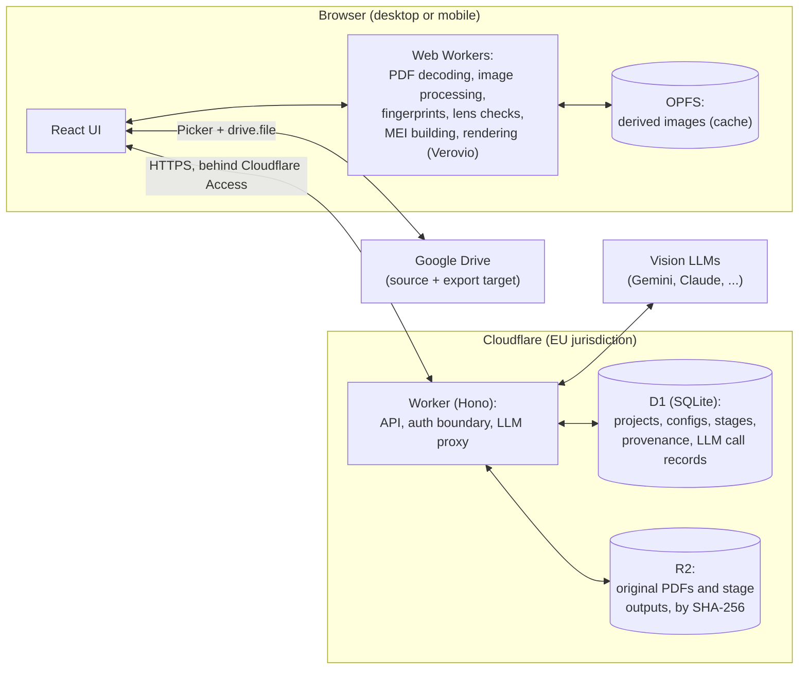

# Design Document — Score-to-MEI Pipeline (v2)

> Status: draft. The early assessment (§16 steps 1–4) is done and the app is being built from the outside inwards (§16 step 6): projects, the project picker and the project view exist and run locally; the pipeline panel shows the real stages from D1 (§5.8), of which only Ingest exists yet. This document records the architecture, the reasons behind it, and the known risks with proposed mitigations. Items marked **Proposed** are leading candidates, not final decisions. Concrete **tasks**, including the decisions still to be made, are collected in §15.

## 1. What this app is

A web app that converts PDFs of music scores into a formal, text-based encoding of the music: **MEI** (§6, "MEI").

- **Input:** a PDF, usually a scan of an old score, sometimes a digitally typeset (vector) PDF.
- **Output:** an MEI file (the **export format**), with an engraved rendering for side-by-side comparison with the original. Inside the pipeline, the models read and write a compact format built on LilyPond's notation instead (the **internal format**, §6, "The lens").
- **Focus:** the **pipeline**, not just the end result.
  - Every step is configurable.
  - Every intermediate input and output can be inspected.
  - Any part of the pipeline can be re-run from the first stage that went wrong, with a different configuration.
  - Any intermediate artifact can be edited by hand, and the pipeline resumes from the edited version.
- **Recognition is done by vision LLMs** (e.g. Gemini, Claude), steered by programmatic steps and human assistance. Programmatic steps handle the deterministic work: image handling, structure, checks, assembly. Humans assist where machines are unreliable, for example cropping heavily ornamented old scores.

### Why a text encoding, and which one
Two goals decided what score3ly should produce:
- **A: work with a score that exists only as a PDF:** convert it, edit it, render it anew. Any good notation format would do, MusicXML with MuseScore included.
- **B: give the music to an LLM** for analysis or generation, e.g. a simpler version for a beginner. score3ly itself does neither, but its output should make them possible. MusicXML is a poor fit here: verbose, full of typesetting, and its durations are tick arithmetic (`<divisions>`, `<backup>`, `<forward>`).

**What models write** (the lens, §6) had to be compact and natural for a model:
- **ABC:** compact, and the format LLMs know best, but weak for dense piano polyphony and cross-staff notes.
- **kern** (Humdrum): a time grid, one column ("spine") per staff and one row per moment, used in research because image-to-sequence models need a compact linear target. Simultaneity is explicit, but melodic lines are scattered down the columns, and every row needs one token per column, which is fragile to generate.
- **LilyPond:** melodic lines stay contiguous and readable, for people and models alike; simultaneity needs duration sums, which code checks. **Chosen,** as a format of our own built on its notation (§6, "The symbolic format").

**What users get** had other requirements:
- everything musical, as opposed to typesetting: pitches, durations, rests, ties, slurs, articulations, tremolo, dynamics, and what a player needs: voices, cross-staff notes, stem directions;
- room for editorial notes and alternatives, clearly separated from the music;
- unambiguous to parse, and, once what isn't musical is removed, one way to encode given music, or equivalences that are trivial to recognize. No format guarantees that by itself: it takes a normalizer, and ours is the conversion from the lens (§6);
- conversion to other formats. Lossless conversion to ABC or kern is impossible (they express less), and LilyPond can only be imported from a subset we define.

**MEI fits best** (§6, "MEI"): XML from the musicology community, with the musical content apart from the layout, pitches as name and octave, durations as note values (no ticks), written and sounding values kept apart (`accid` and `accid.ges`), dynamics, slurs and the like attached to notes, irregular measures marked as such (`@metcon`), editorial markup (`app`/`rdg`, `choice`, `supplied`, `unclear`, `annot`), links to image regions (`facsimile`), and MEI Basic, an official subset with "one way of encoding for every feature". Verovio renders it in the browser and keeps the MEI's ids in its SVG. MusicXML was the fallback (the best ecosystem of tools, but heavy normalization and weak editorial markup); the other formats would be views derived from MEI. Export to them is a later question: no converter between MEI and LilyPond exists in either direction, and Verovio doesn't write MusicXML.

**Considered and dropped:** starting from an OMR tool's MusicXML, checking it in code, and letting an LLM fix only the measures that fail the checks. Cheap, but no OMR output tested is good enough to start from (§13, "Baselines"), and turning MusicXML into LilyPond (`musicxml2ly`) loses things: MusicXML moves a time cursor back and forth between voice numbers where LilyPond has continuous voices (and voice identity is musical information for piano), its data is redundant and often inconsistent (`<duration>` and `<type>`, `<alter>` and the printed accidental), and the converter has gaps (cross-staff notes, changing staff counts, pedal, ornaments, octave marks).

### Lessons from v1
v1 was Python-only, local-only and command-line-only.

**What failed:** heavy programmatic preprocessing (cropping, deskewing, stain removal) followed by Audiveris (MusicXML) and `musicxml2ly`.
- Ornamented old scores were impossible to handle with scripts.
- Audiveris failed badly on them.

**What carries over:**
- The stage-tracking system: detecting finished stages, resuming interrupted runs, re-running stages, with hash checks and JSON documentation. It is the basis for §5.
- Some LilyPond conventions, now part of the lens (§6): absolute pitches, so that an octave error doesn't propagate, and code, not the model, building the score's structure.

**Where v2 starts from:** experience from other projects shows that current vision LLMs read difficult material very well, at a cost of cents per call.

### Scope
- **The scope is as much printed music as possible,** ideally most of it, never limited to one genre or instrumentation. We will probably never support all music, but that is what we strive for.
- **The first priority:** classical piano scores, the project owner's background, where the knowledge and the examples come from. This is hard enough already, because it involves:
  - multiple voices per staff
  - the staff count changing mid-piece (e.g. 3 staves in a passage, 2 elsewhere)
  - lyrics below systems
  - editorial notes, ossia and alternative versions
  - a reduction staff for an orchestral part
  - two-piano double systems
- **Everything else is in scope too,** prioritized after it, not excluded: other instrumentations, lead sheets, Baroque continuo, popular music.
- **Possible later: image input (PNG, JPEG)** in addition to PDFs. It is almost no extra work: an image is a page image, so it skips PDF extraction and joins the same pipeline at `rasterize` (§6), with JPEGs going through the same bundled decoder (§8.1).

### Goals
- **Quality first:** the measure of success is how good the transcription is and how little human correction it needs. Infrastructure only exists to serve that.
- **Cheap:** runs on free tiers. Paid LLM calls are the only expected running cost.
- **Transparent:** open source, simple deployment, documented strategy (this file).
- **Runnable from anywhere:** start on the desktop, continue on the phone. Every pipeline stage should work on both.
- **Reproducible and testable:** every stage output (§5.2) can be traced back to its inputs, code version, prompt version, model and configuration. Non-deterministic parts (LLM calls, human input) are recorded so they can be replayed (§12).

### Non-goals (for now)
- Multiple users, sharing, collaboration. Each person deploys their own instance to their own Cloudflare account, or runs the desktop version (§3, planned), with their own secrets, so the app has no user accounts and none are planned.
- MusicXML output.
- Offline-first operation.

## 2. Architecture overview



### Where data lives

| Data | Location | Why |
|---|---|---|
| Original PDFs | R2, key = SHA-256 of the file bytes | Source of truth. About 0.66 GB for 200 PDFs, well within R2's 10 GB free tier. Identifying PDFs by content makes deduplication and "resume an existing project?" trivial. |
| Projects, step configs, stages, one row per stage output (§5.2), provenance, fingerprints | D1 | Small, structured, relational. SQLite is easy to inspect and migrate. |
| The content of stored stage outputs (analysis JSON, extractions in the internal format, issues, MEI files, human operations) | R2, key = SHA-256 of the content | Small, must never be lost, often not reproducible. One storage mechanism and one rule for everything stored (see below), plain files in the desktop version (§3), and far more room than D1 has. Content can't be queried there, so whatever the app filters or sums on (costs, counts, types of findings) is also a column in D1. |
| LLM call records (full request + response) | D1 (large payloads in R2) | Needed for provenance, cost tracking and replay tests (§12). |
| Derived images (page images, preprocessed pages, system crops) | OPFS on the current device | Large (roughly 150–300 MB per PDF in colour, a third of that in grayscale) but regenerable from the PDF plus the recipe. Device-local means real deletion, no cloud quota, and no data residency issue. |
| Final exports (the MEI file, optionally its engraved PDF) | Download, or an app-created folder in Google Drive | The user's own file space. Browsable anywhere. |

### Why this split
- **No server-side compute.** Workers have tight CPU limits and no native libraries. All heavy processing happens in the browser, so the Worker stays a thin API and LLM proxy, and stays on the free tier. Waiting on an LLM response doesn't consume Worker CPU time.
- **Images are cache, not data.** This removes the biggest storage cost entirely. Switching devices costs some regeneration time, not storage.
- **Everything persistent is small** (rows in D1) or **content-addressed and immutable** (R2).
- **Every object in R2 is stored under the SHA-256 of its bytes,** not only the PDFs. Objects never change: changed content is a new object under a new key. So a repeated upload is harmless, the browser can cache every object for good, a fork (§16) copies no objects, and the hash that a stage's validity check needs anyway (§5.2) is also the key. The price is that an object can't simply be deleted with the row that refers to it, since other rows may refer to it too (§4).

## 3. Technology decisions

| Area | Choice | Reason |
|---|---|---|
| Language | TypeScript everywhere | One set of types shared by the UI, the processing code, the Worker and the DB rows. The v1 Python code is being rewritten anyway. |
| Frontend | React + Vite | Familiar. Deploys to Cloudflare as static assets without changes. |
| Backend | Cloudflare Worker, HTTP layer on Hono | Web-standard `Request`/`Response`, minimal and portable. |
| Database | Cloudflare D1, created with `--jurisdiction eu` | SQLite semantics, free tier, EU data residency. The jurisdiction can only be set at creation. |
| Object storage | Cloudflare R2, bucket created with EU jurisdiction | 10 GB free, no egress fees, native Worker binding. The jurisdiction can only be set at creation. |
| Auth | Cloudflare Access in front of the whole app | No auth code in the app. |
| Device storage | OPFS (Origin Private File System) | Supported by Firefox, Chrome and Safari. Fast binary access from Web Workers. |
| PDF handling | pdf.js, version pinned | Renders vector PDFs and decodes CCITT, JBIG2 and JPEG 2000 images in JS/WASM, deterministically. |
| JPEG decoding | pdf.js's own JavaScript decoder, not the browser's (pdf.js would use the browser's `ImageDecoder` where there is one; it is switched off, §8.1) | Browser JPEG decoders may differ by about ±1 gray level. A decoder in our bundle gives identical pixels everywhere. |
| Vision LLMs | The user's choice, per stage (§7.2). Recommended: Claude Opus 5.5 for everything. | In the manual run (§16 step 3) Opus did best at everything, layout included. Providers are swappable behind the `LlmProvider` port. |
| Structured LLM output | Provider-native schema-constrained output, validated with Zod | Machine-checkable outputs. No free-form parsing. |
| Schema validation | Zod (or similar) | Validates step configs, LLM outputs and DB payloads. The same schema generates the UI controls (toggles, sliders). |
| Rendering | Verovio (WASM) in the browser, rendering the MEI | Keeps rendering runnable everywhere, with no native program. See §9. |
| Google Drive | Google Identity Services + Google Picker + `drive.file` scope, entirely in the browser | `drive.file` is non-sensitive: no app verification, and access only to files the user picks or the app creates. |
| Local development | `wrangler dev` (local D1/R2 emulation) + Vite dev server, run as two processes. Vite proxies `/api` to Wrangler. No Cloudflare Vite plugin. | One code path from day 1. Keeps the app and the Worker as separate packages with a clear boundary. |
| Deployment | One Worker with static assets: `apps/worker`'s Wrangler config serves `apps/web`'s build output. `wrangler deploy` uploads both. | One origin: no CORS, one Access policy, app and API always deployed at the same version. |
| Tests | Vitest | Pure-TS core runs in Node for unit, golden-image and replay tests. |

### Repository layout (suggested)

```
packages/
  core/      Pipeline engine, stage outputs and artifacts, step definitions, config schemas.
             Pure TypeScript, no DOM and no Cloudflare APIs.
  imaging/   Page images from PDFs, deterministic image operations, fingerprints. Pure TS/WASM.
             (Exists: page images, skew detection, rotation. The other packages don't exist yet.)
  notation/  Lens parser and checks, measure building from stretches,
             MEI builder (the frame from the structure and metadata, the music from the lens).
  prompts/   Versioned prompt templates and their output schemas.
apps/
  web/       React UI, Web Worker host, OPFS + Drive + local-file adapters.
  worker/    Hono API, D1 + R2 adapters, LLM provider adapters.
  eval/      Local evaluation tooling: engrave command, side-by-side viewer (§13).
fixtures/    Recorded test projects (§12).
testset/     Evaluation test set (§13): inputs, their strokes and .ly/.musicxml candidates committed, rest ignored.
DESIGN.md
```

### Ports and adapters

The core depends only on interfaces. Adapters live in `apps/*`.

| Port | Adapters |
|---|---|
| `PdfSource` | Local file input, Google Drive (Picker) |
| `BlobStore` (original PDFs, stage outputs) | R2 via the Worker. A folder of files (desktop version). In-memory for tests. |
| `ProjectStore` (projects, stages, output rows, provenance) | D1 via the Worker. A SQLite file (desktop version). SQLite or in-memory for tests. |
| `DerivativeCache` (regenerable images) | OPFS. In-memory for tests. |
| `LlmProvider` | One adapter per provider (via the Worker). **Replay** adapter for tests. |
| `Renderer` | Verovio in the browser. See §9. |
| `ExportTarget` | Browser download, Google Drive folder |

### Desktop version (planned)

The app is built for the browser and Cloudflare, and that stays the focus. An optional **desktop version** wraps the same code, for people who prefer that trade-off:

| | Web app on Cloudflare | Desktop app |
|---|---|---|
| Setup | A Cloudflare account, a deployment, secrets in the dashboard | Install and run |
| Devices | Every device, phones included, with the important data synced | One computer |
| Data | D1 and R2 in the EU, images cached per device (sometimes missing and rebuilt) | Everything local and persistent; the disk is the only backup |
| Secrets | Worker secrets | A local file |
| Residency | EU storage at a US company (§10) | Local, apart from the LLM calls |

The project owner uses the web app. The desktop version mainly makes the app easier to share with people who would not set up Cloudflare (the API keys they have to bring remain a hurdle either way).

**The rule that keeps it cheap:** the web app only ever talks to the Worker's HTTP API, and the Worker only touches Cloudflare through its D1 and R2 bindings and its secrets. Anything Cloudflare-only beyond those (e.g. Workflows or Durable Objects, §16) goes behind a port with a desktop equivalent, or is a deliberate exception. Then the desktop version is a different host for the same server code, not a second app.

**How:**
- **Electron.** Its main process (Node) runs the Worker's Hono app as a local server on `127.0.0.1`, and the window shows that address. The React app doesn't change. Electron rather than Tauri because it ships Chromium: the system web views (WebKit on macOS) differ in canvas, OPFS and pdf.js behaviour, and Tauri would still need Node alongside for the server. The price is a download of about 150 MB.
- **Small adapters on Node, not Miniflare.** D1 is SQLite: the part of the D1 API we use (`prepare`, `bind`, `all`, `batch`) is a thin layer over Node's built-in SQLite, running the same migration files, at startup. R2 is a few calls (`get`, `put`, `head`, `delete`) over a folder of plain files. Miniflare would need no adapters but is a development tool, ships the `workerd` binary per platform and stores R2 objects in its own format.
- **No login:** the server only listens on localhost, so Cloudflare Access isn't needed.
- **The same server also runs without Electron,** as a plain local server, e.g. on a home server reachable from a phone through a VPN.

**What differs in the app.** The server says which host it is (e.g. `GET /api/info`), so the web bundle stays the same for both; the UI asks the server, and nowhere else decides by host:
- **Secrets:** in the desktop version they are in a file in the app's data folder, in the same `NAME=value` format as `.dev.vars` (§10). The app creates it on first start, with a commented example and permissions for the user only. A button in the settings opens it in the system's default text editor: the page asks the server, which opens it (`shell.openPath`), since a web page can't. Changes take effect without a restart: the server reads the file again when it changes, and the secret names in the model configs (§7.2) update. In the web version, the same place in the settings explains that secrets are set in the Cloudflare dashboard, with a link to the user guide.
- **Navigation:** an Electron window has no browser bar, but the app relies on the back button (closing an artifact or a stage's details, leaving a menu page, §5.6). So: back and forward buttons in the header, left of the wordmark, disabled when there is nowhere to go (Electron knows: `navigationHistory.canGoBack()`), and the usual shortcuts, which Electron doesn't set by itself: Alt+←/→ (Windows, Linux), Cmd+[/] (macOS), the mouse's side buttons and swipes on macOS. The condition is "no browser bar", not "desktop": a phone app opened from the home screen without the browser's bar would need the same (§15).
- **The data folder:** nothing in the app opens it. The user guide says where things are stored on each platform, with a strong warning that changing those files can invalidate pipelines that already ran (§5.2).
- **Easier on desktop:** no Worker limits on CPU time, no lost answers when a phone sleeps, no free-tier quotas. Running the whole pipeline on the server (§16) is simple there.

**The real costs** are outside the code:
- **Code signing:** unsigned apps get warnings (macOS Gatekeeper, Windows SmartScreen) that stop non-technical users. Notarizing for macOS needs an Apple Developer account ($99/year); a Windows certificate costs money too.
- **Builds for three platforms** (GitHub Actions) and updates (e.g. electron-updater from GitHub Releases).
- **Migrations on users' machines,** run at startup.

**When:** after the first vertical slice works (§16 step 6). Until then, only the rule above has to hold, and the current code follows it.

## 4. Identity and projects

- A PDF is identified by the **SHA-256 of its bytes**, computed on the device with `crypto.subtle.digest` **before** uploading.
- When a PDF is selected, the app asks D1 whether the hash exists:
  - **Unknown:** upload to R2 at `pdfs/<sha256>.pdf` and create a project.
  - **Known:** offer to resume an existing project on this PDF, or start a new one. There can be several projects per PDF.
- The file name and source (Drive ID, local path) are stored as informational metadata only, never as identity.
- Each project has a **name**, so the user can tell projects on the same PDF apart (e.g. "Sonata, Claude run" vs "Sonata, Gemini run"). The name is a label, not the identity (that is the project ID), but it is unique so it can be relied on:
  - It defaults to the PDF's file name without ".pdf". If a project already has that name, the Worker appends " (1)", " (2)", ... and takes the first free one, like file managers do. A file that is already called `Sonata (1).pdf` becomes `Sonata (1) (1)`, also like file managers.
  - Uniqueness is case-insensitive ("Sonata" and "sonata" clash) and enforced by the database (a unique index, `COLLATE NOCASE`), so two projects created at once can't get the same name. Names are trimmed, never empty, and at most 200 characters.
  - The user can rename a project at any time ("Rename" in the project actions, §5.6). Renaming to a name that is taken is refused with a message, not numbered: numbering only applies to the default. Changing only the case of the project's own name is allowed.
  - Deleting a project frees its name.
- **Deleting a project** (planned): apart from the costs and statistics, it must be **as if the project had never existed** (decided). In particular, a new project with the same PDF, name and config runs every stage from scratch and finds nothing of the deleted one in the cache.
  - **Deleted:** the project's stage outputs (their rows and their content), the full requests and responses of its LLM calls, its PDF and the PDF's image fingerprints, in D1, R2 and the device cache, unless another project that isn't deleted still uses them. That is checked with a query at deletion time, not with stored reference counts, which can drift.
  - **Orphans in R2 are collected then too:** objects that no row in D1 refers to any more, from any project. They are left behind when a manual stage in progress is saved again (the new content is a new object, §2) or when an upload isn't followed by its row in D1. Nothing else deletes them: a save doesn't delete the object it replaces. This lists the whole bucket and compares it with D1, which is acceptable because deleting a project is rare.
  - **Kept, but marked with a deletion time (`deleted_at`):** the project's row, its stages and their LLM calls, for the costs and statistics (§10). Every cache lookup ignores marked rows (§5.8), so they are never reused. A stage that a fork which isn't deleted still uses is not marked (§5.8).
  - A deleted project never appears in the UI again, except in the costs view. Picking its PDF again doesn't trigger the "already based on this file" dialog, unless other projects use that PDF.
  - Uniqueness of names only counts projects that aren't deleted: a partial unique index (`... WHERE deleted_at IS NULL`). *Built* (migration 0003, which rebuilt the table: the earlier constraint sat on the column and couldn't be dropped).
  - Behind several confirmations.
- Each project also has three timestamps, all set by the Worker (ISO 8601, UTC) so a wrong device clock can't scramble the order:
  - **created**
  - **last modified:** any change to the project's own data (pipeline results, manual stages, a rename). Opening or viewing doesn't count.
  - **last opened:** set by a dedicated request when the project is opened, so listing projects doesn't touch it.

  Both start equal to the creation time, so sorting needs no special case for "never".
- Concurrent edits from two devices are prevented by optimistic locking: each project has a version number, and stale writes are rejected with a reload prompt.

## 5. The pipeline model

The pipeline is designed like a small build system. The v1 stage-tracking system (hash checks, resumability, JSON documentation) is the starting point and is ported, not reinvented.

### 5.1 Steps and stages

- A **step** is a definition in the code: what is done, with which configuration options.
- A **stage** is one occurrence of a step in a project's pipeline, with its own configuration and its own results.
- A project's **pipeline** is the ordered list of its stages. It is stored in D1 and shown in the UI (probably in a side panel), so it has to stay short.

There are two sorts of stages:
- **Planned stages** have a predefined order (§6) and can run automatically, one after the other.
- **Manual stages** are added by the user to intervene by hand (§5.4). They are recorded in the pipeline like any other stage.

The same step can occur more than once in a pipeline. Example: the review step run twice for extra accuracy, or once with one model and once more with another.

#### Run modes
A small drop-down in the pipeline panel sets, per project, how the pipeline runs:
- **Auto:** one click starts the pipeline (or resumes it), and it keeps going from stage to stage, following the recipe, until it is done or fails. If a model flags that it would like human input, the flag is recorded, but the pipeline goes on with the model's best guess. The spending cap (§10) also stops it.
- **Manual:** each stage is started by a click. This leaves time to look at the outputs and decide whether to step in with a manual stage or to run a stage again with other parameters.
- Far in the future, perhaps a middle ground: run automatically, but stop when a model asks for human input.

The mode for new projects is a settings item. After installation it is "Auto". Built: `newProjectRunMode` in the settings (`/api/settings`), a drop-down like the panel's on the settings page, saved when picked; the Worker reads it when it creates a project.

The browser drives the pipeline, so in either mode a run only advances while the app is open (§15, §16).

Each step declares:
- `id` and `version`, e.g. `extract@3` (see §11).
- A **config schema** (Zod), which is also the source of its UI controls.
- **Input** and **output types**.
- **Granularity:** per document, per page, or per system. Steps can fan out, e.g. one page becomes many systems.
- Its **kind:** `ingest`, `computed` (code), `llm` or `manual`, and nothing else (decided). `ingest` is the kind of the first stage only: it doesn't run (the PDF is given when the project is created), so the UI treats it apart (no run, progress or retry; it is done from the start), and its output is stored like LLM and manual outputs (§5.3).
- Its **runtime:** browser (Web Worker) or Worker proxy (LLM calls).

While it runs, a stage **reports its own progress** as a fraction from 0 to 1, which the UI shows (§5.6):
- Only the code that performs the stage knows how far it is. It is handed a function to call whenever it has got further (e.g. after each system), and doesn't know about the bar or the circle that show the value. A stage running in a Web Worker can't call into the page, so there the function passes the value on as a message.
- **A single LLM call has nothing to report while it waits,** so its share of the bar fills with the time elapsed out of the call's timeout, and jumps to full when the answer arrives. If the timeout is reached, the call has failed. For a stage that is one call, the share is the whole bar; for a stage with a call per system, each call fills its own slice.

### 5.2 Outputs, artifacts and provenance

**Terminology** (decided):
- **Stage outputs** are internal: many and fine-grained, e.g. one per page, per system or per LLM request. They carry provenance and cache keys, have a row each in D1, and are what is stored or regenerated. They are saved as soon as each is done, so an interrupted or failed stage resumes where it stopped.
- **Stage artifacts** are what the user sees: few per stage, mostly for the whole score (the pages, the layout, the score so far, the MEI file, the issues), shown as tiles and in the artifact view (§5.6). A stage doesn't show 107 tiles for 107 systems. An artifact is built from the stage's outputs, as a view; some are stored as well for convenience (the MEI file for download), but an artifact never holds anything that isn't in, or computable from, the outputs. So provenance and caching live in one place, the outputs.
- **The export format** is what the user gets: MEI (§6, "MEI"). **The internal format** is what the pipeline works with: the lens (§6, "The lens"). There is no single storage format: the outputs may hold either or both, as the stages need; that is settled when they are built.

Every stage output has:
- `step id@version`
- a canonical config hash (JSON with sorted keys)
- the IDs of the outputs it was made from
- its `origin`: the kind of the stage that produced it (`ingest` | `computed` | `llm` | `manual`)
- a fingerprint (for images, see §8.3)
- a timestamp

LLM outputs additionally reference their **call record**: prompt template version, filled-in context, image hashes, exact model ID, parameters, full response, token usage and cost.

**The cache has two levels** (decided):
- **Stage level:** the key is hash(step id, version, canonical config, the model's provider, model and effort for LLM stages, the content keys of the stage's inputs). An input's content key is the hash of its stored content, or the recipe key of a computed image (§8.6): content rather than row IDs, so a stage that produces identical content again (e.g. `layout` run again with the same boxes) doesn't invalidate what follows. If it matches, the stage is skipped and its outputs reused. Outputs of later stages may already exist when an earlier stage is run again with the same inputs and config: they are found through the key and reused.
- **Item level, when the stage's key doesn't match:** the stage runs, but each item checks its own key first: for an LLM request, the exact request including the model config (provider, model, effort; §7.2: an identical request is served from its record); for an image, its recipe (§8.6). Cheap code just runs again. Requests contain only what they really use (§5.5), so fixing one page's boxes changes only the requests that depend on that page; a request that contains the whole score (`review`) changes with any change upstream, as it should.
- **What isn't part of any key:** a model config's plain parameters (the region, the project) and its secrets (§7.2). They choose where and with which credentials a request runs, not what the model is given. A parameter that some day does change the answer must be added to the keys.
- **Only usable answers are cached:** an error (no answer, a timeout) or an answer that fails to parse is recorded (call record, costs, §10) but never served from the cache, so a retry asks again.

Every output has a row in D1, which belongs to the stage that produced it and says whether its content is stored (in R2, under its hash, §2) or only its recipe (§5.3).

**Checking that stages are still valid:** a pipeline checks its stages against the hashes of their inputs and outputs. Stored content can change outside the app (e.g. files in the desktop version's data folder edited by hand), and a stage whose recorded inputs or outputs no longer match what is stored is not valid any more. How and when this is checked, and what the app does then, is still to be designed (§15).

### 5.3 Persisted vs. regenerable (important)

- **Computed** outputs (page images, straightened pages, crops) store only their **recipe plus fingerprint**. Images live in OPFS and can be regenerated. Small text outputs may be stored anyway for convenience.
- **Ingest**, **LLM** and **manual** outputs **must be persisted**: everything that isn't computed. They cannot be regenerated: re-running an LLM call gives a different answer and costs money.
- Rule: *anything you would hate to lose must never exist only as a cached image.*
- **Regeneration is lazy, per device** (decided): a device computes a computed output only when something needs it, never the whole chain up front. Example: seven stages run on a laptop, and on the bus the user adds an eighth, manual stage on a phone. The phone has none of the laptop's images, but the eighth stage's inputs are there (stored outputs fetched from R2, or images regenerated from their recipes because the stage needs them), so the user simply continues. If the user then opens an earlier stage's images to inspect them, they are regenerated from their recipes then, and cached on the phone (§8.6).

### 5.4 Manual stages

The user intervenes by adding a manual stage to the pipeline. The manual stages foreseen so far:
- fix the lines that should be horizontal (`fix_skew`)
- fix the system boxes and bar lines (`fix_layout`)
- fix the metadata (`fix_metadata`) and the observations (`fix_observations`)
- answer the issues and correct the music (`human_review`, after any `apply_review`)

(The stages are listed in §6.)

Rules:
- **One manual stage covers the whole PDF,** however many items are fixed in it. Fixing the boxes on twelve pages is one `fix_layout` stage, not twelve. Otherwise the pipeline shown in the UI would get too long.
- The outputs of a manual stage have `origin = manual` and the corrected output as their parent.
- Edits to images are stored as **replayable operations**, not as edited pixels: lines that should be horizontal, boxes, bar line positions. Replaying them on the regenerated base image reproduces the edited result.
- Text outputs (analysis JSON, extracted music) are stored edited, with a diff to their parent.
- **Undo and redo exist only inside a tool for manual work,** while it is open. Leaving the tool saves, and after that nothing can be undone: the stage can only be edited further or dropped (§5.5).
- **A finished stage never changes.** Editing a finished manual stage creates a new manual stage, which starts from the finished state of the old one and takes its place in the pipeline. The old one becomes a replaced stage (§5.5) and stays in storage as it was. The reason is forking (§16): another project's pipeline can use the same stored stage, and it must not change there.

### 5.5 Resuming and re-running
- **The history of a project is linear.** There are no branches inside a project, and no undo.
- Changing something in the middle (e.g. the config of stage N, or a manual stage added there) means running everything after that point again. The later stages are replaced: they leave the pipeline and are no longer shown.
- To keep the old results and try something else, the project is forked (planned, §16), not branched.
- **Any stage that isn't part of the recipe can be dropped:** manual stages, and extra stages the user added, such as a further review. Dropping is a change in the middle like any other: after a confirmation, the pipeline continues from the stage before the dropped one, with the same rules (run mode, reuse where the inputs match). Planned stages can't be dropped.
- **Execution is per item** (a page, a system), with each item's outputs saved as soon as it is done (§5.2).

#### What a re-run follows
A re-run follows **the pipeline as it was, not the standard recipe** of planned stages, for as long as the outcomes stay the same. This is the intended behaviour, not yet a technical definition; the details are worked out when we get there.
- **A stage whose inputs and config are exactly the same is reused,** manual stages included. Example: the composer's name is corrected after a full run that also had a wrong note fixed by hand. Nothing that the note fix depended on changed, so the fix is still there after the re-run.
- **A manual stage whose input changed at all is dropped as a whole** (decided), even if only one page or system of its input changed, and none of its fixes is applied, and the pipeline continues with the planned stages. The typical manual fix is a better deskewing angle or better system crops on a difficult old score. The point of it is that the stages after it then produce very different, better output, which ideally no longer needs the manual fixes that the poor first attempt needed.
- **Stages must depend only on what they really use.** If an `extract` call got the whole metadata as context, composer included, correcting the composer would change the input of every `extract` call, and all of them would be paid for again.
- **Proposed** (§15)**:** after a re-run, the app reports which manual fixes were carried over and which were dropped. Which ones are dropped depends on the outcome of the run, so it can't be said beforehand, and a dropped fix would otherwise go unnoticed.

#### Replaced stages
- **Replaced stages are kept in storage,** with their outputs and full LLM call records (requests and responses). They are reused whenever possible: a stage that runs again with the same inputs and config, or an identical LLM request (§7.2), is served from what is stored and costs nothing.
- **They stay connected to their project in D1,** although the pipeline no longer shows them, so that deleting the project (§4) finds and deletes them too. Until then, a project's storage only grows.

#### Confirmation before a re-run
A dialog asks for confirmation before anything is replaced. The wording still needs polishing, but it must say clearly:
- The pipeline is **overwritten irreversibly**: there is no undo and no branching, so this is a hard rewrite.
- Changing one stage can change, and is likely to change, the rest of the pipeline.
- Wherever the input stays exactly the same, earlier results are reused: LLM calls already paid for are not paid for again, and manual fixes are kept. Everywhere else, calls are paid for again and manual work is dropped.

### 5.6 How the app shows a project
- **The pipeline is the main attraction; the artifact view is secondary.** The usual use is: new project, let it run, take the final MEI and leave. So the pipeline gets the comfortable place on every screen, and inspecting artifacts is what gets less comfortable on small screens.
- **Two layout modes, nothing in between:** wide (from 1024 px, the same breakpoint as the header) and narrow. Resizing a window switches between them on the fly.
  - **Wide:** the **pipeline panel** on the left (project, run controls, the stages), the **artifact view** on the right, much larger. The panel collapses into a narrow strip that shows only an expand button (a chevron, like the one that collapses the panel) and the progress circles below it, "Pipeline" above "Stage", each labelled below and without numbers. "Stage" is only there while a stage runs. The chevron sits at exactly the same height as the one that collapses the expanded panel. The collapsed state is remembered per browser.
  - **Narrow:** the pipeline panel is the only view. Picking an artifact (or a stage's details) opens it over the whole app, with a close button ("x") floating over its top right corner, white on translucent grey. The artifact is in the URL (`#/projects/<id>/artifacts/<artifact id>`), so the back button closes it too, and a reload keeps it open. A stage's details have a URL too (`#/projects/<id>/stages/<stage id>`). After closing, what was open stays selected in the panel, so the user sees what they last looked at (until the page is reloaded or another project is opened).
- **The artifact view has no header of its own,** in either mode: it is the most valuable space on the screen. Which artifact is shown can be seen in the pipeline panel, where it is selected.
- **Progress:** one indicator for the whole pipeline and one for the running stage, **never with numbers**. In the expanded panel, the pipeline's is a thin bar in the panel's head; the stage's is a bar in the running stage's card. The collapsed strip shows both as circles. The pipeline's total is a best guess (a second review round or a manual correction adds stages), and a change only moves the circle a little. The pipeline's progress is the finished stages out of all stages, so adding a manual stage moves it back a little (accepted). A stage is a big chunk of work: doing something to every system is still one stage.
- **Each stage declares its main artifact** (stages can have several). What the artifact view shows in wide mode, unless the user picked something:
  - a new project: the original PDF;
  - when the pipeline finishes: the final MEI;
  - when a project is opened: the latest stage's main artifact.

  Whether the view follows the pipeline while it runs is still to be decided (§15).
- **Built so far:** the pipeline panel as described below, showing the project's real stages (`GET /api/projects/<id>/pipeline`, §5.8). Ingest, `rasterize` and `skew_analysis` exist (§6): creating a project adds Ingest, done, with the PDF as its output, and the others, planned; migrations 0004, 0006 and 0007 added them to the projects created before. A step's config form is declared with the step (`steps.ts`) and shown by one dialog for all steps (`ConfigDialog.tsx`). **A config is checked when it is saved** (decided), before the confirmation that stages will be replaced, against the PDF too (a page selection beyond its last page): a stage must never be replaced by one that can't run, since the old config is then lost. Only if the PDF can't be opened on the device is the page count left unchecked until the stage runs. What the code declares about each step (title, kind, how its outputs become artifacts) is in `apps/web/src/steps.ts`; `pipeline.ts` turns the stored stages into what the panel shows; `runners.ts` lists the steps that can run. Running a stage works as described here: Run (and Retry), Stop, progress, Auto mode carrying on to the next stage, "Change config" with its dialog and the confirmation when stages that ran are replaced. Manual stages can be added, finished, edited and dropped (below, and §5.8); `fix_skew` is the first. The run mode is stored with the project (`PATCH /api/projects/<id>` with `runMode`). The original PDF is shown with pdf.js (its legacy build: the modern one needs browser features many phones don't have yet). The Worker serves the PDF at `GET /api/pdfs/<sha256>/file`. Later: editing in the artifact view.

#### The pipeline panel
- **A small head stays in view,** and only what is below it scrolls: the project's name (one line, shortened in the middle) with its "⋮" and the collapse chevron, then the **run mode** (a small drop-down showing "Auto" or "Manual", §5.1, which takes less room than a switch), the pipeline's progress bar and, in Auto mode only, **Run** (green) or **Stop** (red) while a stage runs, and, when something went wrong that isn't a stage's own failure (a stage that can't start, a request that failed), the error: in the head, so the list scrolling to the current stage doesn't take it out of view. Below the head, scrolling away: when the project was created and changed.
- **The stages are stacked,** first at the top, as cards (rectangles). The original PDF is the artifact of the first stage, **Ingest**, so every card is a stage and every tile in it an artifact. There are no arrows between the cards: a stage's inputs are often not just the previous stage's outputs, and arrows would suggest they were.
- **A card shows:**
  - an **icon for its step,** not its kind (decided), for the automated stages: Ingest an upload arrow, `rasterize` the usual image icon (a frame with a mountain and a sun). **Manual stages all share one icon, a wrench** (decided): they all fix something by hand. A step without an icon of its own shows its kind's (computed, LLM, manual). The kind is in the icon's tooltip and in the details. Then its name and a "⋮";
  - for LLM stages, the model config on a line of its own: its name, or without one its model string as the config has it, shortened in the middle if it doesn't fit (§5.7, §7.2; built). Then one line of facts: once done, the run time and a short result ("54 systems", "3 boxes moved, 1 added"). **No costs, prices, providers or token counts on the cards** (decided): those belong to the stage's details and the costs view (§10);
  - while running, its progress bar; when failed, the error;
  - its button, if it has one (below);
  - at the bottom, its **artifacts as tiles,** three per row, each with an **icon for its kind of artifact, never a thumbnail:** at a tile's size no content is recognizable, so a thumbnail adds nothing. (Not built yet: the tiles still show thumbnails for images and for the original PDF, §15.) Artifacts are **grouped logically:** all 54 system crops are one artifact, one tile with "×54", not 54 tiles (§5.2). The first artifact is the stage's main one. Tiles are what gets selected (highlighted in coral), not the card.
- **Stage states:**
  - **done**;
  - **running**: a green border and its progress bar;
  - **failed**: a red border and the error. It can run again;
  - **ready**: its turn has come. It looks like a done card, but without outputs;
  - **planned**: not its turn yet. Only the dimmed title (and the "⋮"), no outputs. It becomes ready, no longer dim, when its turn comes;
  - **WIP**: a manual stage being worked on (below).
  - A "needs you" state for a model asking for human input is left out for now; it will be easy to add (§5.1).
- **Buttons:** in Manual mode, the ready stage has **Run** and, while it runs, **Stop** in the same place. In Auto mode the cards have no Run or Stop: those are in the head. When the stage whose turn it is has failed, Run reads **Retry**, with a circular arrow, in both modes. Stop throws away what the running stage did so far: the stage is marked as stopped and leaves the pipeline. Its LLM calls stay, for the costs and the cache.
- **Manual stages** are added from a stage's "⋮" ("Fix layout manually", "Fix skew manually": the manual stage's title and "manually", for whichever fixes fit after that stage; decided). They start as **WIP** (a badge next to the name): the user opens the stage's output as often as they like and works on it, and clicks **Finish** on the card when done. Then the next stage gets its turn. In Auto mode the pipeline carries on by itself; in Manual mode the next stage is ready. A finished manual stage can be edited again ("Edit" in its "⋮"): that continues from where the user left it, not from scratch, but like any change in the middle (§5.5) it replaces the later stages and needs confirming. In storage, the stage being edited is a new one that replaces the finished one (§5.4). There is no "Discard": a manual stage, WIP or finished, is removed with "Drop stage" (§5.5). Undoing single edits belongs to the tools for manual work (§5.4).
- **The stage's "⋮"** holds everything else, so the card stays clean: "Show details", "Change config", "Fix … manually", "Edit" (manual stages), "Drop stage" (stages that aren't part of the recipe, WIP ones included, §5.5; in red). Only what applies is listed, and while a stage runs only "Show details". There is no "Run again": running a stage again without changing its config only makes sense after it failed, and that is Retry. Whatever replaces stages that already ran asks first (§5.5).
- **Show details** opens the stage in the artifact view: step and version, kind, status, run time, cost, result, its config, and for LLM stages the calls it made with their tokens and costs.
- **Groups are shown as a filmstrip:** the items one below the other with a small gap, scrolling continuously, with a counter in a corner ("12 / 54"). That way the end of one system and the start of the next are on screen together, which helps when checking musical content. `extract` shows each system's crop with its music below it.
- **Auto-scroll:** the list scrolls to the current stage (the first that isn't done) when the project is opened, when an Auto run starts, and whenever another stage gets its turn, in both modes: as an Auto run moves on, and in Manual mode when a stage finishes and the next one becomes ready. The stage is brought to about the middle of the view, or as far up as the list goes when few stages follow it.

- **The menu** (☰, at the far right of the header, after "+ New project") leads to the app's own pages: Statistics (including costs, §10), Settings, Help and About, in three groups separated by lines (what you look at, what you change, help). Each page has its own URL (`#/stats`, `#/settings`, `#/help`, `#/about`) and replaces the project view while it is open, so the back button returns to the project. Statistics and Help are placeholders for now (§15); Settings has its first item (below, §15). Help will not be a page of its own: it will lead to a user guide, a Markdown file in the repository on GitHub. Anything urgent (the spending cap reached, a missing key) must not hide in the menu: it is shown where the user is.
- **The settings page has a "Developer" section** (decided) with a button that downloads **the format gap report:** one file (e.g. a zip) built in the browser, so that access to D1 and R2 is the app's own. It goes through every project not deleted, reads the latest list of issues in its pipeline where there is one, and keeps the format issues. Nothing extra is stored for it, no table and no images: the crops are rebuilt from their recipes on demand, as for every other issue. Per issue: the crop with its boxes, the whole page image, the issue itself, the project's name, the PDF's name, the metadata, and the stage that raised it (step and version, model config, the prompt's and the lens's versions, the call). The script that groups and counts them for analysis works on that file.
- **Project actions:** a "⋮" button next to the project's name in the pipeline panel opens a menu of things to do with the project: "Rename", then a line, then "Delete project" in red (`--danger`, kept apart from the coral accent). Deleting isn't built yet (§15): picking it only closes the menu.
  - **Rename** opens a dialog with the name selected. "Rename" stays disabled while the name is empty (after trimming) or unchanged; a name over 200 characters gets a message right away. A name another project has (ignoring case) is refused by the Worker (409) with "A project with that name already exists. Names must be unique (case-insensitive).", and the dialog stays open. The field has no visible label (the dialog's title says it all), only one for screen readers. Both menus share one component (`DropdownMenu`).
- **The About page:** the wordmark (centered), what the app does ("A music transcription tool, driven by vision LLMs, that converts printed scores into MEI, an open, XML-based standard for encoding music notation."), its version (§11), the author (Tomás Silveira Salles), a link to the repository on GitHub, and the license. There is no license yet (§15), so all rights are reserved, and the page says so: the code can be read on GitHub but not copied, changed or shared.
- **Leaving a project loses nothing,** whether for a page from the menu, another project or a closed tab, because manual work is saved as it happens (§5.4). Once editing exists, changes not saved yet are saved or confirmed before the project view goes away.

### 5.7 Look and feel
- **Modern and clean, for desktop, tablet and phone.** Dark theme only for now. A light theme comes later; both must stay high-contrast.
- **Wordmark:** `<score3ly>` in JetBrains Mono, white, with the angle brackets in the accent color. It nods at the source code the app turns music into. It is always on the left of the header, at every width.
- **Accent color: coral** (`#ff7b72`, 8.4:1 on black). It is used for the wordmark's brackets, the "+ New project" button (black text), focus rings, the open picker and the selected pipeline item. Chosen from a set of candidates in a mockup.
- **Fonts:** JetBrains Mono for the wordmark and anything that is code (LilyPond, file names, IDs, times); Inter for interface text. Both are bundled with the app (Fontsource), so no request goes to Google Fonts.
- **Progress is green** (`--green`, `#3fb950`), not coral: bars and circles use `--progress`, which points to `--green`, so changing the progress color is one line.
- **Colors are CSS variables** in `apps/web/src/styles.css` (`--bg` black for the header and side panel, `--surface` near-black for the page, `--accent`, ...), ready for a light theme.
- **Compact mark:** `< >` in the accent color with a white quarter note inside, on a black rounded square (`apps/web/public/icon.svg`). A quarter note rather than an eighth: the flag made the note lopsided between the brackets and is too much detail for a favicon. Besides angle brackets as a tag, `<c e g>` is a chord in LilyPond.
  - It is the favicon, and the icon on a phone's home screen: PNG files in three sizes, listed in a web app manifest. `npm run icons` makes the PNGs from the SVG. They are committed, so after changing the icon the command has to be run again (with `-- --force`, since it doesn't replace existing files otherwise).
  - The icon is a separate image and can't use the app's CSS variables, so its accent color is a copy, named `.accent` in the SVG. A test checks that it matches `--accent`.
  - The manifest doesn't set a display mode, so the app opens from the home screen as a normal browser page.
- **Project and file names are never cut off at the end.** They wrap over up to three lines wherever there is room (the picker's list, the dialogs, the pipeline panel); a name with spaces breaks between words; a name without any (typically a file name) fills each line and breaks wherever it ends, since breaking early at a hyphen wastes most of a line. Only the picker's field in the header is a single line. A name that needs more lines than it may have is shortened **in the middle** ("villa-lobos_bach…prelude.orig (1)"), because names on the same PDF differ at the end, and hovering then shows all of it. This works the same with a mouse and on touch: the full name of the open project is one tap away, in the picker's list. The browser can only cut text at the end, so one component (`FittedText`) measures and shortens.
- **Dates, times and numbers have one fixed English format everywhere.** They don't follow the browser's language or region: the interface text is English, and a browser's idea of the locale often differs from the user's.
  - **Dates:** day and the month's short name, "7 Oct", plus the year when it isn't the current one, "7 Oct 2025". Never all-numeric, which is ambiguous between day-first and month-first. The day is the device's local one.
  - **How long ago:** compact, "20min ago", "5h ago", "2d ago".
  - **Money:** US dollars with two decimals, "$0.12" (§10).

### 5.8 The database
The D1 schema for the pipeline (decided; built in `apps/worker/migrations/0003_pipeline.sql`, which has the columns and their comments, and changed by the later migrations). Artifacts have no table: a step's code defines them as views over its outputs (§5.2), and an artifact that is stored for convenience (the MEI file) is an output for the whole score.

| Table | One row per | Holds |
|---|---|---|
| `projects` | project | Besides §4: the run mode (§5.1), a version for optimistic locking (§4), the number the next issue gets (§6, "Issue ids"), `deleted_at`. |
| `pipeline_entries` | stage in a pipeline | Project, position (1, 2, 3, ... without gaps) and the stage. Nothing else: the pipeline is a list of pointers. |
| `stages` | stage, planned ones included | The project it was created in, the step and its version, the status (`planned`, `running`, `failed`, `done`, `wip`, `stopped`), the step's config, the model config (LLM stages), the stage key, its page count, error, a short result, the stage it replaces (an edited manual stage, §5.4), times, a heartbeat, `deleted_at`. |
| `stage_inputs` | input of a stage | The outputs a stage read. |
| `outputs` | item a stage produced | The stage, the item, the type (`pdf`, `layout`, `lens`, `mei`, ...), the content's hash (stored, in R2) or the recipe and its key (computed), the corrected output (manual), the call that produced it (LLM). One per stage, item and type. |
| `output_inputs` | input of an output | The outputs an output was made from (§5.2). |
| `llm_calls` | LLM call | The stage, the model config, the request key, the model the response names (`response_model`), the full request and response (in R2), the status (`running`, `ok`, `error`, `unparseable`, `refused`, `cut_off`), the error, tokens (output tokens include thinking: Gemini reports thinking apart, and its adapter adds it), the cost, times, `deleted_at`. |
| `model_configs` | version of a model config | Optional name, provider, model, effort, plain parameters (region, project), secrets as `{field: secret name}` (Bedrock with a key pair needs two), the free-tier mark, the row it supersedes, `deleted_at`. Append-only (§7.2). |
| `image_fingerprints` | image sent to a model or worked on by a person | Its recipe key, its PDF, and the fingerprint (§8.3): dimensions, the hash of the raw pixels, the thumbnail. |
| `settings` | user setting | A key and a JSON value. |

- **Planned stages have a row** (status `planned`), so all there is to know about a stage lives in `stages`, and a pipeline entry is only a pointer. A planned stage is unfinished, so it may change: its config is NULL while it takes the settings' choice (§7.2), or what the user picked for it. When it starts, its config is the resolved one (what it actually used), and its version and stage key are set. "Ready" isn't stored: it is the first planned stage after the done ones.
- **The kind isn't stored:** it follows from the step, declared in code (§5.1). A step's kind never changes, which a unit test guarantees (§15).
- **Stages are shared, not owned by a pipeline.** A fork (§16) copies the pipeline entries up to its stage, and the issue counter, and no stages or outputs. `created_in` says which project a stage was created in.
- **Item names:** `''` for the whole score, `p3` for page 3, `p3/s2` for the second system on page 3. A system's number in the whole score (system 17) is derived, not stored.
- **A manual stage has an output for every item** of what it corrects, not only for the items changed: an unchanged one points to the same content (the same hash, so nothing is copied in R2). The next stage's inputs are then simply the outputs of the stages before it, with no falling back to an earlier stage per item.
- **Running a stage:** resolve its config and inputs and compute the stage key. If a stage that is done and not deleted has that key, the entry points to it and nothing runs. Otherwise the stage runs, each item first looks in the cache (`llm_calls` for an LLM request, a successful call with the same request key that isn't deleted; the device's image cache for an image), and each output's row is written as soon as it is done.
- **Retry** runs the failed stage again in the same row: the items already saved stay, the missing ones run.
- **Stop** marks the stage `stopped` and takes it out of the pipeline. Its outputs are deleted; its calls stay, for the costs and the cache.
- **A change in the middle** (§5.5) points the later entries to new planned stages, each with the config of the stage it replaces (a re-run follows the pipeline as it was). The replaced stages stay as they are, for the stage key to find; a dropped manual stage's entry is removed.
- **An interrupted run** (a tab closed mid-stage) leaves a stage `running`. A running stage writes a heartbeat **once a minute**, no more: each one is a write to the remote database. A running stage whose heartbeat is older than about three minutes counts as interrupted, and is resumed like a failed one.
- **The requests while a stage runs** (built, `apps/worker/src/pipeline.ts`; the browser does the work, the Worker records it), all under `/api/projects/<id>/stages/<stage id>/`:
  - `PUT config`: sets a stage's config. A planned stage gets it in place; a stage that has run is replaced by a new planned one, and every stage after it by a planned copy of itself.
  - `POST start`: the browser sends what it resolved (the step's version, the resolved config, the stage key, the page count and the outputs it reads). If a finished stage that isn't deleted has the same key, the entry points to it, the planned stage's row is deleted (nothing ran in it), and nothing runs. A planned, failed or interrupted stage can start; a running one can't.
  - `POST outputs`: records outputs as each is done; an item recorded already is left as it is (a retry skips them anyway).
  - `POST heartbeat`, `POST finish` (done with a short result, or failed with the error), `POST stop`.
- **Manual stages** (built, same file), under the same path:
  - `POST fix` with the step (and its version, page count and inputs), on a done stage: adds a WIP stage right after it. Refused if the next stage is already that step, or if a stage is running.
  - `POST outputs` while WIP: saves outputs as the user works; a WIP stage's item saved again is overwritten (a running stage's is left as it is). Outputs name their parent (the output they correct).
  - `POST finish` on a WIP stage: done, with a short result.
  - `POST edit` on a done manual stage: a new WIP stage takes its place, with the same outputs and inputs, and `replaces_stage_id` pointing to the old one, which stays as it was (§5.4).
  - `POST drop` on a manual stage, WIP or done: its entry is removed and the later ones move up.
  - Each of them, like a config change, replaces the stages after it: a planned one stays as it is, one that ran gets a planned copy.
  - **For now, a manual stage after a change is dropped** (interim): what a re-run does with a manual stage (reuse it when its inputs are the same, §5.5) needs a planned manual stage to be resolved when its turn comes, which isn't built (§15).
  - The Worker knows which steps are manual (`MANUAL_STEPS`): a step's kind is declared in the web app's code, but the Worker needs it for these rules.
  - **The recipe's stages are listed in the Worker** (`RECIPE`), which creates them, planned, with every new project.
- **A stage that seems to run, but not on this device** (another device, or this one before a reload) shows as running, without progress, and can be stopped. Once its heartbeat is about three minutes old it shows as failed ("Interrupted"), and can run again.
- **Progress isn't stored:** only the device that runs a stage knows it (§5.1). Another device sees the stage running, without a bar.
- **Deleting a project** (§4) marks rows instead of deleting them, for the costs and statistics, and every cache lookup ignores marked rows (partial indexes `... WHERE deleted_at IS NULL`). Marking in the rows, rather than filtering every lookup by the projects that aren't deleted, keeps the rule in one place. When project P is deleted:
  - a stage is marked if no other project that isn't deleted has it in its pipeline, and it was created in P or in a project already deleted. A stage a fork still uses stays, and is marked when that fork is deleted; a stage created in a project that isn't deleted is never marked;
  - the calls of a marked stage are marked with it;
  - the outputs of marked stages, the content of stages and calls that nothing else uses, and the fingerprints of a PDF nothing else uses are deleted (§4).
- **Each stage records its page count** (decided), when it starts, and it never changes: the number of pages its inputs cover. `rasterize`: the pages selected; `layout` and `analyze`: the same; per-system stages (`extract`, `review`, `apply_review`): the pages their systems are on; `assemble`: all selected pages, since it also builds the header from the metadata, which `analyze` read from every page, cover included. Pages without music aren't discounted: pages aren't classified (§6, `layout`). NULL for Ingest, which doesn't read the PDF.
  - **Why on the stage, and not the project's:** the selection of pages can change within a project (`rasterize`'s config, then a re-run), and the replaced stages keep their statistics. A replaced `extract` is no longer in any pipeline, so "the `rasterize` stage in the same pipeline" can't give its count. Following its inputs back to its `rasterize` (`stage_inputs`, `output_inputs`) would, but for every statistics query; a column makes per-page averages one query over `stages` (§10).
- **Two kinds of settings:** the user's, in the `settings` table (the default model config, the run mode for new projects, the spending cap, ...), and the device's, in the browser (`localStorage`), for what may differ between a phone and a laptop: screen size, touch or mouse, bandwidth. The collapsed pipeline panel (§5.6) is the first device setting.

## 6. Pipeline stages

### The stages

Stages marked **[manual]** are optional and added by the user (§5.4). The last column lists each stage's artifacts, what the user sees (§5.2); its outputs are finer, e.g. one per page or per system. Everything else is the recipe. Each stage has a short identifier, used throughout this document.

| # | Id | Stage | Kind | Artifacts |
|---|---|---|---|---|
| 1 | `ingest` | Ingest | ingest | The PDF (R2) |
| 2 | `rasterize` | Rasterize | computed | All page images, as one artifact. Not stored: reproduced from the config (§5.3) |
| 3 | `skew_analysis` | Skew analysis | computed | The pages, not rotated, with the staff lines found drawn in red, each labelled with its angle. Stored per page: at most 5 lines, the page's angle, the confidence and the staves (§8.4). No rotated images, and no decision whether to rotate |
| 4 | `fix_skew` | Fix the lines **[manual]**, after `skew_analysis` | manual | The lines, as in `skew_analysis` |
| 5 | `layout` | Layout | LLM | JSON: the structure: per page, the system boxes and the positions of the bar lines in each system |
| 6 | `fix_layout` | Fix system boxes and bar lines **[manual]**, after `layout` | manual | JSON: the structure, as in `layout` |
| 7 | `analyze` | General analysis | LLM | JSON: metadata. JSON: observations, one document (the pages' items as the whole-score call corrected them, including the special bar lines, and the score-wide items). JSON: where the pieces start |
| 8 | `fix_metadata` | Fix metadata **[manual]**, after `analyze` | manual | JSON: metadata |
| 9 | `fix_observations` | Fix observations **[manual]**, after `analyze` | manual | JSON: observations |
| 10 | `extract` | Extraction | LLM, per system | The score so far, system by system (each system's answer in the internal format: the music, the stretches' classification). The issues raised (see below) |
| 11 | `assemble` | Full MEI | computed | The MEI file. Its rendering as a PDF. All issues combined into one JSON. The warnings (see "Warnings") |
| 12 | `review` | Review | LLM, per system | JSON: the issues, updated |
| 13 | `apply_review` | Apply review results | LLM | The MEI file, the new rendering, the issues with what was applied, and the warnings |
| 14 | `human_review` | Human review **[manual]**, after any `apply_review` | manual | JSON: the issues, updated. An `apply_review` is added after it automatically |

- **No manual fixes of the music before the first review.** The first point where the user corrects the music is `human_review`.
- **The recipe has exactly one review** (`review`, followed by `apply_review`). **Further reviews** can be added by hand after it, as many as the user wants, with the same or another config. Adding a review, by hand or after a human review, always adds its `apply_review` after it.
- **Manual stages after an LLM stage** are added from its "⋮": `fix_layout` after `layout`; `fix_metadata` and `fix_observations` after `analyze`. "Fix X manually" is only in the "⋮" of the stage that creates X (decided), so both are in `analyze`'s. **The second of the two goes right after the first** (decided, built): nothing needs an order between them (they edit different outputs of `analyze`), and inserting it directly after `analyze` would drop the first (the interim rule, §5.8). It can be added while the first is still WIP. Dropping the first still drops the second, by the same interim rule, until manual stages are carried through a re-run (§15).
- **Two stages read the pages** (decided): `layout` finds where things are, `analyze` says what they are. `analyze` runs after `fix_layout`, so it sees the final layout: code draws the systems and bar lines on each page, numbered, and the observations refer to those labels. Each has its own model config (§7.2: finding layout boxes, extracting metadata), and a better prompt for one doesn't re-run the other. The price is that every page is sent twice, small next to one `extract` call per system.
- **No skeleton stage** (decided; an earlier draft had one, an MEI file with a placeholder per measure). What it was for (a fixed structure, assembly as filling in, a check that the extraction returns exactly the measures asked for) needs no stored MEI: code builds the MEI frame from the structure whenever it is needed (see "MEI" below).
- **A stage exists where there is a config or a decision** (decided). A pure function of other stages' results is a view, not a stage. So there is no skeleton stage (above), and no stages for the straightened pages or the crops: the angles and boxes are decisions of other stages, and rotating and cropping are fixed operations (§8.2). Those images are computed when something needs them (a view, an LLM request) and cached on the device (§8.6); stages wouldn't add anything but cards in the pipeline and a second copy of every page on the device. They are shown as views of other stages' outputs: `extract` shows each system's crop with its music below it (the filmstrip, §5.6). `rasterize` stays a stage: its config (the resolution for vector pages, perhaps colour or grayscale, §15) changes every image after it, and its pages are the natural first view.
- **The structure is final before `extract`.** The structure is what decides which pixels the models see: the skew angles (`fix_skew`), where the systems are on each page and where the bar lines are on each system (`fix_layout`). `extract` is shown system crops and stretch crops, and if it is shown the wrong part of the page, no model can make up for it. So every fix of the structure comes before `extract`, and no later stage changes it; a mistake in it found later is fixed by going back to `fix_layout`, which replaces everything after it (§5.5). The pieces or movements (`fix_metadata`) are fixed before `extract` too: nothing carries over a piece's boundary (see `extract`), and the MEI's sections and the numbering restart there. `extract` reads only where the pieces start (the `pieces` output, see `analyze`), not the rest of the metadata.
  - **Everything else is content,** read by `extract` and open to correction by the stages after it: how the stretches between bar lines form measures, the kinds of measure and of bar line, and so which measures exist and how they are numbered; and the `scoreDef` (clefs, keys, time signatures, staff labels and groups). Those are hard for a model to get right from a whole page (the stretches need the note durations read), and easy to correct later, now that no MEI is built in advance. A user of an automated app shouldn't be asked to transcribe them by hand before anything is extracted.

#### Details per stage
- **`rasterize`.** Its config (decided):
  - **Which pages,** in the notation known from print dialogs: `1, 41-47`. Default: all pages. The numbers are the PDF's own pages, counted from 1, not the numbers printed on them (the Für Elise first edition's first page is printed "28"); the picker says so. Reasons: often only one piece of a large volume is wanted; the cover plus one piece in the middle lets `analyze` read the metadata from the cover; and every stage after it sees only the selected pages, so `layout` and `analyze` don't pay for pages nobody wants. (score2ly had a similar option.)
  - **The resolution for vector pages,** 300 dpi by default. Scans keep their own pixels (§8.1).
  - **Colour, grayscale or binarized,** once the ablation is done (§15): if one clearly wins, it becomes a fixed default and no option; if it depends on the score, an option with the winner as default. The choice doesn't change what model calls cost (the providers bill images by pixel size, not by channels), only the size of the device cache and of the requests.
  - **Left out:** forcing a scanned page to be rendered (an edge case for debugging, not a user's choice) and a cap on the resolution of scans (models scale large images down themselves; it would only save device cache).
  - Its card shows the usual image icon (§5.6), which image artifacts (its page images among them) use too.
  - **Built** (`apps/web/src/rasterize.ts`, `runRasterize.ts`, `pageImageWorker.ts`). One output per selected page: item `p<n>`, type `page_image`, with its recipe (the PDF's hash, the page, the dpi, the step's version and pdf.js's version) and the recipe's key; no content in R2 (§5.3). The page count is the number of pages selected.
  - **The config is resolved before the stage starts:** the selection is written out for this PDF ("" becomes "1-4" for a PDF of four pages, "3,1" becomes "1, 3"), so selections that mean the same pages give the same stage key. A selection beyond the PDF's last page stops the run before anything is recorded, with a message in the pipeline panel; the stage stays ready.
  - **The stage key** is the hash of the step, its version, pdf.js's version, the resolved config and the PDF's hash.
  - **The images are made while the stage runs,** not only when needed (§5.3): they are needed right away (the page images are the artifact shown when the stage finishes), and a page that can't be drawn should fail this stage, not a later one. Each page is drawn in a Web Worker and cached on the device (§8.6). On another device, or once the cache has lost them, they are drawn again from their recipes when they come into view.
  - **The config dialog** has two fields: Pages (empty: all pages; with the hint about the PDF's own page numbers and the cover example) and the resolution for vector pages (72 to 600 dpi).
  - **Measured** in Chromium on this machine: 4 vector pages at 300 dpi in about 5 s, 3 scans of 5400×7200 px in about 16 s, 22 scans of about 3000×4200 px in about 24 s.
- **`skew_analysis`** (decided). It measures, it doesn't rotate.
  - **Its output per page:** the lines that should be horizontal, at most 5, each with its two ends (fractions of the page) and its own angle; also the page's angle, the confidence and the staves found (§8.4), for display and statistics. **No decision whether to deskew:** that is a function of the lines, computed by whichever stage makes straightened pages (§8.4, "When a page is deskewed"). So a change of the rule is a code update that affects only those stages, and doesn't throw away analyses already done.
  - **Stored** (JSON in R2, one per page), although the stage is computed (§5.3): the lines are what later stages and `fix_skew` build on, and recomputing them on another device could move them slightly (vector pages aren't drawn with exactly the same pixels everywhere, §8.1), which would change every straightened page and every LLM request made from them.
  - **Its artifact is the lines, not the straightened pages.** A rotation of 2 or 3 degrees is very hard to notice by eye, so a page turned by a mistaken angle (a hairpin taken for a staff line, averaged with real ones) would look fine. What a person sees at once is which lines on a page should be horizontal. So the artifact shows the pages from `rasterize`, not rotated, with the lines found drawn in red, each with a small red label giving its angle in degrees (from −max to +max, positive when the line descends to the right). A wrong line, lines on a page without music, or a missing line are obvious, and the user decides whether to add a `fix_skew`. The overlay is drawn by the viewer, not stored. At most 5 lines per page: enough data for the angle, few enough to check at a glance.
  - **Config: the maximum angle,** 5° by default. On normal scans a larger angle is almost always a detection error, but a user who sees a very crooked page without lines can raise it and run the stage again. The search takes longer the larger it is (one candidate per 0.1°, and more strips: about 2.4 s per page at 20° and 6.5 s at 45° in Node, against 0.2 s at 5°); above 2° it measures in two passes (§8.4). Lines at the limit of the search aren't reported (the true angle is probably outside it), so the decision never needs to know the maximum. The other parameters are too technical to set without live visual feedback, so they aren't options (a paid tool asked for a darkness threshold before rasterizing, without showing its effect).
  - **Deskewed pages are made by the first stage that sends them anywhere** (`layout`), from the page image and the lines (§8.6), and cached like the page images.
  - **Built** (`apps/web/src/skewAnalysis.ts`, `runSkewAnalysis.ts`; `findSkew` in the page image worker). One output per page of the latest `rasterize` before it: item `p<n>`, type `skew`, the JSON (all `findSkew` measured, as canonical JSON) stored in R2 under its hash (`PUT /api/content/<sha256>`, served by `GET`). The stage key is the hash of the step, its version, the config and the page images' recipe keys. The card's result: "lines on 8 of 10 pages". The artifact is "Staff lines", the pages with the lines and labels drawn over them (an SVG stretched over the image, the labels as HTML). Measured in Chromium: Bendel's 10 scans of about 5300×7100 px take about 25 s (after 40 s for `rasterize`), Liszt's 22 scans of about 3000×4200 px about 50 s; both covers of Bendel and the cover of Liszt have no lines.
- **`fix_skew`** (decided). The user doesn't set an angle or say whether to deskew: they give lines that should be horizontal, and code decides (§8.4).
  - **It starts with the lines `skew_analysis` found.** The user deletes the wrong ones and draws missing ones by clicking where their two ends should be, along staff lines. A page left without lines isn't deskewed, so lines are the official requests for deskewing: deleting all of a page's lines means "leave it as it is", drawing one on a page without lines means "straighten it".
  - **Lines may be at up to 89.9°,** a constant, not an option: the person sees the page.
  - **It can't be added twice in a row:** "Fix skew manually" isn't offered after a `skew_analysis` that a `fix_skew` already follows, and the Worker refuses it. One stage covers every page (§5.4), so a second one would only split the work.
  - The user flips through the pages with arrows (no continuous scroll), between which it says "Page 3/10": the page's place among the stage's pages, in one font, size and colour.
  - **Two modes, by a toggle** (decided): **hand** and **drawing**, icons only (a hand; a line with a dot at each end).
    - **Hand:** dragging pans; tapping or clicking a line selects it, and Delete (a button, and the key) deletes it. A selected line shows a handle at each end, which can be dragged to move that end (needed in the first version). Handles have large touch targets.
    - **Drawing:** with a mouse, click, move, click: after the first click the line follows the pointer (rubber band), and the second click ends it. On touch, tap and tap: the first tap leaves an anchor dot, the second ends the line. **No press and drag** (decided): too hard on a phone screen. The expected use on a phone is: zoom in very close for the first tap, zoom out, pan, zoom in very close again for the second tap, so zooming and panning must not cancel a line that was started. Two fingers always pan and zoom, in both modes.
  - **Zoom:** pinch, Ctrl + wheel (and a trackpad's pinch, which browsers send as such), and + / − buttons. No magnifier.
  - **Undo and redo** (§5.4): buttons, and Ctrl or Cmd + Z, with Shift (or Ctrl + Y) to redo. Each page has its own history, of its changes since the editor was opened (a line drawn, deleted, or an end moved); flipping pages keeps it, closing the editor ends it. Each step is saved like any change. With a line started, undo first drops its first end. The history is generic (`apps/web/src/history.ts`), for the other tools too.
  - **No preview of the straightened page, ever** (decided): a rotation of a few degrees is hard to judge by eye (see `skew_analysis`), while the lines are easy to judge.
  - **No messages about what the lines mean** (decided): "Straightened by 1.3°" under a page that isn't shown straightened only confused. The editor shows the lines and nothing else. A second end straight above or below the first is simply ignored (the line waits for another end); switching modes or Escape drops a started line. Only an error (a page not saved) is shown, over the page.
  - **Outputs:** one per page of the `skew_analysis` it follows, type `lines`: JSON with the page's lines only (as canonical JSON, in R2 under its hash), its parent the page's `skew` output. Every page has one, changed or not (§5.8), so an unchanged page's content is simply the lines `skew_analysis` found; pages with the same lines share the content. A page's output is saved as soon as it is changed, so leaving loses nothing (§5.6); the others are written on Finish.
  - **Built** (`apps/web/src/fixSkew.ts`, `SkewEditor.tsx`, `finishFixSkew.ts`; the Worker's manual-stage requests, §5.8). "Fix skew manually" in `skew_analysis`'s "⋮" adds the stage and opens its editor, which is the stage's artifact ("Lines") while it is WIP; once finished, the artifact shows the pages with their lines, like `skew_analysis`'s. The card's result: "lines changed on 2 of 10 pages", or "no changes". `layout` takes the lines of the latest `skew_analysis` or `fix_skew` before it. Tried in Chromium with a mouse and with touch at phone size (taps, pinches and one-finger pans, through the DevTools protocol), on Bendel's scans; not yet on a real phone.
- **`layout`.** Per page:
  - whether the page is severely skewed (kept, decided): in normal use (Auto mode, default configs, no `fix_skew`, a maximum angle of 5°) a severely skewed page isn't straightened by `skew_analysis`'s lines, so the model is the one that notices;
  - a bounding box per system (none on a page without music), as fractions of the image's width and height: an object with `left`, `right`, `top` and `bottom`, each from 0 to 1. **This is our format for every box** (systems, issues, zooms, crops), not a provider's (Gemini's native one is a 0–1000 list): fractions don't depend on how a model shrinks the image internally, and Claude returns them reliably. Boxes may overlap, so that nothing is missing from a crop. The model can call a tool that shows the page with its boxes drawn in colour, and adjust them, at most 3 rounds; if it still isn't satisfied, it flags the page for human review and returns its best guess;
  - **Tight boxes** (decided): a box is tight around everything that belongs to its system: horizontally from the brace or bracket (with the instrument names) to its last bar line; vertically everything above and below the staves that belongs to this system (ledger lines, slurs, dynamics, fingering, pedal marks, lyrics). **Margins are code's**, added to every crop by one rule in one place (`extract`'s system and stretch crops): "where the system is" is easier to judge consistently, for a model and a person, than "where it is plus how much room it needs", and margins that turn out too small or too large are changed in code (a step version) without redrawing any box;
  - per system, the positions of **the bar lines inside it** (see "Bar lines, stretches and measures" below), read from the whole page image (decided), in the same rounds as the boxes: every bar line within the system, also one that splits a measure, but **not those at its start and end** (decided): the box's edges stand for them. The point of the bar lines here is the stretches, which only need the inner ones; recording the end line and not the start line was an asymmetry no user would guess.
  - **Colours** (decided): the boxes cycle through the same 7 colours as in the tools for manual work ("Our own component" below), and each system's bar lines are drawn in its box's colour. The same drawing is used in the model's check rounds and in the artifact the user sees.
  - **Built** (`apps/web/src/runLayout.ts`; prompt, schema and checks in `packages/prompts/src/layout.ts`), tested end to end with the fake provider only, not yet with a real model:
    - **The image sent:** the page image straightened by the angle the decision gives for the lines of the latest `skew_analysis` (or `fix_skew`) before it (§8.4), then shrunk to Claude's limits by our own code (area averaging, `packages/imaging/src/scale.ts`): both cached on the device under their recipes (§8.6), whose versions (deskew decision, rotation, scaling) are in the stage key.
    - **Rounds:** the first answer, then up to two checks: code draws the answer on the same image (`drawLayout`: the boxes in the 7 colours, the bar lines in their box's colour, a numbered label at each box's top left corner; thin, solid lines, about 1/1300 of the long edge, so they cover as little of the music as possible, and a drawn bar line beside a printed one shows as a pair while one on top of it hides it) and sends it back in the same conversation. The model answers with the whole layout each time and says whether it is satisfied; the first answer always gets checked. Not satisfied after the third answer: the page is flagged for a person, with the model's note. Every round is its own request, recorded and cacheable.
    - **Checks by code:** boxes within the page and the right way round, bar lines within their box (2% of the page's width of tolerance), sorted. An answer that fails them is marked unusable (§7.2), so it isn't served from the cache again, and the stage fails with what was wrong.
    - **Output per page:** item `p<n>`, type `layout`, JSON in R2: the angle the page was straightened by, whether it is severely skewed, the systems (box and bar lines, fractions of the straightened page), the flag, the model's note, the number of rounds. The output names the call of the last answer.
    - **The model config:** the stage's choice, else the default from the settings; the stage key has its provider, model and effort. No config form yet.
    - **The artifact "Layout":** the straightened pages with the boxes and bar lines drawn over them in the same colours, thicker than in the model's view and continuous (decided), numbered, and badges for flagged and severely skewed pages. The card's result: "54 systems on 12 pages · 2 flagged".
    - **Bar lines are x positions only:** the model gives each bar line's x (a fraction of the page's width); code draws and cuts it over the full height of its system's box.
    - **The image limit comes from the model config's provider** (`imageLimit` in `apps/web/src/llm.ts`), not from its model string, which the app doesn't interpret: Claude's limits (Opus 4.7 and later) on all three of Claude's providers. Gemini's limits aren't checked yet, so Claude's are used for it too. Not done: the image size per request on Bedrock and Vertex AI (5 MB per image, §15); `analyze` checks its requests' size against each provider's limits (`requestLimits` in `apps/web/src/llm.ts`, Bedrock's and Vertex AI's request size assumed 20 MB until checked), `layout` doesn't yet.
  - **No classification of pages** (cover, empty, music, other; decided): nothing is done differently by kind of page. Metadata is read from every page (publishing details may be on a text page inside the book, the pieces and movements are on the music pages), and a page without music is simply a page without systems.
- **`analyze`.** One call per page, then one call for the whole score (decided).
  - **Its input** is the latest layout before it (`fix_layout`'s, else `layout`'s): the pages straightened by its angle, its systems and bar lines.
  - **Per page, each page on its own** (decided): a page's request has only that page, not what earlier pages gave, and the whole-score call combines the pages' results. A page's request then depends on nothing but the page and its layout, so the cache works per page (a re-run pays only for the pages that changed), and a page that isn't read well doesn't spoil the pages after it.
    - **The pages run one after the other, not in parallel** (decided): with a broken input, prompt, schema or code, a sequential run fails at the first page, early and cheap; in parallel, every request would be paid for.
    - **Two images per page** (decided): the clean page first, then the same page with the layout drawn on it (`drawLayout`'s boxes and bar lines, in the same colours as `layout`'s rounds). The clean one shows what the drawing would hide (the dots of a repeat sign beside a drawn bar line, a faint title under a label); with it there, the drawn one can carry more: **each system's label is its number in the whole score** (17, not "3 on this page"), the numbers the user sees (§6, `fix_layout`), and **each bar line is numbered** within its system, in a small label just above the box's top edge, in the box's colour, so that it covers no notes.
    - **What a page gives:**
      - **metadata** found on it, each field with the page and **its confidence**: low, medium or high (decided; "very unsure", "a reasonable guess", "nearly certain"). A title legible on the cover is high; the same title, stained and faded on the first page of music, is low, and mustn't replace it; the other way round, it must;
      - **high-level musical information:** per system, its number of staves (decided: kept; it gives an overview of the instrumentation, e.g. some systems with 3 staves instead of 2: a singer, a violin, or more piano?), the probable instrument of each staff, voices per staff, clefs, key and time signatures, 8va and the like (for all of these also where and how they change), large-scale dynamics such as crescendos, repeats, "da capo", "Fine" and the like, parts, movements or pieces, and the general style (e.g. baroque);
      - **the special bar lines** only (double, final, start repeat, end repeat, dashed; an ordinary single bar line is not listed), as part of the observations: the repeats are part of the score's global structure;
      - **endings** (the "1." and "2." brackets of a repeat, or "1.–3."), each with its number(s), where it starts and ends;
      - **every observation item has a confidence** (low, medium, high, as for the metadata; decided), free texts too, and code gives every item an id;
      - **spanning items stay open where the page cuts them** (endings, 8va, and whatever spans systems later, e.g. hairpins or pedal): a start without an end means "continues on the next system or page", an end without a start "continues from the previous one".
      - **Staves are named "staff k/n"** (decided) where it matters (8va, pedal, a clef change): numbered top to bottom within the system, with the system's number of staves. The total checks itself: the staves can turn out differently in `extract`, and a model that sees "staff 2/3" on a system it reads as two staves knows the numbering came from another reading. Not names ("left hand", "voice"), which don't identify a staff reliably.
    - **Places are labels drawn on the page,** e.g. "system 17, bar line 4": the model reads them, it doesn't count, so a miscounted system elsewhere can't shift them. Code checks that every place exists; an answer that fails is marked unusable (§7.2) and the stage fails, as in `layout`.
    - **What a place can be** (decided): in a system, its **start**, one of its **inner bar lines** (numbered 1 to n, as drawn), its **end**, or a **stretch** between two of them (1 to n + 1). So "end of system 40: final bar line", "start of system 12: start repeat", "a crescendo in stretch 3 of system 17". The drawing numbers the inner bar lines; the box's edges are the start and the end. A person picks a place from that same list, by name (`fix_observations`), never by a number to interpret.
  - **For the whole score:** one call with every page's result as text (every observation item with its id) and every page as an image with the layout drawn on it (for the labels), **in grayscale** (decided: for this call only; it says nothing about colour, grayscale or binarized for the per-page and per-system calls, §15). It merges the metadata (the candidates of all pages with their pages and confidence: the best reading wins, and titles in several languages or a subtitle need judgment, so a model merges, not code).
    - **The observations become one document** (decided): the pages' items, corrected, plus what only the whole shows. The answer doesn't restate the pages' items (that would grow with the score, against a cap on output, and invite copying mistakes): it **corrects** items by id (a misread kind, a wrong place), **removes** items, **adds** items a page missed (a faint start repeat), and gives the **score-wide items**: the instrumentation with the staves (e.g. "systems 12–20 add a third staff, probably a voice: lyrics below it"), the style, the form, melodies that recur on other pages (a smudged note on one page may be read because the passage repeats a theme from a page that was read without problems), and notes for the transcription. Code applies the answer to the pages' items. The prompt tells it to combine the pages' information, resolving conflicts, and to add observations of a larger scope.
    - **No links between items** (decided): no repeat items, no joining of items across pages, neither in `analyze` nor in `fix_observations`. If every special bar line and every ending is reported correctly, the music has one reading, and code can link it: an end repeat goes back to the nearest open start repeat before it (repeats don't nest), or to the start of the piece (the `pieces` output); endings belong to the end repeat they stand at; an item open at the end of a system continues on the next, matched by kind and staff; a score has nearly always one segno and one coda. The model's value is in correcting the pages' items, after which code's linking works; model-made links can come later, if real scores show code linking wrong (§15).
    - **Code links when the links are needed, not before** (decided), with one piece of code for items with a kind and a place, whatever their source: **pre-linking** at the start of `extract` (from the observations as they are then) and of `review` and `apply_review` (from the current extraction), so each system's request says plainly what is in effect there ("the 8va from system 22 continues here and ends at bar line 3", "this is the 1st ending of the repeat from system 14") instead of leaving the model to find it in the whole document; and in `assemble`, on the extracted music, for the repeat structure. A linked item is as certain as its weakest part: confirmed only if every part is, else the lowest confidence among them. What code can't link unambiguously stays unlinked: for the requests, a hint less, said nothing about; in `assemble`, a warning.
    - **How many pages fit in one call** is limited by bytes more than by images. Images are sent inline only (decided: no Files API, for any provider). Claude's API: up to 600 images per request, but with more than 20 every image must be at most 2000 px either way; tokens per image ⌈w/28⌉·⌈h/28⌉, at most 4784 (2576 px); 32 MB per request, 10 MB per image (5 MB on Bedrock and Vertex) ([vision docs](https://platform.claude.com/docs/en/build-with-claude/vision), 2026-10). Gemini (as Gemini itself said; to check against Google's documentation): 3600 images inline, 20 MB per request, 7 to 20 MB per image depending on the SDK, tokens by tiles of about 384×384 px, so larger images cost more.
    - **Measured** (pages from the test set at 2000 px, as PNG; base64 adds a third): vector pages and clean scans 0.3–0.5 MB, the same in colour or gray; the old colour scan of Kinderscenen 3.9 MB in colour, 1.5 MB in gray. So about 60 clean pages fit in Claude's 32 MB, but only about 15 pages like Kinderscenen in gray (6 in colour); Gemini's 20 MB holds about 30–45 clean pages and 10 like Kinderscenen.
    - **So** (decided): **up to 20 pages, 2576 px; above 20, 2000 px** (for Claude; other providers by their own rules). Each provider's adapter declares its limits (request size, image size, image count rules, how tokens are counted), code chooses the size for the provider and checks the request's encoded size before sending, and **a request too big stops the stage** with the suggestion to split the score into several projects (`rasterize`'s page selection). **No JPEG** (decided: one more format isn't worth it). The goal: at least any full movement of a Beethoven sonata, or of a Chopin concerto arranged for two pianos (40–50 pages, about 190k tokens, roughly $0.75 of input on Opus 5.5) without sacrificing the quality of shorter scores, the vast majority.
  - **Pieces and movements start at a system** (decided), not a page: a piece can begin halfway down a page (Kinderszenen has 13 pieces), and the MEI's sections and the measure numbering restart exactly there. By `analyze`, the systems are fixed and checked by the user, so a system is a reliable place.
  - **To try out** (§15): a piece taken from a book that starts in the middle of a page (the page selection takes whole pages), so the first systems belong to the piece before it, or the last ones to the piece after. Maybe harmless (the user ignores a section or two of the MEI); or the user deletes those systems in `fix_layout`, and then: how does `analyze` react to systems clearly on the page but in no box?
  - **Outputs:** per page, item `p<n>`, type `analysis`; for the whole score, item `''`, type `metadata`, item `''`, type `observations` (one document: the pages' items as the whole-score call corrected them, and the score-wide items; the per-page answers stay stored as `analysis` outputs, intermediate results no later stage reads), and item `''`, type `pieces`: the first system of every piece, in ascending order, derived by code from the metadata. `fix_metadata` edits the metadata and writes its own `pieces`; `fix_observations` edits the observations.
    - **Why a separate `pieces` output** (decided): `extract` needs to know where pieces start, and must not depend on the rest of the metadata (§5.5, "Stages must depend only on what they really use"). A corrected composer leaves `pieces` the same, so `extract`'s inputs don't change and it is reused.
    - **It always starts with system 1** (decided): `[1]` when the metadata names no piece, `[1, 5, …]` when the first named piece starts at system 5. The systems before the first named piece are a piece like any other, only without a name, so naming it later (a piece added at system 1) leaves the output the same, and `extract` isn't run again. MEI makes no structural difference either: the music has one `mdiv` per piece, labelled when the piece has a name.
  - **Artifacts:** "Metadata" and "Observations", as read-only views (below), not raw JSON.
    - **Metadata:** the fields grouped as in `fix_metadata`'s form. Next to each, its page ("p. 7") and **its confidence as symbols** (decided): low ???, medium ?, high ✓ (all gray), and **confirmed** ✓ in green. Confirmed means set or checked by the user: after `analyze` nothing is confirmed; after `fix_metadata`, what the user confirmed (see there).
    - **The page opens the pages** (decided, to try out; it may evolve), by the eye button next to it (as in `fix_metadata`): it opens the usual scrollable view of all the pages, scrolled to that page, so the user can look at other pages too when the field seems wrong. Above it, at both screen sizes, a thin strip with only the field that was clicked, not the whole list; closing the pages shows the whole list again. **No boxes for metadata** (decided, for now): the model gives only the page.
    - **Observations:** the same, with each item's confidence, but the pages are shown with the layout's boxes and numbers (the original has no numbered systems), scrolled so that the named system is in the middle of the view, not zoomed.
  - **Built** (`apps/web/src/runAnalyze.ts`, `analyze.ts`, `AnalysisView.tsx`; prompts, schemas and checks in `packages/prompts/src/analyze.ts`; the drawing's labels in `drawLayout`, gray PNGs in `encodePng`), tested end to end with the fake provider only, not yet with a real model (the prompts are drafts, like `layout`'s):
    - **The recipe's fifth stage,** after `layout` (migration 0011 adds it, planned, at the end of existing pipelines). It reads the latest `layout` or `fix_layout` before it. The stage key has the prompt's version, the model, the images' recipe (both size limits, scaling, deskewing, rotation, the drawing's version), and per page its image's recipe key and its stored layout.
    - **Before anything is paid for,** the whole score's request is built without the pages' results (its images are computed and cached) and checked for size; too big, the stage doesn't start. Each page's request is checked too. On Bendel's 10 large scans, computing those images took about two minutes before the first call. Bendel's colour cover, as two colour PNGs at 2576 px, makes a request of about 17 MB, under the API's limits but over Bedrock's 5 MB per image (§15, "Images for the LLMs").
    - **The observations as above** (prompt version 5, step version 3): places as `{system, at, number}` (`at` one of start, barLine, stretch, end; `number` 0 at the start and the end, set by code whatever the model gave); every item with a confidence, the notes and the whole score's texts as lists of items; ottavas as spans with a staff (no longer a kind of change), endings and ottavas open at either end (null); staves as `{number, of}`, on ottavas and, where one staff only, on changes. Code numbers the pages' items through their lists (`p7-1`, … in `withIds`); the whole-score answer gives corrections (whole items by id), removals (ids) and additions (with a page) per list, and the score-wide lists. Checks: every place exists on its item's page (a stretch 1 to n + 1, a bar line 1 to n), special bar lines never in a stretch, **staves that agree** (`stavesProblem`: each system reported at most once, with at least one staff, and every staff k/n named on a system with n its reported number of staves, an ottava open at both ends on every system of its page; checked on each page's answer and again on the pages as the whole score's answer corrected them), corrections and removals of ids that exist (a correction in the item's own list). `combineObservations` applies the answer: corrected items keep their id and page, added ones get `a1`, `a2`, …, the score-wide ones `s1`, `s2`, …; every list but the notes sorted in the score's order (an item open at its start first). The view shows each item's confidence, staves as "staff 2/3", open ends ("from the previous page", "on to the next page") and places by name ("system 17, stretch 3"). Tried in Chromium at both widths with made-up observations, and end to end with the fake provider.
    - **Outputs** as above; the whole-score call, made once, gives its three outputs (a retry that recorded one asks again, served from the cache). The card's result: "10 pages", or "22 pages · 13 pieces".
    - **The views:** tried in Chromium at both widths with stored metadata and observations made up for the test (the fake model's are empty): the links open the pages at the right page, and the named system in the middle of the view once the pages are drawn. On a phone, the pages with their strip cover the whole app, the artifact view's close button too (decided): the strip's close button returns to the list, and only the list's closes the artifact view, so there is never more than one close button.
  - **No content boxes** (decided, until there is evidence they would help). The idea: `analyze`, or a stage before it, finds the box of the content on each page, and most of the analysis runs on content crops. The scenario for it: old paper with an ornate frame around every page, the model's systems and bar lines are nonsense on all of them, and the user has to fix 22 pages of boxes, after which `extract` reads the music fine; with content boxes, the user would fix one box per page and the model would do the rest. Against it: another box per page, another set of images, another stage and more LLM calls, and so far Opus has found systems well. Testing the finished pipeline on Kinderscenen (§15) shows whether the scenario happens.
- **`fix_metadata`.** A form from the start, not a JSON editor: the metadata is small and fixed, its Zod schema exists anyway (§3), and typing JSON on a phone is miserable.
  - **Like the other manual stages:** "Fix metadata manually" in `analyze`'s "⋮" adds it, WIP, and opens the form, the stage's artifact while it is WIP; Finish, Edit and Drop as for `fix_skew` and `fix_layout`.
  - **The sections of "Metadata" below, in a fixed order, shown only when they have content** (decided): Titles, Work, Arrangement, Pieces or movements, Edition, Comment. Within a section, the items are grouped by kind in a fixed order (all composers together, then the lyricists, …). People aren't a section of their own: each is in the section of their role, and changing the role moves the item there. `analyze`'s Metadata view uses the same sections and names.
  - **Each field reads as in `analyze`'s view** (label, value, page, eye, confidence), with a "⋮" holding Edit, Confirm (Unconfirm on a confirmed field) and Remove (decided: no undo and redo; changes are made deliberate instead, so that nothing is changed by accident).
  - **Edit mode, in two rows** (decided; compact enough for the strip over the pages on a phone):
    - **First row:** the kind, the page, ✓. The kind is a picker of every kind of field, grouped by section like "+" ("Piece/Mov." for a piece): every field is one text plus a page, so any field can become any other and keep its text (a Date a Composition date, a Composer an Editor). Then "p." and a picker with "–" (no page) at the top and the score's pages; for a piece instead "from system" and a picker of all the systems, those other pieces start at shown dimmed and not selectable, and no page: a piece's page is its system's, set by code. A field made a piece starts at the first free system.
    - **Second row:** the text (a two-line box for the comment).
    - **Pickers, not inputs** (decided): like the run mode's (the app's own menu, not the native one, which can't be relied on to dim choices), so no page or system can be invalid; the only error left is a piece with no free system.
    - **✓ ends the edit,** as do Enter in the text and leaving the field; Escape cancels it. The strip's close button is hidden while its field is edited.
  - **One "+" for the whole form** (decided), not one per list. It lists everything that can be added, grouped under the form's section headers, as specific entries ("Composer", "Subtitle", "Plate number", not "Person"). The new item opens in edit mode with its drop-down preset, so a composer can later become an arranger and keep the name, like any item the model found. No difference is made between lists and single fields: every kind of item can occur several times, and every item can be edited and removed.
  - **Pages are optional for what the user enters** (decided): the user can add what isn't printed at all (an opus number they know, a composition date), and change or clear a page for their own records. No later stage reads the pages.
  - **Every field opens the score:** its page is shown as a plain label ("p. 3", or "p. –" without one), and an eye button next to it (decided: a page number on a button didn't read as something to click) opens all the pages scrolled to that page, at the first page for a field without one, as in `analyze`'s view, with the field in the strip above them, with its "⋮", so it can be edited while looking at the page.
  - **Confirming is explicit, field by field** (decided; the same in `fix_observations`): saving an edit confirms the field, adding one too, and Confirm marks a field as checked without changing it. **Finish confirms nothing**: the fields the user didn't confirm keep the model's confidence, so a stage opened again with Edit still shows what is unchecked and how sure the model was. (An earlier decision had Finish confirm everything; for the observations that would turn unchecked guesses into ground truth for `extract`, and the two forms work alike.) No "confirm all": confirming one by one is the point.
  - **Confirmed is stored beside the confidence, not instead of it** (decided): every item keeps the model's `confidence` (none for what the user added) and a `confirmed` flag. Unconfirm restores the model's confidence, and the model's confidence on what the user confirmed stays known (e.g. to measure how often "high" was right). The views show the four states as before: ???, ?, gray ✓, green ✓.
  - **What the user enters is the truth.** A value the user corrects keeps its page as the model gave it unless the user changes it, and may no longer fit (the model may have read the wrong page); that is fine, since no later stage reads the pages.
  - **Pieces are structure:** a piece's starting system is required, picked from the systems that exist (numbered as in the layout, continuing across pages), and two pieces can't start at the same system. Pieces are sorted by their system.
  - **Saving** (decided): when a field leaves edit mode and when the form is closed, not while typing.
  - **Outputs:** item `''`, type `metadata`, in `analyze`'s format plus the comments (`comments`), with pages that may be empty, each entry with its confidence and whether it is confirmed, empty items dropped, its parent `analyze`'s metadata output; and item `''`, type `pieces`, derived from it as in `analyze`. The card's result: "2 changed · 5 confirmed", or "no changes". The count compares the two lists without knowing which field became which: an added, an edited and a removed field each count once, but a field removed and another added count as one edit.
  - **Confirming, built:** each item stores the model's `confidence` (null for what the user added) and `confirmed`; `analyze`'s metadata has no `confirmed` and reads as unconfirmed. The "⋮" has Edit, Confirm or Unconfirm (disabled on a field the user added: there is no confidence to go back to) and Remove; confirming saves at once. An edit left unchanged confirms nothing. Finish records the metadata as it is. The card: "2 changed · 5 confirmed", "5 confirmed" or "no changes" (confirming isn't a change). Tried in Chromium at both widths.
  - **Built** (`apps/web/src/fixMetadata.ts`, `MetadataView.tsx`, `finishFixMetadata.ts`): the form and the read-only view are one component, which `analyze`'s Metadata artifact uses too. Tried in Chromium at both widths, on metadata made up for the test: adding (a piece at a system that doesn't exist is refused), editing (a composer made an arranger moves to Arrangement), removing, an edit left as it was keeping the model's confidence, editing in the strip over the pages, a comment being typed saved when the form closes, Finish. Not yet: putting the second of `fix_metadata` and `fix_observations` right after the first, since `fix_observations` doesn't exist.
- **`fix_layout`.** The system boxes and the positions of the bar lines, nothing else (the rest is content, above). A page's systems can be removed altogether, or drawn on a page where `layout` found none. It works like `fix_skew`'s editor wherever it can (decided): the same zoom and pan (pinch, two fingers, Ctrl + wheel, the buttons, one finger dragging), the page arrows and "Page 3/10", saving each change at once, undo and redo per page, an output for every page on Finish, and it can't be added twice after the same stage.
  - **The page shown** is the page straightened as `layout` straightened it (its stored angle): the boxes and bar lines are fractions of that image.
  - **Boxes:** each has its own colour, cycling through 7 that colour-blind people can tell apart (e.g. Okabe–Ito without its black), and a small label in its colour at a corner. One box is selected: opaque, thicker, with handles at its corners and the middles of its edges; the others are dimmed but visible, since the overlap with the neighbouring systems is what the user is checking. Outlines only, no fill, which would hide the music. Tapping a box selects it; tapping again where boxes overlap selects the next one under that point; tapping a label always works.
  - **Systems are numbered top to bottom** (decided), by their boxes' top edges, and **the numbers continue from page to page** (decided): the first system on page 2 is 5 if page 1 has 4. Code keeps the order: a box drawn or resized takes its place at once. Two-column layouts, the only case where top to bottom is wrong, are very rare in printed music. The artifact "Layout" of `layout` and `fix_layout` numbers the same way.
  - **Bar lines** belong to a system and span its box from top to bottom. They are dragged sideways only, within their box.
  - **What to draw, said in the editor** (a short hint, decided): boxes tight around each system; the bar lines inside the system, not at its start or end (the box's edges stand for those). Built: one line under the toolbar.
  - **Three tools, by a toggle with icons only** (decided), instead of "+ System" and "+ Bar line" buttons: **hand**, **box** and **bar line**. Delete (a button, and the key), undo and redo, outside the zoomed page.
    - **Hand:** dragging pans. Tapping selects a box or one of the selected box's bar lines. The selected box's handles resize it, and the selected box's bar lines can be dragged sideways. **A box can't be moved as a whole** (decided): a drag inside it pans; moving it means moving its edges. Bar lines that end up outside their box when it is made smaller are deleted with that step.
    - **Box:** tap, tap at two opposite corners (decided; no press and drag, as in `fix_skew`): the first corner gets a dot, and with a mouse the box follows the pointer; zooming and panning in between keep it. A box too small to be a system (under 1% of the page either way) is ignored, and the corner waits for another tap.
    - **Bar line:** a tap inside a box places a bar line at that x in its system; where boxes overlap, in the selected one if it is among them. A tap outside every box does nothing.
    - **Keys:** Delete or Backspace removes what is selected (a bar line, else the box with its bar lines), Escape cancels a started box and the selection, Ctrl or Cmd + Z undoes. With a bar line selected, the left and right arrows nudge it by a pixel (ten with Shift); otherwise they flip pages.
  - **Flags are cleared on Finish** (decided): finishing means the user has checked every page, so `fix_layout`'s outputs are never flagged. The editor doesn't show `layout`'s flags or the model's note (for now).
  - **Outputs:** one per page of the `layout` it follows, type `layout`, the same JSON as `layout`'s (the angle, severely skewed, the systems, the note, the rounds), with the systems sorted and the flag cleared; its parent is the page's `layout` output. A page's output is saved as soon as it is changed; the others are written on Finish. The card's result: "layout changed on 2 of 10 pages", or "no changes" (the flags and the order of the systems don't count).
  - **Built** (`apps/web/src/fixLayout.ts`, `LayoutEditor.tsx`, `finishFixLayout.ts`). "Fix layout manually" in `layout`'s "⋮" adds the stage and opens its editor, the stage's artifact ("Layout") while it is WIP; once finished, the artifact shows the pages like `layout`'s. The editor loads every page's layout when it opens, for the numbers. `layout`'s own artifact keeps the model's order and colours (what the model saw) but numbers its systems from page to page too. Tried in Chromium with a mouse (boxes drawn, overlap taps, bar lines added, dragged, nudged and deleted, a box made smaller, undo and redo, Finish) on Bendel's scans, with the fake provider's empty layouts; not yet with a model's layouts, nor with touch.
  - **Our own component, not a package:** an SVG layer over the page image, in our fractions, with pointer events for mouse, pen and touch, and our own zoom and pan (`fix_skew` showed it is enough; no `react-zoom-pan-pinch`). Ready-made annotation tools (Annotorious, the closest) handle rectangles and polygons but not bar lines bound to a system, nor our look. The viewport, the toolbar's parts and the history are shared by the editors (`apps/web/src/pageEditor.tsx`, `history.ts`), and will serve `human_review` (boxes for issues).
- **`fix_observations`.** A form like `fix_metadata`'s (decided; JSON on a phone is the same problem as there), on `analyze`'s one observations document.
  - **Observations are rough guidance, not ground truth.** They are a bird's-eye view for `extract`, which looks at one system crop and can't see the larger scope: an observation that is close but not exact is fine. The user fixes what is clearly wrong and confirms what they checked; there is no need to make everything exact.
  - **Fields we predefine, modest ones** (decided): the observations are meant as the model's free-form notes to itself before extracting, and every field we predefine locks the model and the user into it; but structure is what makes them checkable and fixable by hand. So a reasonable set now, without overthinking, and use in the wild decides what the observations need, and what they don't.
  - **Items:** per system, its staves and their instruments; changes (clef, key, time, 8va, tempo, other) with a place; special bar lines (double, final, start repeat, end repeat, both, dashed) with a place; endings with their numbers, a start and an end, either of which may be open; directions (D.C., Fine, segno, coda …) with a place; notes per page. For the whole score: instrumentation, style, form, recurring material (a description and its places), notes for the transcription. No repeat items: repeats are their bar lines and endings (see `analyze`).
  - **Adding and removing staves** (decided): never by changing a number. "Add a staff above" or "below" on a system adds one and renumbers everything on that system: below, staff k/n becomes k/(n + 1); above, (k + 1)/(n + 1); the instruments get an empty entry at the top or the bottom. "Remove the top staff" or "the bottom staff" works only when nothing on that system names that staff; otherwise the message says what is still on it, to remove first; then the same renumbering. **These four are the only way to change a system's number of staves** (decided), whether or not anything names its staves: no picker, no special case. New staves for a system start with one staff. **A staff in the middle** is a series of these steps by hand (rare, and a lot of manual work, decided): to add one, add a staff at the bottom, move everything on the old bottom staff onto it (each item's staff picker), and so on upwards until the staff where the new one goes is free; to remove one, remove or move off what is on it, move everything on the staff below onto it, and so on downwards, until the bottom staff is free, then remove it. So a staff number never disagrees with its system's number of staves: the condition `analyze` checks on the model's answers (`stavesProblem`) stays true through what the form allows.
  - **No linking:** the form edits items (bar lines, endings with open ends, 8va …), never links between them (see `analyze`).
  - **Like `fix_metadata`:** the read view with every item's confidence, a "⋮" with Edit, Confirm (Unconfirm) and Remove, one "+", saving when an item leaves edit mode and when the form closes, an eye that opens the pages, here with the layout's boxes and the item's system in the middle, and editing in the strip over them. Confirming works as there (explicit, item by item, nothing on Finish, the model's confidence kept beside it).
  - **Places by pickers** (decided): a system picker, then a picker of that system's positions by name: start of system, stretch 1, bar line 1, stretch 2, …, stretch n + 1, end of system (only the positions an item can have: a bar line's kind at a bar line, a crescendo in a stretch). No place can be invalid.
  - **Its place in the pipeline:** right after `fix_metadata` if that is there (see "Manual stages after an LLM stage").
  - **Output:** item `''`, type `observations`, the same format as `analyze`'s, its parent `analyze`'s observations output. **Any change re-runs every `extract` call** (decided): the observations are global and `extract` gets all of them, so its requests change and miss the cache. Saving time and money there is for a later version.
  - **Later, perhaps:** choosing places by tapping the score (a bar line, a stretch) instead of with pickers (§15, Optional).
  - **Built** (`apps/web/src/fixObservations.ts`, `ObservationsView.tsx`, `finishFixObservations.ts`; what both forms share in `fieldList.tsx`: editing one field at a time, saving, confirming, the "⋮", the strip over the pages). "Fix observations manually" in `analyze`'s "⋮" adds the stage after `fix_metadata` if that follows `analyze`, WIP or finished: the Worker puts a fix after the manual stages that already follow the stage, the "⋮" offers only the fixes not among them, and adding one asks to overwrite only if a stage after them has run. The form is the stage's artifact while it is WIP; `analyze`'s view and a finished stage's are the same list, read-only. Every item is a row with its list's fields; the sections are the whole score, then page by page. Places are a system picker (grouped by page) and a picker of that system's positions; a span's ends also offer "–" (open). An item moved to a system on another page moves to that page, and a span's other end there becomes open; a staff is fitted to the system it is now on (an ottava keeps its number where it can, a change loses its staff unless the system has as many staves). A system's number of staves changes only with "Add a staff above/below" and "Remove the top/bottom staff" in its "⋮" (new staves start with one staff), which renumber what names them and confirm the staves, and are refused (with what is in the way) when the staff is named or an ottava naming one runs on to another system. Every save is checked with `stavesProblem`, as `analyze`'s answers are, so the staves always agree; removing a system's staves that something names is refused. The user's items get ids `u1`, `u2`, …; the card counts changes by id: "4 changed · 4 confirmed". Tried in Chromium at both widths with made-up observations, after a WIP `fix_metadata`.
- **`extract`.** One call per system, with:
  - the system crop and its stretch crops, both with margins code adds to the tight boxes (see `layout`), the stretch crops with generous ones (e.g. half a measure on each side), so that a slur crossing a bar line shows where it ends (in the manual run, with 25 px margins, every missed slur crossed a bar line or a system break);
  - the crops of the previous and the next system;
  - **all the observations** (decided: global, the whole document from `analyze` or `fix_observations`, not a part per system), each item with its state: low, medium or high confidence, or confirmed. The prompt says what the states mean: confirmed items were checked by a person and can be relied on; the others are the model's bird's-eye guesses, a guide that may be close but not exact, to be checked against what the crop shows;
  - **what is in effect on the system,** pre-linked by code from the observations (see `analyze`, "Code links when the links are needed"): an 8va or an ending that continues from the previous system, the repeat an ending belongs to;
  - the stretches it must classify and fill, and the special bar lines and the staves `analyze` saw, as a starting point;
  - whether the previous system's extraction ended with a measure that continues into this system;
  - the marks left open by the previous system (slurs, ties, hairpins, 8va, pedal, per staff and voice), worked out by code from its extraction (see "Loose ends across systems" below);
  - the state the system begins with (clefs, keys, time signature), carried by code from the previous system's extraction;
  - **where the pieces start** (the `pieces` output of `analyze` or `fix_metadata`; decided), not the rest of the metadata. **Everything is reset at a piece's boundary:** at a piece's first system, code shows no previous system and carries over no state, no open marks and no continuing measure; at a piece's last system, it shows no next system. Otherwise the last system of one piece would be shown as if the next one continued it;
  - later, zoom crops on request (see "Zooming in" below).

  The model classifies each stretch (see "Bar lines, stretches and measures"), extracts the music printed in each stretch, says whether the system's last measure continues into the next system, states every bar line's kind, the clefs, key and time signatures, staff labels, groups and endings as printed (full statements, not corrections; see "The lens"), and reports its doubts as issues. **It can't add or drop a stretch:** code rejects an answer that doesn't cover exactly the stretches asked for. **The extraction is stored per stretch** (its classification and its music), not per measure: stretches are fixed structure, so two versions of an extraction always match stretch by stretch, however the measures were regrouped (`apply_review`); code joins a measure's stretches into one MEI measure. **Each system's answer is checked as soon as it arrives,** not at the end: if the model can't handle the score, that shows early, and an hour of calls isn't paid for answers that turn out not to parse. It tells the user to step in earlier in the pipeline, or to use a stronger model.
  - **Models write music in the symbolic format, wrapped in JSON** (decided; §6, "The lens" and "The symbolic format"), never MEI: code builds the MEI. So MEI's schemas are checked in our tests, as a check on our converter, not at run time (see "MEI").
  - **Checks after each system's answer,** on the system alone (code wraps it with the running state where needed):
    - **parsing:** the answer is valid JSON in our schema, and its LilyPond parses;
    - **durations:** each voice in each measure, its stretches joined, adds up to the time signature (incomplete and unmeasured measures excepted);
    - **the stretches** are exactly the ones asked for.
  - **First version: a single turn per system** (decided), no follow-up rounds. A duration mismatch becomes a warning (see "Warnings"), which `review` sees, and the stage goes on. An answer that doesn't parse (the JSON itself is guaranteed by the provider's schema-constrained output, the LilyPond inside it isn't) **stops the run there** (decided): the stage fails, and the rest of the score isn't extracted. The answers so far stay in the cache, the broken one doesn't (§5.2). The card shows the stage as failed, with Retry, and an error that says exactly what happened, e.g. "Couldn't parse the answer for system 17. The answers for systems 1–16 are kept." A retry is an ordinary run of the stage, with the cache used exactly as in any run: with the same config, systems 1–16 come from the cache and the requests start again at system 17; with another model config, nothing matches and every system is asked again.
  - **Later, perhaps: a failed check goes back to the model** in the same call, with the place and the problem, as one more round of the conversation, with a configurable cap: most slips might be fixed for the price of a short follow-up. Whether it pays off over `review` seeing the warnings is measured then.
  - **Loose ends across systems are matched by code** (decided), from the lens alone; the model lists nothing extra:
    - code parses each system's answer and finds the marks still open at its end: slurs, ties, hairpins, 8va, pedal, per staff (by the score's staff numbers, see "The lens") and voice;
    - the next system's request says what is open ("slur 2 in staff 1, voice 1 continues from the previous system"), as it says whether the last measure continues; the model closes it on the note where it ends. The lens allows a closing mark without an opening one at the start of a system, where the request says it is open, and an opening mark left open at the end of a system;
    - code matches both sides: what was left open must be closed in the next system, or still be open for marks that can run longer (8va, pedal). `assemble` checks the whole score;
    - **ties:** on the page, a tie and a slur are the same kind of curve, and the symbolic format has only curves (§6, "The symbolic format"): code decides which are ties, from the notes the model wrote, also across a system break, once both sides are parsed. A curve meant as a tie whose second note has another letter or octave is simply a slur, so a misread pitch under a tie doesn't show as an inconsistency; it is left to `review`. **A tie to nothing,** "let ring" (*l.v.*, common in piano music, e.g. an arpeggio held with the pedal), has its own notation (LilyPond's `\laissezVibrer`), so it isn't taken for an open curve;
    - a mismatch becomes an issue raised by code, with boxes at the end of one system and the start of the next ("where does this slur end?"), within the 2-system rule;
    - what code can't catch is a slur ended too early on both sides (m31→32 in the manual run): the pairing looks consistent. That is left to `review`'s attention to spanners.
    - The number of voices isn't matched: it changes from measure to measure, and is content.
  - **No list of long marks in advance** (decided; Claude's suggestion in the manual run): `extract` sees the whole system, closer than `analyze` does, plus the neighbouring systems and the marks left open, so planning ahead is a line in its prompt, not an extra pass. Instructions that aren't marks with two ends ("sempre staccato", "simile", "con pedale", "cresc. poco a poco" over a long passage) are in `analyze`'s observations already.
  - **The prompt,** besides what is musical (see "Musical content and typesetting"), carries the lessons of the manual run (§13):
    - **Doubts as alternatives with evidence for each** ("dot near the A♭: staccato or smudge?"), raised as issues, not decided silently. In the manual run, 6 of the 11 errors were at least partly in the model's list of doubts, so a review that gets them sees them for free.
    - **What comes from the previous system is a hint, not ground truth:** whether its last measure continues, the marks it left open, and the state carried by code are the current best guess, given to help. Where the page clearly says otherwise, the model trusts its own eyes. A mistake in one system then doesn't spread to the next, and it doesn't go unnoticed either: code compares both sides and raises an issue on a mismatch (above, and "Bar lines, stretches and measures").
    - **Plan ahead within the system:** follow every long mark (slur, hairpin, 8va, pedal) to its end before writing it down.
    - **Read first, compare afterwards:** a stretch is transcribed from the image before any supposed repeat is looked at; the differences from the repeat are then things to look at again, never a reason to copy (m13 was copied from m9 because of a hint, and was wrong).
    - **No unprinted tuplets:** if the durations don't add up, read again; if they still don't, raise an issue (an invented note in m9 produced an odd rhythm, which was "fixed" with a tuplet that isn't printed).
    - **A checklist per note:** accidental, dots, accents, fingering, where slurs start and end.
    - **Only the main text, no alternatives** (until alternatives are supported, §15): an ossia or another alternative version of a passage is ignored, in `extract` and in `review`.
    - **Telling marks from smudges** is the hard part, not keeping or dropping marks by default: "keep every printed mark" was rejected, since several of the model's omissions were right (a stray dot in m2, a dot beside a note in m15).
- **The checks by code have no stage of their own:** validation happens inside `extract` and `assemble`. Problems that code finds without failing the stage are issues raised by code when they are a question about the page (a slur that never ends: "where does it end?"), and warnings otherwise (a measure whose durations don't add up; see "Warnings").
- **`assemble`.** Code builds the MEI frame from the structure and the metadata, inserts the snippets, validates the whole document, renders it, and combines the issues of all systems.
  - **The rendering** (Verovio) can follow the original's layout or not: its `breaks` option `encoded` uses the page and system breaks in the MEI (below), so the rendering has the same systems as the original and the two can be compared system by system, as in `human_review`; `auto` computes its own breaks for the page size and ignores the encoded ones.
- **`review`.** One call per system, with the same input as `extract`, plus the extraction (in the lens, decided, not MEI: see "The lens") and the issues of the whole score, and what is in effect on the system pre-linked from the current extraction (as for `extract`, see `analyze`). The model reviews the extraction, changes the chosen answers of unresolved issues, and adds an issue for every correction it wants; such an issue has at least two answers, the present state and the one the reviewer thinks is right, and possibly other reasonable ones. Zoom crops and the crops of other systems on request (see "Zooming in") come in a later version. **The review doesn't change the MEI and doesn't propose patches:** issues are its only output. **Its prompt names the common mistakes** to pay attention to, foremost slurs and other spanners crossing bar lines and system breaks (every missed slur in the manual run, §13; no separate tracing pass).
  - **The whole score goes into every call** (decided), so the model can check consistency across the score. It is sent in the compact format the models write the music in (the "lens", `extract`), not as MEI.
  - **Each call sees what the calls before it in the stage changed,** and the cost stays close to linear in the score's length, by prompt caching. A call's prompt is, in this order:
    1. the whole score;
    2. the issues as they were when the stage started, and the warnings of the version being reviewed (see "Warnings"); each call is also told which warnings touch its own system, and its crops show the part of each warning's box that falls on them;
    3. the changes made by the stage's earlier calls, one entry per change, in the order of the calls (e.g. "review of system 7: chose answer 2 for issue 12", or a new issue). Entries are only ever appended, never rewritten, like `choices` in an issue;
    4. the system's own part: its crops, its extraction, the neighbouring systems' crops.

    Parts 1 to 3 of a call are the start of the next call's prompt, so with a cache breakpoint at the end of part 3 each call pays the full price only for the entries added by the call before it, and the rest is read from the cache. Without the append-only log, every change to the issues would break the cache, and the cost would grow with the score's length times the number of issues, which is itself roughly proportional to the length. The calls run one after another (§10), so the cache stays warm between them.
- **Renderings** (decided): `assemble` renders the MEI for people, for the side-by-side view in `human_review`. Models don't get renderings, at first: `review` compares the crops with the extraction as text (the LilyPond subset), as in the manual run (§16 step 3), and `apply_review` changes text. Whether a rendering of the system next to its crop helps `review` is measured later on the test set (§15); if it does, it becomes the default and can be turned off in `review`'s config. A rendering can mislead in its own way: differences of engraving (spacing, stem directions, Verovio's own choices) look like errors to a model comparing pictures.
- **`apply_review`** (decided):
  - **Which issues:** those that need applying (below). Systems with none aren't called.
  - **One call per system where at least one such issue begins** (its first system), applying all issues that begin there. The call's window is that system and, for an issue that reaches it, the next one (an issue spans at most 2 consecutive systems, see "Issues"). Calls run in score order; each sees the earlier calls' changes through the append-only log, so a system changed by one call is up to date when the next call's window includes it. Chained issues (systems 1–2, 2–3, 3–4, …) are applied one call each, and no window is ever larger than 2 systems.
  - **Input, laid out like `review`'s calls so the cache works the same way:**
    1. the whole score in the lens, as it was when the stage started (the same bytes as `review`'s prefix, so right after a `review` even the first call may read it from the cache);
    2. the append-only log of what the stage's earlier calls changed;
    3. the call's own part: the crops of its window (systems and stretches, clean and with the issues' boxes drawn), its current extraction (per stretch, with the continuation flags), what is in effect on its systems pre-linked from the current extraction (as for `review`), the issues to apply (question, location, boxes, chosen answer, the stretches under the boxes), the other issues on those systems, which are not to be changed, and the extraction of the systems just before and after the window.
  - **Answer: only the stretches it changes,** each in full, in exactly `extract`'s per-stretch format (classification and music), plus continuation flags and `scoreDef` changes where they change. Nothing unchanged is copied, so nothing can be miscopied or hallucinated there, and it isn't a custom patch language: a stretch is replaced as a whole. **Merging and splitting measures** are a changed classification ("these two stretches are one measure": the second goes from "new" to "continues"), so they are first-class without anything extra, and nothing but regrouping the fixed stretches is possible.
  - **Per issue, a boolean:** applied or not. If applied, `applied` becomes the chosen answer; if not, it stays, and the model's reason (e.g. the chosen answer contradicts what is printed) is shown to the user.
  - **Changes beyond the boxes:** the model may also change stretches of the systems just before and after its window, not only those under the boxes of the issues it applies, e.g. when an issue says a slur doesn't end at the box but continues into the next system, whose start then changes too. Every stretch changed outside the boxes comes with a reason. A change without one goes back to the model once; a change with one is accepted and becomes a warning, so a person sees what changed beyond the boxes and why.
  - **Checks:** those of `extract` (parsing; durations of the affected measures; continuations consistent across systems), handled as in `extract` (a single turn in the first version); then the comparison before and after (below). Code then rebuilds and renumbers the measures, choosing the 0-or-1 start anew.
  - **Model config:** the same kind of work as `extract` (§7.2: extracting the music notation).
- **`human_review`.** The user picks another answer for an issue, or writes one that isn't in the list ("none of these, but ..."). The user also adds issues of their own to correct something no model raised.
  - **Adding a correction:** the user drags one or more boxes on the original score (easy on touch devices too) and writes the correction as free text ("this should be a C flat"). It becomes an issue like any other (below).
  - **The warnings of the version being reviewed** are shown too (see "Warnings"). The user never sees MEI or LilyPond.
  - **The screen:**
    - **Two panels at most,** side by side or stacked as in the evaluation viewer (§13): the original on the left or at the top, the rendering of the current extraction on the right or below. Zooming is a must. The side-by-side view is mainly for finding problems nobody raised; resolving an issue mostly needs only the original, since issues are about what is hard to read on it.
    - **No list of issues:** the boxes of all issues sit on the original, dimmed, and can be clicked. The selected one is no longer dimmed, and a panel with the issue (its question, location, answers, choices) covers the rendering panel; the original stays visible. Closing it dims the box again. Where the rendering is needed, the panel is opened and closed as often as needed.
    - **Warnings use the same UI:** their boxes are on the original too, in their own style (e.g. dashed, a warning colour); their panel shows the explanation, with nothing to answer. The rendering matters more for warnings than for issues.
    - **Arrow buttons** go from one box to the next (issues and warnings, in score order), scrolling the original to it, with the panel staying open.
    - **The original can be hidden,** to look at the rendering alone, and **the boxes can be hidden,** to see the original cleanly.
    - **A "⋮" menu** takes over once the toolbar gets busy: show or hide the boxes, show or hide the original, create a new issue. Creating one: the next drag on the original draws a box (the box tool of `fix_layout`), and the panel opens with the new issue, whose answer the user writes; boxes can be adjusted or added while it is open, within the 2-system rule.
    - **Scrolling and zooming are linked** between the two panels by default, with a small button to unlink them. Verovio's engraving won't match the original's heights and spacing (staff size, distances between staves and systems, room for titles, lyrics and dynamics), even with options such as `spacingSystem` and `spacingStaff`; widths can come close, rendering each page at the original page's width. But with the encoded breaks, systems correspond one to one, and both sides have their systems located (the original from the layout, the rendering from the system elements of Verovio's SVG). So the link maps positions system by system, piecewise linear (40% into system 12 on one side is 40% into system 12 on the other, gaps interpolated alike), and the zoom is linked so that the same system has the same width on both sides. Re-linking aligns the rendering to the original.
  - **Every correction is applied by `apply_review`,** an LLM call (decided). Applying answers by code doesn't work in general: a measure can have several issues, and an answer would have to come with a replacement for every combination of answers; and many corrections reach beyond one measure ("this slur continues the one in the previous system" touches two systems, perhaps two pages).
  - **Code checks what `apply_review` did:** it compares the extraction before and after, **stretch by stretch** (not the MEI by measure: measures can be merged or split, stretches can't), the rendering highlights the measures whose stretches changed, and a changed stretch outside the boxes of the issues being applied needs a reason and is flagged (see `apply_review`). The stretches of an issue are the ones under its boxes (see "Issues" below).
  - **So `applied` is what the model says, checked only roughly by code.** A model's account of what it did isn't reliable (§13, "The manual run").
    - **Code catches,** as warnings: a missing change (an issue said to be applied, whose stretches didn't change; its `applied` stays as the model said, since the extraction may already have matched the answer), a change beyond the boxes (above), and a change where none was due (the chosen answer is the present state).
    - **Code can't tell** whether the change is the chosen answer: the right stretch changed the wrong way passes. Where several issues share stretches, a change can't be credited to one of them.
    - **The answer itself** can only be verified by a model or the user looking at the result, e.g. in a later review.
  - **No editing of the source and no replacing it by an upload** (decided, for now). Either would make the issues unreliable: after a direct edit, nobody knows which answer of each issue the MEI reflects. A "final touches" stage is an optional item for late in the roadmap (§16).
  - **Adding a correction:** the user drags one or more boxes on the original score (easy on touch devices too) and writes the correction as free text ("this should be a C flat"). It becomes an issue like any other (below).

#### Metadata
What identifies the score, in the narrow sense: the layout (systems, measures, boxes) and the musical observations are separate artifacts of `analyze`. Every field is optional, any kind of field can occur several times, and each notes its page and its confidence (low, medium, high, or confirmed by the user; see `analyze`). **`analyze` reports only what is printed** (as printed): models know famous works and would add an opus number from memory, which can't be checked against the page. **The user can add anything in `fix_metadata`,** printed or not, with or without a page.

**The sections** (decided; `fix_metadata`'s form and `analyze`'s view), following MEI's split between the abstract work and the printed edition:
- **Titles:** `{ text, type }`, the type one of main, subtitle, alternative, translated. Title pages often give the title in several languages ("Kinderscenen / Scènes d'enfants").
- **Work:** composers, lyricists, librettists; the opus or catalogue number (e.g. "Op. 15", "BWV 846"); the dedication; the instrumentation as printed (e.g. "für Klavier zu vier Händen"); the composition date (rarely printed).
- **Arrangement:** arrangers, translators.
- **Pieces or movements:** for each, its title or number as printed and the system where it starts (Kinderszenen has 13).
- **Edition:** editors and people in other roles (an engraver, an illustrator); the publisher, place, date, plate number, copyright and other notices.
- **Comment:** free text by the user, empty by default; `analyze` never sets it.

- **People** are `{ name, role }`, the role from a fixed list taken from MEI's header (composer, arranger, editor, lyricist, librettist, translator, other). The role decides the section. **No printed role** (decided): the list can grow on demand, and what it doesn't cover goes in parentheses after the name ("J. Schmidt (Stecher)", "John Doe (consulting editor)"), as `analyze`'s prompt asks too. Metadata stored with a printed role (an earlier `analyze`) loses it when read.
- **"Work"** (decided) is MEI's and library cataloguing's name. Names from cataloguing ("Catalogue", "Catalogue entry") were considered: they read as the publisher's catalogue, or would cover the edition too.
- **No birth and death years** (decided): score3ly follows MEI's header, and MEI 5 has no element for them (names only have `@startdate` and `@enddate`, which don't clearly mean a life span).

**In MEI's header** (`meiHead`), which follows library cataloguing and separates the abstract work from the printed edition, code fills:
- **The work** (`workList/work`): the titles as repeated `<title>` elements with `@type` (`main`, `subordinate` for a subtitle, `alternative`, `translated`); the people of Work and Arrangement as `<composer>`, `<arranger>`, `<lyricist>`, `<librettist>`, any other role as `<persName role="…">` in a `<respStmt>` (MEI 5.1 also has a generic `<contributor>` with a role; the next version, MEI 6, in feature freeze since 2026, replaces `<composer>`, `<arranger>` and the like with `<creator role="…">` and MARC's roles, which the header code will follow once it is released; an arrangement could be an `expression` of the work, which we don't use); the catalogue number (`identifier`), the dedicatee, the instrumentation (`perfMedium`, structured), the composition date (`creation/date`), and the pieces (`componentList`, matching the `mdiv` sections of the music).
- **The printed edition** (MEI 5: `manifestationList/manifestation`; earlier versions: `fileDesc/sourceDesc`): the editors and other people (`<editor>`, `<respStmt>`), publisher, place, date (`pubStmt`), the plate number (`physDesc/plateNum`), and possibly a transcription of the title page as printed (`titlePage`), which keeps the printed wording of everything above.
- **The user's comment** (`fileDesc/notesStmt/annot`).
- **How the file was made** (`encodingDesc/appInfo`, decided): added by `assemble` to every file, not part of the metadata and not editable: score3ly, its version (§11), and the repository's URL on GitHub; perhaps the models used. Provenance in the file itself, so the comment needs no "transcribed with score3ly".

To check against the MEI 5 guidelines: the details of the edition's description, which changed in MEI 5.

**No `@cert`** (decided): MEI's certainty attribute (high, medium, low, unknown) exists on people, names and dates in the header but not on titles, identifiers, plate numbers or dedications, "confirmed" would be our own convention, and it seems meant for scholarly doubt (who wrote a piece), not for a model's reading. The file carries no confidence. Some day, perhaps, more about the transcription in the MEI (§15, Optional).

#### MEI
**The export format is full MEI 5, close to MEI Basic** (decided): as simple as possible, focused on the musical content. The music uses only what MEI Basic allows; a few features of full MEI are used where needed, each a deliberate decision, listed in one place in the code (below) and explained in our documentation.
- **Divisions:** an `mdiv` per piece or movement, labelled and linked to its entry in the header's `componentList`; an anthology of several works has an `mdiv` per work, with an `mdiv` per movement inside. (MEI's `<parts>` is something else: separate part books, one per player, which we don't produce.)
- **Each division's `<score>` begins with a `scoreDef`:** the staves (`staffGrp`, `staffDef`) with their labels and instrument names as printed, and each staff's starting clef, key and time signature. It declares **every staff that appears anywhere in the division,** e.g. a third staff in one passage, an ossia staff; a measure leaves out the staves it doesn't have. Groups nest: the Mozart concerto in the test set, with two pianos (I and II) of two staves each, is one score with two braced `staffGrp`s labelled "Piano I" and "Piano II" inside the outer one, staves 1 to 4; not parts.
- **Measures:** measure → `staff` (numbered as in the `staffDef`s) → `layer` (a voice) → notes. Code writes each measure's frame, from the classification of the stretches: its number (`@n`), `@metcon="false"` for an incomplete one, the bar lines' kinds (`@left`, `@right`), its zones (`@facs`, below) and one `staff` per staff present on its system. `extract` fills the layers: how many voices a staff has changes from measure to measure, and is content.
- **The original's layout** is kept with page and system breaks (`<pb/>`, `<sb/>`) between measures. Renderers can ignore them (see `assemble`). A measure split across systems is the awkward case.
- **`facsimile`** (decided, a feature of full MEI): zones on the page images, and each measure linked to its zone (`@facs`), or to several when it is split across systems. The structure lives in the file itself, and an issue's boxes map to measures through it.
  - **A `<surface>` per page,** with a coordinate space we choose: zones (`@ulx`, `@uly`, `@lrx`, `@lry`) are in the surface's own space, not in any image's pixels. MEI wants whole numbers, so our fractions are scaled (e.g. to 0–10000).
  - **The coordinates are on the deskewed page,** the image the models and the user saw and where all our boxes are (§8.2); on the original page a box would be a rotated rectangle.
  - **No images are stored or required:** `<graphic>`, which names an image of a surface with its pixel size, is optional and left out, since page images are a regenerable cache (§5.3). MEI has no notion of PDF pages: "surface 3 is page 3 of the project's PDF" is our own convention, documented with the file.
  - **The other direction, from the rendering to the MEI,** comes for free: Verovio's SVG keeps the MEI's `xml:id`s, so a rendered measure or note maps back to the stored one. `human_review` uses it to link the panels and to highlight the measures that changed.

**What MEI Basic allows** (checked in its customization, `customizations/mei-basic.xml` in the music-encoding repository, 2026-10):
- **Nested `mdiv`:** yes, explicitly (an `mdiv` holds a score or further `mdiv`s).
- **The music:** everything above (`scoreDef`, `staffGrp`, measures with `@n` and `@metcon`, `pb`, `sb`).
- **The header:** only `fileDesc` (`titleStmt` with titles and a `respStmt` of `persName`s with roles; `pubStmt` with publisher, place, date, license) and optionally `encodingDesc/appInfo`. No `workList`, `componentList`, `manifestation`, `sourceDesc`, `titlePage`, `perfMedium`, `plateNum`, nor dedicated `<composer>`-like elements.
- **`facsimile`:** `measure` keeps `@facs`, but the facsimile module (`facsimile`, `surface`, `zone`) isn't included.

**So we go beyond MEI Basic in three places:** the header's work, pieces and edition (titles and people would fit), the `facsimile` element, and `@accid.ges` on `note` (decided: MEI Basic keeps it only on the `<accid>` child element, its class being left out of the note's gestural attributes in the customization; we already go beyond Basic in the header, and later tasks will in the music, so the plain attribute it is). Later tasks add more (§15: beams and tuplets across bar lines, alternatives). One file of full MEI 5, rather than a strict MEI Basic file with `fileDesc/@corresp` pointing to a second file with the rest, which MEI Basic would allow.

**Validation is in the tests, not at run time:** models never write MEI (`extract`), so every element comes from our code, and conformance is a property of the code, not of a run. At run time only content varies inside a fixed structure, and a validator (libxml2 as WASM, a few MB) would add nothing but weight. The tests cover every construct of the LilyPond subset and every case of the frame (nested `mdiv`, staff groups, split measures, the header fields), and check every MEI file they produce twice:
1. it validates against full MEI 5;
2. with exactly the elements we decided to use outside MEI Basic removed (the list in the code, the single source of truth), it validates against MEI Basic. Using anything else outside it fails the test until it is added to the list on purpose.

Text from users and models (titles, names) must be escaped correctly when the XML is written; the tests cover that too.

#### The lens
**The format models read and write** (decided: the symbolic format, below; the JSON schema is being defined, its decisions so far here, field names not final).
- **Two formats, each for its purpose:** MEI is the export format, what users get (`assemble`'s file, downloads). The lens is the internal format: inside the pipeline, the extraction is kept in it, per stretch (`extract`): the stretch is our unit of work, and more precise than MEI's measures, which can be split across systems and are regrouped by `apply_review`, while stretches never change. `extract` and `apply_review` write the lens, `review` and `apply_review` read the whole score in it (decided: the lens, not MEI), and code builds the MEI from it.
- **The lens is JSON with strings in the symbolic format:** the JSON schema carries the structure, the symbolic format the music of one voice in one stretch.
- **JSON carries the structure** (the provider's schema-constrained output, §7.1). Our schemas require every property and allow no others, so what is absent is `null`. camelCase, as in `analyze`'s schema.
- **The model reports what the page prints, and code works out the rest** (decided), as in the symbolic format. What `analyze` saw (or `fix_observations` holds) and what the previous system said are hints for the model, never a default for code. Code carries values forward from where they are printed:
  - **clefs and key signatures are printed on every system,** so the model reports them for every staff at the start of every system, again, never "as before" (which would carry a mistake along); a key signature with nothing printed is `"0"`;
  - **a time signature is usually printed only at the start and where it changes,** so the model reports one only where it is printed, and `null` elsewhere;
  - **a change inside a system** (a new key or time signature at a bar line) is reported on the stretch it starts; a courtesy signature at the end of a system on the `none` stretch that holds it, which code checks against the next system;
  - **staff labels** as printed (a full name on the first system, an abbreviation or nothing later), and the groups (brace, bracket) as printed on the system.
- **Per system:** `startRepeat` (whether the system begins with a start-repeat bar line: the line at a system's left edge is the system's connecting line, typesetting, and a single staff usually has none; a start repeat is the only thing there that is musical); the staves top to bottom (below); the groups; the voices used (below); the stretches; whether the last measure continues; the issues.
- **Per stretch:** its index; its class (`none`, `new`, `continues`); on a `new` stretch, the measure's kind (`normal`, `incomplete`, `unmeasured`); the measure number as printed (`printedNumber`, a string or `null`, e.g. `"12–16"`) and, where it is a string, the number it gives the current measure (`measureNumber`, e.g. 12, or `null`), which code compares with its own count (the offset warning, "Bar lines, stretches and measures") without parsing the editions' many forms; the signatures printed at its start, per staff (clef, key, time; on the first stretch every staff's clef and key); its ending (below); its voices (below); and **the bar line at its right** (`rightBarLine`: single, double, final, start repeat, end repeat, both repeats, dashed, or none), the last stretch's being the system's end. Full statements, not corrections of what was suggested: one complete record per bar line is simpler to check, and to replace in `apply_review`.
- **Time signatures as strings** (decided): `"3/4"`, `"6/8"`, `"C"` (common time), `"C|"` (cut time), `"3+2/8"`; code parses them into MEI's `meter.count`, `meter.unit` and `meter.sym`.
- **Code checks the structure** of every answer, and rejects one that fails, as it rejects an answer that doesn't cover exactly the stretches asked for: the first stretch has a clef and a key for every staff on the system; signatures name only staves on the system; the first system of a piece has a time signature on every staff; every value parses (clefs, keys, time signatures); every staff has a voice in every stretch except `none` ones; the staff and voice ids follow their rules (above and below); endings are contiguous and labelled (below).
- **Endings are reported in the lens** (decided), like curves: an ending has a start and an end, a stretch may continue one from the previous stretch or into the next, and not every stretch shows its number. Per stretch, `ending` is `null` or `{ startsHere, endsHere, label }`: `label` is the printed text ("1.", "2.", "1.–3.") or `null` where none is visible; a one-stretch ending has both flags. Endings never overlap, so code resolves the label along the run, and checks that each ending is contiguous, that at least one of its stretches has a label, and that an ending left open at the end of a system continues on the next system's first stretch. `analyze`'s endings are a hint in the request.
- **One stretch schema for `extract` and `apply_review`,** the two stages that write music, so code compares versions stretch by stretch with no conversion. `review` writes only issues (new ones, and choices on existing ones by id) and reads the lens.
- **Issue boxes are on the images sent:** `{ image, box }`, the image named by its label in the request ("system", "stretch 3", "previous system", …, §7.2), the box in fractions of it; code turns them into boxes on the page.
- **Staves are numbered across the whole score** (decided). The model is the only one that can tell which staff of one system continues which staff of another: code has only `analyze`'s count and free-text labels per system, often empty, and the count changes (a staff added above for a higher voice or an orchestra reduction, empty staves dropped in orchestral scores), and even with the same count the order or the instruments could change. Code needs the correspondence to match open marks across a system break, and the MEI needs it to exist at all: one set of staff definitions (`staffDef n`) for the whole score, onto which every system's staves are mapped. So:
  - **the request lists the score's staves so far:** each with its number, the model's short description ("piano right hand", "orchestra reduction") and the system where it was last seen; `analyze`'s instrument labels are hints, as elsewhere;
  - **the answer lists the system's staves top to bottom,** each with a number from that list, or a new number with a description. A staff that comes back after systems without it (hidden while empty) takes its old number, so the numbers needn't be consecutive or in order within a system (3, 1, 2 when a staff is added above staves 1 and 2);
  - **the MEI's staff definitions are the list at the end;**
  - **code checks** that no number is used twice in a system, that every reused number is on the list, and that every new one has a description; a change in the order of the staves is a warning (see "Warnings"), being rare;
  - **the same numbers everywhere:** `\change Staff = "3"` in the symbolic format, open marks across a system break ("slur 2 in staff 3 continues"), with nothing to translate;
  - **one more dependency between systems,** which fits: `extract` runs them in order anyway, for the open marks;
  - **a wrong reuse or a needless new staff can't be caught by code:** `review` may correct the numbers, and its prompt says so.
  - **Considered and dropped:** numbering each system's staves 1, 2, … from the top, with a "continuation of" field naming a staff of the previous system or none. It links only to the previous system, so a staff hidden in between (system 3 and system 12) would need a second mechanism.
- **Voices are numbered across the whole score, like staves** (decided), and listed apart from the staves, since a voice can move between staves (`\change Staff`). Voices are numbered traditionally where it makes sense (voice 1 the upper, stems up; voice 2 the lower), but each has a short description ("melody", "inner alto line", "left-hand bass"); the request lists the voices so far, with where they were last seen, and the answer reuses an id where it makes sense or adds one with a description. So:
  - **a measure split across a system break,** extracted in two calls, has its voices matched by id, which the accidental rule (per voice, "The symbolic format") needs;
  - **an arranger can give voices to instruments, a student practise one alone,** and a conversion into LilyPond can use meaningful, consistent voice variables throughout the score;
  - **per stretch, each voice** is `{ voice, staff, music }`: its id, the staff it starts on, and one string in the symbolic format (below), in which it may move to other staves;
  - **in MEI** the layer numbers stay per staff, top to bottom, and the voice's id and description go on the layer (`@label`, with `layerDef`s in the staff definitions);
  - **code checks** that an id is used once per stretch, that every reused id is on the list and every new one has a description, and that every staff on the system has a voice in every stretch (with `s` or `R` where it has no notes);
  - **the cost:** one more decision per voice and call, and piano voices often blur, merge into chords and come back. A reasonable choice is enough: a "wrong" reuse changes no note, so `review` needn't spend effort on it.
- **The whole lens is defined in the prompt** (decided): the symbolic format and the JSON schema, in full, in every request that writes or reads it. That caps its complexity: it has to fit, the model has to understand it, and it has to keep every detail in mind late in a long answer, with much more in its context. A feature earns its place only if the music needs it, and one way to write a thing beats two; what the lens can't express is raised as a format issue (see "Issues" and "Musical content and typesetting").
- **A sketch** (field names not final):

  ```json
  { "startRepeat": false,
    "staves": [ { "staff": 3, "description": "orchestra reduction", "label": "Orch." },
                { "staff": 1, "description": null, "label": null },
                { "staff": 2, "description": null, "label": null } ],
    "groups": [ { "staves": [1, 2], "symbol": "brace", "label": null } ],
    "voices": [ { "voice": 1, "description": null }, { "voice": 5, "description": "inner alto line" } ],
    "stretches": [
      { "stretch": 1, "class": "new", "kind": "normal", "printedNumber": "12", "measureNumber": 12,
        "signatures": [ { "staff": 1, "clef": "treble", "key": "1f", "time": null }, … ],
        "ending": null,
        "voices": [
          { "voice": 1, "staff": 1, "music": "e''4 \\=1( <c'' e''>4 \\flat a'2 -. \\=1) \\p" },
          { "voice": 5, "staff": 1, "music": "a'2 \\change Staff = \"2\" g2" } ],
        "rightBarLine": "single" } ],
    "lastMeasureContinues": false,
    "issues": [ { "boxes": [ { "image": "stretch 1", "box": [0.1, 0.2, 0.3, 0.4] } ],
                  "location": null, "question": "…", "answers": [ "…" ], "class": "reading", "lilypond": null } ] }
  ```
- **The conversion to MEI normalizes** whatever freedom the lens still leaves (§1, "Why a text encoding").
- **The lens is swappable** (e.g. a kern-like one) without touching MEI. Which lens transcribes best is an empirical question.

#### The symbolic format
**The strings inside the lens:** the music of one voice in one stretch (decided, as an experiment: §15, "Compare the symbolic format with plain LilyPond"). It borrows LilyPond's notation, but it isn't a subset of LilyPond: the model reports the symbols printed, and code works out what they mean, for accidentals and 8va.
- **Standard LilyPond wherever we don't need to diverge** (decided): every token is LilyPond's own, with its usual meaning, unless there is a good reason. What the model writes naturally then needs no explaining, and the prompt stays short (see "The lens": the whole format is in the prompt).
- **Why:** the model looks only at the note in front of it. In the manual run it wrote G♮ for a G♭ whose flat was in the key signature far to the left (§13), and a missed flat on the first G of a measure spoils every later G in it: six fixes. With symbols, a missed flat is one mistake, and fixing it fixes the other notes too; the same for a misread 8va line. MEI keeps the written accidental (`accid`) apart from the sounding one (`accid.ges`), and both are filled exactly; Verovio prints `accid` as given, so the rendering shows the page's accidentals, courtesy ones included, instead of choosing its own. A printing error (an accidental the engraver forgot) stays visible, and a reviewer can raise it.
- **The model still uses its understanding of the music:** reporting symbols is its task, and interpreting what it sees is how it does it well. Musical sense fills gaps and decides what isn't fully clear on the page (a smudged accidental, a faint note); it is why LLMs give better results than OMR. The prompt says so; only where the page is clear does what is printed win over what would be likely.
- **Tokens:** code trims the string, splits it at whitespace and trims each part, and every part must be a token we define; the parser rejects anything else. **One exception, quoted text:** a token that starts with `^"`, `_"` or `-"` runs to its closing quote, spaces included (LilyPond's own form for text above, below, or placed by the renderer: `^"dolce"`, `_"rit."`). Marks after a note are separate tokens (`c'4 -. \=1(`), which LilyPond also accepts.
- **Where tokens go: LilyPond's rule** (decided). Marks (articulations, fingering, dynamics, hairpins, curves, beams, text, pedal, a tremolo) follow the note, rest or chord they belong to; after a chord's `>`, they apply to the whole chord, and inside the brackets, after a note, to that note alone (its fingering, its curves). Commands that change what follows (`\clef`, `\change Staff`, `\ottava`, `\stemUp`, `\tuplet … { }`, `\grace`) come before the notes. Code checks that each mark is on something it can belong to: a curve only on notes, never on a pedal mark or a rest.
- **Everything is absolute:** octaves with `'` and `,` (`c` is the C below middle C, `c'` middle C, `c''` the C above, `c,` an octave below `c`), and every note and rest has its own duration. No `\relative` or `\fixed`, no durations left out to repeat the previous one, no chord repetition (`q`).
- **Notes:** a letter `a` to `g`, the octave marks and the duration (`1 2 4 8 16 32 64 128`, `\breve`, dots), e.g. `g'4.`. The letter and octave are the natural note at that position on the staff, without any accidental; LilyPond's suffixes (`ges`, `fis`) are rejected, so a pitch name can't mean two things.
- **The clef: where the format isn't purely symbolic.** The model needs the clef to name the note it sees: the same staff position is `g'` under a treble clef and `b,` under a bass clef. A purely symbolic format would report staff positions instead, which would make the lens too hard to write, and above all to read: a reviewer that has to work out the actual music behind the text can't easily reason about harmony. **The clef never changes what a note means:** `g'` is the same G under any clef, as in LilyPond. Clef changes are tokens (`\clef treble`, `bass`, `alto`, `tenor`, `"treble_8"`, …; standard LilyPond) for the MEI and the rendering; code doesn't need them to resolve pitches.
- **Accidentals:** five markers, `\flat`, `\sharp`, `\natural`, `\doubleflat`, `\doublesharp` (names LilyPond uses for these glyphs in text markup, so a model is likely to recognize them), each a token directly before the note it is printed for; nothing else may come between (no rest, bar line, bracket, slur or other mark), and in a chord it goes inside the brackets (`< \flat g' b' d'' >`). The model reports exactly the accidentals printed, all of them and nothing implicit: a G that sounds G♭ because of the key signature or an earlier accidental is written `g`.
- **Cautionary accidentals** (reminders that don't change the pitch, often in parentheses) are reported like any printed accidental, as courtesy accidentals; the parentheses are typesetting, which a renderer can add back following the user's preference. `review`'s prompt says so, so that a reminder accidental written without its parentheses isn't taken for a mistake.
- **Code resolves the pitch** by the modern rules (decided; as Elaine Gould's *Behind Bars* and Kurt Stone's *Music Notation in the Twentieth Century* give them, summarized for the project owner by Gemini and accepted as reliable), from the key signature and the accidentals earlier in the measure:
  - **an accidental applies** to the note it stands before and to every later note of the same letter and octave in the measure, until another accidental cancels it or the bar line resets it;
  - **only in its own octave,** not to the same letter in other octaves;
  - **only in its own voice** and on its own staff: an accidental in voice 1 doesn't alter voice 2 on the same staff (engravers print courtesy accidentals where that could be misread). So code goes through each voice's string in order and needs no durations to know which notes come after an accidental: a misread duration can't change which notes it reaches;
  - **a clef change in the middle of a measure doesn't cancel it:** it belongs to the pitch, not to the line or space (engravers print it again after the clef anyway, Gould recommends it, and that is then a courtesy accidental);
  - **over a bar line only to a note tied to it,** that note only; a later note of the same pitch in the new measure follows the key signature again (decided). Across a system break, engravers print the tied note's accidental again in parentheses, a courtesy accidental;
  - **grace notes' accidentals count like any note's** within their measure, and a grace note before a bar line carries nothing over it (decided);
  - **an ottava starting or ending ends the accidentals before it** (decided): a sharp on a `g'`, then `\ottava #1`, then another `g'` doesn't make the second one a G♯, since it sounds in another octave; Gould says to print the accidental again there.
- **Rests:** `r` is a printed rest, `s` an invisible one (a voice that starts later than the others, or pauses without a printed rest).
- **Chords:** `<` … `>`, **the duration after `>`** (decided, as in LilyPond: `<c' e' g'>4`): the notes of one chord in one voice share a stem, so they always have the same duration. A single note's marks go inside, after it, its accidental before it.
- **Whole-measure and multi-measure rests** (decided, standard LilyPond): `R` with the measure's duration (`R1` in 4/4, `R2.` in 3/4), and a multiplier for several measures (`R1*12`, printed as one bar with 12 above it). A stretch with a multi-measure rest is many measures: code builds them from the multiplier (MEI `<multiRest num="12"/>`) and checks that every voice of every staff in the stretch agrees; the JSON needs nothing extra.
- **8va by the same principle:** notes are written where they are printed, under the 8va line, which stays a mark, and code transposes them. The manual run switched to sounding pitch under 8va midway (§13), so this also settles that. **LilyPond's notation** (decided): `\ottava #1` (8va), `#-1` (8vb), `#2` (15ma), `#-2` (15mb), and `\ottava #0` to end it. *Ottava* is "octave": 8va (*ottava alta*) is an octave up, 8vb (*ottava bassa*) an octave down, 15ma and 15mb two octaves. *Coll'ottava* (doubling at the octave) and the small 8 on a clef are something else. **An ottava belongs to a staff,** while the lens has a string per voice: the model writes it in one voice of the staff, whichever it chooses, and code applies it by time to every voice on that staff.
- **What belongs to the staff is written in a voice, not in a track of its own** (decided): an ottava, a clef change, a pedal mark, a breath mark or a caesura goes in the voice where it is printed (the model chooses the most appropriate one), right before the note where it starts, and code applies it to every voice on that staff. **A caesura applies to every staff of the system:** time stops for all of them, or the staves would go out of sync; a breath mark is the staff's own (a singer breathes while the piano goes on). A separate track, like an extra voice, would need its durations right on their own: a misread duration there would put the mark on the wrong note, and give a correct note the wrong sound, and fixing the stretch would take two corrections. In the voice, a misread duration earlier in it can't move the mark off its note, and one fix moves both together. **Dynamics between the staves** (applying to both, MEI `staff="1 2"`) are written in one voice too, and code applies them to both staves when they are printed between them: the model always reads and writes all the staves and voices of the system, so it knows where the mark is.
- **Curves: one kind, numbered** (decided): ties, slurs and phrasing slurs are all written the same way. On the page they are the same curve (a phrasing slur only marks a phrase, usually around shorter slurs, and LilyPond renders both alike); several can be open at once (one from each note of a chord, §13, the triple slurs), so each has a number. **Numbered from top to bottom** where several are open at once, so when the previous system leaves curves 2 and 3 open, the model knows which ends where; curves don't cross in practice, so the order is stable. **Code decides which curves are ties:** a curve between two consecutive notes of the same letter and octave, the second without a different printed accidental, is a tie; any other is a slur. This runs before the pitches are resolved, so a tie can carry an accidental over the bar line. The rare slur over two notes of the same pitch (more common in string bowings than in piano music, often with dots under it) would be taken for a tie; the rendering shows it, and `review` can raise it. **Let ring** is LilyPond's `\laissezVibrer`.
- **Cross-staff notes:** LilyPond's `\change Staff = …` (decided), switching the following notes to the other staff until switched back. The staff is named by its number in the score (`\change Staff = "3"`; see "The lens").
- **Fingering is musical** (decided) and extracted: `-1` to `-5` after the note.
- **Also in the format** (the full list is the prompt's description, below): beams (`[` `]`, since grouping is musical), tuplets (`\tuplet 3/2 { … }`, not nested: they are for complex modern music, and practically never in common-practice piano music; §15), grace notes (`\grace`, `\acciaccatura`, `\appoggiatura`, followed by one note or by several in braces, both as in LilyPond), stem direction where it separates voices (`\stemUp`, `\stemDown`, `\stemNeutral`), dynamics (`\ppp` to `\fff`, `\sf`, `\sfz`, `\fz`, `\fp`, `\sfp`, `\rfz`), hairpins (`\<`, `\>`, `\!`), articulations (staccato `-.`, staccatissimo `-!`, accent `->`, marcato `-^`, tenuto `--`, portato `-_`), `\fermata`, ornaments (`\trill`, `\mordent`, `\prall`, `\turn`), `\arpeggio`, tremolos (`c'4:32` on one note, `\repeat tremolo 4 { c'16 e'16 }` for two; standard LilyPond) pedal (`\sustainOn`, `\sustainOff`, `\unaCorda`, `\treCorde`), and breath marks and caesuras (`\breathe`, `\caesura`, after the note they follow, as in LilyPond; MEI `<breath>`, `<caesura>`).
- **Lyrics come in a later version** (§15).
- **The risk:** it deviates from the LilyPond the models were trained on, 8va even more than accidentals. Hence the experiment (§15): if the symbolic format does worse, and debugging shows the model struggling with the format, we pivot towards plain LilyPond. A lighter variant on the way: the model writes sounding pitches *and* marks the printed accidentals, and code only checks the two against each other (a pitch that differs from what the key and the measure imply, without a printed accidental, contradicts the page).

**Decided elsewhere in the lens:** key signatures are in the JSON, never inside a string: key changes come at the start of a stretch, and code needs them to resolve accidentals. They are written as MEI does, the printed symbols only (`"0"`, `"1s"`, `"4f"`), with no mode: G major and E minor have the same signature, and the mode isn't printed. Texts are written by `extract` where they are, in the strings; `analyze`'s directions ("rit.", "dolce") are only context.

**How the prompt describes the format** (decided): **what is in,** every token and rule, with references to LilyPond to keep it short, under one opening line, "LilyPond with these differences". Drafted both ways: "what is in" took about 520 words, "what is out" (standard LilyPond minus what we removed, restricted or changed) about 320, but its list of what is not allowed never ends (LilyPond is huge, and the draft still missed things a model could write, e.g. `\harmonic`, `\xNote`, `\slashedGrace`), and the parser accepts a closed list anyway: the model would find out what is allowed by having answers rejected, and a rejected answer stops the run. A list of what to use is also easier to keep in mind late in a long context than prohibitions, doubles as the checklist of what to look for on the page, and is the parser's own spec, so it can be generated from the code and never drift from the parser. Its length is mostly LilyPond names the model already knows.

**The token list** (decided): the draft below, with breath marks and caesuras added, and nothing that is a task for a later version (lyrics, nested tuplets, alternatives, beams and tuplets across bar lines, chord symbols and figured bass, repeat signs, harp pedals). What is missing shows up in format issues and the format gap report. **Labelled slurs on single notes inside a chord** (`< c' \=1( e' \=2( >4`, one curve per chord note) are part of it: whether LilyPond itself compiles them doesn't matter, since we never build LilyPond; the lens only borrows its notation, and the form is close enough to LilyPond's to be natural for a model.

**The prompt's description, as drafted** (the wording is settled when `extract`'s prompt is written; the list is generated from the parser's code then):

```markdown
## The music of a voice

Each voice of each stretch is one string: LilyPond with these differences. Write only what is listed here: the parser rejects anything else. Separate every token with a space, also a note from its marks (`c'4 -. \=1(`). Quoted text is one token, spaces included.

### Notes, rests, chords
- **Note:** letter, octave, duration: `g'4.`. Octaves are absolute (LilyPond's absolute mode): `c'` is middle C, `c''` the C above, `c` the C below, `c,` the one below that. Name the note from its place on the staff and the current clef.
- **Accidentals are printed symbols, never part of the name** (no `fis`, `bes`). Write each printed accidental as a token right before its note: `\sharp`, `\flat`, `\natural`, `\doublesharp`, `\doubleflat`. Write exactly the accidentals printed, courtesy ones included (without their parentheses), and none that aren't: a G that sounds G♭ because of the key signature or an earlier accidental is written `g`. Code works out the sounding pitch.
- **Durations:** `1 2 4 8 16 32 64 128 \breve`, with dots. Every note and rest has its own; never leave one out.
- **Rests:** `r4` printed, `s4` invisible (the voice has nothing there and no rest is printed). A whole-measure rest has the measure's duration (`R1` in 4/4, `R2.` in 3/4); a multi-measure rest adds the count (`R1*12`).
- **Chords:** `< c' \flat e' g' >4`, the duration after `>`. Inside the brackets, after a note, only that note's own marks: its fingering and its curves (`< c' \=1( e' \=2( >4`).

### Marks, after the note, rest or chord they belong to
- **Curves:** every tie, slur and phrasing slur is a curve, `\=N(` where it starts and `\=N)` where it ends. Number the curves open at the same time from 1, top to bottom. Never `~`, `(` or `\(`.
- **Articulations:** `-.` `-!` `->` `-^` `--` `-_` `\fermata`
- **Ornaments:** `\trill` `\mordent` `\prall` `\turn`; a trill line `\startTrillSpan` … `\stopTrillSpan`
- **Other:** `\arpeggio` `\glissando` `\laissezVibrer` (a tie to nothing)
- **Fingering:** `-1` to `-5`
- **Dynamics:** `\ppp` … `\fff`, `\sf` `\sfz` `\fz` `\fp` `\sfp` `\rfz`; hairpins `\<` `\>`, ended by `\!` or the next dynamic
- **Beams:** `[` after the first note, `]` after the last
- **Tremolo on one note:** on its duration, `c'4:32`
- **Pedal:** `\sustainOn` `\sustainOff` `\unaCorda` `\treCorde`
- **Pauses:** `\breathe` (a breath mark), `\caesura` (a full stop of the music, //)
- **Text:** `^"dolce"` above, `_"rit."` below, `-"…"` either

### Commands, before the notes they apply to
- `\clef treble`, `bass`, `alto`, `tenor`, `"treble_8"`, `"bass_8"`
- `\ottava #1` (8va), `#-1` (8vb), `#2` (15ma), `#-2` (15mb); `\ottava #0` ends it. Write the notes where they are printed under the line; code transposes them.
- `\change Staff = "3"`: the following notes are on staff 3 (the staff's number in the score), until the next change.
- `\stemUp` `\stemDown` `\stemNeutral`, only where the stem direction separates voices or hands.
- `\tuplet 3/2 { … }` (not nested), `\repeat tremolo 4 { c'16 e'16 }` (two alternating notes)
- `\grace`, `\acciaccatura`, `\appoggiatura`, before one note or `{ … }`

**Clef, ottava, pedal, breath marks and caesuras belong to the staff:** write them in the voice they are printed at, right before or after the note where they are; they apply to every voice on that staff (a caesura to every staff).

**If something printed can't be written with these tokens,** write your best workaround and raise a format issue.
```

#### Zooming in
**Zoom crops on request, without tool calls** (decided, for a later version: the first version has none), for `extract`, `review` and probably `apply_review`:
- **The first answer has one of two shapes,** in one schema: the stage's answer itself, when the model needs nothing more (a clean system), or a list of requests: zoom boxes on the crops it was sent (and, for `review`, other systems' crops), at most N, each with a short reason ("dot near the A♭: staccato or smudge?").
- **The second request** repeats the first, adds the model's requests as its answer and the zoom crops, each labelled (§7.2), and asks for the stage's answer; this one can't ask for more. Its prefix is the first request, so prompt caching makes the repeated part cheap.
- **So at most two rounds per call,** plus the follow-ups for failed checks, if those come too (`extract`). This is a tool loop with one round, built ourselves: the same on every provider (no tool-use APIs, no loop in the adapters), every call record a plain request and answer, and the cap enforced by the schema rather than by the model's judgement (the manual run's over-exploration, §13).
- **Code cuts the zoom crops** from the deskewed page at the page image's resolution. A zoom gives the model real detail where its view of a large crop was shrunk (Claude sees at most 2576 px on the long edge); on a low-resolution scan it is only a closer look at the same pixels, which may still help it focus.
- **The zoom boxes and their reasons are recorded** with the call (§5.2), and the issues that come from them can point at the same boxes: evidence for the reviewer and the user.
- **Open, until `review` is built: accumulating zoom crops across stages.** The places `extract` zoomed into are the parts of the page that are hard to read, so the first `review` call for a system could get them from the start, with their reasons, and still ask for more; every later `review` and `apply_review` would get all zooms asked for so far, the set growing stage by stage. The caps could then differ, e.g. 3 per system for `extract` and 1 per system after it.

#### Musical content and typesetting
**What is extracted is the music, never its appearance** (decided). In the manual run (§13), Claude attached the m7 crescendo to the pedal line instead of the notes, so that it would print lower and not clutter the music: a false musical fact encoded on purpose to make the engraving look better. That must never happen.
- **The test:** *would a player read it differently?* If yes, it is musical and is encoded exactly as printed.
- **Musical** (extracted and reviewed): pitches, rhythms, rests, voices, which hand plays what, ties, slurs (including one slur per chord note), articulations, dynamics and hairpins with the notes they start and end on, 8va extents, clefs, repeats, **beam grouping** (4 × 3 eighths is not 12 single eighths: grouping shows rhythm and phrasing, including beams against the meter or across bar lines and staves), and **stem direction** where it separates voices or hands (in one staff shared by both hands it often shows which hand plays what).
- **Typesetting** (ignored): spacing, the shapes of slurs and beams, beam slope and thickness, stem length, the exact vertical position of marks, line and page breaks, fonts, the default stem direction of a single voice.

**Defences:**
- **The `extract` prompt:** encode what the music means, never how it should look; attach every dynamic, hairpin, articulation and slur to the notes it applies to; never let layout influence what is encoded; never simplify to suit the format, and report what can't be expressed as a format issue (see "Issues") instead of dropping it silently. In the manual run, Claude saw three slurs in the left hand (m23→24, m25→26), one from each note of a chord to the next chord, and silently wrote one, because that is simpler in LilyPond; it reported most of its other simplifications, but not this one. The pedal-line and the triple-slur examples go in the prompt.
- **Hacks are impossible in the lens:** it has no layout controls (no `\override`, `\tweak`, spacer-only voices or separate `Dynamics` contexts); beam grouping (manual beams) and stem direction where it separates voices or hands are in the lens, as musical content, not as layout controls; and dynamics and hairpins can only be written on notes or rests in a voice. The parser rejects anything outside the subset (`extract`'s checks). In MEI, `<dynam>` and `<hairpin>` refer to a staff and to notes or beats; where they appear on the page is decided by the renderer, from the musical data. How the lens says which staff a dynamic belongs to, or both (a dynamic between the piano staves usually applies to both hands, MEI `staff="1 2"`), is a detail of the lens, settled with it.
- **`review` and `apply_review`:** check only the musical content against the original and ignore typesetting; an issue is about the music ("the hairpin looks too high" is not one). They read the extraction as text, not only a rendering, since a rendering can look right while the source is wrong (the pedal-line hack would render plausibly).

#### Bar lines, stretches and measures
Bar lines alone don't give the measures. A courtesy key or time signature at the end of a system comes after the system's last bar line and belongs to no measure (a courtesy clef comes before it, inside the last measure). A measure can be split across systems, even pages, or by a repeat bar line or a double bar in its middle (typically after a pickup). A passage without bar lines (a cadenza) is one long stretch. So:
- **Bar lines:** `layout` gives the x-positions of the bar lines inside each system, not those at its start and end (structure, fixed in `fix_layout`); `analyze` lists the special ones by kind (double, final, start repeat, end repeat, dashed; content, in the observations), and every other bar line is a single one. `extract` may correct the kinds, never the positions.
- **Stretches:** code cuts each system at its bar lines: from the start of the staff to the first bar line, between consecutive bar lines, and from the last bar line to the end. The stretches partition the system.
- **Whether a system ends with a bar line, and of what kind,** is content: `layout` and `fix_layout` only record the bar lines inside the system, and the last stretch runs to the system's end. `extract` reads the end from the system crop (and the reviews correct it); its prompt and the lens must let the model say that a system ends without a bar line (e.g. as the kind of the system's end).
- **`extract` classifies each stretch,** in order, while reading its music: **none** (part of no measure, e.g. courtesy signatures), **new** (starts a measure) or **continues** (part of the same measure as the previous stretch that is part of a measure, even on the previous system or page). This is local: the model never numbers measures across the score.
- **Across systems, from both sides:** `extract` says whether the system's last measure continues into the next system, and that goes into the next system's request; the next system classifies its first stretch as "continues" or not. A mismatch (one says the measure ends, the other that it continues) becomes an issue (below). A measure split across systems is extracted in two calls, one stretch each; code joins them into one MEI measure, and the duration check runs on the joined measure (once both systems are extracted).
- **The kind of each measure,** on its first stretch: **normal**, **incomplete** (a pickup, or the short measure that completes one before a repeat or at the end of a section) or **unmeasured** (a cadenza, a passage without bar lines).
- **Printed measure numbers,** where one is visible (usually at the start of a system), on the stretch where it is printed.
- **Code builds the measures** from the classification and numbers them, **per piece or movement** (from the metadata): numbering starts again with each piece. It does so again whenever the classification changes: after `extract` and after every `apply_review`.
  - **0 or 1:** when a piece begins with an incomplete measure, code numbers it 0 or 1, whichever matches the printed numbers better, chosen anew at every build. Nothing is asked of the user: without printed numbers it doesn't matter, and with them, once the bar lines and the classification are right, the offset between printed and counted numbers is the same throughout the piece and settles it. What doesn't match becomes a warning (below), which the next review sees.
- **Code checks plausibility.** What it finds is either an issue, when it can be asked as a question about the page, or a warning (see "Issues" and "Warnings"):
  - **Issues raised by code:**
    - a mismatch across systems (above), in either direction: "Is the first stretch of system 8 a continuation of the measure that ends system 7?", answers "yes" and "no", `applied` the one the current classification says;
    - the first stretch of a piece classified "continues", or a "none" anywhere but at the end of a system: "What part of a measure is this stretch?", answers "start", "continuation", "not part of a measure", `applied` known;
    - a printed number on a stretch not classified "new": the same question, the first answer stressing the observation ("start, because there is a printed measure number next to it"), which a reviewer takes into account.
  - **Warnings:**
    - printed numbers that don't match code's count. Only where the **offset** between printed and counted numbers changes, not every measure after it: one missing measure must not flag the rest of the score. The box runs from the previous printed number to the one where the change is noticed, since the misclassified stretch is somewhere in that range (usually not more than 2 systems, with a number per system). Some changes are legitimate (editions often give a first and a second ending the same number);
    - durations that don't add up in a measure (a wrong classification is one possible cause).

#### Issues
An **issue** is one question about what the printed score says at one place (or a few, below): a model's doubt, a reviewer's correction or a user's correction. (Earlier called "uncertainty".)

- **It describes a place in the printed score,** not in the MEI or in the rendering, with **bounding boxes,** whoever raised it (a model, the user, code). Each box is a page and a box on it in our usual fractions (§6). An issue can have several, e.g. a slur that continues into the next system, perhaps on the next page: one box at the end of one system, one at the start of the next.
  - **At most 2 systems, consecutive** (decided): the systems an issue's boxes touch must be one system or two consecutive ones, checked when the issue is created, whether by a model (a failed check, back to the model) or by the user (the tool doesn't allow otherwise). It keeps `apply_review`'s calls small; where more systems are genuinely involved, the user writes several issues.
  - **Code works out the stretches** under the boxes, and so the measures, from the system boxes, the bar lines and the measures as code built them (see "Bar lines, stretches and measures"), instead of trusting a model's measure numbers: the detection of measures is one of the things that can be wrong. They are the stretches `apply_review` changes for the issue without needing a reason.
  - **Models give boxes on the crop they were sent** (a system, stretch or zoom crop). Code turns them into boxes on the page: the crops were cut from known boxes, so this is exact.
  - **An optional prose location** says what in the box is meant when the box alone doesn't, e.g. "the middle note of the chord". It must be **simple and local to the box,** and not depend on the model's reading of the score: "the left-hand note on the third beat" turns wrong if the note wasn't for the left hand, or wasn't on the third beat, after all. The prompts say so.
  - **Issues are text only:** no stored image with annotations. A model sees the boxes as coordinates and, **proposed,** as pictures drawn by code when the request is built: one copy of the crop with all boxes in different colours, and one without any, since lines over the music would get in the way of reviewing everything else, and boxes may overlap.
- **What an issue holds** (the field names are a sketch):
  - `id`: assigned by code, the same through all stages (see "Issue ids" below);
  - `source`: who raised it: the extraction, a review, the user or code;
  - `class`: what kind of question it is (below, "Classes of issues");
  - `lilypond`: for a format issue only, the LilyPond tokens that would express what is printed (below);
  - `boxes`: page and box, one or more (above);
  - `location` (optional, above) and `question`: prose, e.g. "the middle note of the chord" and "not sure which duration it has";
  - `answers`: a list of free texts, possibly empty;
  - `choices`: who chose which answer, one entry per stage that chose (the extraction, each review, the user). The answer that counts is the latest one, but nothing is overwritten, so disagreement between reviewers stays visible and the human review can show those issues first. Possibly empty;
  - `applied`: the answer the current MEI reflects, or **null** when that isn't known. It is null for an issue the user added: the user only says what is right, not what the MEI has now;
  - `resolved`: set when a human chose or wrote the answer.
- **One schema for every source** (decided): `location`, `question` and `applied` are optional, `answers` and `choices` may be empty. Which may be missing depends on `source`, and code checks it, e.g.:
  - **from a model:** a question and at least one answer; a format issue also its `lilypond` tokens and the model's choice (the workaround it wrote);
  - **from the user:** one answer, chosen by the user, `resolved` set, `applied` null; the question may be missing;
  - **from code** (see "Bar lines, stretches and measures", and a slur or tie that never ends: "where does it end?"): a question, and the answers where code knows them (e.g. yes and no), with `applied` known when the extraction says which one it reflects. Code doesn't raise an issue when one about the same stretches and the same question exists already; otherwise every rebuild would raise it again.

  The prompts explain what is missing for each source. Answers and choices added later go through the same append-only log as every other change (`review`).
- **Classes of issues** (decided: two), in the `class` field of every issue:
  - **`reading`:** what the page says is hard to tell: a smudge or a staccato, a faint note, a slur that might end on either of two notes. Most of the models' doubts, and the questions code raises (a slur that never ends).
  - **`format`:** the page is clear, but the lens can't express it (a mark the symbolic format doesn't have, lyrics, an ossia). See below.
  - **No class for printing mistakes** (decided): whether something printed is an engraving mistake is a separate problem from transcription. score3ly turns the scan into source code, transcribed as printed; with that in their hands, users can easily have an LLM do that kind of analysis.
- **Format issues: what the lens is missing** (decided, in the first version, with the format gap report). They are real issues, not a mechanism of their own:
  - **raised by `extract` and `review`,** whenever something printed and musically relevant can't be written in the lens (what is typesetting is never one, see "Musical content and typesetting"). The model still writes its best workaround. The prompts say that format issues cost nothing and are wanted;
  - **what they hold:** the boxes and the location as any issue; the `question` says what is printed and why it matters; the `answers` are the workarounds (dropping the mark is one), and the model's choice is the one it wrote, so what it used instead needs no field of its own; `lilypond` lists the tokens that would cover it, e.g. `["\\breathe"]` (required for a format issue, absent on every other class; code checks);
  - **the user takes part in `human_review`:** they see the workaround and can choose another answer, or add one, which `apply_review` applies like any other;
  - **they are also the warning** that the MEI leaves something out, with no other mechanism or UI;
  - **and they are how we learn what the format is missing** (the format gap report, §5.6, "The pipeline panel"): future versions add the features that make the most sense for the app and have the most return on investment.
  - **A gap all over a score** (lyrics under every system) makes an issue per system and crowds the human review. Accepted for now (decided): such issues push us to expand the format sooner, and tell us what to do first.
- **A re-run treats issues like everything else** (§5.5): nothing special. A stage is reused when its inputs are exactly the same, and dropped otherwise. A change before `extract` will usually change the extraction, so the issues start over, and a human review after it is likely dropped with the issues it resolved. That is accepted.
- **Issue ids** (decided):
  - **Code assigns them,** when an issue is first stored: a short number per score (`#1`, `#2`, …), never reused, not even after a re-run drops the issue. After a re-run from before `extract`, the numbering continues, so old and new issues can't be confused in the call records.
  - **Models never write ids.** A new issue comes without one, and code numbers it as soon as the answer is stored, so the next call (the next system, the next review) already sees it with its id. A model refers to existing issues by their ids, e.g. when choosing an answer; a reference to an id that doesn't exist is a failed check and goes back to the model.
  - **Ids carry over:** every stage that touches the issues produces a new version of the same list, with the same ids.
- **A resolved issue stays in the list for good.** No LLM stage can change its chosen answer: later reviews take it as the truth and don't raise the question again. The user can change it, in a later `human_review` (changing their own earlier decision).
- **An issue needs applying** (`apply_review`) when its chosen answer differs from `applied`, which includes every issue whose `applied` is null.
- **The issues of a score are one JSON artifact.** Each stage that touches them produces a new version (§5.4: stored stages never change).

#### Warnings
A **warning** is about the current extraction, or about how it was produced, not about the page (that is an issue). Code finds it; it has boxes and an explanation, and it is never answered or applied: it calls attention, the user's or a reviewer's. The user who sees one can act on it with an issue of their own, e.g. a box around a smudge with the answer "this is a smudge, not a note" after a duration warning showed where the extraction invented a note.
- **The warnings so far:** durations that don't add up in a measure; a change in the offset between printed and counted measure numbers (both in "Bar lines, stretches and measures"); and from comparing two versions (`apply_review`): a change beyond the boxes (with the model's reason), a change where none was due, a missing change.
- **They belong to a version of the music:** whichever stage produces one (`assemble` or `apply_review`) also produces its warnings, as a small artifact of its own, with a warning badge and their number on the stage's card. They open in the artifact view like any output: the original with the warnings' boxes, and their text next to them. A quick look tells the user whether they warrant a human review.
- **They are shown to the next `review`,** in the part of its prompt that all calls share, and that's all. They aren't stored with the issues and don't last: the next version gets its own warnings, computed anew. A problem that persists is warned about again; a problem that was fixed isn't.
- **Their boxes have no cap:** they are never applied, so the 2-system rule of issues doesn't apply.

## 7. LLM steps

What each LLM stage is given and returns is in §6, with the stages (`layout`, `analyze`, `extract`, `review`, `apply_review`), the format models write music in ("The lens"), and what is checked (`extract`'s checks, issues and warnings). This section covers what all of them share.

### 7.1 Structured output
Every call returns JSON validated by a Zod schema, using the provider's schema-constrained output. Doubts are issues (§6), not prose.

### 7.2 Prompts and model configs
- Prompt templates are versioned in `packages/prompts` and are part of their step's version.
- Every call is recorded (§5.2), and identical requests are served from the record instead of being paid for again.
- **Provider, model and thinking budget or effort are the user's choice.** The app is meant to be flexible here and doesn't prescribe a model. The user guide will recommend Claude Opus 5.5 for everything, except perhaps a second review with a different model for variety. The prompts are tuned on Opus, so the app offers the choice but can't promise the same quality with another model.

#### Calling the providers
Built: `apps/worker/src/llm/`. One small request and response shape for every provider (`LlmProvider`, §3): a system prompt, messages of text and images, a maximum of output tokens, an effort, and optionally a JSON schema the answer must follow (the provider's schema-constrained output, §7.1; the answer is then parsed). The response says which model answered, the text (and parsed JSON), why it stopped (finished, cut off, refused) and the tokens. Errors are typed and say whether retrying can help.
- **The chosen model answers, or the call fails.** No fallback to another model, not even Anthropic's server-side fallback on refusals: a refusal comes back as a refusal.
- **Several images in one request are labelled** with a text block right before each ("System 3:", "System 3, stretch 2:"): content is an ordered list of text and images for both Anthropic and Gemini, and the adapters keep the order. Neither API passes a file name to the model. Anthropic's vision docs recommend this way of labelling.
- **Anthropic** (Claude API), with the official SDK. Requests are streamed, so long answers don't hit timeouts. Thinking is left at the model's default (adaptive on current models), and effort maps directly. As a sanity check, an answer that names another model than the one asked is an error (`unexpected_model`).
- **Google** (Gemini API, keys from AI Studio), with the official SDK. Effort maps to Gemini's thinking levels (low, medium, high), which exist from Gemini 3 on; older Gemini models want a token budget and would refuse a level. Thinking tokens count as output, cached ones apart from the rest. Gemini names the exact version that answered, which can differ from the name asked for (an alias, a dated version), so there is no model check.
- **Claude on Google Cloud's Vertex AI** (for processing in the EU, §10), with Anthropic's official Vertex client: the same Messages API, so the same adapter code as for Anthropic's API, sanity check included. Configured with a service account's key file (a secret), a region (`eu` for the EU multi-region, a single region such as `europe-west1`, `us` or `global`) and optionally a project (default: the key file's).
  - **Tokens without Google's auth library,** which expects Node (files, child processes, the metadata server) and doesn't run in a Worker. Our own small token source signs Google's service-account claim with WebCrypto, exchanges it for an access token, and reuses the token until a minute before it expires. A refused service account is an `auth` error.
  - **Billing** goes through Google Cloud, after the fact. Google Cloud now has enforced spending caps per project; the project owner's project ("score3ly") has a monthly cap of €30, with the Vertex AI API enabled. Still to do: a service account, enabling Claude for the project, a key file, the first real call, and checking whether Opus 5.5 is offered on Vertex AI, and in the EU.
- **Claude on Amazon Bedrock** (for processing in the EU: Opus 5.5 isn't offered on Vertex AI in Europe, and Anthropic has no servers there), with Anthropic's official Bedrock client for Bedrock's Messages API endpoint ("Mantle"): again the same adapter code, sanity check included. Configured with a region (e.g. `eu-central-1`) and either a Bedrock API key or an AWS access key pair (a key ID and a secret), both secrets; with a key pair, requests are signed with AWS Signature V4. The client runs in a Worker as it is, given the credentials explicitly (it would otherwise look for them in the environment and AWS's files). The model is Bedrock's own ID for it, e.g. an `eu.` inference profile.
  - **Setting up an AWS account for it** (for the user guide): a new account must first be verified (up to 24 hours), then the AWS Marketplace agreement for the model signed, then Anthropic's use-case form submitted; before that, requests are refused with "not available for this account". The project owner's account is in this process (2026-10-09), with 100 USD of starter credits valid for six months.
  - **To check on the first real call:** whether the answer names the model with the same string that was asked (an inference profile may come back as the bare model ID). The sanity check compares the two as they are.
  - **Spending:** AWS has no hard spending cap as far as known: budgets alert, and a budget action can at most attach a deny policy. The app's spending cap (§10) and the IAM user's permissions are the limits.
- Gemini on Vertex AI isn't built.
- Tested without network, with a fake `fetch`, and run inside the local Workers runtime. `npm run llm:try -w apps/worker -- <anthropic|anthropic-vertex|anthropic-bedrock|google> <model> <image> "<question>" [--json]` sends one image and a question with real credentials, from environment variables.
- **Wired into the Worker** (built, `apps/worker/src/llmRoutes.ts`), as Block 1 of the LLM stages:
  - **`POST /api/projects/<id>/stages/<stage id>/llm`** takes one request of a running stage (system prompt, messages of text and images, base64, an optional JSON schema and maximum of output tokens). The model config is the stage's (set when it starts, from the stage's choice or the default setting, §7.2). **The item-level cache comes first** (decided): an earlier successful call with the same request key, not deleted, is served at no cost, even when the spending cap is reached. Only then: the price, the spending cap, the secrets, the call. The request key is the hash of the request, with each image replaced by the hash of its bytes, and of the model's provider, model and effort.
  - **Every call is recorded** in `llm_calls`, with its tokens (cache reads and writes apart, migration 0008) and cost. The request is stored in R2 as canonical JSON **with images replaced by their hashes** (decided): images are never stored (§2); a cached request is found and served without them, and the images of a request can be rebuilt from the stored outputs when someone needs to look at them (inspection and debugging aren't ordinary use). The response (text, parsed JSON, stop reason, the provider's raw answer) is stored as JSON.
  - **Statuses:** `ok`; `cut_off`, `refused`, `unparseable` and `error` are recorded but never served from the cache. `unparseable` is first the JSON itself: an answer that isn't valid JSON, although the provider was asked for schema-constrained output. Its tokens aren't known (the adapter throws), so its cost isn't recorded: a gap in the costs, accepted for now.
  - **Answers the stage can't use** although their JSON is fine (LilyPond in `extract`'s answer that doesn't parse, a `layout` box outside the page): the stage marks the call unusable (`POST …/llm-calls/<call id>/unusable` with the reason), which records it as `unparseable`, so it isn't served from the cache again; its cost stays recorded.
  - **Free-tier configs are always allowed:** no spending cap needed, no known price needed, and they don't count towards the cap.
  - **Errors the stage acts on** carry a code: `spending_cap`, `no_price`, `no_model_config`, `missing_secret`. The stage fails with the message, and a retry later asks only what is missing.
  - **Model configs** (`/api/model-configs`) and **settings** (`/api/settings`: the default model config, the spending cap and the run mode for new projects) have endpoints; the settings page shows the run mode, the spending cap and the model configs (read-only) so far. Each provider's form is checked: which secrets (by the Worker secret's name) and which plain values it needs.
  - **A fake provider** (`provider: "fake"`) answers without network: the simplest JSON its schema allows, tokens counted from the request's size, made-up prices; some model names make it fail on purpose. For tests, and for trying the pipeline without paying.
  - **In the browser** (`apps/web/src/llm.ts`): the stage's model config, the part of the stage key that depends on it (provider, model, effort), images as request content, and asking the model.

#### Model configs
- **A model config** is a stored, named combination of provider, model, thinking effort and the provider's authentication. The user can keep several. They live in D1 and are edited in the settings.
- **The model is the provider's own string** (to be replaced by picking from the supported models, see "Supported models, prices and the config form" below), entered as the provider spells it (`claude-opus-5-5` on Anthropic's API, an `anthropic.`-prefixed ID or an `eu.` inference profile on Bedrock, ...). The app doesn't translate between providers' names, and the sanity check compares the answer's model with that string as it is (§7.2, "Calling the providers").
- **An optional name** for each model config, shown on the stage cards (§5.6). Without one, the card shows the model string, shortened in the middle when it doesn't fit, like project and file names (§5.7).
- **Each provider declares its own form:** which fields are secrets and which are plain values. The plain Anthropic and Google APIs take one key; Google Vertex AI wants a service-account file plus a project and a region, AWS Bedrock an access key pair plus a region. The form is generated from a schema, like a step's config (§3).
- **A secret field is a dropdown of the Worker's secrets, by name** (§10). The config stores the name, never the value. Several keys per provider are possible, e.g. a free-tier key and a paid one.
- **A missing key:** if a secret was removed or renamed, the configs pointing to it are broken. The app says so on the config and before a run starts, not in the middle of one.

#### Which config a stage uses
Three levels; the most specific wins:
1. **The config picked for a stage in a project** (e.g. behind a gear icon on the stage's card). Full flexibility, not normal use.
2. **Advanced settings: a config per kind of work.** First draft of the kinds: finding layout boxes, extracting metadata, extracting the music notation, review.
3. **The default config:** one settings item. With it, and nothing else set, the pipeline is "fire and wait".

- **Model configs are append-only** (§5.8): editing one adds a new row and marks the old one deleted (copy on change), and deleting one only marks it. So a stage and each of its calls refer to the row they actually used, and editing or deleting a config, or renaming a secret, doesn't rewrite the history of old projects. The secrets' names are part of the row; a secret's value isn't recorded in any way.
- **Changing the config of a stage that already ran** is a change in the middle (§5.5): confirmation, then everything after it runs again.
- **The key is not part of a stage's inputs.** Using another key for the same model doesn't count as a change and doesn't make paid stages run again.

#### Supported models, prices and the config form (under discussion)
**Not decided yet, and not built.** This is where the discussion stands; what is still open is listed at the end of this section, and in §15 ("Decide the model configs"). Where it disagrees with "Model configs" above or with §10 (a model string typed by hand, the price table in the code), this section is the newer thinking.

- **Why:** the code has to know which kind of model it talks to, not only the provider. Today the provider ids carry the model family (`anthropic-vertex` and `anthropic-bedrock` are Claude; `google` is Gemini on Google AI Studio), and the Worker's adapter, the effort levels (Gemini has three, quietly mapped from our five), the image limits (`apps/web/src/llm.ts`) and the prices all follow from that. Gemini on Vertex AI would need code. And a model without a price in the code's table can't be used at all unless marked free tier, which hides its spending from the cap: a new model (an Opus 5.6) can't even be tried without a new version of the app.
- **Providers are platforms,** from a fixed list in the code: Anthropic, Vertex AI, AWS Bedrock, Google AI Studio, Fake. **Model families** are a second fixed list: Claude, Gemini, Fake. The user never picks a family when creating a config; it comes with the model. The pair (provider, family) tells the code which secrets and plain values to ask for, which effort levels to offer, and how to make a request. Only pairs the code can call exist (no Gemini on Vertex AI until there is code for it).
- **The supported models are a table in the database:** per row the provider, the model string as the provider spells it (on Bedrock's Messages API endpoint, which the code uses, `anthropic.claude-opus-5-5`, without a region prefix: the prefixes `eu.`, `us.`, `global.` belong to Bedrock's older integration), the family, the region where the provider has regions (none for Anthropic and Google AI Studio), and four prices in US dollars per million tokens: input, output, cache read, cache write. **One row per provider, model and region,** because prices differ: on Bedrock and Vertex AI, regional (and multi-region) endpoints of Claude 4.5 and later cost 10% more than the global endpoint, and AWS says a price depends on the region a request is made from. Size isn't a concern (a few hundred rows). The four prices are all needed: cache prices aren't a fixed ratio of the input price (a cache hit is 2.5% of it on Fable 5.1, 5% on Opus and Sonnet 5.5, 10% on others).
- **Shipped prices:** the app ships its list in the code, with a version; when the Worker sees a newer version than the database has, it writes the prices of every model on the list (a new version of the app updates all prices it knows). Rows the user added are left alone. Filling a list of this size by hand invites mistakes that make the cap undercount, so the idea is to generate it with a script from the providers' published price lists (AWS publishes its as public JSON files; Google's catalog needs an API key), run before a release.
- **A price is always looked up at call time** (decided): a config doesn't pin a price, so editing a price later corrects the estimate for every config that uses it. Each call already records the prices it was billed at (§10), so history stays as it was.
- **The "prices as of" line leaves the About page** (decided) once prices can be edited by hand.
- **The settings page:**
  - **"Model configs" has a "+" on the heading's line** (like the forms' "+", §6), and each card a "⋮" with Edit, Make default (disabled on the default) and Delete (refused for the default until another config is the default).
  - **Each card shows a compact price label,** input and output per million tokens, e.g. "$4 / $20 per MTok". Money is shown here, never in the pipeline view.
  - **Creating a config: everything is picked, nothing typed** but the optional name: provider, then model and region, the effort (the levels the family has: for Claude "Model's default" and low to max, for Gemini "Model's default", low, medium, high; a level a single model rejects is found by the Test button, below), and each secret from a drop-down of the Worker's secret names (a new endpoint listing the names of its text bindings, never their values). Then the optional name, the free-tier checkbox with its confirmation (§10), and "Make it the default".
  - **Model and region filter each other:** the region picker lists only the regions that have a row for the chosen model, and the model picker only the models served in the chosen region, so a user who wants their data in Europe picks "eu" first and sees what is available there. "Global" is one more region. A combination without a price can't be picked. Vertex AI works the same way.
  - **Adding a supported model:** pick the provider and the family, type the model string, pick one or more regions (where the provider has them), and enter the four prices, with "US dollars" prominent and the provider's pricing page as a hint. One row per region.
  - **A "Test" button** on a config sends a minimal request through the Worker, to show that the model, region and key work before a long run. A hint says what it does and that it costs money (a fraction of a cent, counted towards the cap).
- **Pre-installed:** a new database has the Fake model and a Fake config, which is the default (decided), and a spending cap of $1 (built, §10).
- **Soon after the first round:** editing a config (copy on change, as now), removing a config, editing a supported model (e.g. its prices).
- **Still to settle or research** (the AWS and Google documentation couldn't be reached from the cloud session where this was discussed):
  - **Global versus regional on Bedrock's Messages API endpoint:** a request goes to a regional URL (`bedrock-mantle.{region}.api.aws`); how it asks for global routing, and so what a config stores for "Global", isn't documented on Anthropic's page. Also how the geographic inference profiles (US, EU, JP, AU) are addressed there. AWS's documentation, or a test call.
  - **Bedrock's per-region prices:** whether they differ beyond the 10% regional premium (AWS's pricing page and its price list files), and which regions serve which Claude models (Anthropic's page lists 27 regions; Fable 5.1 is regional only in `us-east-1`).
  - **Vertex AI:** its global, multi-region (`eu`, `us`) and regional endpoints, their prices, and which models each serves.
  - **Gemini's current models and prices** on Google AI Studio, from Google's own pricing page (third-party pages disagree).
  - **The script that generates the shipped list:** which files or APIs, and how it maps their entries to our rows.
  - **Prices that change with the prompt's length** (Haiku 5.5 above 100,000 tokens, Gemini Pro above 200,000): not modelled, since our prompts are believed to be smaller. Stays open until the pipeline is finished and has run on most of the test set with a real model (§15, "Measure the prompt lengths").
  - **Model strings on Vertex AI** (with or without an `@` version) for the current models.

### 7.3 Known LLM risk: plausible wrong notes
LLMs fill in "musically likely" content. That is desirable for a smudge and dangerous everywhere else, because the errors look correct. Defenses:
- issues for every doubt (§6)
- checks by code (`extract`, `assemble`)
- review against the crops (`review`)
- checking the engraved output against the original on the test set (§13)

## 8. Image processing and reproducibility across devices

### 8.1 Getting page images
Built: `packages/imaging/src/pdfPages.ts` (`openPdf`, `pageImage`), tested on the test set (§13). `npm run pages -w packages/imaging -- <file.pdf> <folder>` writes every page, as extracted and straightened, as PNGs.
- **Scanned PDFs:** extract the embedded page image directly instead of rendering the page: the scan's own pixels, at its own resolution.
  - **A page counts as a scan** when it has exactly one image and that image covers at least 85% of the page. Other content, such as an invisible OCR text layer, is ignored. Anything else (vector music, a scan cut into several images, an image at an angle that isn't a right angle) is rendered.
  - **This is decided per page, and exactly, not guessed.** How a PDF was made can't be known for sure (score2ly could only guess whether a PDF was vector), but that doesn't matter: what a page draws is listed exactly in its content stream, and the rule is a decision about that. A PDF that mixes scans and vector pages is handled page by page. Where the rule doesn't take the pixels directly (a scan cut into strips, or with a vector stamp or page number added), the page is rendered, which is always correct, only at our resolution instead of the scan's. Tests that decide by whether a page has text are wrong whenever a scan has an OCR layer or vector music is drawn as paths.
  - **On the test set** (2026-10, all 83 pages of 14 PDFs): 79 pages are scans; the 4 pages of the only vector PDF (Debussy, Mutopia) are rendered, and have no image at all (about 1,100 to 1,400 path and 500 to 1,100 text operations each). Scans range from 785×1228 px at 200 dpi to 5400×7200 px at 600 dpi, and Bendel's resolution changes within the PDF (293 dpi on page 1, about 640 on the rest). Kinderscenen reports 72 dpi for 2000×2578 px scans: its PDF pages are as large as the images (about 28 inches wide), so the dpi means nothing there; the pixels are taken as they are. The test set has no PDF that mixes scans and vector pages, and no scan cut into strips, so that fallback hasn't been tried on real files.
  - **Decoding:** CCITT, JBIG2 and JPEG 2000 by pdf.js (JS and its WASM decoders, which need pdf.js's `wasm` folder), JPEG by pdf.js's own JS decoder: `isImageDecoderSupported: false` stops pdf.js from using the browser's. `isOffscreenCanvasSupported: false` makes pdf.js hand over images as pixel arrays rather than bitmaps.
  - **What the test set showed,** all handled:
    - 1-bit scans stored as a **stencil mask** (ink where a bit is 0, in the fill color);
    - scans with **transparency** (black ink plus a soft mask that says where the ink is): laid on white;
    - scans stored **rotated or mirrored**: turned the way the page shows them;
    - images **larger than the page**: only the part on the page is kept;
    - scans stored with **non-square pixels** (e.g. 300 dpi across and 150 down), which the PDF stretches back into shape. The page as the PDF shows it is the truth, so they are resampled to square pixels at the higher of the two resolutions, nearest neighbour (exact copies for a factor of 2, and 1-bit scans stay sharp).
  - The reported resolution is the scan's (from its size on the page).
- **Colour is kept** when the scan has it. On yellowed, stained paper, colour separates ink from stains and paper better than grayscale, and a global binarization threshold can fail entirely (SmartScore's mandatory threshold on Kinderscenen p3 found no usable setting). LLMs bill images by pixel dimensions, not channels, so colour costs nothing extra in LLM calls; only the device cache grows (§2). Grayscale or binarization may replace it after an ablation (§15).
- **Vector PDFs:** render with pdf.js at a fixed DPI (300 by default), with pixel size computed explicitly as `round(pagePt × dpi / 72)`. Geometry is identical everywhere. Only anti-aliased edges differ slightly between canvas backends, and binarization removes most of that. The canvas is passed in: an `OffscreenCanvas` in the browser, `@napi-rs/canvas` in Node (tests).
- **In the browser:** the same code runs in a Web Worker (`apps/web/src/pageImageWorker.ts`, used by `rasterize`). A worker has no DOM, so pdf.js is given what it would take from it: an `OffscreenCanvas` factory for its canvases, a filter factory that does nothing (pages with transfer functions are drawn without them, as in Node), and its data folders (fonts, character maps, wasm decoders) as absolute URLs fetched by pdf.js's own worker (`useWorkerFetch`). Glyphs are drawn as paths, not with the browser's fonts (`disableFontFace`), as in Node.
  - **Compared with Node** (Chromium, 2026-10): a scan (Bendel p4) gives the same pixels, bit for bit. Vector pages (Debussy, 300 dpi) differ in about 0.5% of their pixels, on anti-aliased edges (at most about 70 gray levels on a pixel, 0.01 on average): "close" by §8.3, not identical. The PNG files our encoder writes from the same pixels are identical in Chromium and Node. Firefox, Safari and phones aren't tried yet (§15).
- **Crops** (`packages/imaging/src/crop.ts`): a box (§6: `left`, `right`, `top`, `bottom` as fractions from 0 to 1) covers every pixel it touches, even partly, so nothing at the edge of a system or measure is cut off. Named regions come as JSON, `{"system_3": {"page": 2, "bbox": {...}}, ...}`, pages counted from 1; names become file names, so they are kept to letters, digits, `_`, `-` and `.`. As in the pipeline (pages extracted, deskewed, sent to an LLM for the boxes, then cropped), crops are cut from the deskewed page images: `npm run crops -w packages/imaging -- "<pages>/page-{n}.straight.png" <regions.json> <folder>` reads the page images (`{n}` is the page number; `npm run pages` writes them so) and writes `<name>.png` for each region.

### 8.2 Deterministic operations
- All image operations are implemented in our own TS/WASM code, never with canvas transforms or `drawImage` scaling.
- `Math.sin`, `Math.cos`, `Math.exp` etc. are not guaranteed to give identical results across JS engines. Round them to a fixed precision (e.g. 12 decimals) or ship our own implementations.
- Operation chains are ordered. Coordinates refer to the output of the previous step.
- **Rotation** (`packages/imaging/src/rotate.ts`): about the image's center, positive angles clockwise as seen on screen, bilinear interpolation. **The output has the input's size:** corners that turn out are cut off, and areas that turn in are filled with the paper's color (the median color of the page, so yellowed paper stays yellowed). Deskewing angles are small, so little is lost, and coordinates stay simple. A test pins the exact pixels (a hash), so any change to rotation shows up as one, and is a new step version.
- Human and LLM coordinates are stored in **normalized units**, so they survive regeneration at a different resolution.

### 8.3 Fingerprints: verifying "close", not just "identical"
Stored for every image a human or LLM has worked on, and for every confirmed system box. Checked after each regeneration in three tiers:

1. **Exact:** pixel dimensions plus SHA-256 of the **raw decoded pixels**. This is not a hash of the PNG file, since PNG encoders differ.
2. **Close:** a downsampled grayscale thumbnail (64×64 to 128×128). Compare the regenerated image downsampled the same way:
   - mean absolute difference below about 1 gray level, and
   - no single tile above a few gray levels.
3. **Mismatch:** flag the project and ask the human to re-check the affected boxes and angles.

### 8.4 Finding the skew
Built: `findSkew` in `packages/imaging/src/skew.ts`. It returns the angle (degrees, positive when horizontal lines descend to the right; `deskew(image, angle)` straightens the page), a confidence from 0 to 1, whether the angle is at the limit of the search, and the staves found (below). `shouldDeskew` applies the rule below.
- **Lines, not ink:** a filter keeps thin, dark, horizontal-ish structures. A pixel counts as much as it is darker than both the pixels a few rows above and below it, relative to them. Large dark areas (scanner borders, a shadow at the spine, beams, noteheads) and vertical strokes give nothing, and faded ink still counts because the measure is relative. Strong responses are capped, so a few very dark lines don't outweigh many faint ones. A margin of 4% on each side is ignored, where scanner borders and page edges are.
- **Projection by strips:** the page is cut into vertical strips (48, or more for a larger range, below), each with a row profile of the line responses. For a candidate angle, the strips' profiles are shifted by how far a line at that angle moves, and added up. At the right angle all of a staff line falls on the same rows, so the sum of squares of the summed profile is largest. A coarse search (0.1°, ±5° by default), a fine one (0.01°) around the best, then a parabola through the best three.
- **Outliers** such as long hairpins or slurs are lines at other angles, but much less ink than the staves, so they add a little to every candidate and don't move the peak. Tested with made-up pages: hairpins, faded ink on dark noisy paper, black borders and a crooked page edge, all within 0.05°. On real pages from the test set, a page turned by a known angle is measured again within 0.05°.
- **Large scans** are first shrunk by an integer factor to about 1800 pixels across, keeping the darkest pixel of each block, so thin lines survive.
- **Confidence** is how much the best angle stands out from the median one: `1 − median score / best score` over the coarse angles. Music pages in the test set scored 0.35 to 0.83; title pages without staves scored 0.01 to 0.35 (and one ornate one 0.35 with a plausible angle). It is not good enough to decide on its own whether to deskew.
- **At most 5° by default** (`skew_analysis`'s config, §6). Larger angles aren't searched: real scans are rarely skewed by more than 1° (the test set's largest is 0.82°), and a wrong angle on a cover page can't turn it so far that a model can no longer read it. A result at the edge of the range means the true angle is outside it.
- **Larger angles: two passes** (decided, built). The strips treat a line as flat within each strip, which holds only for small angles: at 15°, a line drops about 10 pixels across one of 48 strips, as much as the gap between staff lines, so a staff's five lines blur together and no staves are found. So:
  - **More strips for a larger range:** enough that a line at the largest angle searched drops at most about 3.5 pixels across a strip, never fewer than 48 (so the default range is unchanged). This finds the page's angle precisely at any angle.
  - **A second pass above 2°:** the working image is straightened by the first pass's angle (our own rotation, §8.2) and measured again within ±2°, where staves and lines are found as on any page; the lines are then turned back onto the page, and their angles and the page's are the two passes' sums.
  - **Tested** on Kinderscenen p3 (cropped to the paper) turned by 15° and 44°: with a maximum of 20° and 45°, the page's angle within 0.02° and 4 lines on the staves; about 2.4 s and 6.5 s per page in Node (0.2 s with the default). With the default 5°, such a page gets an angle inside the range that is wrong, without being at the limit, but no staves are found at it, so no lines are reported and the page isn't deskewed: "no lines, no deskewing" makes that harmless. Unit tests: a made-up page at 15° and −30°, and Kinderscenen p3 at 20°.
- **Limits:** one angle per page. Curved pages (near a book's spine) have no single right angle; the result is the best compromise. Speed: about 0.1 to 1 second per page in Node with the default range, depending on its size; more for a larger range (above).
  - **Staves must span enough of the page's width:** a line counts when it crosses at least 30% of the strips. Music printed small in the middle of a large page (Kinderscenen's music spans about 45% of the width) is close to that limit, and the same page placed on a larger canvas had no staves found. To keep in mind if pages without lines turn up that clearly have staves.

#### The lines
**What `skew_analysis` reports** (decided): at most 5 lines per page, each the top line of a staff found, from staves spread over the page (the first, the last and evenly in between), as long as the staff line runs. Each line's angle is measured on its own, not copied from the page's: in every strip it crosses, the row where its response peaks, and a straight line fitted through those points. So a line that isn't really horizontal stands out by its angle. A page without staves, or whose angle is at the limit of the search, reports no lines.
- **Built** (`findSkew`'s `lines`, `deskewAngle`). Only the longest run of strips a line crosses counts, with gaps of up to 2 strips (where notes or text interrupt it): on a page with an ornamental border, the border's strokes beyond the staff's ends otherwise stretched the line and pulled its angle.
- **On real scans the lines of one page differ** by 0.1° to 0.45° (Liszt p3: −1.57° to −1.11°; Villa-Lobos p1: 0.59° to 0.76°): scanned pages aren't flat. On a vector page they agree to 0.005°. So the labels show real differences, not noise. The deskew angle fitted to the lines follows a page turned by a known angle within 0.05° (tests on Villa-Lobos, Für Elise (Leipzig) and Debussy).

#### When a page is deskewed
**Best effort, low risk.** Deskewing happens before any LLM call, in code, and a mistake must cost little: at worst, a music page isn't straightened and is a little harder to read. **The decision is a function of the page's lines** (decided), the same for the lines `skew_analysis` found and those a person drew in `fix_skew`, and computed by the stage that makes the straightened pages, not stored:
- **No lines, no deskewing.** Lines come only from staves (or from a person), so a page without music isn't deskewed. Code detects staves for this and for nothing else: it doesn't decide what a page is, nor which pages go to which LLM task. Every page goes to the LLMs (`layout` and `analyze`, §6), which find the systems on it, if any.
- **The angle** is the one that fits all the page's lines best, longer lines counting more. On a curved page (near a book's spine) that is the best compromise.
- **Not for tiny angles:** rotation blurs a little (interpolation), so a page whose lines drift by less than about a pixel across its width (about 0.02° for 2500 px) stays as it is.
- An angle at the limit of the search never gets here: such lines aren't reported. The user can always draw lines by hand (`fix_skew`).

#### Detecting staves
Built, in `findSkew`, from the same line responses and strips, at the angle found:
- **Lines:** rows (along the angle) that cross at least 30% of the strips. A row crosses a strip when its mean line response there reaches 30% of the page's strong lines (the 98th percentile over all strips and rows), kept between 0.02 and 0.08: a staff line counts even where notes interrupt it, and faint staves on faded pages count too.
- **Staves:** five lines with even spacing (within 15%), a spacing between 3 work pixels and 1.5% of the page's height, whose five lines cross the same strips: at least 40% of the strips are crossed by all five. A staff's lines start and end together; the evenly spaced strokes of ornaments and engraved pictures don't, which is what keeps cover pages from having staves.
- **One spacing per page:** staves whose spacing is more than 25% away from the page's median one are dropped.
- **Result:** the staves' tops and bottoms as fractions of the page's height (where they cross the page's vertical center line). Only their number is used.
- **On the test set** (the first three pages of each PDF): all five cover pages have no staves; every music page has at least five (pages have 6 to 14). Not every staff is found (a page's count is often a little low), which doesn't matter: one is enough.

### 8.5 Device constraints
- **Memory:** a 300 dpi page held in canvas memory is about 35 MB, and mobile Safari strictly limits total canvas memory. Process one page at a time in a Web Worker, using typed arrays / `OffscreenCanvas`.
- **Latency:** generate lazily, current page first.
- **Eviction:** call `navigator.storage.persist()`, but assume the OPFS cache can disappear at any time. Missing derivatives are simply regenerated.
- **Rotation:** an LRU cache with a configurable size limit (§8.6). Deletion is real deletion.
- **Bundle size:** avoid OpenCV.js (about 10 MB). With LLMs doing the reading, preprocessing is light enough to write by hand.

### 8.6 The image cache
Page images, straightened pages and crops are views computed from the PDF and the stages' results (§6), and cached in OPFS, each step separately, so a crop doesn't mean rendering the PDF again.
- **The key is the hash of the image's recipe, chained:**
  - page image: hash of (the PDF's SHA-256, the page number, `rasterize`'s version and config);
  - straightened page: hash of (the page image's key, the angle the decision gives for the page's lines, the decision's and the rotation code's versions);
  - crop: hash of (the straightened page's key, the box, the crop code's version).

  Each key contains the key of the image it was made from, so a change anywhere before it (another resolution, another angle, a new version of the code) changes every key after it. Nothing is ever invalidated: an old entry is simply never asked for again, and ages out of the LRU cache (§8.5).
- **Numbers are written canonically** before hashing (angles and box coordinates rounded to fixed decimals, canonical JSON), so the same recipe always gives the same key.
- **The code versions** are those of our image functions, plus pdf.js's for the page images (§11).
- **Stored as PNG** (`cache/<key>.png`), encoded by our own code: a raw RGBA page is about 35 MB, a PNG of line art much smaller and lossless. Reading costs a decode.
  - **Built:** the encoder and decoder (`packages/imaging/src/png.ts`: 8-bit RGBA, the "Up" row filter, compressed with the platform's `CompressionStream`, so the same in browsers and Node) and the cache (`apps/web/src/imageCache.ts`), keyed by the hash of the recipe as canonical JSON. Where OPFS isn't available (some private windows), images are kept in memory while the page is open. The artifact view shows the cached PNG directly (an ``), with no decode. Not built: the size limit, LRU eviction and `navigator.storage.persist()` (§8.5).
- **The key isn't the fingerprint** (§8.3): the key says what an image should be, the fingerprint, stored in D1 for every image sent to a model, what it was. An image regenerated on another device is checked against it.

## 9. Rendering

**Verovio (WASM) renders the MEI in the browser** (decided), to SVG: `assemble`'s rendering, the side-by-side view of `human_review`, and the engraved PDF a user can download with the MEI. Every stage runs on any device, with no local helper and no paid compute. LilyPond is a native program that runs neither in the browser nor in a Worker, with no practical WASM build, so it would need a desktop helper (against "runnable from anywhere") or an always-on container (against "free tier only").
- **Verovio's engraving differs from the original's,** but for comparing pitches, rhythms, voices and marks against the original, that doesn't matter (see `human_review` for how the two panels are linked anyway).
- **Verovio adds a few MB to the download:** it is loaded lazily, only where something is rendered.
- **No LilyPond export** (decided). score3ly's output is MEI. Whoever needs MusicXML or LilyPond can convert it with existing tools: MEI to MusicXML (e.g. music21, MuseScore 4's MEI import, the MEI community's XSLT), then MusicXML to LilyPond with `musicxml2ly`. Each step loses something (§1, "Why a text encoding").

## 10. External services

| Service | Use | Notes |
|---|---|---|
| Cloudflare Workers (static assets + API) | Hosting | Free tier. No heavy compute. |
| Cloudflare D1 | Database | EU jurisdiction set at creation. Cannot be changed later. |
| Cloudflare R2 | Original PDFs, stage outputs, large LLM payloads | EU jurisdiction bucket. Cannot be changed later. |
| Cloudflare Access | Login | Protects everything, including the API. |
| Google Drive | Picking source PDFs. Optional export target. | `drive.file` scope, Picker for selection, app-created export folder. Publish the OAuth app to "production" status (even unverified), because refresh tokens expire after 7 days in "testing" status. |
| Vision LLMs | Layout, analysis, extraction, review (§6) | Called **only through the Worker**: API keys stay in Worker secrets. |

### Secrets
- **The LLM API keys are Worker secrets,** set by whoever runs the instance, outside the app (`wrangler secret put`, or the Cloudflare dashboard, which also works from a phone), under names of their own choosing. They are independent of code deployments: `npm run deploy` doesn't touch them, and changing one takes effect within seconds, without deploying the code again (Cloudflare makes a new version of the Worker with the new value by itself). Locally, `wrangler dev` reads them from `apps/worker/.dev.vars`, which is not committed.
- **The app can't change them and contains no code that handles keys.** The Worker only reads them to call a provider; they never reach the browser.
- **The app only knows their names,** which a model config picks from (§7.2). The Worker can list the names of everything it was given but can't tell a secret from an ordinary setting, since both are text values. Today all of them are secrets; if ordinary settings are ever added, a naming rule has to separate them.
- **Not done on purpose:** letting the Worker change its own secrets through Cloudflare's API. It would need a Cloudflare API token stored in the Worker, and the permission to edit a Worker's secrets also allows replacing its code.
- **Model configs are not secrets:** provider, model, thinking effort and the names of the secrets to use are stored in D1 and edited in the app (§7.2).
- The user guide explains how to set the keys.
- Entering the keys in the app is an optional roadmap item (§16).

### Data residency
- PDFs and stage outputs (R2) and everything else (D1) are in EU-jurisdiction Cloudflare storage. Images stay on the device unless sent to an LLM.
- Cloudflare is a US company. An EU jurisdiction guarantees **where** data is stored, not which legal regime ultimately applies. This is acceptable for this project.
- **LLM calls are the residency gap.** For EU processing:
  - Gemini and Claude are both available in EU regions through Google Vertex AI. Claude is also available through AWS Bedrock.
  - The plain provider APIs give no such guarantee. Anthropic's API can pin where inference runs (`inference_geo`), but only to the US or "global", not the EU.
  - Built: Claude through Vertex AI and through Bedrock (§7.2). Opus 5.5 is offered in the EU only on Bedrock (checked 2026-10-09: not on Vertex AI in Europe; Anthropic's API has no EU option).
  - On Google AI Studio's free tier, inputs may be used to improve Google's products.

  Document the choice per provider in the config.

### Cost
- Storage and hosting: free tiers.
- LLM calls: cents per call. Roughly per PDF: about 12 page analyses, about 50 system transcriptions, plus reviews and fixes. Cheaper models (e.g. Flash-class) for easy steps, stronger models where accuracy matters.
- **LLM requests are sequential and synchronous for now:** one at a time, no parallel calls, no overnight batch requests. Further optimizations are decided once we see how long an extraction takes.

#### How costs are computed and kept
- **The app computes the cost itself:** the providers' APIs report token counts per call, not money. Cost = tokens × a price table per model, kept in the code (to move into the database, under discussion: §7.2, "Supported models, prices and the config form").
- **Currency: US dollars** for everything, since that is how the providers publish their prices. The amounts are estimates, not the invoice: the bill may be in another currency, with tax or discounts. The app doesn't convert.
- **The cost is stored with each call, when it is made,** so a later price change doesn't rewrite history.
- **So are the prices it was computed with** (decided, built): each call records the price table's entry for its model and the date the table was collected (`price_json`, migration 0009). The table's date (`PRICES_AS_OF` in `apps/worker/src/llm/prices.ts`) is shown on the About page, marked once it is older than three months, so stale prices are noticed and a new version updates them. The costs view (planned) may show the prices behind a cost where it doesn't clutter.
- **Costs and statistics come from the rows of the calls and the stages** (§5.8), with no ledger of their own: each call has its cost, each stage its start and end time and its page count (§5.8). Those rows survive everything that removes outputs:
  - stages replaced by re-running from an earlier stage (§5.5), which are no longer visible in the pipeline;
  - stopped stages (§5.6);
  - deleted projects (§4): their project, stage and call rows are kept, marked as deleted.
- **Statistics:** the runtime and cost of each stage and of whole pipelines, and averages per page, using each stage's own page count (§5.8); perhaps also the issues raised per page, by models and by the user.
- **The spending cap** sums the costs of the calls started in the last 24 hours, deleted projects included.

#### The costs view
- **Totals** per stage, per project and per month. No cost per single call, and no estimate before a run.
- **Format:** two decimals, "$0.12", "$3.40". A paid amount below one cent is "<$0.01"; "$0.00" is reserved for free-tier calls.
- **Replaced stages** are included in their project's total.
- **Deleted projects** are listed, clearly marked as deleted, with their creation and deletion dates next to the name, because a deleted project's name can be used again.
- **Free-tier configs:** the user can mark an LLM config as free tier, behind a confirmation dialog, since the app can't check it: a response says nothing about whether the call was billed. Calls with such a config are shown as "$0.00".

#### Spending cap
- **Purpose: protection against bugs,** not against a user who transcribes too much. A bug in the app must not be able to burn a lot of money on a handful of scores.
- **A setting: at most $X within any 24 hours** (a rolling window, not the calendar day, so a runaway just before midnight doesn't get two budgets). Once reached, the app refuses every further request that costs money.
- **Always set** (decided): a new database has a cap of $1, and it can be changed but never removed, so there is no way to run without one. (Migration 0012 removes a cap stored as unset, so the $1 applies.)
- **On the settings page** (built): an amount in US dollars ("$ 1.00"), saved when the field is left or Enter is pressed; anything but an amount above $0 isn't saved and says so. It can't be cleared: an empty field isn't saved, and Escape brings back the cap.
- **Why a day and not a month:** with a monthly budget the user picks a large number ("about $30 a month"), and a bug can spend all of it in a day before anything stops. A daily budget makes them pick a small one ("$1 a day"), so a bug is stopped after a small sum.
- **Why not per project:** scores differ a lot in length, and re-running stages adds cost legitimately.
- **Enforced by the Worker,** which makes the LLM calls. A second tab or a stale page can't get around it.
- **The cap can be overshot** by the cost of the calls in flight when it is reached, because a call's cost is only known when it returns. Sequentially that is one call, a few cents. **If requests ever run in parallel, revisit this:** the overshoot could be far too much.
- **Free-tier configs stay usable** after the cap is reached, and don't count towards it. A config wrongly marked as free spends money the cap doesn't see; a spend limit set at the provider is the backstop.

## 11. Versioning

- **Step versions are explicit and immutable.** An algorithm change that would invalidate human input (e.g. stored system boxes) is a new step version, such as `crop_to_systems_v2`. The old one stays in the codebase, and projects record which version produced each artifact.
- **Part of a step's version:**
  - library versions (pdf.js, decoders, Verovio)
  - prompt template versions

  The model is not part of it: it is the user's choice and belongs to the stage's config (§7.2).
- Load old step versions lazily with dynamic `import()`.
- **A newer step version on a re-run** (first idea, not thought through): a re-run follows the pipeline as it was while the inputs match (§5.5), but a stage's step may by then have a newer version that is considered better. When the re-run is started, the app asks the user which to do:
  - use the new version in any case; or
  - keep the old version's results where the input still matches, and use the new version only where it doesn't.

  Keeping an old result means reusing what is stored (§5.5), so no old code has to run for it.
- **D1 schema migrations** use `wrangler d1 migrations`.
- **The app's version** is the `version` in the root `package.json` (0.1.0 for now), in three parts, major.minor.fix:
  - **Fix** goes up for bug fixes.
  - **Minor** goes up for compatible additions: UI features, new optional stages to pick from, a new step version such as `crop_systems_v2` that becomes the default for new runs. Additions are collected for a while first, so the minor doesn't go up twice a day.
  - **Major** goes up for incompatible changes: ones after which old pipelines can no longer be re-run. This is also the way out if the number of step versions grows unmanageable. Even then we make an effort to keep old projects viewable in the UI, clearly marked as run with a pipeline that is no longer supported.
- The build also records the git commit it was built from, and whether there were uncommitted changes. The About page shows all of it, e.g. "0.1.0 @ 61c081d" (plus "[+ uncommitted changes]" and "[dev server]" where they apply), so a deployed app can always be traced to its code.

## 12. Testing and reproducibility

**Principle:** deterministic parts are tested directly. Non-deterministic parts (LLM calls, human input) are **recorded and replayed**.

- **Unit tests:** image operations, the lens parser and checks, measure building, the MEI builder (validated against MEI 5 and MEI Basic, §6, "MEI"). Among the checks: a two-note tremolo with a wrong count fails the duration check (§15).
- **Golden-image tests:** deterministic image pipelines produce known raw-pixel hashes, or fingerprints within tolerance (§8.3).
- **Fixture projects:** real scores with recorded LLM call records (request + response) and recorded human operations (angles, boxes, answers to issues), stored in `fixtures/`.
- **Replay tests:** run a fixture end to end with the replay `LlmProvider`.
  - Deterministic steps must reproduce identical output hashes. LLM and manual steps return their recordings.
  - This tests the plumbing, assembly and resume logic with no API cost.
- **Stale recordings:** a changed prompt or model changes the request hash, so replay misses. The test reports exactly which recordings are stale, and they are re-recorded against the live API.
- **Quality evaluation** is separate from tests (§13): live runs, with repeated runs to measure variance. A temperature of 0 doesn't guarantee identical answers.

### Test environments (planned)
For trying the app by hand on prepared data, locally only (no remote test database or bucket).

- **A test environment is a folder** in the repo, `testenvs/<name>/`, with:
  - the local D1 and R2 state, which `wrangler dev` reads from any folder (`--persist-to`);
  - a secrets file, loaded with `--env-file` instead of `.dev.vars`. It holds fake or test-only keys, and real keys are never committed. To check when building it: whether an existing `.dev.vars` makes Wrangler ignore the `--env-file`.
- **Environments are built by a script, not by hand:** it applies the migrations to an empty folder (`wrangler d1 migrations apply --local --persist-to`), then adds PDFs and projects through the API. Wrangler's local storage format is internal and can change between versions; with the script, an environment can be rebuilt after a migration or a Wrangler update.
- **One command starts an environment,** e.g. `npm run dev:env -- <name>`:
  1. refuses to start if the test ports are taken;
  2. copies the environment to a scratch folder, so the prepared one stays as it was;
  3. starts `wrangler dev` on the copy and Vite, on the **test ports** (e.g. 8887 and 5273), apart from the normal ones (8787 and 5173). There is one pair for all environments: only one runs at a time. Vite's proxy target, now fixed to `localhost:8787` in `apps/web/vite.config.ts`, comes from an environment variable. Vite listens on `127.0.0.1`, since WSL2 may not forward a server that only listens on IPv6;
  4. waits until the app answers, then opens it in a browser with a **throwaway profile**;
  5. when that browser is closed, stops the servers and deletes the copy and the profile.

  Deleting on exit will fail now and then (a crash, a killed terminal, a file still locked on Windows). So the copy and the profile get folder names with a short random part (e.g. `score3ly-test-3f9a1c`): a leftover from an earlier run never gets in the way of the next one.
- **Throwaway profiles, not private windows:** a fresh profile starts with empty storage (OPFS, `localStorage`, history), so environments never mix, and it behaves like a normal browser. Private windows keep storage in memory with a much smaller limit, which the image cache (§2) can exceed, and they join the running browser instead of starting a separate one.
- **Firefox and Chrome** are supported, from Linux and from WSL2 (the browser then runs on Windows and reaches the servers in WSL through `localhost`):
  - **Firefox:** `firefox -no-remote -profile <folder> <url>`. `-no-remote` starts a separate Firefox even while a normal one is open. A `user.js` in the profile turns off the welcome pages, the default-browser question and telemetry prompts.
  - **Chrome:** `chrome --user-data-dir=<folder> --no-first-run --no-default-browser-check <url>`. A separate user data folder is a separate browser.
  - **From WSL2,** the browser is the Windows program (e.g. `/mnt/c/Program Files/Mozilla Firefox/firefox.exe`), and the profile folder is on the Windows side, in `%TEMP%`: browsers keep their storage in SQLite files, which don't work well on the network file system through which Windows reaches WSL. The script finds `%TEMP%` with `cmd.exe /c echo %TEMP%` and converts paths with `wslpath`.
  - **Which browser and where it is installed** is a local setting, in an uncommitted file, with the usual install paths as defaults.

## 13. Evaluation

**Human evaluation, supported by tooling.** There is no ground-truth LilyPond for interesting scores (only for PDFs engraved from LilyPond, a narrow and easy subdomain). LilyPond can also express the same music in many ways, so comparing source text is meaningless. And the errors music OCR still makes are big and obvious: improvements are visible from a glance at the rendered output. Precise automatic metrics would be the right tool for a production system tuned over years, not for this project.

### Test set
- `testset/` in the repo. Small, since evaluation is by hand. Only the input PDFs (public domain, e.g. from IMSLP), the highlighter strokes on them and the `.ly` and `.musicxml` candidates are committed. The inputs never change, so their strokes stay valid on any machine. Engravings, strokes on engravings and any other files produced there stay local. Its README documents the tooling and why each piece was picked.
- Input PDFs are chosen to cover the phenomena in §1 rather than random pieces: multiple voices per staff, staff count changes, lyrics, editorial notes and ossia/alternatives, reduction staff, two-piano double systems, old ornamented scans, clean vector PDFs, a few non-piano cases.
- Naming: `<piece>.orig.pdf` is the input. Each extraction method adds `<piece>.<method>.ly`, e.g. `fuer_elise.audiveris.ly`, `fuer_elise.s3l-gemini.ly`. Baselines are the best results from existing tools (§16 step 2), e.g. `<piece>.audiveris.ly`. MusicXML from OMR tools is kept as `<piece>.<method>.musicxml` and rendered directly, so a tool isn't judged on a lossy `musicxml2ly` conversion.

### Tooling
- **Engrave command:** engraves every `<piece>.<method>.ly` (local LilyPond install) and `<piece>.<method>.musicxml` (local MuseScore 4 install) that has no `<piece>.<method>.pdf` yet. Never overwrites existing PDFs.
- **Viewer:** a local web page with three PDFs side by side, each scrolling continuously (page breaks don't line up across engravings). The left pane always shows the original. The middle and right panes have dropdowns listing the available engravings of the same piece.
- **Highlighter:** freehand strokes painted over any of the PDFs (original or engraving), in a color from a short list, with multiply blending so the notes underneath stay visible. They point the eye at errors: no types, no counting. A switch between reading and highlighting mode prevents accidental strokes. One "undo last stroke" covers all panes and is the only way to erase. Its history covers the current session and is cleared when switching pieces.
- **Stroke storage:** next to the PDF in `<piece>.<method>.marks.jsonl` (`<piece>.orig.marks.jsonl` for the original), saved after every change, as JSON Lines: one stroke per line. Per stroke: page, color name, width and points (relative to the page size), and the SHA-256 of the PDF it was drawn on. Colors are stored by name and looked up in the viewer's palette, so adjusting a palette value recolors existing strokes; names not in the palette are painted grey. Storing the hash per stroke means strokes drawn on an older version of a PDF stay identifiable even after new ones are added. The viewer warns about such strokes, since they may be misplaced. The PDF itself is never modified.

### Baselines (§16 step 2)
**The question:** how well can existing tools read a PDF, understand the music and write it in a formal text format? Any format counts, so MusicXML is rendered directly with MuseScore 4 (`npm run eval:engrave`), not converted to LilyPond first.
- **Tested** (2026-10), covering free and open source to expensive proprietary: Soundslice (free tier), Newzik (7-day trial), PlayScore 2 (1-week trial), SmartScore 64 Pro (demo), Audiveris 5.11. Not tested: PhotoScore & NotateMe, ScanScore, Klangio Scan2Notes, Opuscan/Flat, ACE Studio, oemer, and research models (LEGATO and others, which mostly output notes and rhythms only, in ABC or kern). Ruled out: combining several tools' extractions with an LLM, which would cost more than any paid service.
- **Results:** every tool is far from usable; even the best results need too much correction by hand.
  - **Soundslice:** Mozart unrecognizable. Its free tier doesn't allow exporting the extracted music, so its results in the test set are screenshots of its rendering (`<piece>.soundslice.pdf`). A very polished UI, which asks multiple-choice questions about everything it was unsure of.
  - **Newzik:** terrible throughout, and very verbose (141k characters of MusicXML for one Mozart page). Failed on the full Kinderscenen.
  - **PlayScore 2:** the best of the three on the whole test set, still not usable. Measures whose durations don't add up (Chopin, Kinderscenen p3, Villa-Lobos). Crashed on the full Kinderscenen.
  - **Audiveris** (batch mode): mostly very bad; Clair de Lune (a vector PDF engraved by LilyPond) surprisingly decent. Failed on Chopin (internal crash), Liszt (a cover page without staff lines aborts the export) and Kinderscenen (pages over its 20-megapixel limit).
  - **SmartScore** (judged in the app, the demo exports almost nothing): Für Elise (Leipzig) the best of any tool, few mistakes; Clair de Lune good, Mozart decent; the rest bad to a disaster. The full Kinderscenen took over 45 minutes and failed; its binarization threshold suits no part of the stained paper (one reason to keep colour, §8.1).
  - **Bendel, La Cascade p4** (an obscure piece): a disaster with every tool.
- **Opus 5.5 in a chat** (§16 step 3) did far better, which decided building the app (§16 step 4).

**Memorization:** LLMs recognize the famous pieces of the test set (Gemini Flash named the Mozart concerto and movement from a page with the edition, plate and page numbers cropped away), so a transcription may be partly recalled rather than read, and the test set would overstate how well the approach works. Two checks: obscure scores unlikely to be in the training data (Bendel, La Cascade, which neither Gemini 3.1 Pro nor Opus 5.5 could identify), and different editions of the same piece (the two Für Elise), to see whether the model follows the page or its memory where they differ (§15).

### The manual run (§16 step 3)
Bendel, La Cascade p4, transcribed by Claude Opus 5.5 in a claude.ai chat with code execution, following the intended pipeline by hand (2026-10). The result, uncorrected, is `testset/bendel_la_cascade_p4.claude-chat.ly`.
- **What was done:**
  1. Structure from the full page, as structured text: systems, measures and staves per system, clefs, keys and time signatures with their changes, voices, and observations such as repeated melodies.
  2. A LilyPond skeleton with one variable per measure and hand (a first version reused one variable for measures it thought identical, and was corrected).
  3. System boxes by eye, with a check loop: code draws the boxes on the page, the model looks and corrects; two rounds sufficed.
  4. System crops, uploaded one at a time; the model cut them into measure crops on its own and zoomed further into tricky note groups.
  5. Transcription system by system, compiled with LilyPond to check, and a correction of system 4 after system 5 (a slur continued into the next system).
- **What it showed, and where it went in the design:**
  - **Opus read the structure from the full page correctly,** measure counts included (6, 6, 6, 7, 8), where Gemini 3.1 Pro and 3.6 Flash had answered 3 per system, guessing from note groups instead of bar lines. One page, one try each, but it supports `layout` on whole pages with bar line positions as evidence rather than counts.
  - **Boxes by eye with a draw-and-check loop work,** at least on a clean page (`layout`'s tool, at most 3 rounds). Unknown on stained, ornamented scans (the Kinderscenen test, §15).
  - **Measure crops help, and so does zooming into small note groups:** stretch crops with every system crop, and zoom crops on request (§6, "Zooming in").
  - **Left alone, the model over-explores:** too many images, turns and tool calls, and too much time (7 minutes for system 1). Images are cheap (a full page is roughly 1.5–3k input tokens); the cost is in turns resending a growing context and in long reasoning. Hence steps we control, one call per system, and caps on every loop.
  - **Systems depend on each other:** slurs, ties, hairpins, 8va lines, pedal and voices cross system breaks, and a later system can change the reading of an earlier one. Hence the neighbouring crops in `extract`, the continuation flags, and `review` with the whole score.
  - **Repetitions seen from above were partly wrong** (m13 isn't m9): observations are hints, and every stretch is read on its own.
- **The author's check of the result** found 11 errors, 6 of them at least partly in the model's list of doubts. Three kinds, needing different remedies:
  - *saw it, decided wrongly* (the extent of an 8va, a crescendo dismissed as a printing mark, staccatos left out, the wrong one of two rhythms): mostly among the doubts; `review` and the issues resolve them;
  - *misread or invented* (an invented note, a wrong note, a missed staccato, a measure copied from a supposed repeat): reading discipline in the prompt, and `review`;
  - *spanners and simplification* (slurs ending too early at bar lines and system breaks, three slurs written as one): crop margins, `review`'s attention to spanners, and the rules on musical content (§6, "Musical content and typesetting").

  Claude's account of what it had checked was wrong until asked again (it recommended comparing the rendering with the crop but never did it): the call records are trusted, not a model's account (§5.2).
- **Claude's own retrospective** (what would have helped from the start), and what became of it:
  - **A fixed output spec,** given in full from the start: it changed its conventions midway (pedal moved into the left hand, phrasing slurs from system 2 on, sounding pitch under 8va). That is the lens and the prompt (§6, "The lens").
  - **A known effort budget:** caps belong to the pipeline, not to the model's judgement (`extract`'s loops).
  - **Context from before the page** (time signature, anything still open, composer and edition): the state carried by code, the observations and the metadata.
  - **Doubts as data, not prose:** issues.
  - **Labels for the images:** in the chat, uploads reached the model as generic file names, so it couldn't tell which crop was which. In the API, a text block before each image labels it (§7.2).
  - **Boxes by eye with a draw-and-check loop, at most 3 rounds:** `layout`.
  - **A render-and-compare self-check, and visual comparison per bar:** a review step we control, not the model's own loop (`review`, "Renderings").
  - **An independent review** by a model that hasn't seen the first transcription: `review`, possibly with another model (§7.2).
  - **Checks** for durations and unclosed marks: `extract` and `assemble`.
  - **Dropped:**
    - **a rough chord per bar as a prior,** with a check for notes clashing with it: Claude did fine without it, and a wrong chord would bias the reading;
    - **staff lines and bar lines found by pixel counting:** that kind of scripting failed in v1 and in score2ly, and a wrong detection would make the extraction worse; bar lines come from `layout`;
    - **transcribing bar by bar:** many more calls, and the view of the whole system is lost (the slur fix came from it).
  - **Experiments for some day** (§15): pitch guides. Printed accidentals and 8va instead of pitches became the symbolic format (§6), as an experiment.

### Use
- Compare methods, prompts and models side by side by eye.
- Count how many of the real errors the issues raised by `extract` catch (6 of 11 in the manual run).
- Cost per piece comes from the LLM call records (§10).

## 14. Things to pay special attention to

| Risk | Mitigation |
|---|---|
| **Infrastructure work crowding out quality work** (plumbing is fun) | Validate the approach by hand before building (§16). Measure quality on the test set early and often. |
| Losing LLM output or human input because it was treated like cache | §5.3: LLM and manual outputs are always persisted. Eviction only touches computed outputs. |
| Plausible but wrong notes from LLMs | §7.3: issues for every doubt, checks by code, review against the crops, measured slip-through rate. |
| Regenerated images drifting from what the human or LLM worked on | §8: deterministic decoding and operations, normalized coordinates, fingerprint checks. |
| Downscaled system images losing detail (models shrink large images, and piano systems are wide) | Stretch crops sent along with the system crop, and zoom crops on request (§6, `extract`, "Zooming in"). |
| Bugs in building the MEI or rendering it, misleading the user in `human_review` | Tests of the MEI builder, validated against the MEI schemas (§6, "MEI"); `review` reads the lens, not the rendering. |
| ML costs creeping up | Per-call cost logging, reuse of recorded requests, cheaper models for easy steps. |
| Two devices editing the same project | Optimistic locking (§4). |
| Irreversible infrastructure choices | D1 and R2 jurisdictions are set at creation. Scripted in the repo. |

## 15. Tasks

Concrete pieces of work, like tickets. The roadmap (§16) is the high-level, long-term plan; every task here is a step somewhere on it.
- **The list isn't complete and doesn't try to be.** Tasks are written down as they become clear, not foreseen for the whole roadmap.
- **A decision still to be made is a task** ("Decide ...").
- **Tasks overlap with the rest of this document,** which says what is intended. A task says what is left to do about it. A bug can be a task without the design mentioning it.
- **A finished task is deleted,** not ticked off. A decision goes into the section it belongs to.

### Decisions
- **Decide the model configs** (§7.2, "Supported models, prices and the config form", under discussion): the supported models and their prices in the database, the config form with pickers, and the research listed there (Bedrock's global and regional endpoints and prices, Vertex AI's, Gemini's prices), which needs a session with access to AWS's and Google's documentation. Then build the first round: the table and its shipped list, the form, adding a supported model, Fake pre-installed as the default, the price label on the cards, the Test button.
- **Verify the prompt and schema of `layout`** (the project owner; `packages/prompts/src/layout.ts`): the texts, the rounds, what counts as a bar line and what a box must hold, before the first real runs.
- **Margins for the crops in code** (§6, `layout`'s tight boxes), with `extract`'s system and stretch crops.
- **The linking code** (§6, `analyze`), when `extract` is built: one piece of code for items with a kind and a place, used to pre-link `extract`'s, `review`'s and `apply_review`'s requests, and in `assemble`.
- **Verify the prompts and schemas of `analyze`** (the project owner; `packages/prompts/src/analyze.ts`): the page and whole-score texts, the metadata fields and the observations' shape, the confidence levels, the places (systems and bar lines by their labels), and the checks, before the first real run.
- **Compare `review` with and without renderings as model input** (§6, "Renderings"), on the test set, some day: run it both ways and compare what it finds, counting false findings as well as extra correct ones. If renderings help, they become the default, and a config option of `review` can turn them off.
- **Define the lens exactly** (§6, "The lens"), when `extract` is built: first the open points of the symbolic format (§6, "The symbolic format"), then the JSON schema. Lyrics, nested tuplets and alternative versions of passages come later (below).
- **Nested tuplets** (a later version): a tuplet inside a tuplet, e.g. a triplet inside a quintuplet. Rare outside complex modern music; until then the parser rejects them, and the model raises an issue.
- **Beams across bar lines** (a later version, `beamSpan`): MEI's `<beam>` is a container inside a voice in one measure, so a beam reaching into the next measure needs `<beamSpan>`, written at the measure level and pointing to its first and last notes (`@startid`, `@endid`, the list of notes). Beam grouping is musical, beams across bar lines included (§6, "Musical content and typesetting"), but MEI Basic excludes `beamSpan`, so it would be a deliberate step beyond it (§6, "MEI"). Cross-staff beams need no span: the notes stay in their voice and point to the other staff (`@staff`). Until then such a beam is split at the bar line.
- **Tuplets across bar lines** (a later version, `tupletSpan`): the same for tuplets, `<tuplet>` being a container in one measure; `<tupletSpan>` is also excluded from MEI Basic.
- **Chord symbols and figured bass** (a later version): letters above the staff naming the harmony (`C`, `Am7`, `G/B`), typical of lead sheets (a melody plus chord symbols: jazz, pop songbooks), and numbers and accidentals under a bass line (`6`, `6/4`, `7`, `♯`) for the continuo player of Baroque music to fill in the chords. MEI has `<harm>` for both (figured bass structured inside it as `<fb>` with `<f>`), and it is in MEI Basic. LilyPond writes them in contexts of their own (`\chordmode`, `\figuremode`), the same kind of construct as lyrics.
- **Repeat signs** (a later version): shorthand telling the player to play again what came just before, without writing it out: the measure repeat (a slash between two dots in an otherwise empty measure, MEI `mRpt`), the two- or four-measure repeat across a bar line (`mRpt2`, `multiRpt`), the beat repeat (`beatRpt`) and the half-measure repeat (`halfmRpt`), long runs often counted above the signs. Common in drum, guitar and bass parts, jazz and pop charts, and orchestral parts; rare in classical piano editions.
- **Harp pedals** (a later version): the concert harp's seven pedals, one per note name (D, C, B on the left; E, F, G, A on the right), each setting every string of that name to flat, natural or sharp. Scores show the settings as letters ("D♮ C♯ B♭ …") or as a small diagram (a horizontal line with a short mark above or below it per pedal), and changes wherever the harpist must move a pedal. MEI has `<harpPedal>`, in MEI Basic.
- **Decide whether tablature is in scope:** notation for fretted string instruments (guitar, bass, lute, ukulele), one line per string with fret numbers on them, rhythm shown with stems or not at all, often under a normal staff with the same music (guitar books, rock and pop transcriptions), with its own marks (bends, slides, hammer-ons, pull-offs); historical lute tablatures use letters and rhythm signs of their own. MEI has a tablature module (`stringtab`), in MEI Basic.
- **Microtonal accidentals** (a later version): quarter-tone and other microtonal signs. They follow the same rules of duration as sharps and flats (to the end of the measure); the symbolic format has only the five markers, so until then they come back as format issues.
- **Older accidental conventions** (a later version): the modern rules (§6, "The symbolic format") are the only ones at first. Several parts:
  - **a model judges which conventions the original probably follows,** from the pages and the metadata (date, edition, style);
  - **the code that turns the printed symbols into sounding notes becomes configurable** by convention. It decides the `.ges` attributes of the MEI, and affects e.g. a conversion into LilyPond;
  - **optionally, or in addition, a modernized MEI:** generated with the configurable code, it doesn't match the original symbol by symbol but musically, under the modern rules: it has written accidentals the original hasn't, or leaves out some it has, so that it sounds the same as the original read with its old conventions.
- **Transposing instruments** (a later version): instruments written at another pitch than they sound (B♭ clarinet a whole tone lower, horn in F a fifth lower, trumpet in B♭, alto saxophone in E♭), so that in a full score written as the players read it the staves have different key signatures at once (horns traditionally none). Key signatures are per staff already; what is missing is the transposition itself, so that the written pitch can differ from the sounding one: MEI's `@trans.semi` and `@trans.diat` on the staff definition.
- **Alternative versions of passages** (a later version): transcribing every alternative the page gives for a passage, e.g. an ossia (an easier version, one for a smaller keyboard, an editor's reading, usually on a small extra staff above a few measures, sometimes in small notes in the main staff; common in virtuoso piano music such as Liszt's), with the text that explains it where there is one, attached to it. **Transcribing and encoding every alternative is musical content; how one is shown is typesetting** (an extra staff, small notes, a footnote) and outside our scope. So:
  - **the lens's JSON schema, `extract` and `review`** get a way to write alternatives for a passage, with their texts;
  - **both stages get crops of the original showing the alternatives,** and `review` gets a rendering of each version on its own, never mixed;
  - **the MEI encodes them all, clearly,** e.g. with `app`, `lem` and `rdg` (MEI also has `<ossia>`, with `oStaff` and `oLayer`; neither is in MEI Basic, so this is a deliberate step beyond it, §6, "MEI"). The user can then do with them whatever they want: render one, render all with their texts as footnotes, render a second one as an ossia on an extra staff or in small notes. Code handles them with full control, instead of us producing an opinionated output the user has to live with.
  - **Until then the lens has no alternatives at all:** the prompts of `extract` and `review` tell the models to transcribe the main text only and to ignore alternatives.
- **Lyrics** (a later version): lines of their own above or below a staff, not in one, with text tokens, durations and invisible rests; the same quoted-text question as in the symbolic format.
- **Decide between colour, grayscale and binarized** page images for the LLM steps, by ablation on the test set (§8.1). The outcome decides whether it becomes an option of `rasterize` or a fixed default (§6, `rasterize`).
- **Decide how the LLM providers are accessed:** direct APIs versus Vertex AI / Bedrock for EU processing (§10). Adapters exist for the Anthropic and Gemini APIs, and for Claude on Vertex AI and Bedrock (§7.2).
- **Design the validity check of stages** (§5.2): checking recorded input and output hashes against what is stored; when (on opening a project, before a run, ...), and what the app shows and does when a stage is no longer valid.
- **A stage running elsewhere only turns "Interrupted" on a reload** (bug): the pipeline panel checks the heartbeat's age when it renders, and nothing renders it again when the three minutes pass. Re-render (or fetch the pipeline) while a stage shows as running without progress.
- **Carry manual stages through a re-run** (§5.5, §5.8): today a change before a manual stage drops it. A re-run should reuse it when its inputs come out the same, and drop it otherwise.
- **Decide on the report after a re-run** (§5.5, proposed): which manual fixes were carried over and which were dropped.
- **Polish the wording of the confirmation before a re-run** (§5.5).
- **Decide whether the artifact view follows the pipeline while it runs** (§5.6).
- **Decide whether the app opens like an installed app on a phone** (§5.7): the web app manifest sets no display mode, so from the home screen it opens as a normal browser page. As an installed app it would get the whole screen, but lose the browser's back button (which closes an artifact or a menu page, §5.6) and the address bar. It would then need the same back and forward buttons as the desktop version (§3).
- **Choose a license** (§5.6, the About page). Until then all rights are reserved.

- **Try `analyze` on an excerpt that starts or ends mid-page** (§6): systems of another piece at the top or bottom of the selected pages, kept or deleted in `fix_layout`.
- **Test the finished pipeline on Kinderscenen** (test set), once it runs end to end. Among other things: whether `analyze` finds the systems and bar lines despite the old paper and decorations, or whether the user would have to fix most pages by hand, the scenario for content boxes (§6, `analyze`).
- **Test the extraction on two-note tremolos** (two notes alternating fast, joined by beams, e.g. the left hand in the first movement of Beethoven's Pathétique), with a score added to the test set for it: the lens writes them as `\repeat tremolo 16 { c32 g32 }`, so the model has to work out the count, and a wrong count is caught by the duration check (a unit test, §12); the task is how often models get it right. If models often miscount, a lens form closer to the page (the printed notes plus the number of strokes, as MEI's `<fTrem>` has them) is the alternative.
- **Test the finished pipeline on the two editions of Für Elise** (test set), for memorization (§13, "Baselines"): where the editions differ, does the extraction follow the page or the famous version?

### Placeholders to replace
- **Pick an icon for each kind of artifact** (§5.6), once the list of stages is final and the kinds of artifact are known (image artifacts: the usual image icon, decided, as on `rasterize`'s card), and remove the thumbnail from the original PDF's tile (`PdfThumb.tsx`).
- **Build the stages** one by one, with the Worker endpoints each needs, added as they are needed rather than planned ahead (decided). A form for "Change config" comes with them. The details in §5.6 are provisional until the possible stages are defined, and are settled then: what exactly a card shows, the icons, the fields of the details view, and which manual stages can be added where.
- **Statistics page:** the costs view and the statistics (§10). Now a placeholder text.
- **Settings page:** the model configs, the default config and the configs per kind of work (§7.2), the spending cap and the free-tier mark for model configs (§10). Built so far: the run mode for new projects (§5.1) and the spending cap (§10), one row per setting, its label (with a short hint where needed) left and its control right; below them "Model configs", read-only: a card per config with its name (else its model), badges for the default and free tier, its provider, model and effort, its plain values and its secrets by the Worker secret's name. Not yet: adding, editing and deleting configs, choosing the default, the free-tier mark.
- **Help:** write the user guide as a Markdown file in the repository, and make "Help" in the menu lead to it on GitHub (§5.6). It has to cover deployment and setting the LLM keys (§10), and it recommends a model (§7.2). For the desktop version (§3): where things are stored on each platform, with a strong warning that changing those files can invalidate pipelines that already ran. Only makes sense once there is something to explain. Now a placeholder page.
- **"Delete project"** in the project actions does nothing. Build deletion as in §4 and §5.8: marking the project, its stages and calls, deleting what nothing else uses, the confirmations. The columns and the partial unique index on names exist (migration 0003); listing projects and numbering default names don't filter deleted projects yet.
- **Light theme** (§5.7).
- **A unit test that no step's kind ever changes** (§5.8): a committed list of every step id with its kind; the test fails when a step's kind differs from the list or a step is missing from it. New steps are added to the list; entries are never edited. *Built* (`apps/web/src/steps.test.ts`), with Ingest as its only entry so far.

### Infrastructure and cleanup
- **MEI in the evaluation tooling** (§13): score3ly's output is MEI, but the engrave command only handles `.ly` (LilyPond) and `.musicxml` (MuseScore). Add `<piece>.<method>.mei`, engraved to PDF with Verovio in Node, so score3ly's results show in the viewer next to the baselines; commit `.mei` candidates like the others, and update §13's naming and wording, which still assume LilyPond output.
- **Create the remote R2 bucket and D1 database** (EU jurisdiction, with a script in the repo, §14) and put the real database ID into `apps/worker/wrangler.jsonc`, which has a placeholder. Until then the app can't be deployed.
- **Set up Cloudflare Access** in front of the deployed app (§3).
- **Answer a PDF that doesn't match its hash with a 400.** The Worker doesn't hash the PDF: R2 checks the bytes against the client's hash and refuses a mismatch, which now surfaces as a plain HTTP 500.
- **Create the shared package** (`packages/core`, §3) and remove the duplicates: the `Project` type (`apps/web` and `apps/worker`), `sha256Hex` (`apps/web` and `apps/eval`), the pdf.js asset plugin and the PDF rendering (`apps/web` and `apps/eval`; the eval copy is dev-only and uses the modern pdf.js build).
- **Build the test environments** (§12): the start script, the build script and a first environment.
- **Try the page images in Firefox, Safari and on phones** (§8.1): they work in Chromium, in a Web Worker. Check that pdf.js loads in a worker there, that the pixels match Node's (scans exactly, vector pages "close"), that the PNG bytes match (they do in Chromium), and the memory needed for large scans on a phone (a 5400×7200 scan is about 155 MB as RGBA).
- **The image cache's size limit and LRU eviction,** and `navigator.storage.persist()` (§8.5, §8.6).
- **Fingerprints** of the page images (§8.3) aren't stored yet: they are for images a model or a person works on, which starts with `layout`.
- **Optimistic locking** (§4): `projects.version` exists, but no request checks it yet. Two devices running or changing the same pipeline at once aren't guarded against, except that a running stage can't be started again.
- **Images for the LLMs:** prepare page and system images for the requests (§14).
  - **Encode** them as PNG, in our own code (`packages/imaging/src/png.ts`, built), so the bytes are the same everywhere and the request hash (§12) is stable: identical in Chromium and Node so far; to check in Firefox and Safari, and if they differ, hash the pixels, not the file, in the request's key. PNG rather than JPEG: lossless, and small for line art.
  - **Size:** Claude's high-resolution models (Opus 4.7 and later) see at most 2576 px on the long edge and 4784 visual tokens (28×28-pixel patches, about 3.75 megapixels); a larger image is shrunk by the API, out of our control. So we decide: shrink a page ourselves (deterministically) to fit, and send wide systems as they fit, or with measure crops alongside (§14). Other limits: 10 MB per image (base64) on Anthropic's API, 5 MB on Bedrock and Vertex, 32 MB per request. *Shrinking is built* (`packages/imaging/src/scale.ts`, used by `layout`). To check with the first real calls: whether a colour scan at 2576 px stays under 5 MB as PNG for Bedrock, and what to do if not (grayscale, or a smaller limit for that provider).
  - **Coordinates:** boxes a model returns refer to the image it was sent; with our fractions of the image (§6) they map back to the page however the image was shrunk.
  - **Gemini** has its own limits and resolution settings; what Gemini said about them is in §6 (`analyze`), to check against Google's documentation when we use it. `imageLimit` gives Gemini Claude's limits for now; each provider's adapter should declare its own (§6, `analyze`).
- **LLM calls, what is left** (the endpoint, records, costs and cap are built, §7.2): the settings page for model configs, the default config and the cap; the configs per kind of work (§7.2); checking Bedrock's and Vertex AI's prices against the list prices that stand in for them (`llm/prices.ts`); the cost of unparseable answers.
- **Keep the device awake while a pipeline runs** (the browser's Screen Wake Lock): the browser drives the pipeline, so a phone that goes to sleep pauses the run. The lock only holds while the app is in front; switching to another tab or app releases it. A run that was paused anyway must resume where it stopped.
- **Losing an LLM answer that was paid for** when the tab is closed or a phone suspends the page mid-call is **accepted** (decided), even if its cost doesn't reach the records. While this device runs a stage, closing or reloading the tab asks first (built; browsers show their own wording, not ours). Some day, perhaps: the Worker finishes the call and stores the answer on its own (a Durable Object or Workflow), so resuming finds it.

### Experiments (some day)
- **Measure the prompt lengths** (when the pipeline is finished): run it on most of the test set with a real model, and get statistics of the prompts' lengths per stage. They decide whether prices that change above a prompt length (Haiku 5.5 above 100,000 tokens, Gemini Pro above 200,000) must be modelled (§7.2, "Supported models, prices and the config form").
Possible improvements to accuracy or speed, deliberately left out of the first prototype.
- **Pitch guides,** if extraction turns out painfully slow: faint labelled lines for the staff lines and ledger-line positions (E4, G4, …, C6) drawn on each crop, so the model reads a label instead of judging a pixel height, its biggest time sink in the manual run (§13). It needs the staff lines detected, which is error-prone, and a wrong detection would make the extraction worse.
- **Compare the symbolic format with plain LilyPond** (§6, "The symbolic format"): the project owner transcribes the page of the manual run (§13) with the symbolic format and compares it with Claude's plain LilyPond from that run, which was good but had a few small mistakes; later, the test set. If the symbolic format does worse, and debugging shows the model struggling with the format, we pivot towards plain LilyPond.

### Optional
- **Split the whole-score analysis of long scores** (§6, `analyze`): chunks of about 20 pages with some overlap, each call knowing it sees a part and where the overlap is, instead of stopping at the size limit. Still valuable for what the call looks for (repeats, endings, recurring melodies).
- **Choose places by tapping the score** in `fix_observations` (some day): a bar line or a stretch tapped on the page, instead of the pickers.
- **Links between observations made by the model** (only if needed): if real scores show code linking repeats, endings or spanning marks wrongly, the whole-score call could say which items belong together, by their ids.
- **More about the transcription in the MEI** (some day): confidence, what was confirmed, the models used, through existing elements of the schema or as a report appended to the file.
- **Undo and redo could bring the change into view** (nice to have, some day): as in a code editor, undoing or redoing a change on a part of the page that is zoomed out of view would pan (and zoom) to it.
- **Go straight to the flagged pages in `fix_layout`** (later, perhaps never): an arrow to the next flagged page, or the flagged pages marked by the page counter.
- **Stages that would run as no-ops stay finished** (some day, after carrying manual stages through a re-run): after a change in the middle, a later stage whose inputs and config come out the same, so that it would be served entirely from what is stored, isn't shown as needing to run again (e.g. `fix_observations` after a new `fix_metadata`).
- **Dates up to about a week old as "how long ago"** ("Created 2d ago"), older ones as a date (§5.7).

## 16. Roadmap

Whether to build the app at all is decided by evidence first (steps 1–4).

1. **Evaluation tooling:** the engrave command and the viewer (§13). *Done.*
2. **Baselines from existing tools:** *Done.* Extract test-set pieces with existing services, paid ones included. The aim is the best transcription obtainable without building anything new. MusicXML outputs are judged by rendering them directly (plus automated checks such as measure durations), not after a lossy `musicxml2ly` conversion. Tools and results: §13, "Baselines". Audiveris is installed only from https://github.com/Audiveris/audiveris/releases: `audiveris.com` and `audiveris.net` are scam sites.
3. **Manual run of the intended pipeline:** extract a few test-set pieces by following §6–7 by hand (cropping, prompting the LLMs, assembling), without building the app. *Done* for Bendel p4 with Claude Opus 5.5 in a chat (§13, "The manual run"; its lessons are in §6).
4. **Decision:** compare 3 against 2 in the viewer and decide whether to build the app. Possible reasons: better results, equal results more cheaply or faster, an open tool that does the job well and gives the user full control and transparency, or simply wanting to.
   *Decided (2026-10-06): build it.* Every existing tool tested, paid or free, was far from usable. Opus 5.5 in a chat was far better, and with this design plus the improvements documented in the notes it should work very well.
5. **Fold the notes into this document:** *Done (2026-10-11).* The notes of 2026-10-02 to 2026-10-06 (baselines, formats, MEI, the manual run) are in §1, §6 and §13, and the notes file is deleted.
6. **Build the app,** after or in parallel with step 5, from the outside inwards as usual. First milestone, a vertical slice:
   1. Pick a PDF (local file only) → hash → upload to R2 → project in D1. *Built, local only.* The "+ New project" button picks a PDF, the browser hashes it, and one request (`POST /api/projects`) stores it in R2 and adds a row to the `projects` table in D1 (`id`, `name`, `pdf_sha256`, `pdf_filename`, `created_at`, `last_modified_at`, `last_opened_at`), with the default name from §4. The API can also rename a project (`PATCH /api/projects/<id>`, 409 if the name is taken) and record that it was opened (`POST /api/projects/<id>/opened`), and lists all projects, most recently opened first (`GET /api/projects`).

      The header has a **project picker**. Narrow screens show the wordmark and "+ New project" on one row and the picker on its own row below. From 1024 px, everything is on one row, with the picker in the middle. The **open project is part of the URL** (`#/projects/<id>`), so it survives a reload, each tab has its own, and the back button and bookmarks work. Any other URL means no project is open, which is how a fresh tab or device starts. "Last opened" is shared by all devices and only sorts the list: a project created or opened elsewhere never changes what this tab shows. The picker shows the open project's name, or "Open a project". Opening the picker turns the name into a filter field over all projects (name, how long ago it was opened, PDF file name). Picking a project opens it and marks it as opened; creating a project opens it too. Loading a URL or going back doesn't mark the project as opened. The list is fetched when the app loads.

      Picking a PDF first looks up its hash (`GET /api/pdfs/<sha256>?filename=...`, which returns the PDF's projects, most recently opened first, and the name a new project would get). An unknown PDF is uploaded and gets a project right away. A known PDF opens a dialog that lists its projects to open one, with "+ New project" as the last item, showing the name the new project would get. A new project on a known PDF is created without uploading the file again (`POST /api/projects` with the `filename` instead of the `pdf`).

      Below the header is the project view (§5.6): the pipeline panel, with the project's real stages (only Ingest so far), and the artifact view. What is left to do here is in §15.

      Note: the Worker's entry module (`apps/worker/src/index.ts`) may only export handlers: the Workers runtime refuses to start otherwise, and the tests (which import the module directly) don't notice. Helpers live in their own modules (e.g. `names.ts`).

      The D1 schema for the stages exists (§5.8, migration 0003). Next: the stages.

      **The manual stages come later.** At first, when a model gets something wrong and the author wants it fixed, the fix goes in as a manual stage without a UI: a small internal API endpoint takes the corrected output (e.g. the fixed boxes as JSON) and adds it as a manual stage after the stage it corrects, and the stages after it run again as designed. Stored outputs are never edited in place (§5.4: a finished stage never changes). The data is the same as the real manual stages will produce later.
   2. Extract page images deterministically → OPFS → show in the UI. *Done* (2026-10-12): `rasterize` (§6). Skew detection and rotation exist (§8.2, §8.4), not yet in the app.
   3. `layout` of one page → system boxes and bar lines; `fix_layout`.
   4. Crops → `extract` of one system with context → checks.
   5. Record the LLM calls, turn the result into the first fixture, and compare against the baselines in the viewer.

   Then: `assemble`, `review` and `apply_review`, `human_review`, the pipeline of stages in D1 and in the UI (§5.1), manual stages (§5.4), re-running from a stage with confirmation (§5.5), regeneration on a second device, Drive integration.

   Also planned, details still to be worked out:
   - **Costs view, statistics, and the spending cap** (§10).
   - **Deleting a project** (§4).
   - **Running the pipeline on the server** (optional but desirable; big, and tricky to get right). Today the browser drives the pipeline and does all the PDF and image work, so a run only advances while the app is open and, on a phone, on screen.
     - **Preferred: all-in.** The whole pipeline runs on the server, PDF and image work included. The browser only shows results and takes the user's input, and a run doesn't depend on any device.
     - **Whether that is possible is the thing to think about first.** A Cloudflare Worker has little memory and, on the free plan, almost no CPU time, and it has no canvas to render vector PDFs with. Image work may need the paid plan ($5/month), or a container, or may not fit Cloudflare at all.
     - **In its favour:** the image operations are our own TS/WASM code (§8.2), not the browser's, so they can run elsewhere. With one place doing the image work, the effort to get identical pixels on every device (§8) would mostly fall away.
     - **Against it:** derived images would live in R2 and not on the device, 150–300 MB per PDF (§2), which eats the free 10 GB quickly; and "no server-side compute" (§2) is one of the reasons the app is free to host.
     - **Fallback: a split.** The browser keeps the PDF and image work (the short part at the start) and uploads the crops to R2; the server runs the remaining stages on its own (the LLM calls, the light checks and the assembly between them) with Cloudflare's building blocks for long-running, resumable work (Workflows, Durable Objects). Waiting for an LLM doesn't count against a Worker's CPU limit, so this may fit the free plan. To be checked against the current terms.
     - Either way, first find out how long a real extraction takes. Until then: keeping the device awake and reliable resuming (§15).
   - **Entering the LLM keys in the app** (optional). The keys are stored in D1, encrypted with one master key, which is the only secret left to set on the host. The Worker decrypts a key only to call the provider and never sends it back to the browser: the settings page shows "set", and perhaps the last four characters. Whoever gets past the login can replace a key, but not read one.
     - **Why:** it decouples the app further from Cloudflare. A SQLite database, object storage, a server and one secret can be had from other providers, and with the right ports and adapters (§3) the app becomes portable. Setting up the keys is then the same on every host, and so is the user guide. It is also more convenient: a key can be changed from the app, on any device.
     - **The price:** code that handles secrets, which has to be right.
   - **Keeping manual fixes per item** (optional, not thought through): when a manual stage's input changes for only some items, keep the fixes on the items whose input didn't change, and drop only the others, instead of dropping the whole stage (§5.5). Well-meant, but it makes the behaviour harder for the user to understand: which fixes survive a re-run would depend on details of the input.
   - **A "final touches" stage** (optional, late): the user edits the MEI directly in the app, in a code editor, validated and rendered again on saving. No stage can be added after it, so the issues, which a direct edit leaves unreliable, are no longer needed; its result goes to the export. Replacing the MEI by uploading a file edited in another program (MuseScore reads and writes MEI) is left out: such a round trip can lose the IDs that tie measures to the original.
   - **Desktop version** (optional, §3): Electron around the same app and server, with Node adapters for D1 and R2 and secrets in a local file.
   - **Forking a project** from a given stage: a new, separate project that starts with the original's pipeline up to that stage. Each project keeps its own linear history. Behind the scenes, the fork reuses the original's stage outputs without duplicating them.
