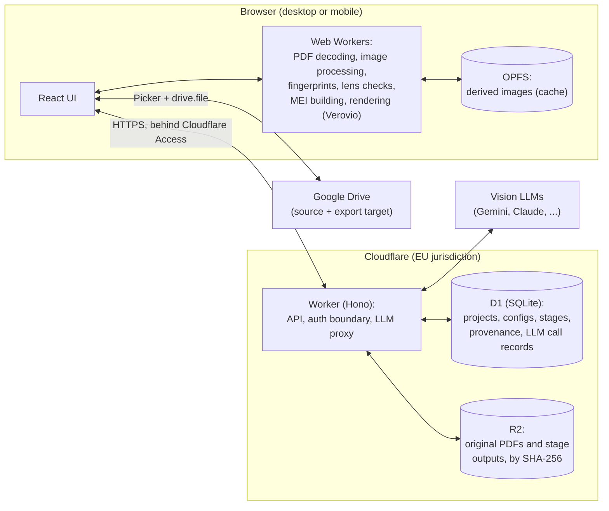

# score3ly: overview

The whole picture of score3ly: what it is, its architecture, the pipeline model, the stages in short, and the decisions with their reasons. Progress is tracked in one place, the checklist of the first release (§16); everything still to do is in [tasks.md](tasks.md). Items marked **proposed** are leading candidates, not final decisions.

## The docs

Everything beyond the overview is in the files below, each about one topic; the overview keeps a short summary of each. Read a file before working on its topic.

**General**
- [tasks.md](tasks.md): everything still to do, and only there: features, decisions to make, bugs, tests by hand, research, far-future ideas. The top of the file explains how the list works.
- [style.md](style.md): the style guide, how the app looks, speaks and behaves. Read it before building or changing anything the user sees.

**The app**
- [project-view.md](project-view.md): what the app shows around a project: the layouts, the artifact view, progress and toasts, the header, the pipeline panel and its stage cards, the cards of dropped stages, the confirmation before a re-run, the pages of the menu. Read it before working on those screens.
- [database.md](database.md): the D1 tables, the Worker's requests while a stage runs and for manual stages, carried manual stages, interrupted runs, deleting a project. Read it before working on the Worker's pipeline code, the migrations or deletion.
- [statistics.md](statistics.md): the Statistics page beyond its costs: why its tabs differ, Usage, Run times, Effort, how active time is counted, the mock data. Read it before working on the statistics (the costs are in llm.md).
- [llm.md](llm.md): how the Worker calls the LLM providers, call records and the cache, model configs and which one a stage uses, supported models and prices, costs, the costs view and the spending cap. Read it before working on providers, model configs, prices or costs.
- [images.md](images.md): page images from PDFs, deterministic image operations, fingerprints, device constraints and the image cache (this overview's §8 subsections, by the same numbers). Read it before working on `packages/imaging` or the image cache.
- [desktop.md](desktop.md): the desktop app, *cadenza* (Electron, the Node adapters, the secrets file, packaging). Read it before working on `apps/desktop` or on what differs between hosts. For users, how to build and install it: [apps/desktop/README.md](../apps/desktop/README.md).

**The music**
- [notation.md](notation.md): how the music is written down: the lens and its symbolic format (what models read and write), MEI (what users get), what is music and what is typesetting, stretches and measures, issues and warnings. Read it before working on the music stages, the prompts that write or read music, `packages/notation`, or the MEI.
- [stages/](stages/): the details of the stages, one file per group. Read the file of the stages a task touches before working on them:
  - [pages.md](stages/pages.md): `rasterize`, `skew_analysis`, `fix_skew`, and how the skew is found (`findSkew`) and when a page is deskewed.
  - [layout.md](stages/layout.md): `layout` (its prompt, rounds and checks) and `fix_layout` (the editor of boxes and bar lines, and the page editors' shared parts).
  - [analyze.md](stages/analyze.md): `analyze` (its prompts, the observations, their checks), `fix_metadata` and `fix_observations` (the forms), and the metadata (its fields and the MEI's header).
  - [music.md](stages/music.md): `extract` (its request, checks and loose ends across systems), `review`, `apply_review`, `human_review` (its screen), the Transcription, and zoom crops on request.
  - [engrave.md](stages/engrave.md): `engrave` (the MEI view, the PDF, the downloads and the run report) and `fix_mei` (the MEI editor and its checks).

**Quality**
- [evaluation.md](evaluation.md): the test set, the evaluation tooling (`apps/eval`), the baselines and the manual run. Read it before working on `testset/` or `apps/eval`, or judging results. The test set's own [README](../testset/README.md) lists its files, why each piece was picked, and how to use the tooling.

**Where decisions go:** into the file that covers the topic, this overview or one of the files above. When a decision changes something this overview sums up, its summary is updated too.

## 1. What this app is

A web app that converts PDFs of music scores into a formal, text-based encoding of the music: **MEI** (`docs/notation.md`, "MEI").

- **Input:** a PDF, usually a scan of an old score, sometimes a digitally typeset (vector) PDF.
- **Output:** an MEI file (the **export format**), with an engraved rendering for side-by-side comparison with the original. Inside the pipeline, the models read and write a compact format built on LilyPond's notation instead (the **internal format**, `docs/notation.md`, "The lens").
- **Focus:** the **pipeline**, not just the end result.
  - Every step is configurable.
  - Every intermediate input and output can be inspected.
  - Any part of the pipeline can be re-run from the first stage that went wrong, with a different configuration.
  - Any intermediate artifact can be edited by hand, and the pipeline resumes from the edited version.
- **Recognition is done by vision LLMs** (e.g. Gemini, Claude), steered by programmatic steps and human assistance. Programmatic steps handle the deterministic work: image handling, structure, checks, assembly. Humans assist where machines are unreliable, for example cropping heavily ornamented old scores.

### Why a text encoding, and which one
Two goals decided what score3ly should produce:
- **A: work with a score that exists only as a PDF:** convert it, edit it, render it anew. Any good notation format would do, MusicXML with MuseScore included.
- **B: give the music to an LLM** for analysis or generation, e.g. a simpler version for a beginner. score3ly itself does neither, but its output should make them possible. MusicXML is a poor fit here: verbose, full of typesetting, and its durations are tick arithmetic (`<divisions>`, `<backup>`, `<forward>`).

**What models write** (the lens, §6) had to be compact and natural for a model:
- **ABC:** compact, and the format LLMs know best, but weak for dense piano polyphony and cross-staff notes.
- **kern** (Humdrum): a time grid, one column ("spine") per staff and one row per moment, used in research because image-to-sequence models need a compact linear target. Simultaneity is explicit, but melodic lines are scattered down the columns, and every row needs one token per column, which is fragile to generate.
- **LilyPond:** melodic lines stay contiguous and readable, for people and models alike; simultaneity needs duration sums, which code checks. **Chosen,** as a format of our own built on its notation (`docs/notation.md`, "The symbolic format").

**What users get** had other requirements:
- everything musical, as opposed to typesetting: pitches, durations, rests, ties, slurs, articulations, tremolo, dynamics, and what a player needs: voices, cross-staff notes, stem directions;
- room for editorial notes and alternatives, clearly separated from the music;
- unambiguous to parse, and, once what isn't musical is removed, one way to encode given music, or equivalences that are trivial to recognize. No format guarantees that by itself: it takes a normalizer, and ours is the conversion from the lens (§6);
- conversion to other formats. Lossless conversion to ABC or kern is impossible (they express less).

**MEI fits best** (`docs/notation.md`, "MEI"): XML from the musicology community, with the musical content apart from the layout, pitches as name and octave, durations as note values (no ticks), written and sounding values kept apart (`accid` and `accid.ges`), dynamics, slurs and the like attached to notes, irregular measures marked as such (`@metcon`), editorial markup (`app`/`rdg`, `choice`, `supplied`, `unclear`, `annot`), links to image regions (`facsimile`), and MEI Basic, an official subset with "one way of encoding for every feature". Verovio renders it in the browser and keeps the MEI's ids in its SVG. MusicXML was the fallback (the best ecosystem of tools, but heavy normalization and weak editorial markup); the other formats would be views derived from MEI. Export to them is a later question: no converter between MEI and LilyPond exists in either direction, and Verovio doesn't write MusicXML.

**Considered and dropped:** starting from an OMR tool's MusicXML, checking it in code, and letting an LLM fix only the measures that fail the checks. Cheap, but no OMR output tested is good enough to start from (`docs/evaluation.md`, "Baselines"), and turning MusicXML into LilyPond (`musicxml2ly`) loses things: MusicXML moves a time cursor back and forth between voice numbers where LilyPond has continuous voices (and voice identity is musical information for piano), its data is redundant and often inconsistent (`<duration>` and `<type>`, `<alter>` and the printed accidental), and the converter has gaps (cross-staff notes, changing staff counts, pedal, ornaments, octave marks).

### Lessons from v1
v1 was Python-only, local-only and command-line-only.

**What failed:** heavy programmatic preprocessing (cropping, deskewing, stain removal) followed by Audiveris (MusicXML) and `musicxml2ly`.
- Ornamented old scores were impossible to handle with scripts.
- Audiveris failed badly on them.

**What carries over:**
- The stage-tracking system: detecting finished stages, resuming interrupted runs, re-running stages, with hash checks and JSON documentation. It is the basis for §5.
- Some LilyPond conventions, now part of the lens (§6): absolute pitches, so that an octave error doesn't propagate, and code, not the model, building the score's structure.

**Where v2 starts from:** experience from other projects shows that current vision LLMs read difficult material very well, at a cost of cents per call.

### Scope
- **The scope is music in conventional Western staff notation** (decided; also called common music notation): notes on staves of five lines, with clefs, key and time signatures, noteheads with stems, beams and flags, rests, bar lines, and the marks that go with them. For any instrument, voice or ensemble, and any genre: piano, voice and choir, chamber and orchestral music, lead sheets, Baroque continuo, popular music. **Unpitched percussion is in it too** (decided), since orchestral music needs it from Beethoven's Ninth on (bass drum, cymbals, triangle, …): one-line staves, or five-line staves with a percussion clef, where a note's position means an instrument rather than a pitch. Every decision about the format and the stages is made with all of it in mind.
- **Outside the scope:** other notations. Tablature (decided); probably also, by the same reasoning, chant neumes, early music's mensural notation and graphic scores.
- **Reached step by step:** what the scope holds is covered release by release, not all in the first one. Lyrics, chord symbols, alternative versions and much else come later (§15). Until something is covered, the model writes its best workaround and raises a format issue (`docs/notation.md`, "Issues"), and the format gap report shows what to cover next.
- **Piano music is the project owner's background, not the scope:** it is where most of the examples, the knowledge and the test set come from, and when something has to wait for a later release, what piano music needs tends to come first. It is also hard enough to test the design: multiple voices per staff, the staff count changing mid-piece (e.g. 3 staves in a passage, 2 elsewhere), lyrics below systems, editorial notes, ossia and alternative versions, a reduction staff for an orchestral part, two-piano double systems.
- **Possible later: image input (PNG, JPEG)** in addition to PDFs. It is almost no extra work: an image is a page image, so it skips PDF extraction and joins the same pipeline at `rasterize` (§6), with JPEGs going through the same bundled decoder (§8.1).

### Goals
- **Quality first:** the measure of success is how good the transcription is and how little human correction it needs. Infrastructure only exists to serve that.
- **Cheap:** runs on free tiers. Paid LLM calls are the only expected running cost.
- **Transparent:** open source, simple deployment, documented strategy (these docs).
- **Runnable from anywhere:** start on the desktop, continue on the phone. Every pipeline stage should work on both.
- **Reproducible and testable:** every stage output (§5.2) can be traced back to its inputs, code version, prompt version, model and configuration. Non-deterministic parts (LLM calls, human input) are recorded so they can be replayed (§12).

### Non-goals (for now)
- Multiple users, sharing, collaboration. Each person deploys their own instance to their own Cloudflare account, or runs the desktop version (§3), with their own secrets, so the app has no user accounts and none are planned.
- MusicXML output, or any export but MEI (§9).
- Other input formats (LilyPond, MusicXML), with score3ly as a normalizer that turns music written in any of them into its well-behaved MEI, a starting point for further work by machines.
- Fixing printing mistakes: the transcription is as printed (`docs/notation.md`, "Issues").
- Offline-first operation.

## 2. Architecture overview



### Where data lives

| Data | Location | Why |
|---|---|---|
| Original PDFs | R2, key = SHA-256 of the file bytes | Source of truth. About 0.66 GB for 200 PDFs, well within R2's 10 GB free tier. Identifying PDFs by content makes deduplication and "resume an existing project?" trivial. |
| Projects, step configs, stages, one row per stage output (§5.2), provenance, fingerprints | D1 | Small, structured, relational. SQLite is easy to inspect and migrate. |
| The content of stored stage outputs (analysis JSON, extractions in the internal format, issues, MEI files, human operations) | R2, key = SHA-256 of the content | Small, must never be lost, often not reproducible. One storage mechanism and one rule for everything stored (see below), plain files in the desktop version (§3), and far more room than D1 has. Content can't be queried there, so whatever the app filters or sums on (costs, counts, types of findings) is also a column in D1. |
| LLM call records (full request + response) | D1 (large payloads in R2) | Needed for provenance, cost tracking and replay tests (§12). |
| Derived images (page images, preprocessed pages, system crops) | OPFS on the current device | Large (roughly 150–300 MB per PDF in colour, a third of that in grayscale) but regenerable from the PDF plus the recipe. Device-local means real deletion, no cloud quota, and no data residency issue. |
| Final exports (the MEI file, optionally its engraved PDF) | Download, or an app-created folder in Google Drive | The user's own file space. Browsable anywhere. |

### Why this split
- **No server-side compute.** Workers have tight CPU limits and no native libraries. All heavy processing happens in the browser, so the Worker stays a thin API and LLM proxy, and stays on the free tier. Waiting on an LLM response doesn't consume Worker CPU time.
- **Images are cache, not data.** This removes the biggest storage cost entirely. Switching devices costs some regeneration time, not storage.
- **Everything persistent is small** (rows in D1) or **content-addressed and immutable** (R2).
- **Every object in R2 is stored under the SHA-256 of its bytes,** not only the PDFs. Objects never change: changed content is a new object under a new key. So a repeated upload is harmless, the browser can cache every object for good, a fork (§15) copies no objects, and the hash that a stage's validity check needs anyway (§5.2) is also the key. The price is that an object can't simply be deleted with the row that refers to it, since other rows may refer to it too (§4).

## 3. Technology decisions

| Area | Choice | Reason |
|---|---|---|
| Language | TypeScript everywhere | One set of types shared by the UI, the processing code, the Worker and the DB rows. The v1 Python code is being rewritten anyway. |
| Frontend | React + Vite | Familiar. Deploys to Cloudflare as static assets without changes. |
| Backend | Cloudflare Worker, HTTP layer on Hono | Web-standard `Request`/`Response`, minimal and portable. |
| Database | Cloudflare D1, created with `--jurisdiction eu` | SQLite semantics, free tier, EU data residency. The jurisdiction can only be set at creation. |
| Object storage | Cloudflare R2, bucket created with EU jurisdiction | 10 GB free, no egress fees, native Worker binding. The jurisdiction can only be set at creation. |
| Auth | Cloudflare Access in front of the whole app | No auth code in the app. |
| Device storage | OPFS (Origin Private File System) | Supported by Firefox, Chrome and Safari. Fast binary access from Web Workers. |
| PDF handling | pdf.js, version pinned | Renders vector PDFs and decodes CCITT, JBIG2 and JPEG 2000 images in JS/WASM, deterministically. |
| JPEG decoding | pdf.js's own JavaScript decoder, not the browser's (pdf.js would use the browser's `ImageDecoder` where there is one; it is switched off, §8.1) | Browser JPEG decoders may differ by about ±1 gray level. A decoder in our bundle gives identical pixels everywhere. |
| Vision LLMs | The user's choice, per stage (§7.2). Recommended: Claude Opus 5.5 for everything. | In the manual run (§13) Opus did best at everything, layout included. Providers are swappable behind the `LlmProvider` port. |
| Structured LLM output | Provider-native schema-constrained output, validated with Zod | Machine-checkable outputs. No free-form parsing. |
| Schema validation | Zod (or similar) | Validates step configs, LLM outputs and DB payloads. The same schema generates the UI controls (toggles, sliders). |
| Rendering | Verovio (WASM) in the browser, rendering the MEI | Keeps rendering runnable everywhere, with no native program. See §9. |
| Google Drive | Google Identity Services + Google Picker + `drive.file` scope, entirely in the browser | `drive.file` is non-sensitive: no app verification, and access only to files the user picks or the app creates. |
| Local development | `wrangler dev` (local D1/R2 emulation) + Vite dev server, run as two processes. Vite proxies `/api` to Wrangler. No Cloudflare Vite plugin. | One code path from day 1. Keeps the app and the Worker as separate packages with a clear boundary. |
| Deployment | One Worker with static assets: `apps/worker`'s Wrangler config serves `apps/web`'s build output. `wrangler deploy` uploads both. | One origin: no CORS, one Access policy, app and API always deployed at the same version. |
| Tests | Node's test runner (`node --test`) | Pure-TS core runs in Node for unit, golden-image and replay tests; no test framework to install. |

### Repository layout

```
packages/
  core/      What more than one app needs (built): content keys and SHA-256, the Project type; and as entry
             points of their own, drawing a PDF page in a browser (`/pdf`) and the Vite plugin serving
             pdf.js's data files (`/pdfjs-assets`). The main entry runs in browsers, Workers and Node.
             (The step definitions and the pipeline's logic live in apps/web for now: only it runs them.)
  imaging/   Page images from PDFs, deterministic image operations (skew, rotation, scaling, crops, PNG),
             fingerprints. Pure TS/WASM.
  notation/  Lens parser and checks, measure building from stretches,
             MEI builder (the frame from the structure and metadata, the music from the lens).
  prompts/   Versioned prompt templates and their output schemas.
apps/
  web/       React UI, Web Worker host, OPFS + Drive + local-file adapters.
  worker/    Hono API, D1 + R2 adapters, LLM provider adapters.
  desktop/   The desktop version (§3): the Worker on Node, in an Electron window.
  eval/      Local evaluation tooling: engrave command, side-by-side viewer (§13).
fixtures/    Recorded test projects (§12).
testset/     Evaluation test set (§13): inputs, their strokes and .ly/.musicxml candidates committed, rest ignored.
docs/        The documentation: this overview, and the files it lists under "The docs".
```

The Worker's entry module (`apps/worker/src/index.ts`) may only export handlers: the Workers runtime refuses to start otherwise, and the tests (which import the module directly) don't notice. Helpers live in their own modules (e.g. `names.ts`).

### License
**score3ly is licensed under the GNU Affero General Public License, version 3 or (at the user's option) any later version** (`AGPL-3.0-or-later`; decided, 2026-10-24; `LICENSE`, added by the project owner; the license's own notice in the README, and the SPDX id in the root `package.json`). **The license is done** (decided): nothing about it is left to decide or build; only the third-party notices are kept up to date, by their test. In short: anyone may use, change and share the code, but whoever shares it, or lets others use a changed version over a network, must offer its source code under the same license. Chosen over a permissive license (MIT, Apache-2.0) to keep options open: no one can run a closed copy as a service, and a paid hosted version or a commercial license stays possible for the copyright holder (who should then accept outside contributions only with a contributor agreement). Moving to a permissive license later is easy; the reverse isn't. "Or later" (decided) lets the code also be used under future versions of the AGPL that the Free Software Foundation may publish.

**What we use from others** sets conditions of its own, all met by passing on their notices: permissive licenses (MIT, Apache-2.0, BSD, 0BSD, the Unlicense) for the libraries; the SIL Open Font License for the fonts (Inter, JetBrains Mono, and Leipzig's metronome glyphs, §6, "Tempo marks"); the Educational Community License 2.0 for the MEI schema the web app loads (Fix MEI). **Verovio is LGPL-3.0:** the app may be under any license, as long as Verovio's license and source are offered and users can replace it with another build (it is a separate WebAssembly module), and changes to Verovio itself would have to be published under the LGPL.

**Third-party notices** (built): `THIRD_PARTY_NOTICES.md`, made by `npm run notices` (`scripts/notices.ts`, whose header says what it includes); a test fails while it is out of date. The About page links to it.

### Ports and adapters

The core depends only on interfaces. Adapters live in `apps/*`.

| Port | Adapters |
|---|---|
| `PdfSource` | Local file input, Google Drive (Picker) |
| `BlobStore` (original PDFs, stage outputs) | R2 via the Worker. A folder of files (desktop version). In-memory for tests. |
| `ProjectStore` (projects, stages, output rows, provenance) | D1 via the Worker. A SQLite file (desktop version). SQLite or in-memory for tests. |
| `DerivativeCache` (regenerable images) | OPFS. In-memory for tests. |
| `LlmProvider` | One adapter per provider (via the Worker). **Replay** adapter for tests. |
| `Renderer` | Verovio in the browser. See §9. |
| `ExportTarget` | Browser download, Google Drive folder |

### Desktop version
In `docs/desktop.md`. In short: an optional desktop app, *cadenza*, wraps the same code for people who would rather not set up Cloudflare: Electron, whose main process runs the Worker's Hono app on `127.0.0.1` with small Node adapters for D1 (`node:sqlite`) and R2 (a folder of files), and the secrets in a local file. The web app on Cloudflare is *concerto*. **The rule that keeps it cheap:** the web app only talks to the Worker's HTTP API, and the Worker only touches Cloudflare through its D1 and R2 bindings and its secrets; anything Cloudflare-only beyond those goes behind a port with a desktop equivalent. The server says which host it is (`GET /api/info`), and nothing else in the app decides by host. Users build the app themselves (`npm run package:desktop`); no code signing, no downloadable builds.

## 4. Identity and projects

- A PDF is identified by the **SHA-256 of its bytes**, computed on the device with `crypto.subtle.digest` **before** uploading.
- When a PDF is selected, the app asks D1 whether the hash exists:
  - **Unknown:** upload to R2 at `pdfs/<sha256>.pdf` and create a project.
  - **Known:** offer to resume an existing project on this PDF, or start a new one. There can be several projects per PDF.
- The file name and source (Drive ID, local path) are stored as informational metadata only, never as identity.
- Each project has a **name**, so the user can tell projects on the same PDF apart (e.g. "Sonata, Claude run" vs "Sonata, Gemini run"). The name is a label, not the identity (that is the project ID), but it is unique so it can be relied on:
  - It defaults to the PDF's file name without ".pdf". If a project already has that name, the Worker appends " (1)", " (2)", ... and takes the first free one, like file managers do. A file that is already called `Sonata (1).pdf` becomes `Sonata (1) (1)`, also like file managers.
  - Uniqueness is case-insensitive ("Sonata" and "sonata" clash) and enforced by the database (a unique index, `COLLATE NOCASE`), so two projects created at once can't get the same name. Names are trimmed, never empty, and at most 200 characters.
  - The user can rename a project at any time ("Rename" in the project actions, §5.6). Renaming to a name that is taken is refused with a message, not numbered: numbering only applies to the default. Changing only the case of the project's own name is allowed.
  - Deleting a project frees its name.
- **Deleting a project** (built): apart from the costs and statistics, it is **as if the project had never existed** (decided): a new project with the same PDF, name and config runs every stage from scratch. What is deleted and what is kept (marked with `deleted_at`, for the costs), the dialog and orphan collection are in `docs/database.md`, "Deleting a project".
- Each project also has three timestamps, all set by the Worker (ISO 8601, UTC) so a wrong device clock can't scramble the order:
  - **created**
  - **last modified:** any change to the project's own data (pipeline results, manual stages, a rename). Opening or viewing doesn't count.
  - **last opened:** set by a dedicated request when the project is opened, so listing projects doesn't touch it.

  Both start equal to the creation time, so sorting needs no special case for "never".
- Concurrent edits from two devices are prevented by optimistic locking: each project has a version number, and stale writes are rejected with a reload prompt.

## 5. The pipeline model

The pipeline is designed like a small build system. The v1 stage-tracking system (hash checks, resumability, JSON documentation) is the starting point and is ported, not reinvented.

### 5.1 Steps and stages

- A **step** is a definition in the code: what is done, with which configuration options.
- A **stage** is one occurrence of a step in a project's pipeline, with its own configuration and its own results.
- A project's **pipeline** is the ordered list of its stages. It is stored in D1 and shown in the UI (in the pipeline panel, §5.6), so it has to stay short.

There are two sorts of stages:
- **Recipe stages** have a predefined order (§6, the recipe) and can run automatically, one after the other. (Not to be confused with the status `planned`, §5.8: a stage of any sort that hasn't run yet.)
- **Manual stages** are added by the user to intervene by hand (§5.4). They are recorded in the pipeline like any other stage.

The same step can occur more than once in a pipeline. Example: the review step run twice for extra accuracy, or once with one model and once more with another.

#### Run modes
A small drop-down in the pipeline panel sets, per project, how the pipeline runs:
- **Auto:** one click starts the pipeline (or resumes it), and it keeps going from stage to stage, following the recipe, until it is done or fails. If a model flags that it would like human input, the flag is recorded, but the pipeline goes on with the model's best guess. The spending cap (§10) also stops it.
- **Manual:** each stage is started by a click. This leaves time to look at the outputs and decide whether to step in with a manual stage or to run a stage again with other parameters.

The mode for new projects is a settings item. After installation it is "Auto". Built: `newProjectRunMode` in the settings (`/api/settings`), a drop-down like the panel's on the settings page, saved when picked; the Worker reads it when it creates a project.

The browser drives the pipeline, so in either mode a run only advances while the app is open (§15).

Each step declares:
- `id` and `version`, e.g. `extract@3` (see §11).
- A **config schema** (Zod), which is also the source of its UI controls.
- **Input** and **output types**.
- **Granularity:** per document, per page, or per system. Steps can fan out, e.g. one page becomes many systems.
- Its **kind:** `ingest`, `computed` (code), `llm` or `manual`, and nothing else (decided). `ingest` is the kind of the first stage only: it doesn't run (the PDF is given when the project is created), so the UI treats it apart (no run, progress or retry; it is done from the start), and its output is stored like LLM and manual outputs (§5.3).

Every stage runs in the browser, its heavy work in Web Workers; an LLM stage sends each of its requests through the Worker (§7.2), which makes the call.

While it runs, a stage **reports its own progress** as a fraction from 0 to 1, which the UI shows (§5.6):
- Only the code that performs the stage knows how far it is. It is handed a function to call whenever it has got further (e.g. after each system), and doesn't know about the bar or the circle that show the value. A stage running in a Web Worker can't call into the page, so there the function passes the value on as a message.
- **A single LLM call has nothing to report while it waits,** so its share of the bar fills with the time elapsed out of the call's timeout, and jumps to full when the answer arrives. If the timeout is reached, the call has failed. For a stage that is one call, the share is the whole bar; for a stage with a call per system, each call fills its own slice.

### 5.2 Outputs, artifacts and provenance

**Terminology** (decided):
- **Stage outputs** are internal: many and fine-grained, e.g. one per page, per system or per LLM request. They carry provenance and cache keys, have a row each in D1, and are what is stored or regenerated. They are saved as soon as each is done, so an interrupted or failed stage resumes where it stopped.
- **Stage artifacts** are what the user sees: few per stage, mostly for the whole score (the pages, the layout, the transcription so far, the MEI file, the issues), shown as tiles and in the artifact view (§5.6). A stage doesn't show 107 tiles for 107 systems. An artifact is built from the stage's outputs, as a view; some are stored as well for convenience (the MEI file for download), but an artifact never holds anything that isn't in, or computable from, the outputs. So provenance and caching live in one place, the outputs.
- **The export format** is what the user gets: MEI (`docs/notation.md`, "MEI"). **The internal format** is what the pipeline works with: the lens (`docs/notation.md`, "The lens"). There is no single storage format: the outputs may hold either or both, as the stages need; that is settled when they are built.

Every stage output has:
- `step id@version`
- a canonical config hash (JSON with sorted keys)
- the IDs of the outputs it was made from
- its `origin`: the kind of the stage that produced it (`ingest` | `computed` | `llm` | `manual`)
- for an image from which a stored result was computed, its fingerprint (§8.3)
- a timestamp

LLM outputs additionally reference their **call record**: prompt template version, filled-in context, the images' recipe keys and hashes, exact model ID, parameters, full response, token usage and cost.

**The cache has two levels** (decided):
- **Stage level:** the key is hash(step id, version, canonical config, the model's provider, model and effort for LLM stages, the content keys of the stage's inputs). An input's content key is the hash of its stored content, or the recipe key of a computed image (§8.6): content rather than row IDs, so a stage that produces identical content again (e.g. `layout` run again with the same boxes) doesn't invalidate what follows. If it matches, the stage is skipped and its outputs reused. Outputs of later stages may already exist when an earlier stage is run again with the same inputs and config: they are found through the key and reused.
- **Item level, when the stage's key doesn't match:** the stage runs, but each item checks its own key first: for an LLM request, the exact request including the model config (provider, model, effort; §7.2: an identical request is served from its record), with each image named by its recipe key; for an image, its recipe (§8.6). Cheap code just runs again. **Only recipes, never pixels, in any key** (decided): an image is identified by its recipe all the way from the PDF to the final crop, at the stage level and at the item level alike. Images made from the same recipe on different devices are taken to be the same, which our deterministic code makes them, or close enough (§8.1, §8.2); anything computed from an image is reused whichever device made the image. So a cached call is also found before its images are made, and a re-run on another device doesn't render and crop images only to find the answers stored. Fingerprints warn when an image turns out not to be close (§8.3). Requests contain only what they really use (§5.5), so fixing one page's boxes changes only the requests that depend on that page; a request that contains the whole score (`review`) changes with any change upstream, as it should.
- **What isn't part of any key:** a model config's plain parameters (the region, the project) and its secrets (§7.2). They choose where and with which credentials a request runs, not what the model is given. A parameter that some day does change the answer must be added to the keys.
- **Only usable answers are cached:** an error (no answer, a timeout) or an answer that fails to parse is recorded (call record, costs, §10) but never served from the cache, so a retry asks again.

Every output has a row in D1, which belongs to the stage that produced it and says whether its content is stored (in R2, under its hash, §2) or only its recipe (§5.3).

**Checking that stages are still valid:** a pipeline checks its stages against the hashes of their inputs and outputs. Stored content can change outside the app (e.g. files in the desktop version's data folder edited by hand), and a stage whose recorded inputs or outputs no longer match what is stored is not valid any more. How and when this is checked, and what the app does then, is still to be designed (§15).

### 5.3 Persisted vs. regenerable (important)

- **Computed** outputs (page images, straightened pages, crops) store only their **recipe** (and its key), plus a fingerprint for an image from which a stored result was computed (§8.3). Images live in OPFS and can be regenerated. Small text outputs may be stored anyway for convenience.
- **Ingest**, **LLM** and **manual** outputs **must be persisted**: everything that isn't computed. They cannot be regenerated: re-running an LLM call gives a different answer and costs money.
- Rule: *anything you would hate to lose must never exist only as a cached image.*
- **Regeneration is lazy, per device** (decided): a device computes a computed output only when something needs it, never the whole chain up front. Example: seven stages run on a laptop, and on the bus the user adds an eighth, manual stage on a phone. The phone has none of the laptop's images, but the eighth stage's inputs are there (stored outputs fetched from R2, or images regenerated from their recipes because the stage needs them), so the user simply continues. If the user then opens an earlier stage's images to inspect them, they are regenerated from their recipes then, and cached on the phone (§8.6).

### 5.4 Manual stages

The user intervenes by adding a manual stage to the pipeline. The manual stages foreseen so far:
- fix the lines that should be horizontal (`fix_skew`)
- fix the system boxes and bar lines (`fix_layout`)
- fix the metadata (`fix_metadata`) and the observations (`fix_observations`)
- answer the issues and correct the music (`human_review`, after any `apply_review`)

(The stages are listed in §6.)

Rules:
- **One manual stage covers the whole PDF,** however many items are fixed in it. Fixing the boxes on twelve pages is one `fix_layout` stage, not twelve. Otherwise the pipeline shown in the UI would get too long.
- The outputs of a manual stage have `origin = manual` and the corrected output as their parent.
- Edits to images are stored as **replayable operations**, not as edited pixels: lines that should be horizontal, boxes, bar line positions. Replaying them on the regenerated base image reproduces the edited result.
- Text outputs (metadata, observations) are stored whole, as edited, and name their parent (the output they correct); what changed is found by comparing the two.
- **Undo and redo exist only inside a tool for manual work,** while it is open. Leaving the tool saves, and after that nothing can be undone: the stage can only be edited further or dropped (§5.5).
- **A finished stage never changes.** Editing a finished manual stage creates a new manual stage, which starts from the finished state of the old one and takes its place in the pipeline. The old one becomes a replaced stage (§5.5) and stays in storage as it was. The reason is forking (§15): another project's pipeline can use the same stored stage, and it must not change there.

### 5.5 Resuming and re-running
- **The history of a project is linear.** There are no branches inside a project, and no undo.
- Changing something in the middle (e.g. the config of stage N, or a manual stage added there) means running everything after that point again. The later stages are replaced: they leave the pipeline and are no longer shown.
- To keep the old results and try something else, the project is forked (planned, §15), not branched.
- **Any stage that isn't part of the recipe can be dropped:** manual stages, and extra stages the user added, such as a further review. Dropping is a change in the middle like any other: after a confirmation, the pipeline continues from the stage before the dropped one, with the same rules (run mode, reuse where the inputs match). Recipe stages can't be dropped.
- **Execution is per item** (a page, a system), with each item's outputs saved as soon as it is done (§5.2).

#### What a re-run follows
A re-run follows **the pipeline as it was, not the standard recipe** of recipe stages, for as long as the outcomes stay the same. This is the intended behaviour, not yet a technical definition; the details are worked out when we get there.
- **A stage whose inputs and config are exactly the same is reused,** manual stages included. Example: the composer's name is corrected after a full run that also had a wrong note fixed by hand. Nothing that the note fix depended on changed, so the fix is still there after the re-run.
- **A manual stage whose input changed at all is dropped as a whole** (decided), even if only one page or system of its input changed, and none of its fixes is applied, and the pipeline continues with the planned stages. The typical manual fix is a better deskewing angle or better system crops on a difficult old score. The point of it is that the stages after it then produce very different, better output, which ideally no longer needs the manual fixes that the poor first attempt needed.
- **Stages must depend only on what they really use.** If an `extract` call got the whole metadata as context, composer included, correcting the composer would change the input of every `extract` call, and all of them would be paid for again.
- **A dropped stage leaves a card where it was** (decided, built, migration 0018: `dropped_stages`): a courtesy heads-up, since which stages are dropped depends on the outcome of the run, can't be said beforehand, and would otherwise go unnoticed. Kept stages need no report: they are in the pipeline. What the card shows, where, and until when: `docs/project-view.md`, "Dropped stages".
- **Extra reviews are dropped like manual stages** (decided; to build with the reviews, §6): a review added after the recipe's one (and its `apply_review`) is carried through a re-run, kept at its turn if its inputs are the same (it would come from the cache anyway) and dropped otherwise, with one card for the pair. Re-running them would be right for a user who always runs several reviews, and wrong for one who added one because the first review missed problems on this score, which a re-run may have fixed. Dropping them means what runs after the first `apply_review` is either not an LLM stage (`human_review`, `fix_mei`, `engrave`) or comes from the cache, so it is fast and free; a user who wants them adds them back, having paid for no unnecessary calls.
- **An `apply_review` goes with its review** (decided): dropping an extra review or a `human_review`, by the user or at its turn, drops the `apply_review` that follows it too. **The recipe's review can't be dropped,** even with further reviews after it (decided: keeping it simple).

#### Replaced stages
- **Replaced stages are kept in storage,** with their outputs and full LLM call records (requests and responses). They are reused whenever possible: a stage that runs again with the same inputs and config, or an identical LLM request (§7.2), is served from what is stored and costs nothing.
- **They stay connected to their project in D1,** although the pipeline no longer shows them, so that deleting the project (§4) finds and deletes them too. Until then, a project's storage only grows.

#### Confirmation before a re-run
A dialog asks for confirmation before anything is replaced (decided, built in `ProjectView.tsx`). It shows when a change replaces stages that have already run (done, failed, WIP or running): a new config for a stage that has run or is followed by one that has; a manual stage added, or a finished one edited, where a stage after it has run. Dropping a stage always asks. What it says (simple and almost generic), its title, text and buttons: `docs/project-view.md`, "Confirmation before a re-run".

### 5.6 How the app shows a project
In `docs/project-view.md`: the two layouts, the artifact view, progress and toasts, the header, the pipeline panel and its stage cards, and the pages of the menu. In short:
- **The pipeline is the main attraction; the artifact view is secondary.** Wide screens (from 1024 px) show the pipeline panel on the left and the artifact view on the right; narrow ones show only the panel, and what is picked in it opens over the whole app.
- **The pipeline panel** lists the stages as cards, top to bottom, each with its artifacts as tiles; a stage's actions are in its "⋮", and the card keeps only its next step (Run, Retry, Finish). The run mode, the pipeline's progress and Run or Stop are in the panel's head.
- **Everything that opens has a URL** (a project, an artifact, a stage's details, a page from the menu), so back closes it and a reload keeps it.
- **Leaving a project loses nothing:** manual work is saved as it happens.

### 5.7 Look and feel
The look of the app (colours and themes, type, components, the brand: wordmark, accent, fonts, icon) is in the style guide, `docs/style.md`; the screenshot script that shows every screen in every theme is in §12. Besides:
- **Installed, the app opens as an app** (decided, built: the manifest's `"display": "standalone"`, with `id`, `start_url` and `scope` "/"): from a phone's home screen, or installed from a desktop browser, it gets its own window or the whole screen, without the browser's bar. It then shows its own back and forward buttons (`docs/desktop.md`, "Navigation"). Opened in a browser tab, nothing changes.

### 5.8 The database
In `docs/database.md`: the tables of D1 and what each row holds, the Worker's requests while a stage runs and for manual stages, carried manual stages, interrupted runs, deleting a project, page counts. In short:
- **The pipeline is a list of pointers** (`pipeline_entries`) to stages (`stages`), which are shared, not owned: a fork copies pointers, never stages or outputs. Planned stages have a row too.
- **Every output has a row** (`outputs`), with its content's hash (stored in R2) or its recipe (computed), and the outputs it was made from; every LLM call has a row (`llm_calls`), with its request and response in R2, its tokens and cost.
- **The browser does the work, the Worker records it:** a stage's start, its outputs as each is done, a heartbeat once a minute, its end.
- **Deleting marks rows instead of deleting them,** for the costs, and every cache lookup ignores marked rows.
- **Two kinds of settings:** the user's, in D1, and the device's, in the browser.

## 6. Pipeline stages

### The stages

Stages marked **[manual]** are optional and added by the user (§5.4). The last column lists each stage's artifacts, what the user sees (§5.2); its outputs are finer, e.g. one per page or per system. Everything else is the recipe. Each stage has a short identifier, used throughout the docs.

| # | Id | Stage | Kind | Artifacts |
|---|---|---|---|---|
| 1 | `ingest` | Ingest | ingest | The PDF (R2) |
| 2 | `rasterize` | Rasterize | computed | All page images, as one artifact. Not stored: reproduced from the config (§5.3) |
| 3 | `skew_analysis` | Skew detection | computed | The pages, not rotated, with the staff lines found drawn in red, each labelled with its angle. Stored per page: at most 5 lines, the page's angle, the confidence and the staves (§8.4). No rotated images, and no decision whether to rotate |
| 4 | `fix_skew` | Fix the lines **[manual]**, after `skew_analysis` | manual | The lines, as in `skew_analysis` |
| 5 | `layout` | Layout | LLM, per page | The layout: the straightened pages with the system boxes and the bar lines drawn over them. Stored per page as JSON |
| 6 | `fix_layout` | Fix system boxes and bar lines **[manual]**, after `layout` | manual | The layout, as in `layout`; the editor while it is WIP |
| 7 | `analyze` | General analysis | LLM, per page and for the whole score | Metadata (including the pieces and where they start) and Observations, as views. Stored as JSON: the metadata, the observations (one document: the pages' items as the whole-score call corrected them, including the special bar lines, and the score-wide items), and `pieces`, where the pieces start, taken from the metadata as an output of its own for `extract` |
| 8 | `fix_metadata` | Fix metadata **[manual]**, after `analyze` | manual | JSON: metadata |
| 9 | `fix_observations` | Fix observations **[manual]**, after `analyze` | manual | JSON: observations |
| 10 | `extract` | Extraction | LLM, per system | The Transcription (see "The Transcription"): each system's crop with its rendering, the issues and the warnings on it. Stored per system: its answer in the lens, its issues and warnings |
| 11 | `review` | Review | LLM, per system | The Transcription, with the issues as the review left them |
| 12 | `apply_review` | Apply review | LLM, per system | The Transcription, as the review's answers changed it, with the issues (what was applied) and the warnings |
| 13 | `human_review` | Human review **[manual]**, after any `apply_review` | manual | The Transcription as a form: the issues answered and added by the user. An `apply_review` is added after it automatically |
| 14 | `fix_mei` | Fix MEI **[manual]**, after the latest stage that produces the extraction, right before `engrave` | manual | The MEI, edited as text: the MEI view, editable while WIP |
| 15 | `engrave` | Engrave | computed | The full score's MEI (with syntax highlighting and navigation) and its engraving as a PDF; the card has a download button for both. Always the last stage |

- **No manual fixes of the music before the first review.** The first point where the user corrects the music is `human_review`.
- **The recipe has exactly one review** (`review`, followed by `apply_review`). **Further reviews** can be added by hand after it, as many as the user wants, with the same or another config. Adding a review, by hand or after a human review, always adds its `apply_review` after it. Further reviews are dropped with their `apply_review`, and carried through a re-run like manual stages, kept only if their inputs stay the same; the recipe's review can't be dropped (§5.5).
- **Manual stages after an LLM stage** are added from its "⋮": `fix_layout` after `layout`; `fix_metadata` and `fix_observations` after `analyze`. "Fix X manually" is only in the "⋮" of the stage that creates X (decided), so both are in `analyze`'s. **The second of the two goes right after the first** (decided, built): nothing needs an order between them (they edit different outputs of `analyze`), and inserting it directly after `analyze` would carry the first (§5.8), for no reason. It can be added while the first is still WIP. Dropping the first carries the second, which is kept if its input comes out the same (§5.8).
- **Two stages read the pages** (decided): `layout` finds where things are, `analyze` says what they are. `analyze` runs after `fix_layout`, so it sees the final layout: code draws the systems and bar lines on each page, numbered, and the observations refer to those labels. Each has its own model config (§7.2: finding layout boxes, extracting metadata), and a better prompt for one doesn't re-run the other. The price is that every page is sent twice, small next to one `extract` call per system.
- **No skeleton stage** (decided; an earlier draft had one, an MEI file with a placeholder per measure). What it was for (a fixed structure, assembly as filling in, a check that the extraction returns exactly the measures asked for) needs no stored MEI: code builds the MEI frame from the structure whenever it is needed (`docs/notation.md`, "MEI").
- **A stage exists where there is a config or a decision** (decided). A pure function of other stages' results is a view, not a stage. So there is no skeleton stage (above), and no stages for the straightened pages or the crops: the angles and boxes are decisions of other stages, and rotating and cropping are fixed operations (§8.2). Those images are computed when something needs them (a view, an LLM request) and cached on the device (§8.6); stages wouldn't add anything but cards in the pipeline and a second copy of every page on the device. They are shown as views of other stages' outputs: `extract` shows each system's crop with its music below it (the filmstrip, §5.6). `rasterize` stays a stage: its config (the resolution for vector pages, perhaps colour or grayscale, §15) changes every image after it, and its pages are the natural first view.
- **The structure is final before `extract`.** The structure is what decides which pixels the models see: the skew angles (`fix_skew`), where the systems are on each page and where the bar lines are on each system (`fix_layout`). `extract` is shown system crops and stretch crops, and if it is shown the wrong part of the page, no model can make up for it. So every fix of the structure comes before `extract`, and no later stage changes it; a mistake in it found later is fixed by going back to `fix_layout`, which replaces everything after it (§5.5). The pieces or movements (`fix_metadata`) are fixed before `extract` too: nothing carries over a piece's boundary (see `extract`), and the MEI's sections and the numbering restart there. `extract` reads only where the pieces start (the `pieces` output, see `analyze`), not the rest of the metadata.
  - **Everything else is content,** read by `extract` and open to correction by the stages after it: how the stretches between bar lines form measures, the kinds of measure and of bar line, and so which measures exist and how they are numbered; and the `scoreDef` (clefs, keys, time signatures, staff labels and groups). Those are hard for a model to get right from a whole page (the stretches need the note durations read), and easy to correct later, now that no MEI is built in advance. A user of an automated app shouldn't be asked to transcribe them by hand before anything is extracted.

#### The stages in short
- **`rasterize`, `skew_analysis` and `fix_skew`:** in `docs/stages/pages.md`. In short: `rasterize` makes one image per selected page (a scan's own pixels, a vector page drawn at a chosen resolution); `skew_analysis` measures on each page up to 5 lines that should be horizontal and stores them, deciding nothing; `fix_skew` lets the user delete, move and draw those lines. Whether and by how much a page is straightened is a function of its lines, computed by the stage that first sends the page anywhere (`layout`).
- **`layout` and `fix_layout`:** in `docs/stages/layout.md`. In short: `layout` asks a model, page by page, for a box around each system and the positions of the bar lines inside it (not those at its start and end), in up to 3 rounds where code draws the answer on the page and the model corrects it; a page it isn't satisfied with is flagged for a person. `fix_layout` is the editor where the user draws, resizes and deletes boxes and bar lines. Both write one `layout` output per page. Three things that hold beyond them:
  - **Every box in the app is in our format:** `{ left, right, top, bottom }`, fractions of the image's width and height from 0 to 1 (systems, issues, zooms, crops), not a provider's.
  - **Boxes are tight** around everything that belongs to the system; **margins are code's,** added by one rule where crops are cut (`extract`).
  - **Systems are numbered top to bottom, continuing from page to page,** and drawn in 7 colours that colour-blind people can tell apart, cycling; a system's bar lines have its box's colour.
- **`analyze`, `fix_metadata` and `fix_observations`:** in `docs/stages/analyze.md`, with the metadata's fields and how they fill the MEI's header. In short: `analyze` reads every page with the final layout drawn on it, one call per page and then one for the whole score, and gives the metadata (what is printed about the work and the edition), the observations (a bird's-eye view of the music for `extract`: staves and instruments, changes, special bar lines, endings, directions, notes for the whole score) and `pieces` (the system where each piece starts). `fix_metadata` and `fix_observations` are forms in which the user corrects and confirms them. What holds beyond them:
  - **Confidence:** every item a model reports has a confidence, low, medium or high; a user's confirmation is stored beside it (`confirmed`), never instead of it. The views show ???, ?, a grey ✓ and a green ✓ (confirmed).
  - **Places are labels drawn on the page,** read by the model, never counted: a system's start, one of its inner bar lines (1 to n), a stretch (1 to n + 1), its end. A person picks them from the same list, by name.
  - **Observations are hints, not ground truth:** `extract` checks them against what it sees.
  - **Code links items when the links are needed, not before** (an end repeat to its start, an ending to its repeat, a span across systems): at the start of `extract` (from the observations), of `review` and of `apply_review` (from the current extraction), and in the checks of the whole score. No links are stored, by a model or a person.
  - **Pieces start at a system,** and `pieces` always starts with system 1. `extract` reads only `pieces`, not the rest of the metadata.
  - **The metadata reports only what is printed;** the user can add anything in `fix_metadata`.
- **`extract`, `review`, `apply_review`, `human_review` and the Transcription:** in `docs/stages/music.md`. In short:
  - **`extract`:** one call per system, in the score's order, with the system's crop and its stretch crops, the neighbouring systems' crops, all the observations, and what code carries over from the previous system (the state, the marks left open, whether the last measure continues); nothing carries over a piece's boundary. The model writes the lens (below), never MEI, and reports its doubts as issues. Each answer is checked as soon as it arrives; an answer that can't be used stops the run there, the answers before it kept.
  - **`review`:** one call per system, with the whole score in every call; it writes issues only (never the music), and sees what the earlier calls changed through an append-only log, which keeps prompt caching working.
  - **`apply_review`:** one call per system where an issue that needs applying begins; it answers with a typed patch of only what it changes, stretch by stretch. A change outside the issues' boxes needs a reason and becomes a warning.
  - **`human_review`:** the user answers the issues, and adds their own, on the original score. Every correction, the user's too, is applied by `apply_review`, an LLM call, never by code; nobody edits the source directly before `fix_mei`.
  - **The Transcription:** the artifact of all four, a filmstrip of the systems, each crop with its music rendered below it and the issues and warnings as boxes on the crops.
  - **Models don't get renderings,** at first: they compare the crops with the lens as text.
  - **Zoom crops on request** (a later version): the model may ask once for closer crops, without tool calls (`docs/stages/music.md`, "Zooming in").
- **The checks by code have no stage of their own:** validation happens inside `extract` and `apply_review`, on the lens, after each system and for the whole score at the stage's end. Problems that code finds without failing the stage are issues raised by code when they are a question about the page (a slur that never ends: "where does it end?"), and warnings otherwise (a measure whose durations don't add up; see `docs/notation.md`, "Warnings").
- **No `assemble` stage** (decided; an earlier draft had one, to build the full MEI after `extract`). Building MEI is code, and nothing before `engrave` needs the full score's MEI:
  - **the checks of the whole score** (loose ends, the repeat structure, measures across systems, measure numbers) run on the lens at the end of `extract` and of `apply_review`, not on MEI, so their warnings come while reviews can still act on them;
  - **each system gets a small MEI of its own, rendered** (see "The Transcription"), as a view;
  - **the full score's MEI is built by `engrave`,** at the end.
- **`engrave` and `fix_mei`:** in `docs/stages/engrave.md`. In short: `engrave` is always the last stage: it builds the full score's MEI from the latest extraction, layout, metadata and pieces (or takes `fix_mei`'s MEI as it is), engraves it with Verovio, and offers the MEI, the engraved PDF and a report of the run for download; its main artifact is the MEI view, the file beside its engraving, linked both ways. `fix_mei` is the only place where the user edits the MEI directly, as text, checked against MEI's schema before it is applied; it comes right before `engrave` and nothing else can come after it, since a direct edit makes the issues unreliable. What holds beyond them:
  - **The engraving has Verovio's own breaks,** never the original's: the PDF always engraves exactly the MEI it comes with. Matching the original system by system is the review's business.
  - **The MEI is what is stored;** the PDF is made again from it when it is needed.

#### The notation
In `docs/notation.md`: the lens, the symbolic format, MEI, what is music and what is typesetting, stretches and measures, the issues and the warnings. In short:
- **Two formats:** MEI is the export format, what users get. The lens is the internal format, what models read and write: JSON for the structure, with strings in the symbolic format (LilyPond's notation, borrowed, not a subset of it) for the music of one voice in one stretch. Code builds the MEI from the lens; models never write MEI.
- **The model reports what is printed, and code works out the rest:** the accidentals printed, not the pitches they mean; notes under an 8va where they are printed; clefs and keys at every system's start. Code resolves the pitches, the ties, the ottavas and the measures' numbers.
- **The music, never its appearance:** the test is "would a player read it differently?" Typesetting (spacing, slur shapes, positions of marks, breaks) is never encoded.
- **Stretches:** code cuts each system at its bar lines into stretches, which are fixed structure; `extract` classifies each (no measure, a new one, or continuing one), and code builds and numbers the measures from that, per piece. Versions of the extraction are compared stretch by stretch.
- **Issues** are questions about what the printed page says at a place: boxes on the pages (at most 2 consecutive systems), answers keyed by letter, every stage's choice kept, and the answer the music reflects (`applied`). Two classes: `reading` (hard to tell what the page says) and `format` (clear, but the lens can't express it, which the format gap report collects). Ids are numbers per score, given by code, never reused.
- **Warnings** are about the current extraction, not the page (durations that don't add up, a change in the offset of the measure numbers, changes beyond an issue's boxes): never answered, computed anew for each version, shown to the next review.
- **The MEI is full MEI 5, close to MEI Basic,** going beyond it only where a list in the code says so (`BEYOND_BASIC`), and validated against both schemas in the tests, not at run time.

## 7. LLM steps

What each LLM stage (`layout`, `analyze`, `extract`, `review`, `apply_review`) is given and returns is in its file in `docs/stages/`; the format models write music in, the issues and the warnings are in `docs/notation.md`. This section covers what all of them share.

### 7.1 Structured output
Every call returns JSON validated by a Zod schema, using the provider's schema-constrained output. Doubts are issues (§6), not prose.

### 7.2 Prompts and model configs
In `docs/llm.md`: calling the providers, the call records and the cache, model configs, which config a stage uses, and supported models and prices (under discussion). What holds for every LLM stage:
- Prompt templates are versioned in `packages/prompts` and are part of their step's version.
- Every call is recorded (§5.2), and identical requests are served from the record instead of being paid for again.
- **Provider, model and thinking budget or effort are the user's choice.** The app is meant to be flexible here and doesn't prescribe a model. The user guide will recommend Claude Opus 5.5 for everything: the only evidence so far is the project owner's manual runs with Gemini 3.1 Pro, a Gemini Flash and Opus 5.5, and even Gemini 3.1 Pro got far too much wrong. The prompts are tuned on Opus, so the app offers the choice but can't promise the same quality with another model.
- **One small request and response shape for every provider,** behind the `LlmProvider` port; Claude on Anthropic's API, Vertex AI and Bedrock share one adapter, Gemini on Google AI Studio has its own, and a fake provider answers without network. The chosen model answers, or the call fails: no fallback to another model.
- **Every LLM request goes through the Worker** (`POST /api/projects/<id>/stages/<stage id>/llm`), which serves an identical earlier request from its record first, then checks the price, the spending cap and the secrets, and records the call. The browser asks first without the images and makes them only when the call isn't cached.
- **A model config** is a stored, optionally named combination of provider, model, effort and the names of the Worker secrets to use, never their values; configs are append-only. A stage uses the config picked for it, else the one for its kind of work, else the default.

### 7.3 Known LLM risk: plausible wrong notes
LLMs fill in "musically likely" content. That is desirable for a smudge and dangerous everywhere else, because the errors look correct. Defenses:
- issues for every doubt (§6)
- checks by code (`extract`, `apply_review`)
- review against the crops (`review`)
- checking the engraved output against the original on the test set (§13)

## 8. Image processing and reproducibility across devices
In `docs/images.md`, whose sections keep their numbers: §8.1 getting page images, §8.2 deterministic operations, §8.3 fingerprints, §8.4 finding the skew (in `docs/stages/pages.md`), §8.5 device constraints, §8.6 the image cache. In short:
- **Images are cache, not data** (§2): every image is made on the device from a recipe (the PDF's hash, the page, the angles, the boxes, the code's versions), cached in OPFS with an LRU limit, and made again wherever it is missing.
- **Our own code for every pixel:** scans' own pixels taken from the PDF, vector pages drawn by pdf.js at a fixed resolution, JPEGs by pdf.js's own decoder, and rotation, scaling, crops and PNG encoding in our own TS, never canvas transforms. So the same recipe gives the same image on every device, or one close enough.
- **Only recipes in keys, never pixels** (§5.2); **fingerprints** (size, a hash of the raw pixels, a small thumbnail) of every image a stored result was computed from warn, never stop, when an image made again isn't close to the one the result came from.
- **Coordinates are fractions** of the image, so they survive another resolution.

## 9. Rendering

**Verovio (WASM) renders the MEI in the browser** (decided; npm package `verovio`, LGPL-3.0, §3, "License"), to SVG: each system's rendering in the Transcription (and so the side-by-side view of `human_review`), and `engrave`'s PDF a user can download with the MEI. Every stage runs on any device, with no local helper and no paid compute. LilyPond is a native program that runs neither in the browser nor in a Worker, with no practical WASM build, so it would need a desktop helper (against "runnable from anywhere") or an always-on container (against "free tier only").
- **Verovio's engraving differs from the original's,** but for comparing pitches, rhythms, voices and marks against the original, that doesn't matter (`docs/stages/music.md`, `human_review`, for how the two panels are linked anyway).
- **Verovio adds a few MB to the download:** it is loaded lazily, only where something is rendered.
- **No LilyPond export** (decided). score3ly's output is MEI. Whoever needs MusicXML or LilyPond can convert it with existing tools: MEI to MusicXML (e.g. music21, MuseScore 4's MEI import, the MEI community's XSLT), then MusicXML to LilyPond with `musicxml2ly`. Each step loses something (§1, "Why a text encoding").

## 10. External services

| Service | Use | Notes |
|---|---|---|
| Cloudflare Workers (static assets + API) | Hosting | Free tier. No heavy compute. |
| Cloudflare D1 | Database | EU jurisdiction set at creation. Cannot be changed later. |
| Cloudflare R2 | Original PDFs, stage outputs, large LLM payloads | EU jurisdiction bucket. Cannot be changed later. |
| Cloudflare Access | Login | Protects everything, including the API. |
| Google Drive | Picking source PDFs. Optional export target. | `drive.file` scope, Picker for selection, app-created export folder. Publish the OAuth app to "production" status (even unverified), because refresh tokens expire after 7 days in "testing" status. |
| Vision LLMs | Layout, analysis, extraction, review (§6) | Called **only through the Worker**: API keys stay in Worker secrets. |

### Secrets
- **The LLM API keys are Worker secrets,** set by whoever runs the instance, outside the app (`wrangler secret put`, or the Cloudflare dashboard, which also works from a phone), under names of their own choosing. They are independent of code deployments: `npm run deploy` doesn't touch them, and changing one takes effect within seconds, without deploying the code again (Cloudflare makes a new version of the Worker with the new value by itself). Locally, `wrangler dev` reads them from `apps/worker/.dev.vars`, which is not committed.
- **The app can't change them and contains no code that handles keys.** The Worker only reads them to call a provider; they never reach the browser.
- **The app only knows their names,** which a model config picks from (§7.2). The Worker can list the names of everything it was given but can't tell a secret from an ordinary setting, since both are text values. Today all of them are secrets; if ordinary settings are ever added, a naming rule has to separate them.
- **Not done on purpose:** letting the Worker change its own secrets through Cloudflare's API. It would need a Cloudflare API token stored in the Worker, and the permission to edit a Worker's secrets also allows replacing its code.
- **Model configs are not secrets:** provider, model, thinking effort and the names of the secrets to use are stored in D1 and edited in the app (§7.2).
- The user guide explains how to set the keys.
- Entering the keys in the app is an optional task (§15).

### Data residency
- PDFs and stage outputs (R2) and everything else (D1) are in EU-jurisdiction Cloudflare storage. Images stay on the device unless sent to an LLM.
- Cloudflare is a US company. An EU jurisdiction guarantees **where** data is stored, not which legal regime ultimately applies. This is acceptable for this project.
- **LLM calls are the residency gap.** For EU processing:
  - Gemini and Claude are both available in EU regions through Google Vertex AI. Claude is also available through AWS Bedrock.
  - The plain provider APIs give no such guarantee. Anthropic's API can pin where inference runs (`inference_geo`), but only to the US or "global", not the EU.
  - Built: Claude through Vertex AI and through Bedrock (§7.2). Opus 5.5 is offered in the EU only on Bedrock (checked 2026-10-09: not on Vertex AI in Europe; Anthropic's API has no EU option).
  - On Google AI Studio's free tier, inputs may be used to improve Google's products.

  Document the choice per provider in the config.

### Cost
- Storage and hosting: free tiers.
- LLM calls: cents per call. Roughly per PDF: about 12 page analyses, about 50 system transcriptions, plus reviews and fixes. The recommended model is Opus 5.5 for every stage (§7.2).
- **LLM requests are sequential and synchronous for now:** one at a time, no parallel calls, no overnight batch requests. Further optimizations are decided once we see how long an extraction takes.
- **Costs are computed by the app** (tokens × prices), in US dollars, and stored with each call when it is made, with the prices used. A **spending cap** ($1 within any 24 hours for a new database, changeable, never removable) is enforced by the Worker, against bugs rather than heavy use. How costs are kept, the costs view and the cap: `docs/llm.md`, "Costs".

## 11. Versioning

- **Step versions are explicit and immutable.** An algorithm change that would invalidate human input (e.g. stored system boxes) is a new step version, such as `layout@2`. The old one stays in the codebase, and projects record which version produced each artifact.
- **Part of a step's version:**
  - library versions (pdf.js, decoders, Verovio)
  - prompt template versions

  The model is not part of it: it is the user's choice and belongs to the stage's config (§7.2).
- Load old step versions lazily with dynamic `import()`.
- **A newer step version on a re-run:** what a re-run does when a stage's step has a newer version is still open (§15).
- **D1 schema migrations** use `wrangler d1 migrations`.
- **The app's version** is the `version` in the root `package.json` (0.1.0 for now), in three parts, major.minor.fix:
  - **Fix** goes up for bug fixes.
  - **Minor** goes up for compatible additions: UI features, new optional stages to pick from, a new step version such as `layout@2` that becomes the default for new runs. Additions are collected for a while first, so the minor doesn't go up twice a day.
  - **Major** goes up for incompatible changes: ones after which old pipelines can no longer be re-run. This is also the way out if the number of step versions grows unmanageable. Even then we make an effort to keep old projects viewable in the UI, clearly marked as run with a pipeline that is no longer supported.
- The build also records the git commit it was built from, and whether there were uncommitted changes. The About page shows all of it, e.g. "0.1.0 @ 61c081d" (plus "[+ uncommitted changes]" and "[dev server]" where they apply), so a deployed app can always be traced to its code.

### Branches and releases
(decided, 2026-10-27)
- **`dev` is the branch for daily work.** Bigger chunks of work go from `dev` into `main` when they are ready.
- **The claude.ai sessions work on their own branches,** assigned automatically. The fast-forwarding both ways that keeps them level with the daily work is between those branches and `dev`, not `main`. The project owner says explicitly when to fast-forward what where.
- **Every commit on `main` is a release:** users can always pull the latest commit of `main` and build their desktop app (§3), and that is promised to be safe and an improvement. So the About page keeps the commit's short hash in the version (above): two builds of `main` with the same version number can differ.
- **When a big chunk of work reaches `main`, the version goes up** (by the rules above) **and the commit gets a tag** (`v0.2.0`), for users who would rather follow coarser steps.
- **No release cycle and no release branches** are planned, and no big releases.

## 12. Testing and reproducibility

**Principle:** deterministic parts are tested directly. Non-deterministic parts (LLM calls, human input) are **recorded and replayed**.

- **Unit tests:** image operations, the lens parser and checks, measure building, the MEI builder (validated against MEI 5 and MEI Basic, `docs/notation.md`, "MEI"). Among the checks: a two-note tremolo with a wrong count fails the duration check (§15).
- **Golden-image tests:** deterministic image pipelines produce known raw-pixel hashes, or fingerprints within tolerance (§8.3).
- **Fixture projects:** real scores with recorded LLM call records (request + response) and recorded human operations (angles, boxes, answers to issues), stored in `fixtures/`.
- **Replay tests:** run a fixture end to end with the replay `LlmProvider`.
  - Deterministic steps must reproduce identical output hashes. LLM and manual steps return their recordings.
  - This tests the plumbing, assembly and resume logic with no API cost.
- **Stale recordings:** a changed prompt or model changes the request hash, so replay misses. The test reports exactly which recordings are stale, and they are re-recorded against the live API.
- **CI** (decided and built, 2026-10-26, `.github/workflows/ci.yml`): GitHub Actions runs `npm ci`, the typecheck of every workspace (`npm run typecheck --workspaces`) and `npm test` on every push to **main only** (and by hand); the working branches aren't checked there, only what lands on main. Node 22, as in development; Electron's binary isn't downloaded (the tests don't run it). Tried as a fresh clone here before the first run on GitHub.
- **Screenshots** (built, `npm run screenshots`, `scripts/screenshots.ts`): to compare versions and themes at a glance, without clicking through the app. It starts its own Worker and Vite on the test ports (8887 and 5273, §12), with a database and storage in a temporary folder, seeds them through the app with the fake model (a finished project, one with the card of a dropped stage (§5.5), one with `fix_layout` in progress, one whose `layout` failed, one whose page images differ from their fingerprints, §8.3), and takes, for every theme and three layouts (wide with the pipeline panel expanded, wide collapsed, narrow at 390 px), each artifact, a stage's details, the editor, the failed card, the warning, the menu pages, and, by a few scripted clicks, the open menus (the project picker, the header's menu, the project's and a stage's "⋮") and dialogs (rename, delete, a config, the confirmation before a re-run, a PDF already known), and the project as an installed app, with its back and forward buttons (Chromium can't emulate the display mode, so the script answers the app's `matchMedia` question). `--only <text>` takes only the shots whose names contain it. `--desktop` runs them against the desktop version's server (§3) instead of Wrangler, which tests it end to end. `screenshots/<theme>/<layout>/<shot>.png` (ignored by git) and `index.html`, a contact sheet of all of them. Needs Playwright's Chromium (`npx playwright install chromium` once locally). About four minutes; 146 shots with both themes.
- **Quality evaluation** is separate from tests (§13): live runs, with repeated runs to measure variance. A temperature of 0 doesn't guarantee identical answers.

### Test environments (planned)
For trying the app by hand on prepared data, locally only: a folder per environment, started by one command on the test ports in a throwaway browser profile. The plan is in the task "Build the test environments" (§15).

## 13. Evaluation
In `docs/evaluation.md`: the test set (`testset/`), the tooling (`apps/eval`: the engrave command, the side-by-side viewer, the highlighter), the baselines from existing tools, and the manual run. In short: **evaluation is by people, supported by tooling,** not by automatic metrics: there is no ground truth for interesting scores, the same music can be written many ways, and the errors are big and visible at a glance in the engraved output. Every existing tool tested was far from usable; Opus 5.5 in a chat did far better, which decided building the app (2026-10-06), and the manual run's lessons are in the design of the stages.

## 14. Things to pay special attention to

| Risk | Mitigation |
|---|---|
| **Infrastructure work crowding out quality work** (plumbing is fun) | Validate the approach by hand before building (§13). Measure quality on the test set early and often. |
| Losing LLM output or human input because it was treated like cache | §5.3: LLM and manual outputs are always persisted. Eviction only touches computed outputs. |
| Plausible but wrong notes from LLMs | §7.3: issues for every doubt, checks by code, review against the crops, measured slip-through rate. |
| Regenerated images drifting from what the human or LLM worked on | §8: deterministic decoding and operations, normalized coordinates, fingerprint checks. |
| Downscaled system images losing detail (models shrink large images, and piano systems are wide) | Stretch crops sent along with the system crop, and zoom crops on request (`docs/stages/music.md`: `extract`, "Zooming in"). |
| Bugs in building the MEI or rendering it, misleading the user in `human_review` | Tests of the MEI builder, validated against the MEI schemas (`docs/notation.md`, "MEI"); `review` reads the lens, not the rendering. |
| ML costs creeping up | Per-call cost logging, reuse of recorded requests, the spending cap (§10). |
| Two devices editing the same project | Optimistic locking (§4). |
| Irreversible infrastructure choices | D1 and R2 jurisdictions are set at creation. Scripted in the repo. |

## 15. Tasks

Everything still to do is a task in `docs/tasks.md`, which explains how the list works. A reference to §15 in the docs points to a task there, by its name where it gives one.

## 16. The first release
The main parts of the first release, and the measure of progress: ticked items stay. Finer tasks are in §15.

**Assessment**
- [x] Evaluation tooling: engrave command, viewer, highlighter (§13)
- [x] Baselines from existing tools (§13)
- [x] Manual run of the pipeline with Opus in a chat (§13)
- [x] Decide to build the app

**The app's frame**
- [x] Projects: create from a local PDF, pick, rename (§4, §5.6)
- [x] The project view: the pipeline panel and the artifact view, wide and narrow (§5.6)
- [x] The pipeline in D1: stages, outputs, run, stop, retry, Auto and Manual, config changes with confirmation (§5.8)
- [x] Manual stages: add, finish, edit, drop (§5.4, §5.8)
- [x] LLM calls through the Worker: the providers' adapters, call records, the cache, costs, the spending cap (§7.2, §10)
- [x] Settings page: run mode, spending cap, model configs read-only
- [ ] Model configs: decide (§15), then supported models and prices in the database, and the config form (§7.2)
- [x] Delete a project (§4)
- [x] Statistics page (§10; docs/statistics.md)

**The stages**
- [x] `rasterize` (§6)
- [x] `skew_analysis` and `fix_skew`
- [x] `layout` and `fix_layout`
- [x] `analyze`, `fix_metadata` and `fix_observations`
- [x] Define the lens and the symbolic format (§6)
- [x] The lens's parser and checks
- [x] Crops with margins for `extract`
- [ ] The linking code (§6, `analyze`)
- [x] `extract`
- [x] The MEI builder, validated against MEI 5 and MEI Basic (`docs/notation.md`, "MEI")
- [x] The Transcription: each system rendered by Verovio (§9), the boxes of issues and warnings, the raw toggle
- [x] The checks of the whole score at the end of `extract` (`apply_review` runs them too, once it exists)
- [ ] `review` and `apply_review`
- [ ] `human_review`
- [x] `engrave`: the full score's MEI, its view, the PDF, the download

**With real models and scores**
- [ ] Check the prompt and the response schema of `layout`
- [ ] Check the prompt and the response schema of `analyze`
- [ ] Check the prompt and the response schema of `extract`
- [ ] Check the prompt and the response schema of `review`
- [ ] Check the prompt and the response schema of `apply_review`
- [ ] Run the pipeline with a real LLM
- [ ] The first fixture, and replay tests (§12)
- [ ] Results on the test set, compared with the baselines in the viewer (§13)

**Deployment**
- [ ] The remote D1 database and R2 bucket in the EU, and a first deployment
- [ ] Cloudflare Access in front of it
- [ ] Tried in Firefox, Safari and on a phone
- [ ] The user guide (Help)
- [x] A license (AGPL-3.0, and the third-party notices)
